# Documentação Modelo Preditivo - Inteli

# Ignis

## Os CALORos

### Integrantes

- [Ana Camily Figueiredo dos Santos](https://www.linkedin.com/in/ana-camily-figueiredo-1125a83b1/)
- [Ana Luiza Lima de Carvalho](https://www.linkedin.com/in/anacarvalholuiza/)
- [Guilherme Barbosa de Souza](https://www.linkedin.com/in/guilhermebarbosa-souza/)
- [João Pedro de Barros Lima Dantas Peixoto](https://www.linkedin.com/in/jo%C3%A3o-pedro-de-barros-peixoto/)
- [Júlia Amanda Gregate de Araujo](https://www.linkedin.com/in/julia-amanda-gregate-de-araujo/)
- [Matheus Porto Monzani de Souza](https://www.linkedin.com/in/matheus-porto-/)
- [Melissa Leonel D'Angelo](https://www.linkedin.com/in/melissa-leonel-dangelo/)
- [Vanessa Carli de Andrade](https://www.linkedin.com/in/van-carli/)

## Sumário
[1. Introdução](#c1)

[2. Objetivos e Justificativa](#c2)

[3. Metodologia](#c3)

[4. Desenvolvimento e Resultados](#c4)

[5. Conclusões e Recomendações](#c5)

[6. Referências](#c6)

[Anexos](#attachments)

[Anexo I — Teste de Normalidade e Escalonamento das Variáveis Quantitativas](#anexo1)

[Anexo II — Requisitos Funcionais da Visão Técnica do Dashboard Ignis](#anexo2)

[Anexo III — Requisitos Funcionais da Visão Não Técnica do Dashboard Ignis](#anexo3)


## <a name="c1"></a>1. Introdução
A Whirlpool Corporation é uma multinacional americana fundada em 1911, com sede em Benton Harbor, Michigan. Trata-se de uma das maiores fabricantes de eletrodomésticos do mundo, com operações em mais de 170 países. Sua missão declarada é melhorar a qualidade de vida das pessoas em casa, e seus valores corporativos se estruturam em torno de cinco pilares: respeito, integridade, diversidade e inclusão, trabalho em equipe e espírito de vitória. Do ponto de vista estratégico, a empresa orienta seu posicionamento por quatro eixos: inovação, liderança em produtos, talentos e sustentabilidade.

No Brasil, a Whirlpool está presente há mais de 70 anos, com a incorporação da marca Consul em 1994, e ocupa a posição de liderança no mercado de linha branca. As marcas Brastemp e Consul, juntas, correspondem a cerca de 38% do mercado nacional de eletrodomésticos (KEN RESEARCH, 2026), segmento estimado em USD 33,66 bilhões em 2026 (MORDOR INTELLIGENCE, 2026). A operação brasileira é a segunda maior da companhia no mundo, atrás apenas dos Estados Unidos, e respondeu por uma receita de aproximadamente USD 2,26 bilhões nos últimos doze meses encerrados em setembro de 2025 (WHIRLPOOL CORPORATION, 2026). Além de Brastemp e Consul, o portfólio local inclui as marcas KitchenAid e Compra Certa, atendendo a diferentes faixas de mercado. A empresa conta com três fábricas no país (Rio Claro/SP, Joinville/SC e Manaus/AM), quatro centros de tecnologia, 22 laboratórios de pesquisa e desenvolvimento e três centros de distribuição, além de um centro administrativo em São Paulo (WHIRLPOOL CORPORATION, 2026). Entre 3% e 4% do faturamento anual é destinado a P&D, com retorno de 23% da receita proveniente de produtos desenvolvidos a partir dessas atividades (WHIRLPOOL CORPORATION, 2026).

A América Latina como um todo representa aproximadamente 21% das vendas globais de grandes eletrodomésticos da Whirlpool, o que evidencia a relevância estratégica da região para a corporação. No México, a empresa possui cinco plantas fabris, distribuídas entre Apodaca (Nuevo León), Celaya (Guanajuato) e Ramos Arizpe (Coahuila). A planta de Celaya concentra a produção de fogões, refrigeradores compactos e lavadoras semiautomáticas. É nesse contexto de complementaridade produtiva entre Brasil e México que se insere o escopo do projeto: a divisão de fogões de piso (freestanding) atende ambos os mercados, mas com arquiteturas de produto distintas para cada país, o que exige modelos preditivos separados para cada configuração.

O compromisso da Whirlpool com sustentabilidade e inovação está diretamente alinhado ao problema abordado neste projeto. A empresa opera sob o conceito de inovação sustentável, buscando equilíbrio entre fatores sociais, ambientais e econômicos no desenvolvimento de produtos e processos. Seus pilares de sustentabilidade incluem redução de resíduos, eficiência energética, diminuição de emissões de carbono e uso responsável de recursos. A redução da dependência de protótipos físicos e testes destrutivos contribuiria diretamente para esses objetivos, ao diminuir o consumo de materiais e energia associados ao ciclo de validação de novos produtos.

O problema que motiva este projeto reside no processo de validação térmica de fogões de piso. Atualmente, o desenvolvimento de novos modelos depende de ciclos extensos que combinam simulações numéricas de dinâmica dos fluidos computacional (CFD) e ensaios físicos com protótipos. Cada simulação CFD demanda tempo computacional elevado, os softwares de simulação têm alto custo de licenciamento e exigem treinamento especializado para operação. Esse ciclo gera alto lead time de desenvolvimento e custos operacionais significativos, limitando a capacidade da divisão de responder com agilidade às demandas de mercado. A equipe interna de CFD possui disponibilidade restrita no primeiro semestre de 2026, o que torna o gargalo ainda mais crítico para os prazos de validação previstos.

## <a name="c2"></a>2. Objetivos e Justificativa

Esta seção apresenta os objetivos da Whirlpool que orientam o projeto, a proposta de solução construída para atendê-los e a justificativa dessa proposta, com seus benefícios e diferenciais.

### 2.1 Objetivos

Os objetivos apresentados nesta seção são os da Whirlpool, parceira de negócios do projeto, e foram extraídos do Project Charter (WHIRLPOOL CORPORATION, 2026), do material apresentado no kickoff e das reuniões de sprint. Organizam-se em um objetivo geral, que expressa o resultado de negócio buscado pela Divisão Fogões, e em objetivos específicos, que desdobram esse resultado em metas verificáveis. A forma como o modelo preditivo proposto pretende atendê-los é tratada na Seção 2.2.

#### Objetivo geral

Reduzir o tempo e o custo da validação térmica de fogões de piso das linhas brasileira e mexicana, antecipando a avaliação do comportamento térmico para as etapas iniciais de concepção do produto, sem comprometer a segurança térmica dos componentes. Atualmente, essa validação depende de simulações de dinâmica dos fluidos computacional (CFD) e de ensaios com protótipos físicos, e o assessment térmico de uma configuração consome cerca de três semanas, conforme descrito na Seção 1. O objetivo se alinha a dois eixos estratégicos da companhia: a inovação, pela incorporação de aprendizado de máquina ao desenvolvimento de produto, e a sustentabilidade, pela redução do número de protótipos e de ensaios destrutivos.

#### Objetivos específicos

1. **Encurtar o assessment térmico** de cerca de três semanas para menos de um dia, indicador fixado pela parceira e que corresponde ao ganho de até 90% no tempo de previsão de temperatura em relação à simulação tradicional (WHIRLPOOL CORPORATION, 2026).
2. **Reduzir em até 30% o tempo total de desenvolvimento** de novos fogões, como consequência de identificar o risco térmico enquanto o escopo do produto ainda pode ser alterado, e não na fase de protótipo.
3. **Reduzir em cerca de 25% os gastos com protótipos físicos e testes destrutivos**, encaminhando ao laboratório apenas as configurações aprovadas na triagem. A meta também atende aos compromissos de sustentabilidade da corporação, pela redução do descarte de chapas metálicas, componentes e resíduos industriais.
4. **Obter estimativas de temperatura com margem de erro de até 10%** e sinalizar de forma consistente os componentes que se aproximam do limite térmico. Como a regra de projeto aprova apenas configurações cuja temperatura fique 10% abaixo do limite do componente, a subestimação é o erro de maior custo para a parceira, por ser o único capaz de liberar uma configuração que ultrapasse o limite na operação real (Seção 4.1.5, risco R06).
5. **Atender às duas arquiteturas de produto**, brasileira e mexicana, que o Project Charter prevê tratar com modelos separados (WHIRLPOOL CORPORATION, 2026).
6. **Reduzir a dependência da equipe de simulação**, cuja disponibilidade é restrita no primeiro semestre de 2026, reservando a fila de CFD às configurações que passaram pela triagem e oferecendo às áreas de engenharia de produto, design, qualidade e marketing acesso autônomo ao parecer térmico.
7. **Manter autonomia sobre a solução** após o encerramento do projeto, por meio de código aberto, documentado e passível de retreinamento pela própria engenharia à medida que novos ensaios forem registrados, sem custo de licenciamento.
8. **Organizar o histórico de simulações e ensaios** e receber recomendações nas três frentes solicitadas pela parceira: arquitetura de dados, seleção de algoritmos e visualização.

Em horizonte posterior ao projeto, a parceira declarou no kickoff a intenção de transformar a abordagem em boa prática para as categorias de Refrigeração e Lavanderia (Seção 4.1.5, oportunidade O05). Esse objetivo não integra o escopo contratado, mas orienta a documentação do processo de forma independente do produto.

A tabela a seguir relaciona cada objetivo específico ao indicador que permite verificá-lo e às seções deste documento em que ele é tratado.

| Objetivo específico | Indicador | Onde é tratado |
|---|---|---|
| 1. Encurtar o assessment térmico | De cerca de três semanas para menos de um dia | Seções 4.1.3 e 4.1.4 |
| 2. Reduzir o tempo de desenvolvimento | Até 30% do tempo total | Seção 4.1.3 e Anexos II e III |
| 3. Reduzir gastos com protótipos | Cerca de 25% dos gastos com protótipos e ensaios destrutivos | Seção 4.1.3 e Anexos II e III |
| 4. Estimar com erro controlado | Erro de até 10% e sinalização dos componentes próximos do limite | Seções 4.1.5, 4.3 e 4.4 |
| 5. Atender às duas arquiteturas | Cobertura das linhas brasileira e mexicana | Seção 4.1.5 e Anexos II e III |
| 6. Reduzir a dependência da equipe de simulação | Consulta autônoma pelas áreas usuárias | Seções 4.1.4 e 4.1.7 |
| 7. Manter autonomia sobre a solução | Código aberto, documentado e reexecutável | Seção 3.3.6 |
| 8. Organizar o histórico e receber recomendações | Recomendações nas três frentes solicitadas | Seções 4.1.5, 4.3 e 5 |

Os objetivos 1 a 3 são resultados de negócio que só podem ser medidos depois que a solução estiver em uso pela parceira, fase de implantação que ultrapassa o escopo do módulo (Seção 3.3.6). No escopo do projeto, verificam-se as condições que tornam esses resultados possíveis: o erro do modelo, a sinalização de risco, a cobertura das duas arquiteturas e a entrega reexecutável. Nenhum dos objetivos pressupõe substituir a simulação CFD ou os ensaios de certificação, uma vez que a predição atua como triagem e as configurações aprovadas perto do limite continuam exigindo validação completa (Seção 4.1.4).


### 2.2 Proposta de solução

A solução proposta, denominada Ignis, é um modelo substituto da simulação térmica: um estimador treinado sobre os resultados que a própria engenharia da Whirlpool já produziu, capaz de antecipar o que uma nova simulação mostraria sem precisar executá-la (LIU et al., 2025). O modelo recebe a configuração de projeto de um fogão de piso, descrita pelas decisões que variam entre os ensaios, como a direção do soprador, a abertura do compartimento e do defletor, o material do suporte das bobinas, o modo de operação e o perfil de perdas térmicas, e devolve a temperatura estimada de cada componente monitorado, em graus Celsius. O histórico fornecido pela parceira reúne 56 ensaios, e a avaliação é feita sempre sobre configurações que o modelo não viu durante o treinamento, que é a condição real de uso da ferramenta.

O fogão não é tratado como um sistema térmico único. A solução é composta por sete modelos, um para cada área do produto, decisão justificada na Seção 4.3 pela heterogeneidade térmica entre as regiões. Dentro de cada área, um mesmo modelo atende a todos os componentes e os distingue pelo patamar térmico e pela sensibilidade de cada um. Na formulação entregue ao fim da Sprint 4, o algoritmo é a floresta aleatória em cinco áreas e a média de dois algoritmos baseados em árvores de decisão nas outras duas, Coil Temps e Main Ventilation System, com peso maior no treinamento para as leituras próximas do limite do componente, onde a decisão de aprovação efetivamente acontece. O desempenho dessa formulação e a comparação com as alternativas avaliadas estão registrados na Seção 4.4.

A temperatura prevista não chega ao usuário como número isolado. Cada valor é confrontado com o limite do componente e com a regra de projeto da engenharia, que só aprova o que opera 10% abaixo desse limite, e o resultado é convertido em uma de três situações: conforme, em atenção, quando a previsão invade a folga de segurança sem atingir o limite, e não conforme. Junto do veredito permanece visível a distância, em graus, entre a previsão e o limite, razão pela qual o modelo prevê a temperatura, e não diretamente o veredito, como registrado na Seção 4.3. A previsão é exibida com a faixa de incerteza estimada para aquele componente, de modo que um valor próximo do limite seja lido como caso duvidoso, e não como aprovação.

O acesso ao modelo se dá por um dashboard que apresenta o mesmo resultado em duas leituras. A visão técnica, voltada à engenharia de simulação e à qualidade, preserva o detalhe de cada ponto de medição, ordena os componentes pela proximidade do limite e gera um parecer exportável com a versão do modelo e os limites aplicados, conforme os requisitos do Anexo II. A visão não técnica, voltada ao marketing, ao design industrial e à engenharia de custo, traduz o resultado em estado de conformidade e permite comparar configurações lado a lado, sem vocabulário de simulação, conforme o Anexo III.

No fluxo da engenharia, a solução ocupa a posição de triagem anterior à simulação. As configurações claramente conformes ou claramente reprovadas se resolvem na consulta, e apenas os casos próximos do limite, ou de baixa confiança, seguem para a simulação completa e para o ensaio físico, que permanecem como a validação final, conforme a fronteira estabelecida na Seção 4.1.4. Todo o fluxo, do tratamento da planilha ao modelo treinado, está implementado em notebooks reexecutáveis, de modo que a própria parceira possa retreinar os modelos à medida que novos ensaios forem incorporados à base.

### 2.3 Justificativa

A razão central da proposta está no momento do desenvolvimento em que ela atua. No fluxo atual, o parecer térmico chega depois do congelamento do desenho e do custo, como mostra a jornada da engenharia de simulação na Seção 4.1.7. Uma estimativa obtida na própria consulta desloca essa informação para a conversa de escopo, quando alterar o projeto ainda custa pouco, e permite que design, engenharia de custo, marketing e qualidade decidam com dado, e não pelo cenário mais conservador. O ganho, portanto, não é apenas de velocidade, mas de oportunidade: é essa antecipação que converte a redução de tempo em menos retrabalho, menos protótipos e menos material de proteção térmica mantido no produto apenas por falta de resposta.

O que diferencia a solução de um modelo substituto genérico é a forma como ela foi avaliada. O desempenho é medido sempre sobre configurações de fogão ausentes do treinamento, e não sobre leituras sorteadas da mesma base, o que impede que o modelo seja premiado por reconhecer ensaios que já viu. A medida de sucesso também não se esgota no erro em graus: como subestimar a temperatura de um componente que ultrapassa o limite é o erro capaz de liberar uma arquitetura insegura, os modelos são comparados ainda pelas aprovações indevidas que produzem. A distinção tem efeito prático já observado no projeto, em que uma alternativa de erro médio maior produziu menos aprovações indevidas que o modelo de menor erro, de modo que a escolha apenas pelo erro médio levaria à decisão errada (Seção 4.3, item d). Por fim, o desempenho da formulação entregue é reportado como faixa, obtida por dois métodos que corrigem o viés de escolher e avaliar com os mesmos dados, e não pelo valor mais favorável (Seção 4.4).

Os benefícios já são mensuráveis. Na formulação entregue ao fim da Sprint 4, 77,0% das previsões ficam dentro da margem de 10% acordada com a parceira, contra 73,8% na Sprint 3, e a triagem, avaliada com a margem de comparação de 8 °C, sinaliza entre 83,2% e 87,9% dos componentes que de fato ultrapassam o limite, conforme o método de validação (Seção 4.4). Para a qualidade, isso significa chegar ao ensaio físico sabendo onde olhar e concentrar a bateria destrutiva nos componentes apontados como próximos do limite. Para a engenharia de simulação, significa reservar a simulação completa aos casos que realmente a exigem. E, ao exibir a incerteza de cada previsão e os ensaios históricos que a sustentam, a solução atende à condição que a engenharia impõe para adotar um resultado que precisará assinar, reduzindo o risco de baixa adoção registrado na matriz de riscos (Seção 4.1.5).

A defesa da proposta não depende de ocultar onde ela é mais frágil. A área Coil Temps, que reúne os componentes de limite 150 °C e 220 °C e concentra o risco de subestimação registrado como R06, permanece com 69,0% das previsões dentro da margem, o menor valor entre as sete áreas, e a tentativa de melhorá-la com um modelo físico reduzido não produziu ganho (Seção 4.3, item d). A base também não cobre todos os regimes de operação, e parte deles não está representada no conjunto de teste. São essas limitações que justificam manter a solução como triagem, na posição descrita na Seção 2.2, e não como substituta da validação completa.

O potencial da proposta vai além da entrega do módulo. Cada consulta registrada pelo dashboard pode realimentar a base com novos casos em formato padronizado, atacando na origem a escassez e a desorganização do histórico que hoje limitam o modelo, conforme a oportunidade O04 da Seção 4.1.5. E, como o método não depende de características exclusivas de fogões, pois se apoia na separação por região térmica, na avaliação sobre configurações não vistas e na decisão contra o limite de cada componente, ele pode ser transposto às categorias de Refrigeração e Lavanderia, intenção declarada pela parceira e registrada como oportunidade O05.

## <a name="c3"></a>3. Metodologia

Esta seção descreve o modelo de processo que conduziu o projeto, o CRISP-DM, a justificativa de sua escolha frente a alternativas como o KDD e a forma como cada uma de suas seis etapas foi planejada neste trabalho.

### 3.1. Modelo de processo adotado

A condução deste projeto segue o CRISP-DM (Cross Industry Standard Process for Data Mining), modelo de processo formulado por um consórcio de empresas para padronizar projetos de mineração de dados de forma independente do setor, da ferramenta e da técnica empregada (CHAPMAN et al., 2000). Esta seção enuncia o framework adotado e o que cada uma de suas etapas estabelece; a forma como foram executadas e os resultados delas decorrentes são objeto da Seção 4. A adoção se apoia em duas características do contexto em que o projeto se desenvolve. A primeira é a natureza dos dados, que não são coletados para esta análise, e sim herdados de um acervo que a engenharia da parceira produziu para outra finalidade, com as inconsistências de registro próprias de um histórico acumulado ao longo de anos. A segunda é a existência de um ciclo de negócio já estabelecido do lado da parceira, no qual a avaliação térmica ocupa posição determinada e antecede o congelamento da especificação do produto. O CRISP-DM foi formulado a partir de experiência prática de projeto, e não como proposta acadêmica (CHAPMAN et al., 2000), e sua primeira aplicação documentada ocorreu em contexto industrial (WIRTH; HIPP, 2000), característica que o alinha às duas condições descritas.

### 3.2. Justificativa da escolha

A alternativa mais consolidada é o processo de descoberta de conhecimento em bases de dados, o KDD, que organiza o trabalho em etapas de seleção, pré-processamento, transformação, mineração e interpretação (FAYYAD; PIATETSKY-SHAPIRO; SMYTH, 1996). A distinção que orienta a escolha não está no tratamento dos dados, ponto em que os dois processos se aproximam, e sim nas extremidades do ciclo. O KDD parte de um conjunto de dados já selecionado e encerra na interpretação dos padrões encontrados, ao passo que o CRISP-DM abre com uma etapa dedicada a converter um objetivo de negócio em um problema de análise e fecha com uma etapa dedicada a entregar o resultado a quem irá operá-lo. São justamente essas duas extremidades que concentram os requisitos mais rígidos deste projeto, no qual o problema chega enunciado como necessidade de engenharia, e não como pergunta analítica, e no qual o compromisso firmado com a parceira prevê que a solução permaneça utilizável e possa ser retreinada por ela após o encerramento do trabalho. Ao lado do KDD, o SEMMA é a outra referência recorrente nas comparações entre modelos de processo; a comparação aqui conduzida toma o KDD por ser o mais próximo do CRISP-DM em abrangência.

Soma-se a essas razões o caráter iterativo do modelo. O CRISP-DM não descreve uma sequência percorrida uma única vez, pois prevê de forma explícita o retorno a etapas anteriores sempre que o que se aprende adiante invalida uma decisão tomada antes, e admite que um projeto percorra o ciclo mais de uma vez até que o objetivo de negócio seja atendido (CHAPMAN et al., 2000). Essa propriedade não é acessória neste projeto. Ao longo do desenvolvimento, decisões de classificação de variáveis e de organização do conjunto de treinamento foram revistas depois de as etapas seguintes já terem sido iniciadas, e esclarecimentos obtidos junto à parceira alteraram a leitura de registros que já haviam sido processados. Um modelo de processo estritamente sequencial trataria esses retornos como falha de planejamento, ao passo que o CRISP-DM os trata como funcionamento esperado, o que permite documentá-los como parte do método. Cabe registrar que a própria rigidez sequencial sugerida pelo diagrama original é objeto de crítica na literatura recente, que observa que projetos de ciência de dados percorrem trajetórias menos lineares do que o desenho do modelo sugere (MARTÍNEZ-PLUMED et al., 2021).

### 3.3. Etapas do CRISP-DM

O modelo organiza o trabalho em seis etapas, descritas a seguir quanto ao que cada uma estabelece e quanto à forma como foram planejadas neste projeto. Cabe registrar que essas etapas constituem o nível mais alto de uma estrutura de quatro níveis de abstração, desdobrando-se em tarefas genéricas, tarefas especializadas e instâncias de processo, de modo que o mesmo modelo comporta tanto o planejamento geral quanto o detalhamento operacional (WIRTH; HIPP, 2000).

#### 3.3.1. Entendimento do negócio

A primeira etapa converte um objetivo organizacional em um problema de análise de dados. Compreende o levantamento do contexto em que a demanda surge, a identificação de quem é afetado pela decisão, a definição dos critérios pelos quais o resultado será considerado satisfatório e a tradução desses critérios em um objetivo técnico verificável (CHAPMAN et al., 2000). É a etapa que determina o sentido de todas as demais, uma vez que um modelo tecnicamente correto que responda à pergunta errada não produz valor algum (PROVOST; FAWCETT, 2013).

Neste projeto, a etapa foi planejada para partir do material fornecido pela parceira no evento de abertura e no termo de abertura do projeto, dos quais são extraídos os critérios de aceitação da solução. Sobre essa base, previu-se a construção do contexto setorial, da análise de forças e fraquezas, do canvas de proposta de valor e da matriz de riscos, além do mapeamento das áreas da parceira que consomem o parecer térmico e das jornadas que descrevem como esse parecer circula hoje e como circularia com a solução em operação. A decisão de mapear também áreas que não operam a ferramenta decorre de uma característica do problema: o parecer térmico é produzido por uma área e consumido por várias, de modo que o critério de sucesso não se esgota na precisão do modelo.

#### 3.3.2. Entendimento dos dados

A segunda etapa reúne a coleta inicial, a familiarização com o conteúdo disponível, a verificação da qualidade do registro e a identificação de relações que possam orientar a modelagem (CHAPMAN et al., 2000). Não se trata ainda de preparar os dados, e sim de descobrir o que eles são, o que lhes falta e em que medida sustentam o problema formulado na etapa anterior. É também nesta etapa que se formulam as conjecturas sobre o fenômeno que serão submetidas a verificação.

O planejamento desta etapa foi condicionado pela origem do acervo. Como os registros foram produzidos pela engenharia da parceira ao longo de anos e para outra finalidade, previu-se, antes de qualquer análise, a classificação de cada coluna quanto à sua natureza, distinguindo o que constitui grandeza efetivamente medida do que constitui especificação definida por norma ou por projeto. Em seguida, previram-se a caracterização descritiva das variáveis, o exame das relações entre elas e a verificação formal do comportamento distribucional da grandeza medida, esta última registrada em anexo por exigir desenvolvimento próprio. Por fim, foi previsto o enunciado de hipóteses sobre a relação entre as variáveis e o problema térmico, formuladas de modo a poderem ser confrontadas com os dados e retomadas na etapa de avaliação.

#### 3.3.3. Preparação dos dados

A terceira etapa constrói, a partir do acervo bruto, o conjunto que efetivamente alimentará o algoritmo. Abrange a seleção do que entra e do que fica de fora, a limpeza de registros inconsistentes ou ausentes, a construção de atributos derivados, a integração de fontes distintas e a formatação exigida pela técnica escolhida (CHAPMAN et al., 2000). É reconhecidamente a etapa mais extensa do ciclo, e aquela que mais depende de conhecimento do domínio, e não apenas de recurso técnico.

Nesta etapa, o planejamento precisou responder às inconsistências identificadas na etapa anterior. Previram-se a reestruturação do arquivo de origem, cuja disposição em matriz não corresponde ao formato exigido pelos algoritmos, o tratamento das leituras ausentes segundo o significado que a ausência assume em cada coluna, o exame das leituras atípicas à luz da condição de ensaio que as produziu, e a codificação das variáveis de configuração do produto. Cada decisão foi planejada para ser sustentada por comportamento físico do equipamento ou por esclarecimento obtido junto à parceira, e não apenas por critério estatístico, uma vez que descartar uma leitura legítima e conservar uma leitura defeituosa produzem consequências igualmente indesejáveis sobre a avaliação térmica.

#### 3.3.4. Modelagem

A quarta etapa seleciona as técnicas adequadas ao problema, define o desenho experimental que permitirá avaliá-las, constrói os modelos e ajusta os seus parâmetros (CHAPMAN et al., 2000). O modelo prevê o retorno à preparação dos dados sempre que a técnica escolhida impuser requisito de formato que o conjunto ainda não atenda, o que faz destas duas etapas o par de maior acoplamento do ciclo.

O planejamento desta etapa foi orientado por uma característica física do produto: as regiões do fogão não compartilham nem faixa de operação nem fonte de calor, de modo que tratá-las como um sistema térmico único obrigaria um mesmo modelo a aprender comportamentos heterogêneos sob um único conjunto de parâmetros. Previu-se, por isso, segmentar o conjunto por região térmica e dedicar um modelo a cada uma, em vez de manter um modelo único que recebesse a região como atributo de entrada. Definiu-se ainda que a grandeza a ser predita é a temperatura medida em cada ponto do produto, conservada na unidade em que foi registrada, e que o limite térmico especificado para cada componente permanece fora do conjunto de entrada, reservado à comparação posterior à predição. Essa última decisão foi tomada para impedir que a resposta do modelo seja construída a partir de uma informação que, por definição, já a delimita.

#### 3.3.5. Avaliação

A quinta etapa examina se os modelos construídos atendem aos critérios definidos no entendimento do negócio, e não apenas se apresentam bom desempenho estatístico (CHAPMAN et al., 2000). Compreende a revisão do processo percorrido até ali, a verificação de que nenhuma etapa foi conduzida de forma que comprometa a validade do resultado, e a decisão sobre prosseguir para a entrega ou retornar a alguma etapa anterior. É o ponto do ciclo em que o critério de aceitação do negócio prevalece sobre a medida de desempenho isolada (PROVOST; FAWCETT, 2013).

Nesta etapa previu-se a comparação entre modelos candidatos segundo medidas escolhidas por sua correspondência ao que importa na validação térmica, e não por convenção da área. Previu-se igualmente a retomada das hipóteses enunciadas no entendimento dos dados, a fim de verificar se o comportamento aprendido pelos modelos as sustenta ou as contraria. Uma exigência específica do problema orientou o desenho da avaliação: subestimar a temperatura de um componente e superestimá-la não acarretam o mesmo custo, pois apenas o primeiro caso pode liberar uma configuração que, na operação real, ultrapasse o limite térmico do componente. Daí decorre a decisão de examinar o erro quanto à sua direção, e não apenas quanto à sua magnitude.

#### 3.3.6. Implantação

A sexta etapa organiza a entrega do resultado a quem irá utilizá-lo. Pode assumir formas que vão de um relatório à incorporação do modelo a um processo recorrente, e compreende o planejamento do monitoramento, da manutenção e da eventual necessidade de retreinamento ao longo do tempo (CHAPMAN et al., 2000). É a etapa que determina se o trabalho se converte em prática estabelecida ou permanece como estudo isolado, e a forma como vem sendo conduzida em projetos publicados é objeto de revisão sistemática da literatura (SCHRÖER; KRUSE; GÓMEZ, 2021).

Esta etapa não é executada dentro do escopo do módulo, mas é registrada aqui por integrar o método adotado e por condicionar decisões tomadas nas etapas anteriores. Para a parceira, a implantação significaria disponibilizar a predição às áreas que hoje dependem da fila de simulação, em interface que dispensasse a mediação de um especialista, e assegurar que o modelo possa ser retreinado internamente à medida que novos ensaios sejam incorporados ao acervo. É desse requisito que decorre a exigência, firmada com a parceira, de que o código entregue seja documentado e reexecutável por terceiros — exigência que, embora só se realize na implantação, orienta a forma como todas as etapas anteriores foram conduzidas.

## <a name="c4"></a>4. Desenvolvimento e Resultados

Esta seção foi revista ao longo das sprints a partir dos apontamentos dos professores e das revisões internas do grupo. Os apontamentos recebidos, a localização da correção correspondente e o registro de alteração que a comprova estão consolidados em [registroRevisoes.md](extras/relatorios_sprints_3/registroRevisoes.md), de modo que a conferência do atendimento não dependa de percorrer o histórico do repositório.

### 4.1. Compreensão do Problema

Esta seção reúne as análises de negócio que fundamentam a solução: o contexto da indústria de linha branca, a análise SWOT, o planejamento geral, o Value Proposition Canvas, a matriz de riscos, as personas, as jornadas do usuário e a política de privacidade do projeto.

#### 4.1.1. Contexto da indústria 

<div align = "justify">
Esta seção dedica-se à análise do contexto setorial em que a Whirlpool Corporation se insere no segmento de bens de consumo duráveis da indústria de linha branca na América Latina, destacando operações nos territórios brasileiro e mexicano. Deste modo, serão abordados os principais concorrentes da organização, a estrutura do modelo de negócio utilizado e as tendências gerais que influenciam o setor. Além disso, será apresentada uma visão do mercado a partir da análise das 5 Forças de Porter.

##### Principais concorrentes

A Whirlpool Corporation, proprietária das marcas Brastemp e Consul, é líder no mercado brasileiro de linha branca há cerca de 30 anos tendo, atualmente, cerca de 38% de atuação. Esse domínio no mercado é consolidado pela tradicionalidade construída pela marca incorporada em 1994, a Consul, e pela infraestrutura, que produz mais de 90% de seus produtos nacionalmente. Apesar de sustentar a posição entre líderes, atualmente há grande competição entre tecnologias desenvolvidas por outras empresas atuantes na América Latina, entre as principais estão: Electrolux, empresa sueca e principal concorrente no mercado de linha branca LATAM e brasileiro, atende à demanda da América Latina com as principais fábricas residindo no Brasil e destaca-se no mercado pelo portfólio que utiliza tecnologias inovadoras que alinham o design funcional com sustentabilidade; Mabe, multinacional mexicana que possui grande força no mercado da América Latina, fora no Brasil, devido à fusão entre regionalidade focada em países hispânicos, alta capacidade logística de produção e diversidade no portfólio de produtos, focando desde o alto consumo popular até linhas premium; por fim, a empresa chinesa Midea, a 3ª maior fabricante de linha branca no Brasil, que possui grande investimento na ampliação industrial no território brasileiro, fonte da exportação para outros países da LATAM e competitividade nos preços para atrair consumidores durante sua consolidação.


##### Estrutura do Modelo de Negócio

A estruturação comercial da Whirlpool na América Latina fundamenta-se, principalmente, em uma arquitetura multissegmentada, utilizando diferentes marcas incorporadas para alcançar diferentes públicos, indo desde distinções de renda até distinções de perfis de consumo, de modo a construir sua proposta de valor de forma ampla. São exemplos as marcas KitchenAid, com foco na linha premium; Consul, tradicional e com foco em acessibilidade de uso e custo-benefício; e Brastemp, com foco em testes de novas tecnologias. A relação da empresa com a entrega do produto final é estabelecida de duas formas. A principal é a estratégia B2B, por meio de parcerias com organizações varejistas diversas pela América Latina, como Casas Bahia (no Brasil) e Walmart (no México). Além disso, é utilizada uma estratégia D2C através de e-commerces, como o Compra Certa do grupo Whirlpool, que oferece múltiplos serviços que auxiliam a agregar valor aos produtos do grupo. Por fim, a captura de valor estrutura-se na escala industrial focada em Major Domestic Appliances (MDA — eletrodomésticos não portáteis) na operação latino-americana, que gera entre R$16,64 bilhões e R$18,2 bilhões em receita anual líquida, cerca de 20% das vendas da organização. Essa escalabilidade industrial decorre de um investimento estratégico de R$300 milhões para a aceleração da nacionalização de componentes e renovação de produtos, reduzindo custos com insumos importados, preservando suas margens operacionais e fortalecendo sua capacidade de exportação regional.

##### Tendências do setor

As tendências setoriais constantes no mercado de bens duráveis de linha branca exigem uma constante atualização das estratégias e abordagens utilizadas pela Whirlpool nos setores tecnológicos e socioambientais. De modo primário, o avanço tecnológico constante viabiliza a expansão das casas inteligentes (IoT), transformando produtos isolados em plataformas integradas geridas por aplicativos proprietários e assistentes de voz, o que abre oportunidades para diagnósticos remotos e serviços personalizados que elevam a retenção de clientes. Em paralelo, as exigências socioambientais e metas de sustentabilidade (ESG) aceleram a adoção de compressores Inverter e demandam contínuos investimentos em P&D. Em um contexto latino-americano de juros elevados e restrição de crédito, o consumidor prioriza bens de alta durabilidade e baixo consumo recorrente de água e energia, exigindo que a empresa equilibre inovações de ponta com a acessibilidade de preço em suas marcas de massa. Dessa forma, converter tais megatendências em soluções funcionais, alavancando a flexibilidade de seus polos fabris locais e canais D2C, é o que permite à Whirlpool sustentar sua posição competitiva na região diante do avanço de concorrentes asiáticos.

##### 5 Forças de Porter


**Ameaça de Novos Entrantes - Média**:

Atualmente, os obstáculos voltados à entrada no setor latino-americano de produção de linha branca são considerados grandes devido, principalmente, à quantidade de investimentos necessários na construção de parques fabris e no desenvolvimento de redes de distribuição focada na logística regional, algo observável no investimento de R$300 milhões feito pela Whirlpool na automatização de uma fábrica. Além disso, como obstáculos ainda há a necessidade de construir fábricas localizadas na América Latina devido às políticas de importação de eletrodomésticos, com tarifas de até 35%, e a lealdade dos consumidores em marcas mais antigas e estabelecidas no mercado. Apesar disso, ainda há grande avanço de organizações globais, principalmente asiáticas, dentro do mercado de MDA da LATAM. Desse modo, a ameaça é classificada como mediana pois, apesar dos obstáculos, ainda há multinacionais dispostas a realizar grandes investimentos no mercado latino-americano.


**Ameaça de Produtos Substitutos - Média**:

A ameaça de produtos substitutos no setor de eletrodomésticos de grande porte é classificada como média devido ao caráter essencial de categorias como refrigeração e cocção no ambiente doméstico, as quais possuem pouca substituibilidade funcional direta. Contudo, mudanças demográficas e socioeconômicas exercem pressões indiretas sobre a demanda, como o avanço de serviços de lavanderia compartilhada e de entrega de alimentos (delivery) nas grandes cidades, que concentram mais de 80% da demanda consumidora da região. Além disso, a redução da área média dos imóveis urbanos força a migração para produtos integrados, como os modelos lava e seca, substituindo a aquisição de aparelhos individuais. Por fim, em cenários de crédito caro e retração econômica, a manutenção técnica e o reparo de aparelhos antigos atuam como substitutos temporários à compra de um eletrodoméstico novo. 


**Rivalidade entre concorrentes - Alta**:

A rivalidade entre os concorrentes estabelecidos é classificada como alta devido à elevada concentração do setor e à disputa acirrada por participação de mercado na América Latina. No Brasil, a Whirlpool sustenta a liderança histórica com cerca de 38% de market share, rivalizando diretamente com a Electrolux, que detém aproximadamente 31% das vendas em valor, e com o avanço da chinesa Midea, que investiu R$700 milhões em sua nova fábrica em Minas Gerais. No mercado mexicano, a disputa se acirra perante a liderança da Mabe e sua aliança estratégica com a GE Appliances. Essa competição é intensificada pela necessidade de manter alta ocupação industrial para diluir custos fixos elevados, enquanto um cenário de juros altos encarece o crédito de bens duráveis, obrigando as empresas a disputarem volume por meio de inovações tecnológicas.


**Poder de barganha dos fornecedores - Média**:

O poder de barganha dos fornecedores sobre a Whirlpool é classificado como médio, pois, embora a companhia fabrique mais de 90% do seu volume de produtos no Brasil e movimente até US$3,5 bilhões (R$18,2 bilhões) em receita anual na América Latina, ela não produz internamente insumos e peças fundamentais, como chapas de aço, plásticos injetados e módulos eletrônicos. Essa dependência de terceiros para o fornecimento de matérias-primas básicas e componentes tecnológicos essenciais limita o controle total da empresa sobre a cadeia de custos, elevando o poder de barganha dos parceiros comerciais. Por outro lado, a elevada escala da Whirlpool ainda impulsiona o adensamento da cadeia fabril nacional, levando fornecedores a realizarem investimentos dedicados à sua operação, a exemplo dos R$16 milhões aportados pela Injequaly para expandir a produção de peças plásticas para o hub de lavanderia da empresa. Dessa forma, o equilíbrio entre a grande escala de compra da Whirlpool e sua dependência externa de componentes industriais consolida a intensidade dessa força em escala média. 


**Poder de barganha dos clientes - Alta**:

O poder de barganha dos clientes e de empresas varejistas intermediárias é classificado como alto devido à forte concentração dos canais de distribuição B2B do setor. Grandes redes como Magazine Luiza, Casas Bahia e Walmart detêm elevado volume de escoamento de produtos, exercendo pressão considerável por margens de desconto, prazos estendidos de pagamento e subsídios comerciais em períodos de juros elevados. Em contrapartida, a Whirlpool busca equilibrar essa força expandindo seus canais diretos ao consumidor (D2C), alinhando-se a um mercado em que as vendas virtuais de linha branca já superam 15% do total. Além disso, a forte preferência popular pelas marcas do grupo, como a Consul, gera uma demanda puxada pelo próprio consumidor que limita as exigências arbitrárias do varejo.

</div>


#### 4.1.2. Análise SWOT 

A análise SWOT (Strengths, Weaknesses, Opportunities, Threats) é uma ferramenta estratégica que identifica forças (pontos fortes internos), fraquezas (pontos fracos internos), oportunidades (fatores externos positivos) e ameaças (fatores externos negativos) de uma organização. Com base nesses quatro elementos, é possível compreender a posição competitiva de uma empresa em seu setor e elaborar planos de ação mais assertivos para o direcionamento de um projeto. Desse modo, esta seção apresenta a análise SWOT da Whirlpool, com foco em sua atuação no Brasil e na América Latina, região diretamente relacionada ao escopo do projeto Ignis, que contempla as arquiteturas de fogões de piso do Brasil (BR) e do México (MX).

<div align="center">
  <p><b> Imagem 1 -</b> Análise SWOT</p>
  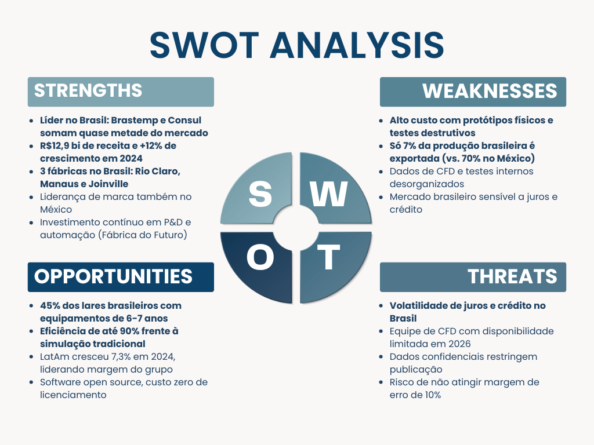<br>
  <p><b>Fonte:</b> Elaborado pelos autores, 2026</p>
</div>

##### Forças

Entre os pontos fortes, destaca-se a liderança de mercado no Brasil com as marcas Brastemp e Consul, que juntas correspondem a cerca de 38% do mercado brasileiro de eletrodomésticos, resultado que, em 2024, se traduziu em receita de R$12,9 bilhões e crescimento de 12%. A Whirlpool é também a maior fabricante de eletrodomésticos da América Latina, com presença no Brasil há mais de 70 anos e estrutura industrial robusta, contando com três fábricas no país (Rio Claro, em São Paulo; Manaus, no Amazonas; e Joinville, em Santa Catarina), além de operação relevante no México. A companhia mantém, ainda, investimento contínuo em inovação regional, aplicando entre 3% e 4% da receita anual em desenvolvimento, com destaque para a Fábrica do Futuro em Rio Claro, centro de capacitação em manufatura avançada e automação que reforça a estrutura técnica capaz de absorver soluções de inteligência artificial, como o Ignis. Por fim, a liderança de marca também é consolidada no México, onde a Whirlpool ocupa a primeira posição em posse de máquinas de lavar entre os consumidores, reforçando a relevância da marca nas duas arquiteturas contempladas pelo projeto.

##### Fraquezas

Como fraqueza central, observa-se o alto lead time de desenvolvimento e os custos elevados decorrentes da necessidade de protótipos físicos e testes destrutivos, problema que motiva diretamente o projeto Ignis e impacta tanto a operação brasileira quanto a mexicana. Soma-se a isso o risco de que as bases de dados de simulação numérica (CFD) e de testes físicos internos estejam desorganizadas ou não estruturadas, o que pode comprometer a qualidade e a velocidade de desenvolvimento do modelo preditivo nas duas plantas. Há também um desequilíbrio estrutural entre as operações latino-americanas: apenas cerca de 7% do que é produzido no Brasil é exportado, enquanto no México mais de 70% da produção é destinada à exportação. Por fim, o mercado brasileiro apresenta sensibilidade a ciclos de crédito e juros, evidenciada pela alta das taxas no fim de 2024, que tornou o cenário mais incerto para o setor em 2025.

##### Oportunidades

Entre as oportunidades, destaca-se o ganho potencial de eficiência de até 90% no tempo de previsão de temperatura em relação à simulação tradicional — piso contratado com o parceiro, que na prática se traduz na meta operacional de reduzir o assessment térmico de três semanas para menos de um dia —, reduzindo o custo com protótipos físicos tanto na operação brasileira quanto na mexicana. O cenário macroeconômico regional também é favorável: em 2024, a América Latina registrou crescimento de 7,3% (excluindo efeitos cambiais) e liderou o aumento de margem entre as regiões do grupo, com Brasil e México consolidados como pilares de crescimento na região. Há, ainda, uma retomada esperada da demanda por reposição de eletrodomésticos no Brasil, já que a empresa estima que 45% dos equipamentos nos lares brasileiros têm de seis a sete anos, somada a esforços já em curso para ampliar a relevância das fábricas brasileiras nas exportações do grupo. Por fim, o uso obrigatório de software open source (Python ou R) no projeto garante custo zero de licenciamento, reforçando o apelo de eficiência operacional em um momento no qual a companhia busca soluções internas de redução de custos frente a um mercado mais instável.

##### Ameaças

Entre os principais riscos, está a disponibilidade limitada da equipe interna de CFD no primeiro semestre de 2026, apontada como possível gargalo para a fase de validação do modelo prevista para junho daquele ano, justamente em um momento de investimento estratégico da companhia na região. Há também o caráter confidencial dos históricos de simulação e testes físicos, de uso interno da Whirlpool, o que exige alinhamento prévio sobre o que poderá ser publicado no repositório final e pode restringir a documentação e a replicabilidade do projeto. Soma-se a isso a volatilidade do mercado brasileiro ligada a juros e crédito ao consumidor, cenário no qual a própria empresa reconhece que, caso o mercado dê sinais de involução, será necessário recorrer a reduções internas de custo e a apoio governamental via crédito. Por fim, existe pressão competitiva regional por ciclos de desenvolvimento mais curtos, o que eleva o risco caso o modelo não atinja a margem de erro máxima de 10% exigida pelo escopo do projeto, afetando diretamente a competitividade das arquiteturas brasileira e mexicana frente a concorrentes com lançamentos mais ágeis.

##### Conclusão

No Brasil, a Whirlpool ocupa posição de destaque com as marcas Brastemp e Consul, sustentando cerca de 38% do mercado nacional e consolidando o país, ao lado do México, como pilar de crescimento da companhia na América Latina. Esse protagonismo regional cria um ambiente favorável para o desenvolvimento do Ignis, especialmente diante do investimento contínuo em automação e inovação industrial. Ao mesmo tempo, o próprio problema que originou o projeto, o alto custo e o longo lead time dos protótipos físicos, reflete uma fraqueza estrutural comum às operações brasileira e mexicana, agravada pelo desequilíbrio entre uma produção brasileira majoritariamente doméstica e uma produção mexicana voltada à exportação. Das forças e fraquezas mapeadas, é a ameaça que mais deve pautar o cronograma da Sprint 2: a disponibilidade limitada da equipe interna de CFD no primeiro semestre de 2026 é o fator que mais restringe a janela de validação do modelo, e por isso deve orientar a priorização das dúvidas técnicas enviadas ao parceiro antes de qualquer outra frente. As oportunidades de retomada da demanda por reposição no Brasil e o momento de forte crescimento regional reforçam a viabilidade do projeto, enquanto as restrições de confidencialidade dos dados e a volatilidade macroeconômica brasileira permanecem como riscos secundários a monitorar. Assim, o sucesso do Ignis no Brasil e na América Latina depende, antes de tudo, de garantir a resposta da equipe de CFD dentro do cronograma da Sprint 2.

#### 4.1.3. Planejamento Geral da Solução

Considerando o gargalo de tempo gerado pelas simulações computacionais tradicionais na validação de novos fogões, esta seção detalha o planejamento estratégico e técnico da solução baseada em Inteligência Artificial. A estruturação apresentada a seguir é fundamental para demonstrar como o histórico de dados da engenharia será integrado à modelagem preditiva para antecipar o comportamento térmico dos produtos. Dessa forma, os próximos parágrafos contextualizam os insumos disponíveis, a arquitetura e usabilidade propostas, bem como os benefícios esperados e critérios de sucesso, evidenciando como a ferramenta viabilizará tomadas de decisão ágeis logo nas fases iniciais de concepção.

Os dados que alimentarão o modelo são de uso interno e confidencial da Whirlpool, provenientes tanto de simulações numéricas (CFD) quanto de testes físicos realizados internamente pela engenharia. O conteúdo dessas planilhas detalha o comportamento térmico de várias configurações de fogões de piso, cobrindo as arquiteturas dos mercados brasileiro e mexicano. A base cruza parâmetros de design com a temperatura final medida em componentes críticos, como a placa inversora (PCB Inverter), vidros e motores. O foco técnico inicial é a limpeza e a organização estrutural dessa planilha para o treinamento do algoritmo: remover inconsistências, tratar dados vazios e quebrar informações operacionais hoje registradas em formato de texto, transformando-as em variáveis numéricas independentes (features). Assim, as configurações do fogão passam a ser representadas como colunas padronizadas, no formato que o modelo de machine learning exige para aprender os padrões térmicos.

Para resolver esse gargalo, a solução proposta é um modelo preditivo de Machine Learning capaz de estimar as temperaturas dos componentes críticos do fogão, uma abordagem de surrogate model, que substitui simulações numéricas custosas por um estimador estatístico treinado sobre seus resultados históricos (LIU et al., 2025). Em vez de depender de simulações computacionais complexas e demoradas a cada mudança de design, o algoritmo aprenderá os padrões térmicos históricos e devolverá previsões a partir de novos parâmetros de entrada, em uma fração do tempo. Esse modelo preditivo permitirá que a engenharia avalie se um novo design tende a superaquecer já nas etapas iniciais de concepção, momento em que alterar o projeto ainda é rápido e barato.

Quanto à utilização da solução, o modelo preditivo será integrado a um dashboard visual, acessível a áreas como engenharia de produto, design, qualidade e marketing, que poderão consultar a ferramenta de forma independente sempre que precisarem. Basta preencher os parâmetros de um novo design para receber a previsão do comportamento térmico daquele fogão. Isso amplia o acesso aos dados térmicos e permite que times multifuncionais testem e comparem cenários rapidamente, sem depender exclusivamente da fila de atendimento da equipe especialista em simulação (CAE) para cada pequena alteração.

Os benefícios dessa automação relacionam-se diretamente às principais dores da área de pesquisa e desenvolvimento. O mais direto deles é a redução do tempo de resposta técnica, já que a meta é diminuir em até 30% o tempo total de desenvolvimento de novos produtos, encurtando o assessment térmico das três semanas atuais para menos de um dia. Como o modelo antecipa falhas térmicas ainda no ambiente virtual, a empresa evita retrabalhos e espera reduzir em cerca de 25% os gastos com protótipos físicos e testes destrutivos. Essa otimização também conversa com as metas de sustentabilidade (ESG) da corporação, já que menos testes destrutivos significam menor desperdício de chapas metálicas, componentes e resíduos industriais.

Por fim, o projeto será considerado bem-sucedido se atingir critérios técnicos objetivos, alinhados com o parceiro:

- Velocidade: a predição da inteligência artificial deve ocorrer em uma fração do tempo de uma simulação tradicional de CFD, aproximando o assessment térmico das três semanas atuais para menos de um dia.
- Precisão: a previsão de temperatura deve ficar dentro de uma margem de erro aceitável, definida em 10%.
- Confiabilidade: o modelo precisa alertar a engenharia de forma consistente sempre que um componente se aproximar do seu limite térmico de falha, e não apenas acertar o valor médio.
- Escalabilidade: a entrega de um código limpo e documentado deve garantir que a Whirlpool consiga retreinar o modelo com dados de novos fogões no futuro, sem depender do grupo atual.

#### 4.1.4. Value Proposition Canvas

O Value Proposition Canvas organiza, de um lado, o perfil de quem vai usar a solução e, de outro, o que a solução entrega, de modo que seja possível verificar se os dois lados se encaixam (OSTERWALDER et al., 2014). Esta seção aplica o modelo ao Ignis, tomando como referência o time que operará a ferramenta no dia a dia. Dentro de cada bloco, os itens estão ordenados por prioridade, do mais crítico ao mais acessório, conforme recomendam os autores.

<div align="center">
  <p><b> Imagem 2 -</b> Canvas Proposta de Valor</p>
  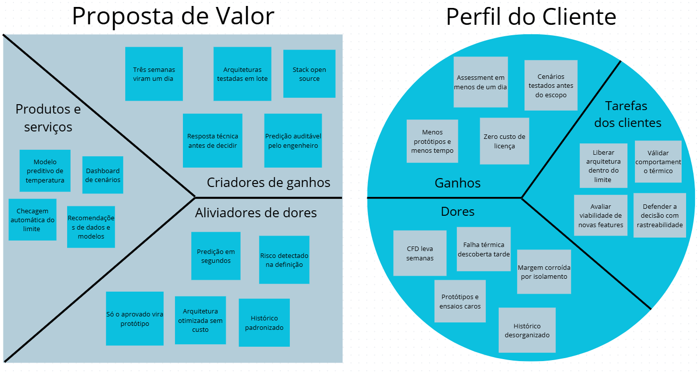<br>
  <p><b>Fonte:</b> Elaborado pelos autores, 2026</p>
</div>

##### A. Perfil do Cliente

Público-alvo principal: equipe de Virtual Product Development (VPD) da Divisão Fogões, formada pelos engenheiros de simulação CAE e pela gerência da área, responsável por avaliar o comportamento térmico das arquiteturas antes que elas virem produto. É o perfil representado pela persona da Engenharia. Como público secundário, as áreas de Marketing e Design, que não operam a ferramenta, mas dependem do parecer térmico para definir o escopo dos próximos lançamentos, e a gerência de CAE, que decide a alocação das horas de simulação entre projetos.

##### a) Tarefas do cliente

A tarefa central do VPD é garantir que cada componente do fogão opere abaixo do seu limite térmico antes de a arquitetura ser aprovada, o que hoje passa por rodar simulações CFD e construir protótipos para ensaio físico. O time também avalia a viabilidade de features como maior potência, cavidade ampliada e air fry enquanto o produto ainda está sendo definido, distribui as horas de simulação entre projetos que correm em paralelo e precisa preservar o histórico do que já foi simulado. Em um plano menos técnico, cabe ao VPD sustentar suas decisões diante de Design, Manufatura e Qualidade e ser percebido como quem acelera o cronograma, não como gargalo. Existe ainda uma dimensão emocional da tarefa: aprovar uma arquitetura é assinar embaixo dela, e o engenheiro precisa poder defender aquele número diante de quem questionar.

##### b) Dores

O ciclo de avaliação térmica leva de semanas a meses, e qualquer alteração de design o reinicia do zero. Isso inviabiliza explorar alternativas e faz com que falhas térmicas apareçam tarde, em uma fase na qual corrigir custa muito mais do que na definição. Cada iteração consome orçamento em protótipos e ensaios destrutivos, além do custo das licenças de simulação, peso que recai igualmente sobre as operações brasileira e mexicana. Existe também uma dor de margem, menos visível no cronograma mas igualmente cara: resolver segurança térmica com lã de vidro, dissipadores e ventiladores potentes funciona, e encarece o produto. Por fim, o histórico de simulações e testes está desorganizado e sem padrão, o que obriga a refazer análises parecidas em vez de reaproveitá-las, e faz os especialistas gastarem horas com configurações que nunca deveriam ter chegado à CFD.

##### c) Ganhos

O time valoriza reduzir o assessment térmico das três semanas atuais para menos de um dia, o que abre espaço para testar dezenas de configurações antes de o escopo ser congelado e para aprovar ou rejeitar propostas de feature com base técnica enquanto o projeto ainda é maleável. Somam-se a isso as metas de reduzir em até 30% o tempo de desenvolvimento e em 25% os gastos com protótipos, liberar os especialistas para as análises que exigem julgamento humano, operar sem custo de licença e dispor de uma metodologia reaproveitável nas categorias de Refrigeração e Lavanderia.

##### B. Mapa de Valor

O Mapa de Valor descreve o que o Ignis oferece ao perfil de cliente apresentado acima: os produtos e serviços da solução, as dores que ela alivia e os ganhos que ela cria.

##### a) Produtos e Serviços

A solução é um modelo preditivo treinado sobre o histórico de simulações CFD e ensaios físicos da própria Whirlpool, capaz de estimar a temperatura de cada ponto de medição sem executar a simulação completa. O modelo é sensível à arquitetura, atendendo às configurações brasileira e mexicana, e chega ao usuário por um dashboard no qual o engenheiro monta um cenário, compara alternativas e recebe a verificação automática de cada componente contra o seu limite, já com a folga de segurança de 10% exigida pela regra de projeto. Tudo roda sobre bibliotecas abertas em Python, sem licenciamento. Acompanham a entrega as recomendações de arquitetura de dados, seleção de algoritmos e visualização solicitadas pelo parceiro para os próximos ciclos do VPD.

##### b) Aliviadores de Dores

O modelo substitui a espera por uma rodada completa de CFD por uma estimativa que responde em segundos, meta que o próprio parceiro fixou como KPI ao definir a redução do assessment térmico de três semanas para menos de um dia. Com resposta imediata, o risco térmico é identificado ainda na definição do escopo, quando mudar é barato, e não no protótipo. Menos protótipos são construídos, porque só as arquiteturas aprovadas na triagem chegam ao laboratório, e o consumo de licença cai, já que consultar o modelo não ocupa uma estação de simulação. Como é possível comparar dezenas de combinações de ventilação, potência e housing, o time consegue encontrar a configuração que respeita os limites sem recorrer às soluções caras de isolamento e resfriamento, o que ataca diretamente a dor de margem. A padronização exigida pelo treinamento converte o histórico disperso em base organizada e pronta para retreinamento, e a fila da CFD fica reservada ao que sobreviveu à triagem.

##### c) Criadores de Ganho

Com o assessment caindo de três semanas para menos de um dia, a avaliação térmica cabe dentro da própria conversa de escopo e permite testar arquiteturas em lote, em vez de uma por vez. A engenharia passa a responder com dado enquanto o produto ainda pode mudar. Cada protótipo evitado e cada semana poupada alimentam as metas de redução de 25% e 30%, enquanto as horas dos especialistas voltam para as análises que exigem julgamento. Como a solução roda sobre bibliotecas abertas, esse ganho vem sem custo de licença, e o pipeline documentado de forma agnóstica ao produto permite transpor a metodologia para Refrigeração e Lavanderia. O dashboard exibe a incerteza de cada predição e os casos históricos que a sustentam, o que responde à ressalva central do engenheiro de simulação: um número isolado, sem margem nem rastreabilidade, transfere risco a quem assina sem lhe dar instrumento de defesa. É também a mitigação direta do risco de baixa adoção tratado na matriz de riscos.

Vale delimitar o alcance da solução. O modelo não substitui a simulação CFD nem os ensaios de certificação: ele atua como triagem, e toda arquitetura aprovada perto do limite continua exigindo validação completa. A fronteira é deliberada e corresponde à condição de aceite do próprio usuário, porque uma predição apresentada como veredito final, em um contexto de segurança térmica, seria rejeitada pelo time que responde por eventuais falhas.

#### 4.1.5. Matriz de Riscos

Os riscos deste projeto foram mapeados em sete naturezas: técnica, externa, humana, de cronograma, de escopo técnico, de negócio e de conformidade. A distribuição não é equilibrada por acaso: as ameaças mais severas se concentram na entrada de dados, e é de lá que vem a maior parte do que pode comprometer os KPIs firmados no Project Charter.

A classificação segue a análise qualitativa de riscos do Guia PMBOK (PMI, 2017) e as diretrizes da ABNT NBR ISO 31000 (ABNT, 2018), que orientam tanto o cruzamento entre probabilidade e impacto quanto o tratamento de riscos de efeito favorável, separados aqui em ameaças e oportunidades. Antes de classificar, fixamos o significado de cada nível da escala de probabilidade do template: 90% indica condição já verificada nos artefatos do projeto; 70%, forte indício documental de que o evento ocorrerá; 50%, dependência de agentes externos ao grupo; 30%, possibilidade sem indício atual. Nas ameaças, o impacto é Muito Alto quando inviabiliza a entrega, compromete um KPI do Charter, envolve a segurança térmica do produto ou fere a relação institucional entre o Inteli e o parceiro; Alto quando trava uma sprint, obriga a redesenhar o escopo técnico ou impede que o valor esperado da solução se realize; Moderado quando o retrabalho cabe dentro da própria sprint. Nas oportunidades a lógica se inverte: Muito Alto quando o ganho estende o alcance do projeto para além do escopo contratado, Alto quando melhora materialmente um entregável previsto e Moderado quando o benefício é localizado.

<div align="center">
  <p><b> Imagem 3 -</b> Matriz de Risco - Ameaças</p>
  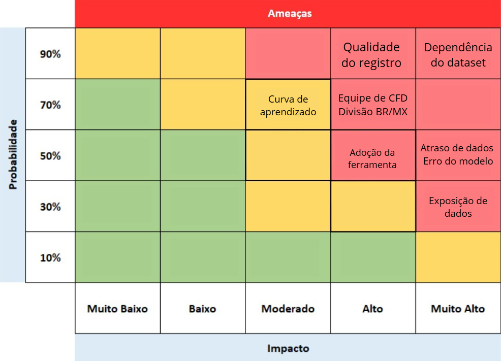<br>
  <p><b>Fonte:</b> Elaborado pelos autores, 2026</p>
</div>

Oito das nove ameaças caem na faixa vermelha do template. Essa concentração é, ela própria, um resultado da análise: o projeto tem premissas fortes e pouca folga, e reconhecer isso na primeira sprint é o que permite agir enquanto ainda há tempo.

R01 — Dependência do dataset. Risco de natureza técnica. O histórico entregue tem 39 colunas de Run, mas apenas 32 configurações únicas, para cerca de 75 pontos de medição. Pior que o volume é a variação: das oito variáveis de metadado registradas por Run, seis repetem praticamente o mesmo valor em todas as colunas, e as duas que sobram incluem o ciclo de operação do forno, que não é uma escolha de projeto. Como a condição está verificada no arquivo, a probabilidade é de 90%. O impacto é Muito Alto porque atinge a finalidade da ferramenta e o KPI de margem de erro de até 10% firmado no Project Charter (WHIRLPOOL CORPORATION, 2026): pediram um modelo que diga o que acontece quando o design muda, e o histórico quase não registra mudanças de design. Como plano de ação, a equipe deve solicitar ao parceiro os parâmetros geométricos e de potência de cada Run no setup das simulações e, enquanto isso, trabalhar com validação cruzada e modelos mais simples, menos sensíveis a bases pequenas.

R02 — Qualidade do registro. Risco de natureza técnica. Seis Runs aparecem repetidos com leituras diferentes, cerca de dez pontos trazem a palavra "Monitor" onde deveria haver um limite numérico, três não têm leitura alguma e um dos componentes registra temperatura acima do próprio limite em todas as simulações. Há ainda pontos marcados em cinza e itálico, o que costuma indicar item desativado, informação que existe só na formatação e desaparece quando o arquivo é convertido para leitura em Python. Tudo isso está verificado no arquivo, o que sustenta a faixa de 90%. O impacto ficou em Alto, e não em Muito Alto, porque cada ocorrência é contornável; somadas, porém, distorcem a validação e impedem que a regra de aprovação rode de forma automática. O tratamento previsto é levar a lista de inconsistências à primeira reunião de sprint e converter as marcações visuais em campos explícitos antes de qualquer treino.

R03 — Atraso de dados. Risco de natureza externa. Este é o risco que sustenta os dois anteriores: as respostas para R01 e R02 dependem de material adicional do parceiro, e o Project Charter (WHIRLPOOL CORPORATION, 2026) trata o acesso aos servidores como premissa. Se a premissa cair, os dois se materializam de uma vez, o que explica o impacto Muito Alto. A probabilidade é de 50% por depender da liberação de material confidencial e da agenda de terceiros. Como plano de ação, a equipe deve enviar um pedido formal logo na primeira sprint, específico e justificado item a item, em vez de solicitações genéricas ao longo do projeto.

R04 — Equipe de CFD. Risco de natureza de cronograma. O parceiro sinalizou no Project Charter (WHIRLPOOL CORPORATION, 2026) a disponibilidade limitada dessa equipe no primeiro semestre, indício que sustenta a faixa de 70%. As dúvidas que travam o trabalho são justamente as que só ela responde, e o ciclo quinzenal faz cada rodada de espera custar caro: uma pergunta represada trava a sprint em que a resposta era necessária, e a entrega daquele ciclo sai incompleta ou apoiada em suposição. O impacto é Alto pela definição adotada, porque trava uma sprint inteira e obriga a entregar o ciclo apoiado em suposição. Para reduzir o número de idas e vindas, o grupo concentra as dúvidas em uma lista única e priorizada por sprint.

R05 — Curva de aprendizado. Risco de natureza humana. Este é o primeiro contato do grupo com modelagem preditiva, e o projeto exige regressão multissaída, tratamento de dados faltantes e avaliação de erro, conteúdos que serão aprendidos ao longo do próprio módulo. A probabilidade é de 70%: não é hipótese, é a condição de partida da turma. O impacto é Moderado porque o atraso gerado é absorvível dentro da sprint, com apoio dos professores e dos materiais do módulo. É a única ameaça fora da zona vermelha. Como plano de ação, a equipe deve dividir os temas entre os integrantes, levar dúvidas técnicas às aulas antes de travar na implementação e começar por um modelo simples que funcione de ponta a ponta, antes de buscar sofisticação.


R06 — Erro do modelo. Risco de natureza técnica com efeito sobre a segurança do produto. Os documentos do parceiro trazem dois números de 10%: o Project Charter (WHIRLPOOL CORPORATION, 2026) admite margem de erro de até 10% no modelo, e a regra de design exige aprovar apenas predições 10% abaixo do limite real. As duas margens têm a mesma ordem de grandeza, o que significa que uma predição errada para baixo, ainda dentro do que foi contratado, consome toda a folga de segurança e libera uma arquitetura que na prática ultrapassa o limite. Erros nessa faixa são esperados em uma base pequena, daí a probabilidade de 50%. O impacto é Muito Alto porque a consequência recai sobre a segurança do produto e de quem o usa. Como plano de ação, a equipe deve avaliar o modelo de forma assimétrica, com penalidade maior para a subestimação, e aplicar a regra de aprovação sobre o limite superior do intervalo de predição, nunca sobre o valor central. Duas medições da Sprint 4, registradas no item d da Seção 4.3, confirmam o mecanismo descrito e delimitam o tratamento. A primeira é que, na área Coil Temps, o modelo entregue subestima justamente as leituras que se aproximam do limite, e 22 das 57 leituras que atingem a linha de 0,9 vez o limite são colocadas abaixo dela pela predição. A segunda é que uma alternativa com erro médio maior produziu menos aprovação indevida, 2 contra 13 nas mesmas leituras, o que mostra que erro e decisão de segurança não são a mesma grandeza e que a escolha entre modelos não pode ser feita pelo erro médio. A reclassificação de probabilidade e de impacto não é objeto deste registro.

R07 — Divisão BR/MX. Risco de natureza de escopo técnico. O Project Charter (WHIRLPOOL CORPORATION, 2026) prevê um modelo para cada arquitetura, mas a base já é curta para um só, e ainda não se sabe se ela contempla as duas, indício documental que sustenta a faixa de 70%. Repartir 32 observações em dois conjuntos leva cada modelo a um tamanho em que treinar deixa de fazer sentido. Como se trata de um entregável explícito do Charter, o impacto é Alto. O tratamento previsto é propor ao parceiro um modelo único que receba a arquitetura como variável de entrada, preservando as diferenças entre BR e MX sem partir a amostra ao meio.

R08 — Adoção da ferramenta. Risco de natureza de negócio. Um modelo tecnicamente correto que ninguém usa não gera valor nenhum. Quem vai operar a ferramenta são especialistas em simulação, acostumados a resultados auditáveis, e a tendência natural desse público é desconfiar de uma predição que não explica de onde veio, ainda mais em decisões de segurança. A probabilidade é de 50% por depender do comportamento de terceiros. Sem adoção, os ganhos de tempo e de custo projetados não se realizam, o que caracteriza impacto Alto pela definição adotada. Como plano de ação, a equipe deve mostrar a incerteza de cada predição, indicar as variáveis que mais pesaram no resultado e validar a interface com usuários reais do VPD ao longo das sprints.

R09 — Exposição de dados. Risco de natureza de conformidade. Todo o material recebido está marcado como Whirlpool Confidential. As regras já combinadas no grupo tornam o episódio pouco provável, na faixa de 30%, mas o impacto seria Muito Alto: uma exposição rompe o acordo institucional entre o Inteli e a Whirlpool e extrapola em muito o âmbito do projeto, razão pela qual permanece na zona vermelha apesar da probabilidade baixa. Em resposta, o grupo adota repositório privado, mantém o arquivo original fora do versionamento e publica apenas dados agregados no relatório aberto.

A ISO 31000 define risco como efeito da incerteza sobre os objetivos, o que abrange também eventos incertos de efeito favorável. Cinco deles foram identificados, e a resposta prevista é potencializá-los.

<div align="center">
  <p><b> Imagem 4 -</b> Matriz de Risco - Oportunidades</p>
  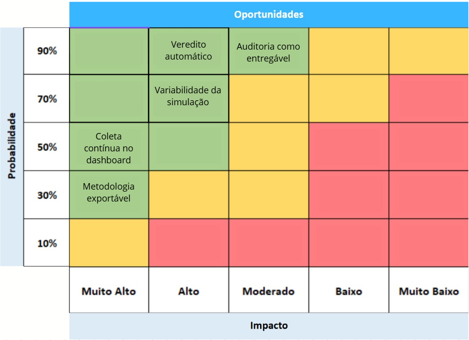<br>
  <p><b>Fonte:</b> Elaborado pelos autores, 2026</p>
</div>

As cinco oportunidades caem na zona verde. Três dependem apenas do grupo e podem ser buscadas de imediato; duas dependem de decisão do parceiro e entram na pauta das reuniões de sprint.

O01 — Variabilidade da simulação. As repetições de Runs, hoje contabilizadas como inconsistência em R02, guardam uma informação valiosa: quanto a simulação CFD varia entre rodadas do mesmo caso. Esse número estabelece um piso de erro que nenhum modelo consegue superar, e dá base técnica para discutir o KPI de 10% com o parceiro em vez de simplesmente persegui-lo. A probabilidade é de 70% porque o aproveitamento depende de o parceiro confirmar que as repetições correspondem a rodadas do mesmo caso; o impacto é Alto porque o resultado muda a forma de validar o modelo.

O02 — Auditoria como entregável. O levantamento da estrutura do arquivo, feito para construir esta matriz, já responde parte da frente de arquitetura de dados que o parceiro solicitou. Consolidado em recomendações de ingestão e padronização para simulações futuras, deixa de ser trabalho interno e vira entrega. A probabilidade é de 90%, já que o levantamento está pronto e a consolidação depende apenas do grupo; o impacto é Moderado, por atender parte de uma frente prevista sem alterar escopo nem KPIs.

O03 — Veredito automático. O parceiro pediu a predição de temperatura, mas a planilha traz também o limite de cada componente e a regra de aprovação com safety factor de 10%. Com os dois, a saída do modelo deixa de ser um número em graus e passa a ser uma decisão: esta arquitetura passa ou não passa. A probabilidade é de 90% porque depende apenas de implementar a regra sobre a predição; o impacto é Alto porque transforma o entregável previsto em algo diretamente acionável pela engenharia, que é o que sustenta a adoção discutida em R08.

O04 — Coleta contínua no dashboard. O dashboard foi pedido como interface de consulta, mas pode registrar de forma estruturada cada simulação que passar por ele, alimentando a base a cada uso. Isso ataca a causa raiz de R01 e R02 no médio prazo: o problema não é só o histórico ser pobre, é não haver um caminho padronizado de entrada para dados novos. A probabilidade é de 50%, porque exige aval do parceiro sobre onde e como armazenar; o impacto é Muito Alto por resolver a primeira das três frentes solicitadas e viabilizar o retreinamento contínuo do modelo.

O05 — Metodologia exportável. O parceiro declarou no kickoff a intenção de transformar a abordagem em best practice para as categorias de Refrigeração e Lavanderia. Se o grupo documentar o processo de forma agnóstica ao produto, separando o que é específico de fogões do que vale para qualquer análise térmica, o alcance do trabalho ultrapassa o escopo contratado. A probabilidade é de 30%, já que a decisão é do parceiro e ocorre depois do horizonte do projeto; o impacto é Muito Alto pelo mesmo motivo.

#### 4.1.6. Personas

&ensp;&ensp;Conforme Gothelf (2013), protopersonas constituem representações de usuários elaboradas a partir do conhecimento prévio e das suposições da equipe sobre o público-alvo, sem depender de pesquisa de campo extensiva, servindo como instrumento inicial de alinhamento e sendo posteriormente refinadas à medida que novas evidências são obtidas. Essa abordagem é adequada ao estágio atual do projeto, no qual o entendimento dos usuários deriva das informações fornecidas pelo parceiro: as protopersonas a seguir foram construídas a partir das cinco áreas indicadas pela Whirlpool durante o kick-off: Engenharia, Marketing e Produto, Cost Model, Design Industrial e Qualidade, cada uma com seus respectivos papéis em relação à solução, necessidades, dores e comportamentos frente ao problema térmico.

**I. Engenharia**

<div align="center">
  <p><b> Imagem 5 -</b> Persona do time de engenharia</p>
  <br>
  <p><b>Fonte:</b> Elaborado pelos autores, 2026</p>
</div>

&ensp;&ensp;É sexta-feira à tarde e Sandra ainda não pode fechar o caso: o solver vai rodar durante o fim de semana, e a resposta só chega na segunda. Há 14 anos na Whirlpool, ela responde hoje pela simulação térmica dos fogões de piso, em ciclos longos que passam por preparar o caso, submeter ao solver e esperar dias por um resultado utilizável, para então defendê-lo quando ele não bate com o que o laboratório mediu. É também a quem os colegas mais novos recorrem antes de fechar um caso, posição construída ao longo de mais de uma década e que carrega uma responsabilidade incômoda: o número que sai da área leva a assinatura dela.

&ensp;&ensp;Essa responsabilidade explica sua relação cautelosa com ferramentas novas. Sandra não rejeita automação, mas sim um resultado que não consegue reconstruir. Cada valor que chega às mãos dela passa por uma conferência contra ensaios anteriores, e desvios acima do que sua experiência considera aceitável interrompem o fluxo em vez de serem absorvidos como ruído. Sem entender de onde veio a resposta, ela não tem como defendê-la em reunião.

&ensp;&ensp;Ela reconhece valor em encurtar o tempo de espera, especialmente nas configurações rotineiras que hoje consomem semanas para confirmar o previsível. A ressalva é outra: uma ferramenta que devolva apenas um número, sem margem de incerteza nem indicação de quais casos anteriores o sustentam, transfere risco para quem assina sem dar instrumento de defesa. Para ela, o modelo preditivo é bem-vindo como triagem, desde que a simulação completa continue disponível quando o caso fugir do padrão conhecido.

&ensp;&ensp;Mapear Sandra importa porque a engenharia ocupa posição dupla no projeto: é a área que gera os dados históricos de simulação que alimentam o modelo e, ao mesmo tempo, aquela cujo trabalho a solução pretende acelerar. Como usuária com maior poder de veto técnico, se o resultado não for explicável e rastreável, a adoção não se sustenta, tornando sua persona condição para definir requisitos de explicabilidade e intervalo de confiança que atendam a métrica de margem de erro ≤ 10% prevista.

**II. Marketing e Produto**

<div align="center">
  <p><b> Imagem 6 -</b> Persona do time de Marketing e Produto</p>
  <br>
  <p><b>Fonte:</b> Elaborado pelos autores, 2026</p>
</div>

&ensp;&ensp;Diego atua há 7 anos na Whirlpool e hoje responde pelo posicionamento e pelo calendário de lançamento dos fogões de piso nos mercados brasileiro e mexicano. Sua rotina é feita de compromissos externos: ele comunica datas ao varejo e constrói os argumentos de venda que chegam ao consumidor final, sempre antes de o produto estar tecnicamente fechado. Ocupa a posição mais distante do dado térmico na cadeia de decisão do projeto, ainda que seja quem assume publicamente as consequências de um atraso de engenharia.

&ensp;&ensp;Por isso a temperatura chega até ele já convertida em outra coisa: sinal de risco de prazo. Diego não precisa saber por que uma configuração falha, mas precisa saber cedo que ela vai falhar, porque cada semana descoberta tarde vira recuo diante de parceiros comerciais. O agravante está na desproporção entre a simplicidade da pergunta que faz e o custo de obter a resposta, já que depende da agenda de uma equipe técnica sobrecarregada para saber apenas se a versão planejada se mantém de pé. Na prática, recorre a contatos informais na engenharia, que respondem mais rápido do que os canais formais.

&ensp;&ensp;Ele valoriza antecipar esse sinal de risco para antes de o calendário ser comunicado externamente. Sua ressalva é a mais rígida entre as áreas mapeadas: qualquer informação que precise ser traduzida por um engenheiro antes de virar slide é, para ele, informação indisponível. O modelo preditivo é bem-vindo como alerta antecipado, desde que a leitura seja de poucos segundos, permita comparar as versões de Brasil e México na mesma tela e dispense o vocabulário de simulação. Do contrário, sua alternativa continua sendo prometer menos do que o produto entrega e adiar o compromisso de data.

&ensp;&ensp;O marketing é o ponto em que o ganho técnico do projeto se converte em resultado de negócio, transformando redução de lead time em janela de lançamento e em compromisso assumido publicamente com o varejo. Diego representa o usuário mais distante do dado térmico e, por isso mesmo, aquele que estabelece o teto de complexidade aceitável do dashboard iterativo previsto no escopo: se a leitura exigir tradução por um engenheiro, o entregável não cumpre sua função. Sem mapeá-lo, o projeto corre o risco de entregar um modelo tecnicamente correto e comercialmente inutilizável, comprometendo a meta de reduzir em até 30% o tempo de desenvolvimento.

**III. Cost Model/Engenharia de Custo**

<div align="center">
  <p><b> Imagem 7 -</b> Cost Model/Engenharia de Custo</p>
  <br>
  <p><b>Fonte:</b> Elaborado pelos autores, 2026</p>
</div>

A especificação fecha na sexta, e a folga térmica ainda não veio da simulação — então Adriana assume o pior cenário e registra a premissa, porque uma premissa de custo homologada não volta mais à mesa. Há 12 anos na Whirlpool, ela responde hoje pelo cost model da linha de fogões de piso a partir da operação mexicana, avaliando as arquiteturas de Brasil e México sob o mesmo critério financeiro. Sua rotina é feita de decisões de espessura de chapa, isolamento, material e componentes de proteção térmica, todas convertidas em custo por unidade antes de virarem especificação — e é ela quem responde pelo custo-alvo diante da liderança, posição que traz junto a responsabilidade de assinar números replicados em todo o volume de produção.

O ponto crítico do seu trabalho é temporal. A janela em que precisa fechar o custo-alvo quase nunca coincide com a disponibilidade da equipe de simulação, e a ausência do dado térmico não interrompe a decisão, apenas a empurra para o cenário mais defensável. Cada premissa assumida no escuro é registrada e raramente reaberta depois. Assim, o custo do atraso não é a espera em si, e sim o sobrepreço permanente que a espera induz.

Ela valoriza receber a informação térmica dentro da sua própria janela de decisão, já que folga térmica, para ela, é material que pode sair do produto. A ressalva é de formato: um resultado detalhado por ponto de medição não entra na planilha de custo, e um valor isolado não sustenta comparação entre alternativas. O modelo preditivo é bem-vindo como insumo de trade-off, desde que coloque duas ou três configurações lado a lado, com a conformidade e a margem disponível traduzidas em linguagem simples, e desde que chegue antes do congelamento da especificação.

O cost model traduz decisão de engenharia em custo por unidade, sendo o ponto onde a ausência do dado térmico produz seu efeito mais duradouro: uma margem de segurança em material que permanece no produto por todo o ciclo de vida. Adriana representa o usuário que mede se o projeto de fato entregou o benefício econômico prometido, já que é a sua planilha que registra a redução de 25% nos gastos operacionais esperada pelo parceiro. Mapeá-la é condição para garantir que a predição chegue em formato comparativo entre configurações e dentro da janela de congelamento da especificação, pois um resultado correto que chega depois dessa janela não gera economia alguma.

**IV. Design Industrial**

<div align="center">
  <p><b> Imagem 8 -</b> Design Industrial</p>
  <br>
  <p><b>Fonte:</b> Elaborado pelos autores, 2026</p>
</div>

Rafael atua há 9 anos na Whirlpool e hoje responde pela definição de geometria, materiais, acabamentos e posicionamento dos componentes visíveis dos fogões de piso. Sua rotina é feita de ciclos curtos, em que ele leva três ou quatro alternativas a cada revisão de projeto e precisa descartar a maioria delas em poucos dias. O dado térmico não chega até ele como informação de trabalho, e sim como veredito — quase sempre tarde e em um vocabulário que não é o seu —, o que o coloca na posição de defender escolhas de projeto que não tem como examinar sozinho.

O que pesa na sua rotina não é a precisão do número, mas o momento em que ele aparece. Rafael não resiste à restrição térmica, mas sim a recebê-la quando o desenho já não pode mudar. Uma alternativa reprovada no início do ciclo é apenas mais uma opção descartada, enquanto a mesma reprovação depois de encaminhado o ferramental significa refazer o projeto sob pressão de cronograma. Sem resposta em tempo hábil, ele escolhe a configuração mais conservadora e abre mão da proposta que considerava melhor.

Ele reconhece valor em antecipar esse veredito para o início do ciclo, quando ainda há espaço para mudar o desenho sem custo de retrabalho. A ressalva é de linguagem: uma ferramenta que devolva campos de temperatura, pontos de medição e terminologia de simulação continua exigindo a mediação de um engenheiro e não altera o fluxo que ele tem hoje. O modelo preditivo é bem-vindo como filtro de alternativas, desde que responda se a configuração se sustenta e com qual folga, permitindo comparar duas ou três opções lado a lado em minutos.

O design industrial ocupa a fase mais precoce do ciclo de desenvolvimento, sendo a área em que uma mesma informação térmica tem o maior poder de evitar retrabalho e o menor custo de aplicação. Rafael representa o usuário que consome a predição como restrição de projeto, não como resultado técnico: cada alternativa que ele descarta por falta de resposta em tempo hábil é uma decisão tomada por precaução, não por evidência. Mapeá-lo é condição para dimensionar o requisito de velocidade da solução, já que a meta de eficiência de 90% sobre a simulação tradicional só produz efeito real se a resposta couber dentro do ritmo de iteração do projeto de produto.

**V. Qualidade**

<div align="center">
  <p><b> Imagem 9 -</b> Persona do time de qualidade</p>
  <br>
  <p><b>Fonte:</b> Elaborado pelos autores, 2026</p>
</div>

Henrique está há 8 anos na planta mexicana da Whirlpool e responde pelos ensaios de segurança térmica da linha MX. Esse é o último ponto de checagem antes de uma configuração seguir adiante, onde o que passa por ele carrega o aval de conformidade e o que não passa volta para a engenharia. A rotina começa pela planilha que chega do time de simulação e, só depois de revisá-la, ele define o que vai para a bancada. O custo desse arranjo é conhecido, uma falha térmica costuma aparecer no ensaio destrutivo, quando já não há prazo nem material para corrigir sem impacto no cronograma.

Ademais, como o critério de aprovação é dele, Henrique construiu uma disciplina de verificação própria, escolhendo as amostras a testar pelo repertório de oito anos, não por regra escrita, e na dúvida amplia a bateria em vez de reduzi-la.

Uma triagem prévia confiável resolveria seu problema mais caro, que é chegar ao ensaio sem saber onde olhar. Desse modo, Henrique veria valor em identificar de antemão quais componentes operam próximos ao limite, concentrando a bancada no que de fato oferece risco. Sua condição é de forma, a predição precisa falar a linguagem da norma que ele aplica, com o limite vigente visível ao lado do valor. Do contrário, a ferramenta que deveria acelerar sua decisão vira mais uma fonte que ele terá de traduzir e conferir antes de confiar.

A qualidade concentra a decisão de aprovação que autoriza um produto a seguir para o mercado, sendo a área onde o custo do erro é mais alto e menos reversível. Henrique representa o ponto exato em que o modelo preditivo pode gerar economia direta, reduzindo ensaios destrutivos (que estão entre os custos que o projeto pretende diminuir em 25%), mas também o ponto de maior risco, já que um falso negativo aqui não é imprecisão estatística, e sim falha de segurança. Por atuar na linha MX, ele ainda permite verificar se a solução atende igualmente às duas arquiteturas previstas no escopo, e não apenas à realidade brasileira.


#### 4.1.7. Jornadas do Usuário

A Jornada do Usuário, também conhecida como "user journey", é uma visualização do processo que uma pessoa percorre para alcançar um objetivo, de acordo com Jim Kalbach, especialista em UX Design. Segundo Kalbach, a jornada do usuário ocorre desde o primeiro contato com a solução até a conclusão da ação desejada, incluindo diversos pontos de interação, os objetivos do usuário, suas emoções e possíveis dores e frustrações ao longo do processo (KALBACH, 2016). Normalmente, essa jornada é representada por meio de mapas visuais que demonstram as etapas percorridas, os canais utilizados, os sentimentos em cada fase e, por fim, as oportunidades de melhoria identificadas. Essa forma de representação segue o modelo de mapa de jornada descrito por Gibbons (2018), adotado nos quatro mapas desta seção.

Esta seção reúne as jornadas das duas personas que operam a ferramenta ou dependem diretamente do seu resultado. A primeira tem como ator Diego Villalobos, responsável pelo calendário de lançamento; a segunda, Sandra, a engenheira de simulação térmica descrita na seção 4.1.6, escolhida por ocupar posição dupla no projeto, já que gera os dados históricos que alimentarão o modelo e atua na área cujo trabalho a solução pretende acelerar. Para cada persona são apresentados o estado atual e o estado futuro, com o modelo já em operação, porque é a leitura em paralelo que revela quais fases desaparecem e em que ponto a decisão passa a contar com o apoio do Ignis. As falas atribuídas às personas foram construídas pela equipe a partir das protopersonas e do kick-off, conforme Gothelf (2013), e devem ser revisadas quando houver acesso direto aos times de VPD e de marketing.

#### 4.1.7.1 Jornada do Usuário: Diego Villalobos

Esta jornada acompanha Diego Villalobos, responsável pelo posicionamento e pelo calendário de lançamento dos fogões de piso, e compara o estado atual, em que o risco térmico chega tarde ao marketing, com o estado futuro, em que a previsão do Ignis está disponível ainda no planejamento.

##### Jornada do usuário - Estado atual

<div align="center">
  <p><b> Imagem 10 -</b> Jornada do Usuário Atual </p>
  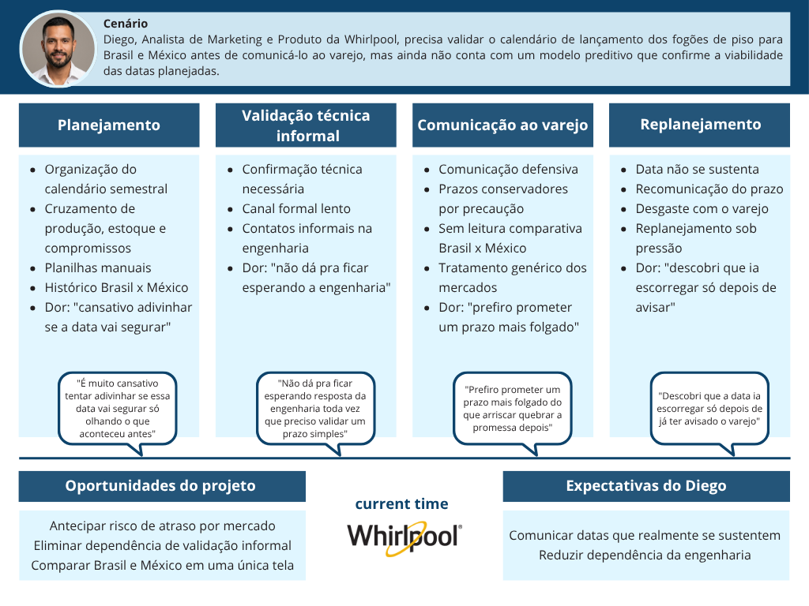<br>
  <p><b>Fonte:</b> Elaborado pelos autores, 2026</p>
</div>

###### Cenário e expectativas

Inicialmente, Diego tem algumas expectativas ao realizar o processo de validação do calendário de lançamento sem contar com a solução: a principal delas é conseguir comunicar ao varejo, tanto no Brasil quanto no México, uma data de lançamento que realmente se sustente, sem precisar recuar ou renegociar o prazo depois de já tê-lo anunciado. Junto a isso, Diego também espera reduzir sua dependência da engenharia para responder dúvidas simples sobre a viabilidade de uma configuração de lançamento, já que, no cenário atual, qualquer confirmação técnica passa pela agenda de outra área, o que o deixa refém de prazos que não controla.

###### Fase 1 — Planejamento

Diego precisa começar a organizar o calendário de lançamento dos fogões de piso para o semestre, cruzando informações de datas de produção, disponibilidade de estoque e compromissos já assumidos com o varejo em ciclos anteriores. Sem um sistema que centralize e projete essas informações, ele recorre a planilhas e relatórios manuais, cruzando dados históricos de lançamentos passados no Brasil e no México para tentar estimar se a data cogitada é factível. "É muito cansativo tentar adivinhar se essa data vai segurar só olhando o que aconteceu nos lançamentos anteriores" é uma dor expressa por Diego ao lidar com a falta de uma ferramenta que realmente projete a viabilidade do calendário.

###### Fase 2 — Validação técnica informal

Depois de montar uma primeira versão do calendário, Diego precisa confirmar tecnicamente se essa configuração é viável, mas o canal formal para esse tipo de resposta costuma levar dias, o que não cabe no seu prazo de comunicação ao varejo. Por isso, ele recorre a contatos informais dentro da engenharia, buscando atalhos para obter uma resposta mais rápida do que a que teria pelos canais oficiais. "Não dá pra ficar esperando resposta da engenharia toda vez que preciso validar um prazo simples" representa uma das maiores dores de Diego, que sente que uma pergunta que deveria ser resolvida em segundos acaba consumindo dias do seu processo.

###### Fase 3 — Comunicação ao varejo

Sem uma confirmação sólida sobre a viabilidade do calendário, Diego se vê obrigado a comunicar prazos ao varejo de forma defensiva, prometendo datas mais conservadoras do que o necessário como forma de se proteger de possíveis atrasos. Essa comunicação é feita sem o apoio de uma leitura comparativa entre Brasil e México, o que significa que decisões que deveriam ser diferentes para cada mercado acabam sendo tratadas de forma genérica. "Prefiro prometer um prazo mais folgado do que arriscar quebrar a promessa depois" traduz o comportamento defensivo de Diego, mesmo sabendo que isso pode reduzir a competitividade da comunicação junto ao varejo.

###### Fase 4 — Replanejamento

Por fim, a última fase representa o momento em que, apesar de todo o esforço de planejamento manual e validação informal, a data comunicada ao varejo não se sustenta, obrigando Diego a recomunicar um novo prazo. "Descobri que a data ia escorregar só depois de já ter avisado o varejo, agora preciso quebrar essa notícia e ainda tentar segurar a relação com eles" traduz a situação vivida por Diego, reforçando a necessidade de uma ferramenta que permita antecipar esse tipo de risco antes da comunicação, e não depois dela.


##### Jornada do usuário - Estado futuro

<div align="center"> 
  <p><b>Imagem 11 </b> Jornada do Usuário Futuro</p> 
  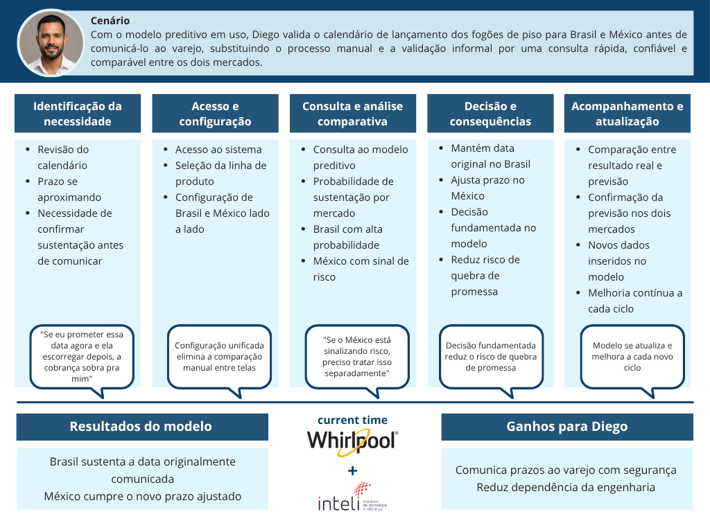<br> 
  <p><b>Fonte:</b> Elaborado pelos autores, 2026</p> 
</div>

###### Cenário e expectativas

Passado o período inicial de adaptação ao Ignis, Diego chega a um novo ciclo de planejamento do calendário de fogões de piso já com o modelo preditivo incorporado à sua rotina. O gatilho continua sendo o mesmo de antes, a proximidade do prazo em que o calendário precisa ser comunicado ao varejo, cobrindo Brasil e México, mas agora ele espera outra coisa do processo: confirmar a viabilidade das datas em poucos minutos, comparando os dois mercados lado a lado na mesma tela, e sustentar essa decisão com um resultado que ele próprio consiga demonstrar caso seja questionado depois pela área comercial.

###### Fase 1 — Identificação da necessidade

Diego revisa o calendário de lançamento e percebe que a data de comunicação ao varejo está se aproximando, sendo necessário confirmar, antes de repassá-la oficialmente, se ela ainda é sustentável. "Se eu prometer essa data agora e ela escorregar depois, quem vai levar a cobrança do varejo sou eu, preciso confirmar antes de comunicar", pensa Diego, movido por uma emoção de apreensão e cautela herdada de experiências anteriores em que o prazo precisou ser revisto.

###### Fase 2 — Acesso e configuração

Diego acessa o sistema, seleciona a linha de produto (fogões de piso) e configura os parâmetros de mercado, trazendo Brasil e México lado a lado na mesma tela, exatamente como sua necessidade exige, sem precisar alternar entre relatórios separados para comparar os dois mercados.

###### Fase 3 — Consulta ao modelo e análise comparativa

Com os parâmetros configurados, Diego consulta o modelo preditivo, que processa os dados e retorna, para cada mercado, a probabilidade de sustentação da data planejada, em um formato de leitura direta, sem necessidade de tradução técnica. A partir desse resultado, Diego compara os dois mercados: o Brasil apresenta alta probabilidade de sustentação, enquanto o México sinaliza risco de atraso. "Se o México está sinalizando risco, não posso comunicar a mesma data para os dois mercados, preciso tratar isso separadamente", conclui Diego, já direcionado para a etapa de decisão.

###### Fase 4 — Decisão e consequências

Diego decide manter a data original para o Brasil e ajustar o prazo de comunicação para o México, informando um cronograma mais conservador ao varejo mexicano, decisão fundamentada diretamente no resultado do modelo. Como consequência, reduz-se o risco de recomunicar uma data quebrada, o calendário passa a refletir prazos diferenciados por mercado, e a credibilidade de Diego junto ao varejo é preservada.

###### Fase 5 — Acompanhamento e atualização

Diego acompanha os resultados reais: o Brasil lança dentro do prazo originalmente comunicado, e o México cumpre o novo prazo ajustado, confirmando a previsão do modelo nos dois mercados. Em seguida, esses novos dados são inseridos de volta na interface do modelo, aumentando sua acurácia e fortalecendo a qualidade das próximas previsões, consolidando um processo cíclico de melhoria contínua a cada novo lançamento.


#### 4.1.7.2 Jornada do Usuário: Sandra

Esta jornada acompanha Sandra, engenheira de simulação térmica, e compara o estado atual, marcado pela fila de CFD e pela espera do solver, com o estado futuro, em que o Ignis faz a triagem das configurações e a simulação completa fica reservada aos casos limítrofes. Ao final, discute-se o ponto em que as duas jornadas futuras convergem.

##### Jornada do usuário - Estado atual

<div align="center">
  <p><b> Imagem 12 -</b> Jornada Da Sandra - Estado Atual </p>
  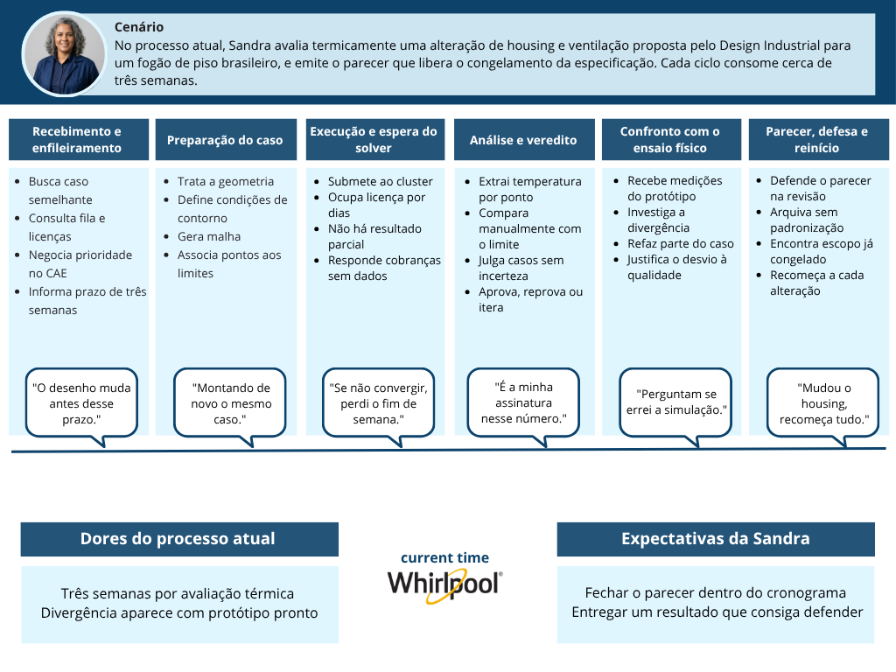<br>
  <p><b>Fonte:</b> Elaborado pelos autores, 2026</p>
</div>

###### Cenário e expectativas

  O Design Industrial propõe alterar o housing e o sistema de ventilação de uma arquitetura de fogão de piso do mercado brasileiro. Sandra precisa avaliar termicamente a proposta e emitir o parecer que libera o congelamento da especificação. O ciclo leva cerca de três semanas, prazo que a Whirlpool registrou como linha de base ao definir a meta de reduzir o assessment térmico para menos de um dia.

  Ela entra no processo esperando três coisas: fechar o parecer dentro da janela do cronograma, entregar um resultado que ela consiga reconstruir e defender quando questionada, e descobrir eventuais falhas térmicas antes que exista protótipo construído. As seis fases descritas a seguir mostram que o processo atual frustra as três.

###### Fase 1 — Recebimento e enfileiramento da demanda

  A solicitação chega por e-mail junto com a geometria da nova proposta. O primeiro movimento de Sandra é procurar na pasta de rede algum caso semelhante já simulado, tentativa que costuma fracassar, porque o histórico foi arquivado sem padrão de nomenclatura, e vasculhá-lo acaba custando mais tempo do que refazer o trabalho. Ela então consulta a fila da equipe, verifica a disponibilidade de licenças, negocia prioridade com a gerência de CAE e devolve ao solicitante o prazo de três semanas.

  O que trava esta fase é a ausência de critério técnico na ordenação da fila. A prioridade sai de uma negociação entre áreas, e configurações cujo resultado qualquer engenheiro experiente anteciparia disputam o mesmo recurso escasso que os casos realmente incertos. "Se eu prometer três semanas, o desenho muda antes disso", pensa Sandra ao aceitar a demanda, ciente de que pode estar iniciando um ciclo que será invalidado no meio do caminho.

###### Fase 2 — Preparação do caso

  Aceita a demanda, começa a montagem: tratamento da geometria, definição das condições de contorno, geração de malha e posicionamento dos pontos de medição, cada um associado ao limite térmico do seu componente. O trabalho é manual, demorado e precisa replicar fielmente o setup de casos anteriores, sob pena de a comparação entre versões perder validade. Boa parte do que Sandra monta aqui já foi montada antes, em algum caso que existe no histórico mas que ela não consegue localizar com segurança. As interrupções de colegas mais novos, que recorrem a ela antes de fechar os próprios casos, alongam ainda mais a etapa.

###### Fase 3 — Execução e espera do solver

  O caso é submetido ao cluster e passa a ocupar uma licença. Daí em diante o trabalho fica suspenso por dias, quase sempre atravessando o fim de semana, porque a simulação não oferece resultado parcial. Marketing e Design cobram previsões por canais informais durante esse intervalo, e Sandra não tem o que responder.

  Existe ainda um risco que ela carrega em silêncio: se o caso não convergir, o ciclo inteiro recomeça. "Se não convergir, perdi o fim de semana." É a primeira queda da curva emocional, uma espera improdutiva que a rotina já absorveu como inevitável.

###### Fase 4 — Análise dos resultados e veredito

  Com a simulação concluída, Sandra extrai a temperatura de cada ponto de medição e confronta valor a valor com o limite do componente, aplicando o fator de segurança de 10% previsto na regra de projeto. Desse cruzamento sai a decisão: aprovar, reprovar ou pedir nova iteração de desenho.

  A comparação é feita à mão, ponto a ponto, e não vem acompanhada de nenhuma medida de incerteza. Nos casos que ficam logo abaixo do limite, Sandra precisa julgar se aquilo é folga real ou variação do próprio modelo, apoiada apenas no repertório de catorze anos.

  "É a minha assinatura nesse número." A frase resume por que ela evita atalhos aqui: a responsabilidade pelo parecer é individual e permanece com ela depois que o produto chega ao mercado.

###### Fase 5 — Confronto com o ensaio físico

  O laboratório instrumenta o protótipo com termopares e devolve as medições reais. Quando previsto e medido divergem além do aceitável, Sandra investiga a origem da diferença, refaz parte do caso e precisa explicar o desvio ao time de qualidade, responsável pela liberação da configuração.

  Este é o ponto mais baixo da jornada, por dois motivos que se somam. A divergência aparece tarde, com protótipo já construído, quando corrigir deixa de ser iteração de projeto e vira retrabalho sob pressão de cronograma. E a conversa técnica escorrega para o terreno da credibilidade: "se não bate, perguntam se a minha simulação está errada". Em nenhum dos dois casos o problema está na precisão do método; está no momento em que a informação aparece. Aqui se concentra o custo mais alto do processo atual, contando tanto o material desperdiçado quanto o desgaste da engenheira que assina. É exatamente esse desperdício que a meta de reduzir em cerca de 25% os gastos com protótipos físicos e testes destrutivos pretende atacar.

###### Fase 6 — Parecer, defesa e reinício do ciclo

  Sandra apresenta o parecer na revisão de projeto e o sustenta diante de Design, Engenharia de Custo e Marketing. O caso é arquivado na pasta de rede com a mesma falta de padrão que a atrapalhou na Fase 1, o que garante que a dificuldade retorne no próximo ciclo.

  O problema de fundo desta fase é o calendário. Quando o parecer sai, custo e desenho já foram congelados por precaução, então a informação térmica serve para confirmar uma decisão tomada no escuro em vez de orientá-la. Se o Design ajusta o housing depois da reunião, as três semanas recomeçam do zero, e a jornada volta à Fase 1 sem aproveitar nada do trabalho anterior. "Mudou o housing, e as três semanas recomeçam."

##### Jornada do usuário - Estado futuro

<div align="center">
  <p><b> Imagem 13 -</b> Jornada Da Sandra - Estado Futuro </p>
  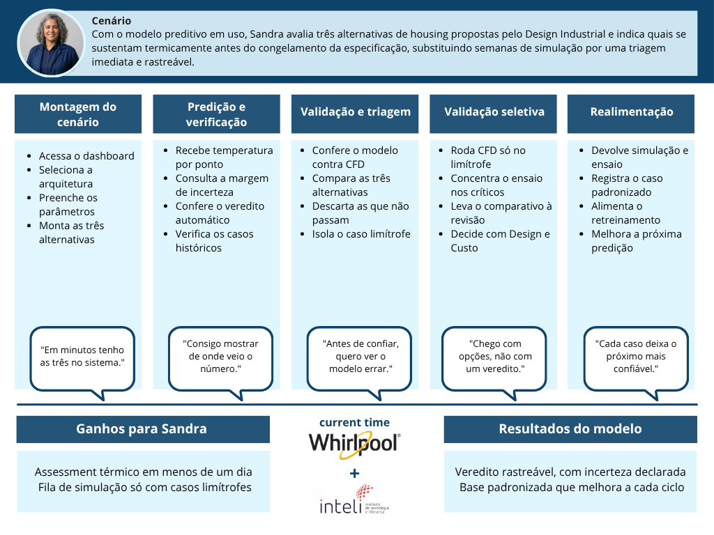<br>
  <p><b>Fonte:</b> Elaborado pelos autores, 2026</p>
</div>

###### Cenário e expectativas

O Design Industrial leva à revisão de projeto três alternativas de housing para a arquitetura brasileira, e o congelamento da especificação está marcado para dali a duas semanas. Sandra precisa dizer quais delas se sustentam termicamente enquanto a escolha ainda pode ser feita por evidência. A jornada supõe que o Ignis já passou pelo período de validação descrito na Fase 3 e que ela o utiliza com familiaridade.

Os dados de simulação e ensaio são classificados como confidenciais de uso interno da Whirlpool, conforme a seção 4.1.8, e o uso da ferramenta fica restrito a quem já possui acesso a esses dados. São cinco fases. As três primeiras acontecem na mesma manhã, o que cumpre a meta de reduzir o assessment térmico para menos de um dia; as duas últimas se estendem até o fim daquela semana, contra as três semanas do processo atual. A quinta fase realimenta a primeira.

Sandra chega a esse ciclo esperando responder antes do congelamento da especificação, poder reconstruir cada resultado que apresenta e não ser surpreendida no ensaio físico.

###### Fase 1 — Montagem do cenário

  Sandra abre o dashboard, seleciona a arquitetura de referência, brasileira ou mexicana, e preenche os parâmetros das três alternativas: potência, sistema de ventilação, geometria do housing e materiais. Os campos falam a língua do projeto, e não a da simulação, o que permite montar os três cenários em poucos minutos. A avaliação deixa de depender de licença disponível e de negociação de prioridade, porque consultar o modelo não ocupa estação de simulação.

###### Fase 2 — Predição e verificação automática

  O modelo devolve em segundos a temperatura estimada de cada ponto de medição, com a margem de incerteza e a indicação dos casos históricos que sustentam aquele resultado. Sobre a predição, o sistema aplica o limite de cada componente com o fator de segurança de 10% e apresenta o veredito de conformidade.

  Essa forma de apresentação responde à ressalva que Sandra manifesta na seção 4.1.6. Uma ferramenta que devolvesse apenas o valor em graus transferiria risco a quem assina sem oferecer instrumento de defesa; com a incerteza e a rastreabilidade à vista, ela consegue mostrar em reunião de onde veio o número.

###### Fase 3 — Validação do modelo e triagem

  Nas primeiras semanas de uso, Sandra não confia no veredito de saída. Ela submete à CFD completa casos que o Ignis já havia classificado, compara as duas respostas e constrói o próprio repertório sobre onde o modelo acerta e onde ele escorrega. É o comportamento previsto na protopersona: ela não rejeita automação, mas rejeita resultado que ela não consegue reconstruir. Esse período de checagem em paralelo custa tempo e não produz ganho imediato, e ainda assim é o que sustenta a adoção da ferramenta pelo restante do time, já que Sandra é a referência técnica a quem os colegas recorrem.

  Superada a validação, a triagem passa a ser rotina. Com as três alternativas lado a lado, ela descarta as que não se sustentam, identifica a de maior folga térmica e isola a configuração que ficou próxima do limite. Aqui está a decisão central da jornada: apenas o caso limítrofe segue para simulação completa, e os demais se resolvem na própria triagem.

  A comparação em lote alcança também a dor de margem apontada na seção 4.1.4. Testar dezenas de combinações de ventilação, potência e housing permite encontrar a configuração que respeita os limites sem apelar para lã de vidro, dissipadores e ventiladores potentes, que resolvem o problema térmico às custas do custo por unidade. É o momento mais alto da curva emocional, quando Sandra responde com dados enquanto o produto ainda pode mudar.

###### Fase 4 — Validação seletiva e parecer

  A simulação completa roda apenas no caso limítrofe. O ensaio físico se concentra nos componentes que o modelo apontou como próximos do limite, o que encurta a bateria de testes destrutivos. Na revisão de projeto, Sandra apresenta um comparativo entre alternativas em lugar de um veredito sobre uma proposta única.

  A reunião muda de natureza. Design, Custo e Marketing passam a discutir trade-offs com a informação térmica disponível durante a conversa de escopo, em vez de receberem uma restrição depois de o desenho estar fechado. Vale registrar o limite deliberado da solução: o modelo funciona como triagem anterior à CFD e não substitui a simulação nem os ensaios de certificação, fronteira estabelecida na seção 4.1.4 e que corresponde à condição de aceite da própria usuária.

###### Fase 5 — Realimentação da base

  O caso simulado e os resultados de bancada retornam ao sistema pelo próprio dashboard, que registra cada consulta de forma estruturada e padronizada. O histórico deixa de ser um conjunto disperso de planilhas e vira base pronta para retreinamento, o que ataca a causa da dificuldade que abre a jornada anterior. A cada ciclo, a predição seguinte fica mais confiável, e o conhecimento acumulado da engenharia cresce como subproduto do uso. É também o que viabiliza o critério de escalabilidade acordado com o parceiro, já que permite à Whirlpool retreinar o modelo com dados de novos fogões sem depender do grupo atual.

##### Convergência entre as jornadas futuras

  As duas jornadas futuras se encontram no mesmo ponto do processo, e esse encontro já aparece nas jornadas atuais. Enquanto Sandra espera dias pelo solver, Marketing e Design cobram dela uma previsão por canais informais; do outro lado da mesma cena, Diego recorre a contatos dentro da engenharia porque o canal formal não responde dentro do prazo em que ele precisa comunicar o varejo. É a mesma lacuna vista de dois lugares diferentes.

  Com o Ignis em operação, a resposta que Sandra obtém em segundos na triagem é a informação de que Diego depende para confirmar se a data planejada se sustenta, e cada um lê o resultado no nível que o seu trabalho exige. Sandra consulta a temperatura estimada por ponto de medição, com a incerteza e os casos históricos à vista, porque é ela quem assina o parecer. Diego consulta a probabilidade de sustentação por mercado, porque o que está em jogo é o que ele pode prometer ao varejo. A realimentação da base descrita na última fase da jornada de Sandra fecha o circuito: cada caso que a engenharia devolve ao sistema torna mais confiável a previsão que Diego usará no ciclo seguinte.

#### 4.1.8. Política de Privacidade

Esta seção apresenta a política de privacidade do Ignis, em conformidade com a LGPD: quais dados são tratados, com que finalidade, como são armazenados, compartilhados e protegidos, quais são os direitos dos titulares e quem é o encarregado de dados.

##### Informações Gerais

Esta política de privacidade informa como o projeto **Ignis**, desenvolvido pelo grupo **Os CALORos** em parceria com a Whirlpool (Divisão Fogões — Brasil & México), trata os dados pessoais coletados durante o uso da solução. Está em conformidade com a Lei nº 13.709/2018 – LGPD.

**Nota sobre a natureza dos dados tratados pelo modelo:** os dados técnicos utilizados para treinar e alimentar o modelo (histórico de simulações numéricas CFD e testes físicos) consistem em leituras de temperatura de componentes do fogão (ex.: Mainback, Bobina, Sistema de Ventilação, componentes IPC, HMI/Knobs), organizadas por caso de teste ("Run"). Esses dados **não constituem dado pessoal** para fins da LGPD (não há identificação de pessoa física em nenhum registro), mas são classificados como **confidenciais (Uso Interno Whirlpool)**, conforme o Project Charter compartilhado pela parceira.

##### Dados Coletados

Dados fornecidos diretamente: não se aplica. O projeto não possui mecanismo de login, cadastro ou qualquer formulário que colete dados pessoais diretamente do usuário. O registro de consulta e o parecer exportado na tela de Testes guardam data, recorte, versão do modelo e uma observação opcional, sem autor nem outro identificador de pessoa. Os campos de texto livre, que são o nome de uma configuração salva e a observação de uma consulta, destinam-se a descrições técnicas e são sinalizados na interface como campos que não devem conter dados pessoais.
Dados coletados automaticamente: No evento de acontecer a hospedagem da aplicação em algum site na internet, a infraestrutura pode coletar dados de acesso, como IP/Data e Hora, mesmo sem autenticação. No uso offline/local, nenhum dado é coletado: as fontes, os ícones e as bibliotecas do dashboard são servidos pela própria pasta do projeto, de modo que abrir a aplicação não envia o endereço IP do usuário a serviços de terceiros. O servidor local comunica-se apenas com o banco de dados do histórico de configurações, descrito em Armazenamento e Retenção, e não envia dado pessoal algum; como em qualquer serviço em nuvem, o fornecedor do banco pode registrar em seus logs o endereço IP da máquina que faz a requisição.

Armazenamento no navegador: o dashboard guarda no próprio navegador do usuário as preferências de exibição (tema, modo de leitura, idioma, tamanho do texto, filtro de cor e regiões selecionadas), os últimos 200 registros de consulta da tela de Testes e, apenas enquanto a aba estiver aberta, uma cópia da lista de configurações salvas. Nenhum desses dados identifica pessoa física, e todos são apagados quando os dados do site são limpos no navegador; a cópia da lista de configurações é apagada também ao fechar a aba.

##### Finalidade do Tratamento

Não se aplica a dados pessoais de usuários finais, já que o projeto não possui identificação de usuário. Eventuais logs de acesso da infraestrutura de hospedagem (ver seção anterior), se existentes, têm finalidade apenas de segurança e monitoramento básico do ambiente, com base legal no cumprimento de obrigação legal ou regulatória (art. 7º, II, da LGPD, c/c o Marco Civil da Internet) ou, alternativamente, no legítimo interesse do controlador (art. 7º, IX, da LGPD).

##### Armazenamento e Retenção

Local: Servidores em nuvem da plataforma de hospedagem utilizada pelo projeto.
Histórico de configurações: as configurações de protótipo salvas no dashboard são armazenadas num projeto do Supabase, na região de São Paulo (sa-east-1). Cada registro contém o código da configuração, o nome dado a ela, a linha do produto, os oito campos de configuração do modelo, a versão do modelo, as datas de criação e de atualização e os componentes usados, identificados por um código mascarado, junto com o limite ativo de cada um. Não são armazenadas temperaturas, previstas ou medidas, nomes reais de componentes nem dados pessoais. O acesso às tabelas é feito exclusivamente pelo servidor local do dashboard, com chave de serviço mantida fora do repositório, e a chave pública do projeto não tem permissão de leitura nem de escrita.
Prazo (logs de acesso): Os logs de infraestrutura contendo endereço de IP serão armazenados por até 6 (seis) meses como previsto no Art. 15 da Lei nº 12.965/2014 (Marco Civil da Internet).
Prazo (planilha da parceira): a planilha de dados fornecida pela Whirlpool permanece em posse do grupo apenas durante o módulo, sendo eliminada de todas as máquinas e ambientes de execução ao término da última sprint do projeto. Nenhuma cópia é retida após essa data.

Vale ressaltar que a planilha de dados fornecida pela parceira (Whirlpool) não se encaixa como banco de dados pela Lei nº 13.709/2018 – LGPD já que não armazena dados pessoais, apenas confidenciais relacionados a medições de temperaturas. Por isso não é regido por esse documento e sim pela Governança de Dados da Whirlpool.

##### Compartilhamento de Dados

Não há dados pessoais a compartilhar. Os dados técnicos de CFD e testes físicos (não pessoais, porém confidenciais) circulam apenas entre a Central de Projetos, o corpo docente e a turma 29 do Inteli, além dos stakeholders Whirlpool (Sponsor e PM da Divisão Fogões, e equipe interna de CFD). O Supabase atua como fornecedor de infraestrutura do histórico de configurações e recebe apenas os registros descritos em Armazenamento e Retenção; como os componentes são identificados por código mascarado, os nomes dos componentes e as temperaturas da parceira não chegam ao fornecedor.

##### Segurança dos Dados

O projeto, conforme escopo atual, não possui mecanismo de autenticação. Isso não gera risco direto à LGPD (não há dados pessoais tratados). Apesar disso, o projeto é de uso interno e só será compartilhado entre aqueles que já possuem acesso aos dados da Whirlpool (ver seção anterior). Como medidas concretas de segurança, o grupo adota repositório privado, mantém o arquivo original fora do versionamento e publica apenas dados agregados no relatório aberto, o que garante a permanência da confidencialidade dos dados fornecidos.

##### Direitos dos Titulares

Ainda que o projeto não colete dados pessoais diretamente, e portanto não haja titulares de dados pessoais no escopo tratado, caso a hospedagem gere logs automáticos de acesso (IP), a pessoa titular pode exercer os direitos previstos no art. 18 da LGPD: confirmação da existência de tratamento; acesso aos dados; correção de dados incompletos, inexatos ou desatualizados; anonimização, bloqueio ou eliminação de dados desnecessários ou tratados em desconformidade com a lei; portabilidade dos dados; eliminação dos dados tratados com consentimento; informação sobre as entidades com as quais o controlador compartilhou dados; informação sobre a possibilidade de não fornecer consentimento e suas consequências; e revogação do consentimento. As solicitações serão respondidas em até 15 (quinze) dias, conforme o art. 19 da LGPD.
Solicitações via e-mail: fabio.cassio@prof.inteli.edu.br

##### Encarregado de Dados (DPO)

Nome: Fábio Cássio de Souza (professor orientador — Inteli)
E-mail: fabio.cassio@prof.inteli.edu.br

### 4.2. Compreensão dos Dados

Esta seção descreve o conjunto de dados fornecido pela Whirlpool e o trabalho feito sobre ele antes da modelagem: a exploração das variáveis, o pré-processamento, com limpeza e transformação, e as hipóteses levantadas sobre a relação entre os dados e o problema.

#### 4.2.1. Exploração de dados

Esta subseção apresenta a exploração inicial da base: a classificação das colunas em numéricas e categóricas, a estatística descritiva das variáveis e os gráficos que relacionam a temperatura às principais variáveis do ensaio.

##### 4.2.1.1 Identificação das colunas numéricas e categóricas

Antes que a exploração estatística dos dados fosse iniciada, foi necessária a classificação de cada coluna do conjunto de dados, já reestruturado em formato longo, com uma linha por leitura de sensor em um teste, como numérica ou categórica.

O critério inicial consultado foi o tipo de dado retornado pelo pandas (dtypes), mas esse critério não é suficiente por si só: um valor pode estar armazenado como número sem que represente, de fato, uma grandeza mensurável, como ocorre com o TC Number. Por essa razão, o critério final adotado pelo grupo foi conceitual, sendo verificado se a operação de média ou de diferença entre os valores da coluna possui significado real. Em caso afirmativo, a coluna foi classificada como numérica; caso contrário, sendo a coluna um rótulo, grupo ou identificador, foi classificada como categórica.

A classificação obtida é resumida na tabela abaixo:

| Coluna | Classificação | Justificativa |
|---|---|---|
| Temperature | Numérica | Temperatura medida pelo sensor em cada run. A média e o desvio padrão possuem significado físico. |
| Active Limit | Categórica | Limite de temperatura de referência do sensor. Ainda que seja expresso em graus Celsius, sua função é definir se a temperatura medida está acima ou abaixo do permitido, e não a de representar uma medição que varia a cada ensaio. Foi verificado que a coluna assume apenas 16 valores de limite distintos, aos quais se soma a categoria zero atribuída aos sensores sem limite aplicável, e que nenhum dos 76 sensores possui mais de um valor, de modo que ela é inteiramente determinada pelo TC Name, constituindo um atributo fixo do componente definido por norma. Por essas razões, foi classificada como categórica, conforme discutido na Seção 4.2.2.3. |
| TC Name | Categórica | O sensor é identificado por ela. Trata-se de um rótulo, e não de uma quantidade. |
| Key Area | Categórica | A área do fogão em que o sensor está posicionado é identificada por ela. Trata-se de um rótulo. |
| Run | Categórica | O teste realizado é identificado por ela. Trata-se de um rótulo, sem significado matemático como sequência. |
| Reason, Blower Direction, Housing, Board Position, Run Case, Material Coil Support, Losses, Deflector Hole | Categóricas | Metadados de configuração de cada run, pelos quais são representados grupos, como aberto e fechado, e não grandezas. |
| TC Number | Categórica (caso de atenção) | Apesar de armazenado como número, é um identificador do sensor. O cálculo de sua média não possui significado algum. |

Essa classificação foi implementada no notebook de leitura e utilizada como base para as etapas seguintes de estatística descritiva e de pré-processamento, nas quais são realizadas a normalização das variáveis numéricas e a codificação das variáveis categóricas.

Para facilitar a leitura, a implementação está dividida em cinco notebooks encadeados, disponíveis na pasta notebooks do repositório. O primeiro, leitura.ipynb, concentra a leitura da planilha, a limpeza, o tratamento de outliers e a estatística descritiva, e exporta a base limpa consumida pelos demais. O segundo, normalizacao.ipynb, trata do teste de normalidade, da normalização, da codificação e da separação entre features e variável-alvo. O terceiro, graficos.ipynb, reúne as visualizações de relação entre variáveis. O quarto, hipoteses.ipynb, verifica sobre os dados as três hipóteses da Seção 4.2.3. O quinto, analise_escalonamento.ipynb, dá apoio ao Anexo I.

##### 4.2.1.2 Estatística Descritiva

Esta seção descreve o comportamento das variáveis da base após a limpeza dos dados, servindo de base para a etapa de modelagem. Temperature é a única variável numérica, já que é a grandeza medida pelos sensores. As demais variáveis, bem como Active Limit, passam a ser tratadas como categóricas, pois seus valores não são medidos, e sim escolhidos entre um conjunto fixo de limites definidos por norma técnica ou por especificação de cada componente.

Temperature tem média de 80,04°C e desvio padrão de 29,82°C, com valores entre 27,69°C e 234,60°C. Metade das leituras está abaixo de 76,03°C, e a maior parte se concentra entre 59,11°C e 96,02°C, o que mostra que a base é composta majoritariamente por temperaturas moderadas, com poucas leituras bem mais altas puxando o máximo para cima.

Entre as variáveis categóricas, algumas concentram grande parte das observações em poucos valores. Key Area tem 7 categorias, e quase metade das leituras (49,3%) pertence à área IPC Comp. Run Case tem 5 categorias, com Broil Qualitative respondendo por 39,1% da base. Essa concentração é relevante porque mostra que o modelo terá bem mais exemplos de algumas áreas e tipos de teste do que de outros.

Active Limit, já como categórica, tem 16 valores tabelados diferentes, aos quais se soma a categoria zero atribuída aos sensores sem limite aplicável, sendo 110°C o mais comum, presente em 23,7% das leituras. Isso confirma que os limites de segurança seguem um padrão definido por norma, e não uma distribuição contínua de valores.

As demais variáveis de configuração (Blower Direction, Housing, Board Position, Deflector Hole e Material Coil Support) também concentram a maioria das leituras em um único valor dominante. Isso é esperado, já que representam decisões de projeto que se repetem entre os testes, mas reforça que algumas combinações de configuração têm poucos exemplos na base.

##### 4.2.1.3 Gráficos de Relacionamento

Os gráficos a seguir relacionam a temperatura medida a três variáveis da base: o tipo de ensaio (Run Case), o limite térmico do componente (Active Limit) e a área do produto (Key Area).

###### Temperature X Run Case

<div align="center">
  <p><b> Imagem 14 -</b> Relação Temperatura X Run Case</p>
  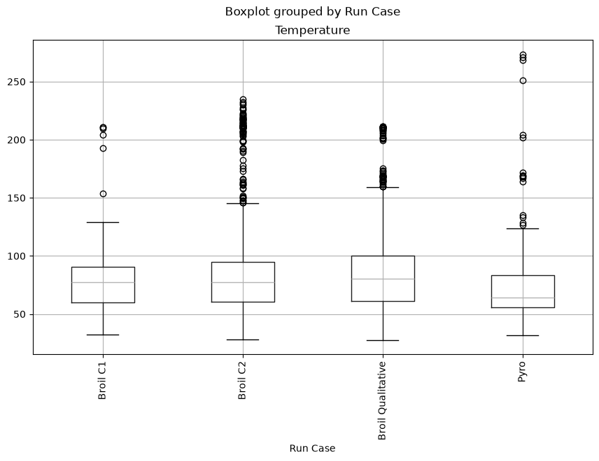<br>
  <p><b>Fonte:</b> Elaborado pelos autores, 2026</p>
</div>

No gráfico é demonstrada a diferença nas medições dos diferentes sensores, correspondentes às peças do fogão, em um mesmo teste de função. A parte majoritária das temperaturas encontra-se abaixo dos 100 °C, o que se deve ao fato de que os outliers correspondem a peças expostas à cavidade de aquecimento do fogão, em número reduzido na comparação com o todo, no qual são registradas temperaturas mais controladas.

###### Temperature X Active Limit

<div align="center">
  <p><b> Imagem 15 -</b> Gráfico de Dispersão - Temperature vs Active Limit </p>
  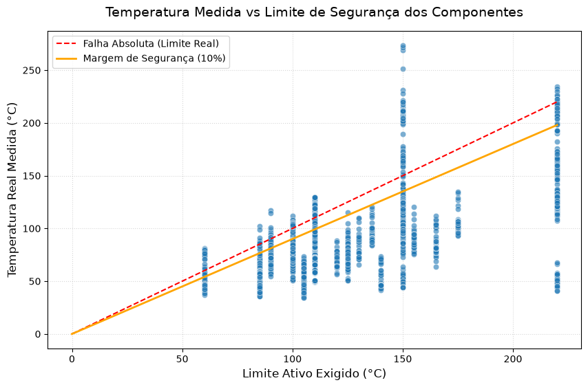<br>
  <p><b>Fonte:</b> Elaborado pelos autores com Matplotlib, 2026</p>
</div>

O gráfico de dispersão relaciona, para cada sensor, a temperatura medida com o limite térmico ativo (Active Limit) definido para aquele componente, evidenciando o quanto cada leitura se aproxima do ponto de falha. A análise considera apenas os sensores com limite de segurança real associado, excluindo os sensores de monitoramento sem limite definido.

A leitura do gráfico é guiada por duas linhas de referência: a linha vermelha (y = x) indica a falha absoluta, enquanto a linha laranja (y = 0.9x) representa a margem de segurança de 10% exigida pela engenharia.

Componentes posicionados entre as duas linhas passam no teste, mas operam fora da margem de segurança recomendada, o que ajuda a apontar quais pontos exigem atenção prioritária tanto do modelo preditivo quanto da engenharia.

###### Temperature X Key Area

<div align="center">
  <p><b> Imagem 16 -</b> Boxplot Temperature vs Key Area</p>
  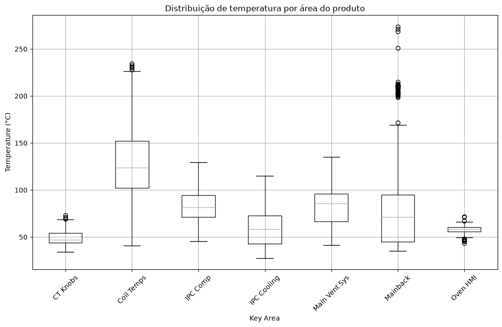<br>
  <p><b>Fonte:</b> Elaborado pelos autores com Matplotlib, 2026</p>
</div>

O boxplot compara a distribuição de temperatura entre as áreas do produto (Key Area), destacando quais regiões concentram os maiores riscos térmicos e a variabilidade das leituras dentro de cada uma.

Cada caixa corresponde à distribuição de temperatura de uma Key Area específica: a linha central indica a mediana, e os pontos fora da caixa representam outliers daquele grupo.

Caixas posicionadas mais alto ou com maior dispersão sinalizam áreas sujeitas a temperaturas mais extremas ou menos previsíveis, tornando-se boas candidatas a atenção prioritária tanto na engenharia física do produto quanto no treinamento do modelo.

#### 4.2.2. Pré-processamento dos dados

Nesta seção são apresentadas as ações de limpeza e de transformação aplicadas ao conjunto de dados. A limpeza abrange o tratamento de valores ausentes, nas colunas numéricas e categóricas, e a análise dos outliers de temperatura. A transformação abrange a normalização das variáveis numéricas e a codificação das variáveis categóricas, além da separação entre as features e a variável-alvo.

##### Correção de erro de formatação na planilha original

Antes do tratamento dos valores ausentes, foi corrigido um erro de formatação identificado na planilha original, pelo qual leituras válidas estavam sendo descartadas como se fossem dados ausentes, uma vez que o texto malformado é convertido em NaN pela função de conversão numérica.

O erro consiste na formatação indevida como porcentagem. Oito células da coluna Run 5 - Broil Qualitative foram gravadas no Excel com formato de porcentagem, de modo que o valor 113,77 passou a ser exibido como 11377,00%. Sem correção, essas oito leituras reais de temperatura seriam perdidas. A correção foi feita pela divisão do valor por 100.

Cabe registrar que a grafia Monitor (150 C), encontrada no Active Limit do sensor Turbo Duct / AC Blower Outlet, chegou a ser interpretada como um segundo erro de formatação, e o número foi extraído do texto como se constituísse um limite documentado. Conforme esclarecido posteriormente pela parceira, esse valor corresponde apenas a uma referência de monitoramento, e não a um limite de segurança. A extração foi, por isso, removida do carregamento, e toda grafia iniciada por Monitor passou a ser tratada como ausência de limite, conforme detalhado na Seção 4.2.2.1.

##### 4.2.2.1 Preenchimento de valores ausentes

Esta subseção trata os valores ausentes da base, separando as colunas numéricas Temperature e Active Limit das colunas categóricas, já que a ausência tem significado diferente em cada caso e exige tratamento próprio.

###### Valores ausentes nas colunas Temperature e Active Limit

<div align="center">
  <p><b> Imagem 17 -</b> Valores Ausentes Numéricos</p>
  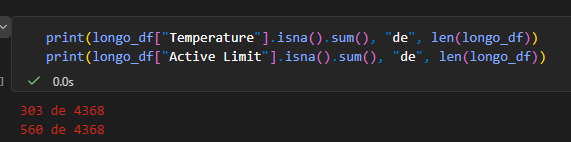<br>
  <p><b>Fonte:</b> Elaborado pelos autores, 2026</p>
</div>

Na imagem é mostrada a presença de 863 valores ausentes somados nas colunas Temperature e Active Limit, sendo 303 na primeira e 560 na segunda. Tratamentos distintos são exigidos pelas duas colunas, uma vez que a ausência possui significados diferentes em cada uma delas. Nesta subseção é tratada a Temperature, única coluna numérica do conjunto; o Active Limit, classificado como categórico, é tratado na subseção seguinte.

Para a temperatura, a estratégia escolhida foi a eliminação das leituras ausentes (dropna), em vez do seu preenchimento. Os 303 nulos representam 6,9% do total de leituras, e o seu padrão foi investigado antes que a decisão fosse confirmada, sendo revelados três achados que sustentam a escolha.

O primeiro é que os nulos não estão distribuídos aleatoriamente. Do total, 199 deles, ou 65,7%, encontram-se concentrados em apenas cinco sensores, que ficaram sem medição na maior parte ou na totalidade dos ensaios:

| Sensor | Leituras ausentes |
|---|---|
| Dedicated IPC/CKTP Outlet | 100,0% |
| AC Blower Inlet Avg | 92,9% |
| AC Blower Inlet Max | 92,9% |
| Heat Sink (Point/Probe) | 37,5% |
| IPC Blower (Air Outlet Temp) | 32,1% |

Nesses casos não existe informação a recuperar, uma vez que a medição nunca chegou a ser realizada. Qualquer imputação, seja por média, mediana ou interpolação, equivaleria a fabricar uma medição física inexistente.

O segundo achado é que esses cinco sensores são justamente sensores de monitoramento, e não de segurança. Todos os cinco integram o grupo sem limite ativo, tratado adiante nesta mesma seção, e correspondem aos sensores descritos pela parceira como não possuindo limite de segurança, monitorados porque seus valores influenciam determinadas áreas do produto, sendo boa parte deles sensores de ar. Há coerência física nesse resultado, uma vez que se trata de medições complementares de fluxo de ar, e não de verificações obrigatórias de segurança do componente, o que explica serem as menos instrumentadas.

O terceiro achado é que o conjunto de dados não é desequilibrado pelo descarte. Na comparação da distribuição percentual das categorias antes e depois do dropna, é observada variação máxima de 0,3 ponto percentual em Run Case e de 1,9 ponto percentual em Key Area, no caso de Main Vent Sys, que passa de 9,0% para 7,1%. Dessa forma, praticamente a mesma proporção de cada configuração de ensaio continuará sendo observada pelo modelo.

Os 104 nulos restantes são esparsos, originados de sensores que habitualmente medem, mas que apresentaram falha pontual em ensaios específicos, sendo o Run 22 responsável por 33 deles, equivalentes a 42% daquele ensaio. Ainda que pudessem ser imputados, foi mantido o mesmo critério adotado para os demais: caso uma temperatura real seja substituída por um valor estimado, o modelo pode ser levado a errar uma previsão de superaquecimento, o que prejudicaria a Whirlpool em etapas mais avançadas da prototipação. Optou-se, assim, por perder 6,9% das linhas em vez de serem introduzidas medições fictícias.

Além das leituras ausentes, foi descartado por orientação da parceira o sensor Oven RTD Connector Body. A verificação nos dados sustenta a decisão: as 53 leituras do sensor encontram-se integralmente acima do limite de 150 °C registrado para ele, sendo a menor delas 198,76 °C, o que representa um excedente de 48,76 °C. O comportamento é observado em todos os tipos de ensaio, o que afasta a hipótese de restrição a uma condição específica e é compatível com falha de calibração ou com limite cadastrado incorretamente na planilha. Como nenhuma das suas leituras é aproveitável, a remoção equivale à exclusão do próprio sensor, e o conjunto passa de 77 para 76 sensores e de 4065 para 4012 leituras.

###### Valores ausentes nas colunas categóricas

<div align="center">
  <p><b> Imagem 18 -</b> Valores Ausentes Categóricos</p>
  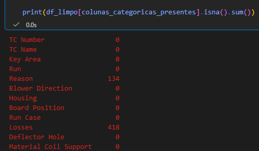<br>
  <p><b>Fonte:</b> Elaborado pelos autores, 2026</p>
</div>

Na imagem é mostrado que os valores ausentes nas colunas categóricas se encontram apenas em Losses e Reason, o que é coerente, uma vez que nem todos os testes sofrem perdas ou possuem um motivo de alteração registrado.

Diferentemente da Temperature, os nulos nas colunas categóricas de metadado, como Losses e Reason, não decorrem de erro de leitura do sensor: correspondem a runs em que aquele dado simplesmente não foi preenchido na planilha original da Whirlpool. Por essa razão, em vez da remoção dessas linhas, o que descartaria leituras de temperatura válidas, esses nulos foram preenchidos com um rótulo explícito, de modo que os algoritmos de codificação categórica utilizados adiante no pré-processamento não sejam interrompidos ao encontrar NaN.

Também foram encontrados espaços em branco sobrando em alguns valores dessas colunas, como "Center " em vez de "Center", em Board Position. Trata-se de um erro grave para a codificação categórica: sem correção, "Center" e "Center " são tratados pelo Python como duas categorias diferentes, e o que deveria ser um único grupo acaba dividido em dois no One-Hot Encoding. A correção foi feita pela remoção dos espaços das pontas de todas as colunas categóricas antes da codificação.

Quanto ao Active Limit, foi comunicado pela parceira que os componentes sem Active Limit de fato não possuem limite, sendo apenas dados de monitoramento. Diferentemente da Temperature, aqui o nulo não significa medição perdida, e sim não aplicável. Por essa razão, em vez da remoção das linhas, o que descartaria leituras de temperatura válidas, uma coluna booleana auxiliar, Possui Active Limit, foi adicionada para informar se há um limite definido, e os nulos foram preenchidos com 0, evitando a perda de dados sem que fosse inventado um limite de segurança inexistente. Com o Active Limit tratado como variável categórica, o valor 0 passa a funcionar como a categoria pela qual são identificados os sensores sem limite aplicável, e nenhuma ambiguidade é gerada, uma vez que nenhum componente possui limite real de 0 °C.


A lista de sensores sem limite exigiu duas correções ao longo da análise. A primeira foi a inclusão do sensor Dedicated IPC/CKTP Outlet, que também apresenta a grafia Monitor no lugar de um número no Active Limit original e havia sido omitido. O resultado não era comprometido por coincidência, uma vez que todas as leituras de Temperature desse sensor são nulas e ele já era descartado antes dessa etapa, mas a correção foi aplicada para que o código não dependesse dessa coincidência.

A segunda diz respeito ao sensor Turbo Duct / AC Blower Outlet, cujo Active Limit está registrado com a grafia Monitor (150 C). O valor numérico presente no texto foi inicialmente interpretado pela equipe como um limite de segurança documentado, e o sensor chegou a ser retirado da lista. Conforme esclarecido posteriormente pela parceira, o número entre parênteses constitui apenas uma referência de monitoramento, e não um limite de segurança. O sensor foi, por isso, mantido na lista, e a extração do número a partir do texto foi removida do carregamento, de modo que as suas 56 leituras passam a ser tratadas como não possuindo limite aplicável.

Cabe registrar ainda a interação entre os dois tratamentos de ausentes. Como os sensores sem limite ativo são também os que concentram a maior parte das leituras ausentes de temperatura, parte de suas linhas é removida pelo dropna antes que o preenchimento do Active Limit seja aplicado. O caso extremo é o Dedicated IPC/CKTP Outlet, cuja totalidade das leituras de temperatura é nula e que, por essa razão, não chega a integrar o conjunto final de dados.

##### 4.2.2.2 Tratamento de Outliers

Foi realizada a análise dos valores dos dados numéricos para a identificação dos outliers e, possivelmente, sua modificação, de modo que o modelo preditivo seja alimentado com dados relevantes e que não o enviesem. De início, já é possível determinar que apenas a temperatura deve ser analisada, uma vez que o Active Limit é um limite fixo para cada peça, definido pela legislação.

Na primeira versão da detecção, os outliers eram agrupados apenas por TC Name, o que fazia com que leituras de Pyro, mais quente, e de Broil, mais variado, fossem misturadas na mesma distribuição, e leituras de Broil perfeitamente normais parecessem outliers apenas por comparação com Pyro. A correção foi feita pelo agrupamento por TC Name e Run Case em conjunto, de modo que cada leitura seja comparada apenas com leituras do mesmo sensor no mesmo tipo de teste.

Com essa correção, foram encontrados 194 outliers, assim distribuídos: 56 em ensaios de Pyro, 82 em Broil C2 e 56 em Broil Qualitative. A decisão foi a de manter todos. Para os de Pyro, a justificativa está no próprio processo de autolimpeza pirolítica, o mais extremo de aquecimento do fogão. Para os de Broil, a coluna Reason desses casos foi verificada, e praticamente todos apresentam uma mudança de configuração documentada, como "Baseline new Duct", "No cover on HS", "Double Flow on Blower", "Run with cover" e "Part of study of position", ou seja, são variações intencionais do experimento, envolvendo mudança de duto, cobertura, vazão do soprador e posição, e não erro de medição. A alteração ou a remoção desses dados representaria perda de informações importantes para o modelo, já que por eles é documentado exatamente o efeito dessas mudanças de configuração na temperatura.

<div align="center">
  <p><b> Imagem 19 -</b> Boxplot de Temperatura por Componente</p>
  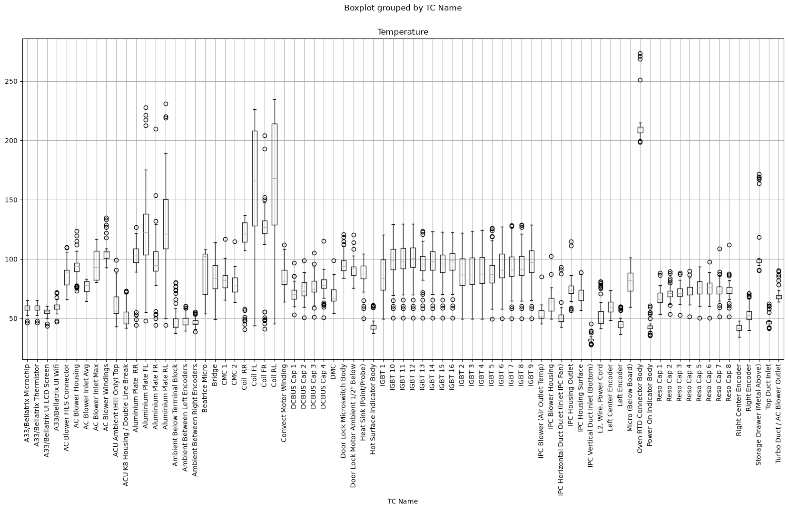<br>
  <p><b>Fonte:</b> Elaborado pelos autores, 2026</p>
</div>

Nos boxplots acima é apresentada a distribuição das temperaturas para cada componente do fogão. A presença de outliers é explicada pelas diversas funcionalidades de um fogão, operadas em temperaturas diferentes.

<div align="center">
  <p><b> Imagem 20 -</b> Quantidade de Outliers</p>
  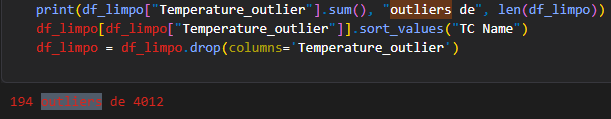<br>
  <p><b>Fonte:</b> Elaborado pelos autores, 2026</p>
</div>

Na imagem é demonstrada a contagem de outliers de temperatura no dataframe.

##### 4.2.2.3 Normalização e Codificação

Esta subseção descreve as transformações aplicadas antes da modelagem: a normalização das colunas numéricas, a criação da margem de segurança, a codificação das colunas categóricas e a separação entre features e variável-alvo.

###### Normalização das Colunas Numéricas

A normalização foi realizada com a biblioteca sklearn, através do método StandardScaler, pelo qual cada valor é convertido no seu desvio em relação à média da própria coluna, resultando em colunas com média 0 e desvio padrão 1. Dessa forma, os dados passam a ser comparados pelo modelo em uma só língua.

Temperature é a única coluna numérica do conjunto, e a normalização recai apenas sobre ela. Como a Temperature é também a variável-alvo, as previsões do modelo sairão na escala padronizada e exigirão a transformação inversa, obtida por scaler.inverse_transform, para que retornem a graus Celsius.

O Active Limit, apesar de valor numérico (número), não foi normalizado. Por ser tratado como categoria, seus valores distintos são convertidos em indicadores binários na etapa de codificação, e a padronização por média e desvio padrão deixa de ser aplicável. Cabe registrar a consequência dessa decisão: sob o One-Hot Encoding, a ordem entre os limites deixa de ser representada, de modo que um limite de 130 °C passa a ser um rótulo sem qualquer relação com um de 125 °C ou de 136 °C. Com isso, a generalização para um componente cujo limite intermediário não tenha sido observado no treinamento não será possível.

###### Margem de Segurança

Foi criada a coluna Margem de Seguranca, definida como Active Limit menos Temperature. Nessa escala, em graus Celsius, o valor é diretamente interpretável: uma margem negativa indica que o componente ultrapassou o limite permitido, e sua magnitude informa por quantos graus.

O cálculo precisa anteceder a etapa de codificação, uma vez que a subtração exige que os valores do Active Limit ainda estejam em forma numérica. Após o One-Hot Encoding, a coluna é substituída por indicadores binários e a operação deixa de ser possível. Pela mesma razão, o cálculo antecede a normalização da Temperature: com a padronização, a leitura deixaria de estar em graus Celsius e a diferença perderia o significado físico de graus até o limite. A coluna também não é normalizada, pois se mostra mais útil na escala original.

Para os sensores que não possuem limite de segurança, a margem não é fisicamente definida e recebe NaN, e não 0. A distinção é necessária para que esses registros não se confundam com uma leitura real que tenha atingido exatamente o limite, situação em que a margem seria legitimamente zero.

Cabe registrar que a Margem de Seguranca constitui uma ferramenta de análise, e não uma feature do modelo. Como a variável-alvo é a própria Temperature, a sua inclusão em X configuraria vazamento de dados: sendo o Active Limit conhecido de antemão, a margem revela exatamente o valor que se pretende prever. O modelo apresentaria desempenho artificialmente alto em teste e falharia em produção, já que, para uma configuração nova, não há margem calculável antes que a temperatura seja conhecida. A coluna é, portanto, mantida para a análise descritiva e explicitamente removida do conjunto de features.

<div align="center">
  <p><b> Imagem 21 -</b> Dados Normalizados</p>
  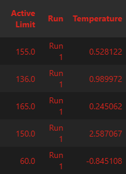<br>
  <p><b>Fonte:</b> Elaborado pelos autores, 2026</p>
</div>

Na imagem é mostrado o resultado da normalização da temperatura, ao lado do limite ativo e da margem de segurança, ambos mantidos em graus Celsius. A conversão de um valor normalizado de volta para graus Celsius é feita com os parâmetros da própria coluna: Temperature_bruta = Temperature_normalizada * std_Temperature + media_Temperature.

###### Codificação das Colunas Categóricas

Para as colunas categóricas, dois métodos foram utilizados. O primeiro é o One-Hot Encoding, aplicado às colunas de baixa cardinalidade: por ele, é criada uma coluna booleana para cada valor possível, de modo que Housing, que assume apenas os valores aberto ou fechado, dá origem a Housing_Open e Housing_Closed, sem que seja atribuída uma ordem entre categorias que não a possuem. Para TC Name, que reúne 76 valores distintos, o One-Hot geraria um número excessivo de colunas; nesse caso foi aplicado o Label Encoding, pelo qual é atribuído um número inteiro único a cada sensor.

O Active Limit integra o grupo tratado por One-Hot Encoding, em coerência com sua classificação como variável categórica. Seus valores distintos dão origem a um indicador binário cada, entre os quais o correspondente ao valor 0, pelo qual são identificados os sensores sem limite de segurança aplicável.

Em consequência, a coluna auxiliar Possui Active Limit torna-se perfeitamente redundante nesta etapa, uma vez que passa a ser o complemento exato do indicador Active Limit_0.0. Ela é mantida no conjunto de análise, onde continua a ser utilizada tanto para leitura quanto para mascarar a Margem de Segurança nos casos não aplicáveis, mas é retirada do conjunto de features.

<div align="center">
  <p><b> Imagem 22 -</b> Dados Codificados</p>
  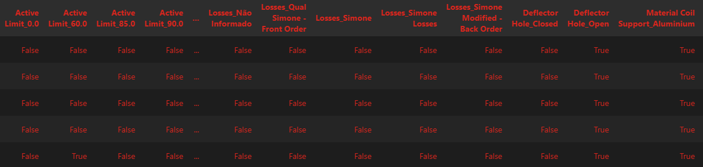<br>
  <p><b>Fonte:</b> Elaborado pelos autores, 2026</p>
</div>

A imagem mostra os dados codificados, onde uma coluna apresenta a presença daquela característica ou não, de forma booleana. Isso permite que o modelo compreenda e, acima de tudo, analise tudo sem pesos indesejados que possam vir de números altos

###### Separação entre Features e Variável-Alvo

A definição da variável-alvo como Temperature determina a composição final de X. São removidas do conjunto de features a própria Temperature, por ser o alvo; a Margem de Seguranca, por vazamento de dados; o TC Number, por ser identificador sequencial redundante em relação ao TC Name já codificado; e o Run, por identificar o ensaio específico em vez de uma característica física da configuração, o que levaria o modelo a memorizar experimentos em lugar de aprender o comportamento térmico.

Também é removida a coluna Possui Active Limit, por redundância. Após a codificação, ela passa a ser o complemento exato do indicador Active Limit_0.0, e duas colunas idênticas configuram colinearidade perfeita, situação inofensiva para modelos baseados em árvores, mas problemática para regressão linear e para modelos com regularização, nos quais o peso atribuído é dividido entre elas e a interpretação dos coeficientes fica distorcida.

Permanece como feature o Active Limit, agora sob a forma dos indicadores binários gerados pelo One-Hot Encoding, por se tratar de especificação do componente conhecida previamente ao ensaio.

#### 4.2.3. Hipóteses

Nesta seção são analisadas três hipóteses principais sobre a relação entre as variáveis do conjunto de dados e o problema de negócio a ser resolvido pelo modelo preditivo térmico. A verificação de cada uma sobre os dados está implementada no notebook hipoteses.ipynb, em que o enunciado da hipótese acompanha o código que a sustenta. As hipóteses foram escolhidas porque são sustentadas por evidências levantadas na etapa de compreensão e preparação dos dados, e porque se conectam aos objetivos definidos com a Whirlpool no Kickoff do projeto.

##### Hipótese 1 - A área do produto (Key Area) é o fator com maior poder explicativo sobre a temperatura

Cada termopar (o sensor que mede a temperatura em um ponto específico do fogão) está associado a uma área do produto, registrada na coluna Key Area. A hipótese é que essa área já explica boa parte da temperatura registrada: saber em que parte do fogão um sensor está posicionado ajuda a prever se a leitura dele tende a ser alta ou baixa, antes mesmo de olhar qualquer outra variável.

O boxplot que separa Temperature por Key Area mostra essa diferença com clareza. A área CT Knobs, que reúne os botões de controle, fica concentrada numa faixa estreita e baixa. Já a área Mainback, que reúne exaustão, cabeamento de potência e motores dos ventiladores, se espalha por uma faixa muito maior, com vários pontos acima de 200°C.

<div align="center"> <p><b> Imagem 23 -</b> Boxplot Temperature vs Key Area</p> <br> <p><b>Fonte:</b> Elaborado pelos autores com Matplotlib, 2026</p> </div>

A verificação quantitativa confirma o peso da variável: a área do produto responde por 43,6% da variância total da temperatura, medida pela razão entre a soma dos quadrados entre áreas e a soma dos quadrados total. A análise estatística por região detalha esse resultado. A temperatura média muda bastante de uma área para outra, indo de 49,30°C em CT Knobs a 126,93°C em Coil Temps. A dispersão também é muito diferente entre regiões: Oven HMI tem desvio padrão de 3,96°C e CT Knobs de 7,69°C, enquanto Coil Temps chega a 45,03°C e Mainback a 25,39°C. Ou seja, cada área não tem só um patamar de temperatura próprio, mas também um comportamento de variação próprio.

Essa diferença faz sentido dentro da arquitetura do produto. No material de kickoff, a Whirlpool aponta a cavidade do forno, o módulo de indução e o console/HMI como os subsistemas de maior risco térmico, cada um esquentando por um motivo físico diferente. Isso ajuda a explicar por que Mainback, mais próxima dessas fontes de calor, aparece tão mais quente e dispersa do que uma área como CT Knobs.

Um reforço importante veio do teste de normalidade feito na base: ao analisar a variável Temperature, a recomendação foi tratar os dados de forma segmentada por Key Area, já que cada região tem escala térmica e formato de distribuição próprios. Ou seja, uma análise feita com outro objetivo chegou de forma independente à mesma conclusão desta hipótese.

Na prática, isso orienta uma decisão do projeto: pode fazer mais sentido treinar um modelo separado para cada Key Area, ou pelo menos garantir que essa variável tenha peso alto na modelagem, em vez de tratar o fogão inteiro como um único sistema térmico. Essa divisão também facilita a leitura dos resultados pelos times de engenharia, design e qualidade, que já pensam o produto dividido nesses subsistemas.

##### Hipótese 2 - O tipo de teste (Run Case) determina o patamar da temperatura

A coluna Run Case indica o tipo de teste realizado em cada simulação, sendo os principais o modo Pyro (ciclo de autolimpeza, que atinge temperaturas extremas na cavidade do forno) e variações do modo Broil (mais próximo do uso comum do fogão). A hipótese é que o tipo de teste muda o patamar de temperatura esperado para um mesmo sensor: não basta saber qual componente está sendo medido, porque o mesmo sensor pode registrar temperaturas diferentes dependendo do teste simulado.

A análise descritiva agrupada por Run Case mostra essa separação. As variações de Broil e Qualitative apresentam medianas próximas entre si (de 77,37°C a 81,16°C), formando um grupo coeso. O Pyro, por outro lado, apresenta mediana de 64,29°C, quase 17°C abaixo do Broil Qualitative. Essa diferença pode parecer contraintuitiva, já que o Pyro é o modo que atinge as maiores temperaturas absolutas na cavidade do forno. A explicação é que o dataset monitora o fogão inteiro: enquanto a cavidade esquenta ao extremo, os demais componentes medidos pela base (eletrônica, ventilação, cooktop) tendem a registrar temperaturas mais baixas nesse modo, puxando a mediana global para baixo.

<div align="center"> <p><b> Imagem 24 -</b> Estatísticas entre Temperature e Run Case </p> 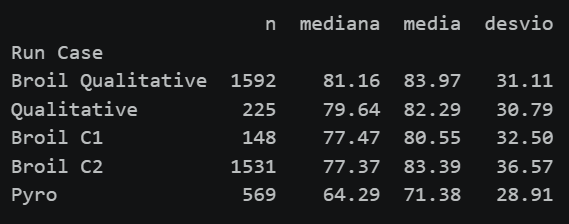<br> <p><b>Fonte:</b> Elaborado pelos autores com Matplotlib, 2026</p> </div>

O teste de normalidade trouxe a primeira evidência estatística desse comportamento. A variável Temperature reprovou no teste de Shapiro-Wilk em todas as regiões do produto, e a explicação registrada foi que as distribuições possuem múltiplos picos (são multimodais), pois cada região reúne leituras de configurações e modos de operação distintos. Ou seja, o fato de runs diferentes produzirem patamares diferentes é parte do que causa a não normalidade da base.

O impacto dessa mistura também ficou evidente no tratamento de outliers. Ao calcular os limites agrupando as leituras apenas pelo nome do sensor (TC Name), sem separar por tipo de teste, leituras normais de Broil eram marcadas como outliers por comparação com Pyro. Depois de corrigir o agrupamento para considerar TC Name e Run Case em conjunto, os outliers encontrados correspondiam a mudanças físicas documentadas nos ensaios, como troca de duto ou aumento da vazão do soprador.

Para o projeto, isso significa que o modelo precisa considerar o tipo de teste como variável relevante. A diferença de quase 17°C entre as medianas de Pyro e Broil Qualitative já ultrapassa, sozinha, a margem de erro de 10% para componentes com limites na faixa de 100°C a 150°C. Tratar todas as leituras como vindas de uma mesma distribuição produziria previsões sistematicamente enviesadas dependendo do modo de uso simulado.

##### Hipótese 3 - A distância até o limite de segurança (Active Limit) é mais relevante para o problema do que a temperatura absoluta

O Active Limit é a temperatura máxima que um componente pode atingir antes de correr risco de falha, definida por norma técnica ou pela especificação do fornecedor da peça. Cada sensor com risco real de superaquecimento tem esse limite associado no dataset.

A hipótese é que, para decidir se um design de fogão é seguro, não basta saber a temperatura medida em cada componente: o que importa é o quão perto essa temperatura está do limite daquele componente específico. Dois componentes podem estar na mesma temperatura e, ainda assim, um estar em risco e o outro com folga de sobra, dependendo de qual é o limite de cada um.

A base fornece um caso exemplar dessa situação. O sensor IGBT 10, da área IPC Comp, registra 115,30 °C contra um limite de 110 °C, e portanto opera 5,30 °C acima do permitido. O sensor Coil RR, da área Coil Temps, registra 115,61 °C, temperatura praticamente idêntica, contra um limite de 220 °C, o que lhe confere folga de 104,39 °C. A mesma leitura de temperatura corresponde, assim, a situações opostas de risco.

A classificação do conjunto reforça o argumento. Das 3.654 leituras com limite aplicável, 3.102, ou 84,9%, operam dentro da margem de segurança de 10%; 296, ou 8,1%, situam-se entre a margem e o limite, aprovando no critério absoluto mas fora da folga recomendada; e 256, ou 7,0%, ultrapassam o limite. A correlação entre a temperatura absoluta e a margem de segurança é de −0,295, valor que confirma que uma variável não substitui a outra.

Um exemplo dado pela própria Whirlpool no kickoff ajuda a entender: um sensor IGBT medindo 106°C, com limite de 110°C, tem uma folga real de apenas 4°C. Se olharmos só para a margem de 10% definida como meta do projeto (10% de 106°C são 10,6°C), pode parecer que o componente está seguro, mas na prática ele já está bem perto do limite.

Os próprios dados mostram por que a temperatura sozinha não basta. A região Mainback, por exemplo, reúne 10 termopares com 7 limites normativos distintos, indo de 60°C a 165°C. Ou seja, dentro de uma mesma área, o valor que representa risco muda de componente para componente, o que confirma que a temperatura só ganha significado quando comparada ao limite específico de cada peça.

O gráfico de dispersão que relaciona a temperatura medida com o Active Limit torna esse risco visual. Uma linha marca a falha absoluta (temperatura igual ao limite) e outra marca a margem de segurança de 10% exigida pela engenharia. Vários pontos aparecem entre essas duas linhas, principalmente entre os componentes com limite de 150°C e 220°C: casos que passam no teste, mas já operam fora da margem recomendada.

<div align="center"> <p><b> Imagem 25 -</b> Gráfico de Dispersão - Temperature vs Active Limit </p> <br> <p><b>Fonte:</b> Elaborado pelos autores com Matplotlib, 2026</p> </div>

Essa distinção entre componentes com risco real e sensores de monitoramento também aparece nos dados ausentes. Dos 303 valores ausentes de Temperature (6,9% da base), 199 vieram de apenas 5 sensores que a Whirlpool descreve como de monitoramento, sem Active Limit real associado. Ou seja, os sensores menos medidos na prática são justamente os que não têm risco de falha, o que reforça que o que importa é a proximidade do limite, e não apenas a existência de uma leitura de temperatura.

Por isso, essa hipótese muda a forma de medir o sucesso do modelo. O KPI do charter pede margem de erro de até 10% sobre a temperatura, mas essa métrica sozinha pode aprovar um modelo que erra a decisão mais importante: se um componente está ou não dentro da margem de segurança. Complementar o erro percentual com uma taxa de acerto sobre aprovação e reprovação deixaria a avaliação mais alinhada ao uso real que a engenharia da Whirlpool fará do modelo.

### 4.3. Preparação dos Dados e Modelagem

O problema foi tratado como aprendizado supervisionado de regressão, em que a temperatura de cada componente é estimada a partir dos parâmetros de configuração do fogão. A modelagem foi segmentada por área térmica, de modo que cada uma das sete regiões possui seu próprio conjunto de dados.

A implementação encontra-se nos notebooks de duas pastas. Em notebooks/colabs_S3 são preparados os conjuntos por área (preparacao_datasets.ipynb), tratados os valores ausentes (tratamento_nulos_pos_revisao.ipynb) e conduzida a modelagem (modelagem.ipynb). Em notebooks/colabs_S3/preparacao_testes são construídas a divisão dos dados (split_treino_teste.ipynb), a verificação de ausência de vazamento (verificacao_vazamento.ipynb) e as funções de métrica (metricas.ipynb). Em ambas, cada bloco de código é precedido da célula que o justifica, e os artefatos que atravessam notebooks são persistidos em arquivo, a saber a partição e a chave de replicata que sustenta o piso de erro. O formato adotado é JSON, e não CSV, uma vez que os arquivos de dados não são versionados por compromisso de proteção de dados entre o Inteli e a parceira.

#### a) Modelagem, features e organização dos dados

Este item descreve como o problema foi formulado para o aprendizado de máquina: a definição do problema, sua decomposição em sete áreas térmicas, a seleção e o tratamento das features e dos alvos e a organização dos dados em treino, validação e teste.

##### A.1 Definição do problema de aprendizado

O ensaio térmico da Whirlpool instrumenta um protótipo de fogão com dezenas de termopares e mede a temperatura de cada componente sob uma configuração de projeto. Cada rodada é cara e leva semanas — ciclo que a solução pretende encurtar.

A tarefa do modelo é reproduzir o resultado do ensaio a partir da configuração: dada uma combinação de decisões de projeto ainda não testada, estimar a temperatura de cada componente. É **aprendizado supervisionado** (a base reúne 56 ensaios com resposta conhecida) e de **regressão** (a resposta é contínua, em °C).

A opção pela regressão, em vez de classificar diretamente entre aprovado e reprovado, é deliberada. A decisão de engenharia não depende da temperatura isolada, mas da sua distância até o *Active Limit* do componente, obtida por subtração assim que a temperatura é prevista. Prever o número e derivar o veredito preserva as duas informações: a aprovação (aplicando a margem de 10% exigida) e a magnitude da folga ou do excedente, que orienta o redesenho. Um modelo treinado só em rótulos de aprovação não informaria por quantos graus o componente está fora.

##### A.2 Decomposição do problema

A base foi separada em **sete conjuntos independentes**, um por área do produto (coluna *Key Area*), em vez de tratar o fogão como um sistema único. A separação se justifica pela heterogeneidade entre áreas: a *Key Area* responde sozinha por 43,6% da variância da temperatura, e as médias vão de 49,30 °C (CT Knobs) a 126,93 °C (Coil Temps), com desvios de 3,96 °C a 45,03 °C. Um modelo único acomodaria essas diferenças num comportamento médio que não descreve bem nenhuma área. A divisão coincide com a que os times de engenharia, design e qualidade já usam.

Os sete conjuntos compartilham os mesmos 56 ensaios e diferem no número de componentes (de 37 em IPC Comp a 4 em Oven HMI). A *Key Area* deixa de ser feature: torna-se o critério que separa os arquivos e seria constante dentro de cada um.

Dentro de cada área, o alvo é a temperatura de cada componente. A base deixa o formato longo e passa a uma matriz por área: 56 ensaios nas linhas, 27 colunas de entrada (após a codificação do item A.4) e uma coluna-alvo por componente. Após as exclusões do item A.5, restam **74 componentes modeláveis**, cobertos por sete modelos, um por área.

Essa granularidade motivou uma tentativa de simplificação, depois revertida: a área IPC Comp reúne 16 IGBTs e 8 Reso Caps, de temperaturas próximas, o que sugeria substituí-los pela média. A reversão se apoia no critério de aprovação: o *Active Limit* é verificado componente a componente, e um único componente acima do limite reprova o projeto. A média diluiria justamente o caso que o produto precisa detectar, então os componentes foram mantidos individualmente.

##### A.3 O que entra e o que fica de fora das features

O critério de entrada: só entra a variável que descreve uma **decisão de projeto**, conhecida antes do ensaio e que atue como **causa** da temperatura. Ficam de fora identificadores, consequências da medição e anotações não padronizadas.

Sete variáveis atendem ao critério, todas categóricas (constante `ORDEM_FEATURES`):

| Feature | O que representa | Categorias |
|---|---|---|
| blower_direction | Direção do ventilador | to back, to front |
| housing | Estado do compartimento | closed, open |
| board_position | Posição da placa | center, right |
| run_case | Modo de operação do ensaio | broil c1, broil c2, broil qualitative, pyro |
| losses | Perfil de perda térmica da placa | 13 categorias |
| deflector_hole | Estado do furo do defletor | closed, open |
| material_coil_support | Material do suporte da bobina | aluminium, plastic |

Nenhuma é constante na base. O conjunto é o mesmo nas sete áreas, ainda que nem toda variável tenha efeito em todas — optou-se por mantê-lo uniforme e medir a importância de cada uma por área, em vez de podar por suposição.

**Exclusões:**
- **Reason:** texto livre que muitas vezes identifica o próprio ensaio ("Run 31"), o que produziria colunas-identificador. Como contém informação física real, foi posteriormente estruturada em **seis indicadores binários**, sob duas regras: rótulos que nomeiam o experimento não geram atributo, e cada nível exige suporte mínimo de três ensaios. A extração reduziu o erro de 7,560 para 6,991 °C (melhora em 55 de 74 componentes, p < 0,0001). Limitação: o reconhecimento é por casamento de texto literal, e a correspondência texto-atributo ainda não foi confirmada pela parceira.
- **TC Number:** identificador sequencial, corrompido na origem.
- **run_idx:** identificador do experimento, induz memorização (o mesmo princípio orienta a divisão treino/teste, item A.7).
- **Key Area:** virou critério de separação dos sete conjuntos.
- **Active Limit:** determinado pelo *TC Name* e, portanto, constante dentro de cada modelo; é especificação do componente, não causa da temperatura. Preservado em `limites_ativos.csv` para consulta após a predição (leitura em três zonas: segura, atenção dentro da margem de 10%, e excedida).
- **TC Name:** com um modelo por componente, a identidade do sensor define *qual* modelo é treinado, não é entrada.

##### A.4 Padronização, codificação e a variável Losses

As categorias vinham com grafias inconsistentes (caixa, acento, abreviação). Uma função de normalização (caixa baixa, sem acento, sem espaço excedente) e um dicionário de sinônimos unificam os rótulos, preservando os nomes originais para rastreabilidade. As unificações são de nomenclatura: `open - updated` → `open` (mesmo estado físico com outro rótulo, 9 ensaios); `aluminium plate` → `aluminium`; `qualitative` → `broil qualitative` (reduz run_case de 5 para 4 categorias).

A conversão é por **One-Hot Encoding** (uma coluna binária por categoria), escolhido em vez de codificação ordinal porque nenhuma das variáveis tem ordem natural. O conjunto resultante tem **27 colunas** (2+2+2+4+13+2+2). A variável-alvo permanece em °C, sem escalonamento: os modelos de árvore são invariantes à escala, e o erro precisa ser lido em graus para comparação com o *Active Limit*.

###### Tratamento de Losses

A coluna registra o perfil de perda térmica da placa (no modo pyro, perda ausente). O problema é de proporção: 13 categorias para 56 ensaios, com cinco categorias em um único ensaio cada. Uma coluna binária com um único 1 funciona como identificador de experimento — o mesmo problema da *Reason*.

Prepararam-se **duas versões**: a original com 13 categorias (27 colunas), e uma agrupada por perfil de perda (17 colunas), em que nenhuma categoria fica com ocorrência única. Nenhuma foi eleita de antemão; ambas foram comparadas por validação cruzada agrupada. O resultado foi estatisticamente indistinguível (7,543 vs 7,560 °C, p = 0,848). **Adotou-se a versão agrupada, por parcimônia** e por acomodar novas variáveis sem agravar a razão colunas/observações.

Em ambas as versões, um ensaio **sem registro** de Losses (seis ensaios, todas as colunas em zero) é distinguido de um ensaio **sem perdas** (condição física do modo pyro) — não são confundidos.

##### A.5 Conjunto de alvos e tratamento das ausências

Dos 78 componentes, **quatro foram excluídos** e 74 permanecem:
- **Oven RTD Connector Body** (Mainback): 53 leituras todas acima do limite de 150 °C (mínimo 198,76 °C), compatível com falha de calibração.
- **AC Blower Inlet Max/Avg** (Main Vent Sys): 92,9% de leituras ausentes cada.
- **Dedicated IPC/CKTP Outlet** (IPC Cooling): nenhuma leitura na base.

As ausências restantes concentram-se na variável-alvo, e há **duas abordagens em comparação**: o **mascaramento** (cada componente treina só nos ensaios em que foi medido, sem preencher) e a **imputação** pela média (ou mediana, quando há extremos). Combinadas com as duas versões de Losses, formam as **quatro configurações** levadas ao treinamento.

Para a comparação ser legítima, a estatística de imputação é calculada **dentro do treino de cada divisão**, não sobre os 56 ensaios em bloco — do contrário, o preenchimento incorporaria informação do teste (vazamento), dando vantagem artificial à versão imputada. A avaliação usa apenas valores efetivamente medidos; a condição é testada em `verificacao_vazamento.ipynb`. Registra-se que preencher o **alvo** é decisão mais delicada que imputar uma feature, pois treina o modelo sobre uma estimativa do pré-processamento em vez de uma medição — efeito que a comparação com o mascaramento mede.

##### A.6 Síntese do fluxo e limitações

```
Planilha original (56 ensaios x 78 componentes)
   ├── Key Area separa em 7 conjuntos (deixa de ser feature)
   ├── Active Limit -> limites_ativos.csv (consultado após a predição)
   ├── Reason, TC Number, TC Name, run_idx removidos das entradas
   ├── normalização de grafia e unificação de sinônimos
   ├── 7 features -> One-Hot Encoding -> 27 colunas (17 na versão Losses agrupada)
   ├── 6 indicadores extraídos da Reason -> 33 e 23 colunas
   ├── 4 componentes excluídos; 74 permanecem (IGBTs e Reso Caps individuais)
   ├── ausências do alvo: mascaramento ou imputação (em comparação)
   └── alvo: temperatura em °C, sem escalonamento, um modelo por área
```

A limitação central é a proporção: 56 ensaios para 27 colunas (ou 23 na versão adotada), pouco mais de duas observações por coluna — condição em que qualquer algoritmo ajusta ruído com facilidade. É o que a formulação por área ataca, treinando cada modelo sobre todas as leituras da sua área (179 a 1.616) em vez das 45 de um modelo por componente. Essa restrição orienta as escolhas seguintes: preferência por modelos de árvore com profundidade controlada, comparação entre as configurações de dados, e leitura conjunta das métricas de treino e teste (erro baixo só no treino indica memorização).

##### A.7 Organização dos dados: treino, validação e teste

A forma de dividir os dados é, ela própria, uma decisão de modelagem: é o que garante que as métricas reportadas reflitam o uso real da ferramenta — prever uma configuração de fogão ainda não ensaiada.

###### A unidade independente é a configuração, não a leitura

Embora cada arquivo tenha uma linha por ensaio, a base contém repetições da mesma configuração, então as linhas não são independentes. A divisão agrupa por configuração, e nenhuma configuração aparece ao mesmo tempo em treino e teste. Sem isso, a mesma configuração cairia dos dois lados e o modelo seria avaliado sobre casos que já viu, produzindo métricas artificialmente otimistas. É a mesma razão pela qual o identificador do ensaio foi retirado das features (item A.3).

###### Treino e teste

Os 56 ensaios foram divididos em dois conjuntos disjuntos, agrupados por configuração: 17 configurações e 46 ensaios (82%) no treino, 8 configurações e 10 ensaios (18%) no teste. O teste permanece intocado até a avaliação final, para que o desempenho reportado não influencie nenhuma decisão. As proporções diferem entre configurações (32% no teste) e ensaios (18%) porque as configurações reservadas ao teste são, em maioria, de ensaio único, enquanto as mais repetidas ficaram no treino — o que preserva volume de dados para o ajuste sem reduzir a diversidade avaliada.

###### Validação

Não há um terceiro conjunto fixo de validação. Toda escolha de algoritmo, hiperparâmetro e feature é feita por **validação cruzada leave-one-group-out** sobre o treino: cada uma das 17 configurações de treino é retirada por vez, o modelo treina nas demais e prevê na que ficou de fora. Essa estratégia preserva mais dados para o ajuste e produz estimativa de erro mais estável que uma divisão única (cujo erro varia fortemente conforme o sorteio). O leave-one-group-out é preferido por estimar o desempenho de um modelo treinado com quase todo o conjunto — a condição do modelo efetivamente entregue.

###### Partição única para as sete áreas

As sete áreas compartilham os mesmos 56 ensaios e a mesma estrutura de grupos, então a partição é sorteada uma vez e aplicada igualmente às sete. Isso é necessário porque avaliar um fogão exige prever todas as áreas para a mesma configuração, e porque permite agregar as métricas entre áreas. A partição é gravada em arquivo e lida por todos os notebooks, garantindo que os sete modelos e todos os integrantes usem exatamente a mesma divisão.

###### Ordem das operações

A divisão antecede qualquer transformação que aprenda parâmetros dos dados (escalonamento, estatística de imputação): essas são ajustadas dentro do treino, nunca sobre a base completa, para evitar vazamento — a introdução, no ajuste, de informação que não estaria disponível na predição. A avaliação nunca incide sobre valor imputado, sob pena de o modelo ser pontuado por reproduzir um rótulo criado pela equipe em vez de prever a medição real.

###### Limitações declaradas

Duas condições não são cobertas pelo conjunto de teste: o modo *broil c1* (apenas 2 ensaios na base, ambos necessários ao treino) e o suporte de bobina em plástico (justamente o regime de maior temperatura). Refazer a partição para cobri-los retiraria do treino ensaios das células mais difíceis e escassas, então as limitações são assumidas de forma declarada. Delas decorre o pedido à parceira de ensaios adicionais em *broil c1* e com suporte em plástico — em particular combinado ao modo *broil c2*.

#### b) Métricas relacionadas ao modelo

As métricas foram implementadas como funções reutilizáveis no notebook notebooks/colabs_S3/preparacao_testes/metricas.ipynb, e a mesma célula é reaproveitada pelo notebook notebooks/colabs_S3/modelagem.ipynb, de modo que um único conjunto de definições atende a todas as áreas. A implementação é acompanhada de dezesseis casos de teste, entre eles a conferência manual de um exemplo calculado à mão, a verificação de que o alinhamento ocorre por posição e não por índice, e a recusa explícita de entradas inválidas. A identidade entre as duas cópias da célula é conferida automaticamente pelo notebook de ausência de vazamento, verificacao_vazamento.ipynb, na mesma pasta, que interrompe a execução caso divirjam.

Três grupos de métricas foram adotados, e a distinção entre eles é a decisão central desta subseção.

##### Métricas de erro

O erro absoluto médio é a métrica principal, escolha alinhada à recomendação de preferi-lo à raiz do erro quadrático médio quando se deseja uma medida de erro típico não dominada por poucas observações extremas (WILLMOTT; MATSUURA, 2005). Duas razões o sustentam. A primeira é a unidade: o valor sai em graus Celsius, que é a unidade em que a engenharia térmica raciocina e em que os limites de segurança estão expressos, o que permite confrontar o erro diretamente com a folga até o limite. A segunda é a ponderação, uma vez que todos os desvios pesam por igual, sem que poucas leituras extremas determinem o resultado.

A raiz do erro quadrático médio acompanha-o como complemento, e o que interessa é a razão entre as duas. Por penalizar o desvio ao quadrado, ela se afasta do erro absoluto médio na proporção em que os erros se concentram em poucas observações. Uma razão próxima de um indica erro distribuído de forma homogênea, enquanto uma razão alta indica que a média esconde falhas pontuais de grande magnitude, situação enganosa para quem assina um parecer de segurança.

O coeficiente de determinação responde a uma pergunta que as métricas em graus não respondem: se o modelo aprendeu algo além do patamar médio daquele componente. Um valor negativo significa que prever sempre a média do componente teria produzido erro menor. Ele é devolvido como ausente, e não como zero, quando o alvo assume um único valor, situação em que é matematicamente indefinido e em que a implementação do scikit-learn (PEDREGOSA et al., 2011) devolve zero, valor que se confundiria com resultado legítimo. Cabe registrar que não é comparável entre áreas, uma vez que seu denominador é a variância do alvo de cada área.

O viés é o erro médio com sinal, positivo quando o modelo superestima. Ele foi incluído porque, neste problema, os dois sentidos do erro não têm o mesmo custo. Subestimar a temperatura de um componente que ultrapassa seu limite produz aprovação indevida, e é o erro que a triagem existe para evitar.

##### Métricas percentuais

O indicador acordado com a parceira é a margem de erro de até 10 por cento sobre a temperatura, o que exige métrica percentual. Foram adotadas duas, por medirem coisas distintas. O erro percentual absoluto médio calcula o percentual de cada leitura e depois os promedia, de modo que uma leitura de baixa temperatura pesa tanto quanto uma de alta. O erro absoluto ponderado divide o erro absoluto total pela soma dos alvos, e por isso reflete a magnitude térmica. A diferença entre as duas foi verificada em caso de teste construído para isso: com leituras de 10 e de 1000 graus e erro de 10 graus apenas na primeira, o erro percentual médio resulta em 50 por cento e o ponderado em menos de 1 por cento.

É reportada ainda a proporção de previsões que caem dentro da margem de 10 por cento, que é a leitura direta do indicador acordado.

Registra-se a assimetria intrínseca dessa família de métricas, igualmente verificada por caso de teste: para o mesmo erro em graus, prever abaixo do valor real é menos penalizado que prever acima, porque o denominador é o valor real. A assimetria é oposta à do problema, no qual subestimar é o erro perigoso, e é essa a razão pela qual as métricas percentuais não bastam.

##### Métricas de decisão

O uso previsto da ferramenta não é informar uma temperatura, e sim indicar se um componente ultrapassará seu limite de segurança. Uma métrica de erro pode aprovar um modelo que erra exatamente essa decisão. Foram adotadas, por isso, métricas construídas sobre a comparação entre a previsão e o limite ativo de cada componente.

O falso aprovado designa o componente que atinge o limite na realidade e é aprovado pelo modelo, e é o erro caro, pois deixa passar risco térmico que a triagem deveria interromper. O falso reprovado designa o inverso, e seu custo é uma verificação desnecessária. A assimetria entre os dois custos é declarada e orienta a calibração da margem de segurança, cujo efeito é reportado como curva e não como valor único, de modo que a escolha do ponto de operação permaneça com quem responde pela decisão.

##### Referências de comparação

Nenhum valor de erro é interpretado isoladamente. A primeira referência é a previsão pela média histórica do próprio componente, calculada sobre as mesmas dobras, que estabelece o que se obtém sem modelo algum. A segunda é o piso de erro da base, descrito no item a, que estabelece um limite inferior imposto pela variabilidade do próprio experimento.

As métricas são consolidadas em duas formas de agregação, porque respondem a perguntas diferentes. A macro-média atribui o mesmo peso a cada componente e responde se o modelo funciona bem em todas as partes do produto. A micro-média pondera pelo número de observações e responde qual o erro típico de uma leitura qualquer.

##### Estrutura da solução entregue

A solução é composta por sete modelos, um por área térmica, sobre a versão da base em que a coluna de perdas é reduzida ao perfil.

Cada área possui um modelo treinado sobre o formato longo daquela área, em que cada linha corresponde a um par de ensaio e componente. Ao vetor de configuração somam-se dois atributos que descrevem o componente, ambos calculados exclusivamente sobre as linhas de treino de cada dobra: o patamar térmico, que é a média do componente, e a escala, que é o seu desvio-padrão. A substituição de um identificador de alta cardinalidade por estatísticas do alvo calculadas no treino é procedimento consolidado para atributos categóricos com muitos níveis (MICCI-BARRECA, 2001).

Esses dois atributos são o que torna a formulação viável, e a diferença é grande. Sem eles, com a identidade do componente fornecida por colunas indicadoras, o modelo gasta na memorização de setenta e quatro patamares a capacidade que deveria empregar no efeito da configuração, e o erro alcança 14,02 graus. Com o patamar, cai para 7,17. Com o patamar e a escala, chega aos 6,57 reportados abaixo. O reconhecimento de que componentes diferem não apenas em temperatura média, mas também na sensibilidade com que respondem à configuração, responde por parte relevante do desempenho.

O algoritmo adotado é o Random Forest (BREIMAN, 2001) com 300 árvores e os demais parâmetros no padrão. Cabe registrar que o parâmetro de atributos por divisão não é alterado: o padrão de regressão considera todas as colunas em cada divisão, e a alternativa da raiz do total, que é o padrão de classificação, foi medida e custa 1,55 grau no agregado, por deixar as colunas dominantes de fora na maioria das divisões.

##### Resultado da solução entregue

Os valores abaixo provêm de validação cruzada agrupada, na forma de leave-one-group-out sobre as 17 configurações de treino, com as 8 configurações de teste reservadas.

| Área | Erro absoluto médio | Raiz do erro quadrático | Razão entre as duas | Coeficiente de determinação | Viés | Dentro de 10 por cento |
|---|---|---|---|---|---|---|
| Oven HMI | 2,42 °C | 4,14 °C | 1,71 | −0,16 | +0,20 °C | 90,0% |
| CT Knobs | 3,16 °C | 5,14 °C | 1,63 | +0,56 | +0,56 °C | 84,4% |
| IPC Cooling | 4,04 °C | 7,10 °C | 1,76 | +0,85 | +1,06 °C | 82,1% |
| Main Vent Sys | 4,68 °C | 7,34 °C | 1,57 | +0,89 | +0,31 °C | 79,6% |
| Mainback | 5,68 °C | 10,10 °C | 1,78 | +0,84 | +0,54 °C | 71,8% |
| IPC Comp | 7,30 °C | 10,66 °C | 1,46 | +0,62 | +0,90 °C | 70,7% |
| Coil Temps | 11,71 °C | 17,56 °C | 1,50 | +0,85 | +0,53 °C | 65,4% |

Sobre os 74 componentes e as 3.277 previsões de validação, o erro absoluto médio é de 6,57 graus, a raiz do erro quadrático médio de 10,60, o erro percentual absoluto médio de 8,50 por cento e a proporção dentro da margem de 10 por cento de 73,8 por cento.

A tabela seguinte confronta o resultado com as duas referências.

| Área | Solução entregue | Média histórica | Ganho | Piso da base | Razão erro sobre piso |
|---|---|---|---|---|---|
| Oven HMI | 2,42 °C | 2,55 °C | +5,2% | 0,63 °C | 3,84 |
| CT Knobs | 3,16 °C | 4,07 °C | +22,3% | 0,92 °C | 3,44 |
| IPC Cooling | 4,04 °C | 4,52 °C | +10,6% | 0,87 °C | 4,64 |
| Main Vent Sys | 4,68 °C | 5,79 °C | +19,3% | 1,19 °C | 3,93 |
| Mainback | 5,68 °C | 8,15 °C | +30,3% | 0,57 °C | 9,97 |
| IPC Comp | 7,30 °C | 10,23 °C | +28,6% | 3,52 °C | 2,07 |
| Coil Temps | 11,71 °C | 31,05 °C | +62,3% | 5,07 °C | 2,31 |

O modelo supera a média histórica em todas as sete áreas, o que não ocorria nas formulações anteriores. O coeficiente de determinação médio por componente é de mais 0,164, com 23 componentes negativos entre 74, e é o primeiro resultado do projeto em que essa média é positiva.

##### Decisão contra o limite

Das 3.037 leituras cujo componente possui limite documentado, 193 de fato o atingem. O viés separa-se de forma acentuada entre as duas situações: nas leituras que não atingem o limite ele é de mais 1,55 grau, e naquelas que o atingem é de menos 11,48. O modelo subestima justamente onde o erro é caro, e é esse o comportamento que a margem de segurança corrige.

| Margem aplicada à previsão | Falsos aprovados | Falsos reprovados | Excessos detectados |
|---|---|---|---|
| 0 °C | 74 | 44 | 61,7% |
| 3 °C | 56 | 94 | 71,0% |
| 5 °C | 46 | 126 | 76,2% |
| 8 °C | 36 | 194 | 81,3% |
| 10 °C | 31 | 243 | 83,9% |
| 12 °C | 25 | 317 | 87,0% |

A curva explicita a troca. Cada excesso adicional detectado é pago com verificações desnecessárias, e a taxa de câmbio piora à medida que a margem cresce.

##### Resultado no conjunto de teste reservado

As tabelas anteriores reportam desempenho medido por validação cruzada dentro do conjunto de treino. Esta subseção reporta o desempenho sobre os 10 ensaios reservados, que não participaram de ajuste algum: nem do treino dos modelos, nem da escolha de hiperparâmetros, nem da seleção entre formulações. Os sete modelos foram retreinados com a totalidade dos 46 ensaios de treino, condição do modelo efetivamente entregue, e aplicados uma única vez ao conjunto reservado.

| Área | Erro absoluto médio | Raiz do erro quadrático | Coeficiente de determinação | Viés | Erro percentual | Dentro de 10 por cento |
|---|---|---|---|---|---|---|
| Oven HMI | 2,84 °C | 3,72 °C | +0,24 | −0,97 °C | 4,72% | 85,0% |
| CT Knobs | 2,98 °C | 4,36 °C | +0,64 | −1,53 °C | 5,56% | 78,3% |
| IPC Cooling | 3,24 °C | 5,01 °C | +0,94 | −0,92 °C | 5,03% | 82,1% |
| Main Vent Sys | 3,44 °C | 5,43 °C | +0,93 | −1,08 °C | 4,03% | 84,0% |
| IPC Comp | 4,14 °C | 5,53 °C | +0,88 | +1,86 °C | 4,75% | 89,8% |
| Mainback | 4,62 °C | 8,58 °C | +0,89 | −3,72 °C | 6,13% | 76,8% |
| Coil Temps | 8,19 °C | 11,78 °C | +0,92 | −3,74 °C | 6,09% | 86,8% |

Sobre as 727 previsões dos 74 componentes, o erro absoluto médio é de 4,37 graus, a raiz do erro quadrático médio de 6,75, o erro percentual absoluto médio de 5,11 por cento e a proporção dentro da margem de 10 por cento de 85,7 por cento. O coeficiente de determinação é positivo em todas as sete áreas.

Confrontado com o indicador acordado com a parceira, o erro percentual de 5,11 por cento situa-se dentro da margem de 10 por cento, e 85,7 por cento das previsões individuais também.

##### Decisão contra o limite, no conjunto de teste

Das 673 leituras do conjunto reservado cujo componente possui limite documentado, 63 de fato o atingem.

| Margem aplicada à previsão | Falsos aprovados | Falsos reprovados | Excessos detectados |
|---|---|---|---|
| 0 °C | 20 | 4 | 68,3% |
| 5 °C | 9 | 24 | 85,7% |
| 8 °C | 6 | 46 | 90,5% |
| 10 °C | 4 | 65 | 93,7% |
| 12 °C | 1 | 85 | 98,4% |

O viés mantém a assimetria observada na validação, ainda que atenuada: mais 0,09 grau nas leituras que não atingem o limite e menos 3,07 naquelas que o atingem.

##### O que a avaliação no teste autoriza afirmar

Os números do conjunto reservado são melhores que os da validação cruzada, em que o erro absoluto médio é de 6,57 graus e a proporção dentro da margem é de 73,8 por cento. A diferença não deve ser lida como ganho de desempenho, e sim como diferença de dificuldade entre os dois conjuntos.

A razão está na composição do conjunto reservado, descrita no item a desta seção: os 10 ensaios são todos de suporte de bobina em alumínio, e nenhum pertence ao modo broil c1. O regime de maior temperatura, em que o modelo mais erra, está ausente da avaliação final. A leitura conservadora é, portanto, a da validação cruzada, que cobre os dois regimes, e é ela que deve ser apresentada à parceira como estimativa de desempenho geral.

Registra-se, por fim, que o conjunto reservado foi consultado uma vez antes desta avaliação, em 11 de setembro de 2026, para decidir entre duas formulações que não são a adotada. Por causa dessa consulta, ele deixou de constituir árbitro plenamente independente para escolhas futuras, e a confirmação do desempenho em novos regimes depende dos ensaios adicionais solicitados à parceira.

##### Comparação com a formulação por componente

A formulação alternativa, de um modelo por componente, totalizando setenta e quatro, foi medida sob o mesmo protocolo. A comparação pareada por componente, forma recomendada para confrontar algoritmos avaliados sobre o mesmo conjunto, por eliminar a variação entre componentes da incerteza da diferença (DIETTERICH, 1998), devolve erro absoluto médio de 7,222 graus na formulação por componente e 6,819 na formulação por área, com diferença de menos 0,403 grau em favor desta, p de 0,011 no teste t pareado e intervalo de confiança de 95 por cento de menos 0,710 a menos 0,095, que não contém zero. A formulação por área melhora em 40 dos 68 componentes.

Registra-se ainda um ganho de natureza prática. Sete modelos constituem artefato treinável e versionável, ao passo que setenta e quatro tornam a persistência trabalhosa.

Cabe registrar uma contrapartida medida. O Gradient Boosting (FRIEDMAN, 2001) com 300 árvores e taxa de aprendizado de 0,05, sob esta mesma formulação, apresenta erro maior, de 7,06 graus, e deixa passar menos excessos: 26 na margem de 8 graus, contra 36 do Random Forest. O algoritmo que minimiza o erro médio não é o que minimiza a aprovação indevida, e a escolha entre os dois constitui uma troca entre precisão e segurança.

##### Limitações declaradas

Três limitações delimitam o que os números acima autorizam concluir.

A primeira é que diversas variantes foram comparadas sobre as mesmas dobras, de modo que parte da vantagem observada pode decorrer da própria seleção, efeito descrito na literatura como viés de seleção em avaliação de desempenho (CAWLEY; TALBOT, 2010).

A segunda é que o conjunto de teste reservado não se encontra mais disponível como árbitro imparcial. Ele foi utilizado uma única vez, em 11 de setembro de 2026, para comparar duas outras formulações, e o resultado então obtido contrariou o que a validação sugeria, o que é precisamente a razão pela qual havia sido reservado.

A terceira é que o coeficiente de determinação permanece negativo em 23 dos 74 componentes, e no agregado da área Oven HMI. Nessas áreas o modelo não supera de forma consistente a previsão pela média histórica do componente, e a predição serve de referência, não de veredito.

#### c) Primeiro modelo candidato e discussão dos resultados

Este item apresenta o primeiro modelo candidato, um Random Forest por área térmica, e discute seus resultados na validação cruzada, na decisão contra o limite e no conjunto de teste reservado, encerrando com as limitações do candidato.

##### C.1 O modelo candidato
 
A solução é composta por sete modelos de Random Forest (BREIMAN, 2001), um por área térmica, cada um treinado sobre o formato longo da sua área, em que cada linha corresponde a um par de ensaio e componente. A configuração é de 300 árvores, com os demais hiperparâmetros no padrão de regressão do scikit-learn (PEDREGOSA et al., 2011), sobre a versão da base em que a coluna de perdas é reduzida ao perfil. A implementação está no notebook notebooks/colabs_S3/modelagem.ipynb.
 
A escolha do algoritmo responde às três restrições levantadas no item a. A primeira é a proporção entre observações e colunas, com 56 ensaios e pouco mais de duas observações por coluna, qualquer modelo único ajusta ruído com facilidade, e o *bagging* ataca exatamente esse ponto, ao promediar árvores treinadas sobre reamostragens distintas e reduzir a variância do preditor sem exigir regularização calibrada à mão. A segunda é a natureza das features, em que todas são categóricas e codificadas em binário, sem ordem natural e sem escala a normalizar, condição em que árvores operam diretamente sobre os indicadores e captam interações entre decisões de projeto. Por fim, a terceira é a leitura em graus, onde o alvo permanece em °C, sem escalonamento, e árvores são invariantes à escala, de modo que a previsão é confrontada diretamente com o *Active Limit* do componente.
 
Ao vetor de configuração somam-se dois atributos que descrevem o componente, ambos calculados exclusivamente sobre as linhas de treino de cada dobra, sendo eles o patamar térmico, que é a média do componente, e a escala, que é o seu desvio-padrão. A substituição de um identificador de alta cardinalidade por estatísticas do alvo calculadas no treino é procedimento consolidado para atributos categóricos com muitos níveis. São esses dois atributos que tornam a formulação por área viável, sem eles, com a identidade do componente fornecida por colunas indicadoras, o modelo gasta na memorização de setenta e quatro patamares a capacidade que deveria empregar no efeito da configuração, e o erro alcança 14,02 °C. Por outro lado, com o patamar, cai para 7,17 °C, com o patamar e a escala, chega aos 6,57 °C reportados adiante.
 
Cabe registrar o hiperparâmetro que não foi alterado, o número de atributos considerados por divisão permanece no padrão de regressão, que examina todas as colunas em cada divisão. A alternativa da raiz do total, que é o padrão de classificação e uma substituição frequente por inércia, foi medida e custa 1,55 °C no agregado, com o efeito concentrado no Coil Temps, que passa de 12,49 para 22,18 °C, as colunas dominantes ficam de fora na maioria das divisões, e a área que mais depende delas é a mais penalizada.
 
Todos os resultados a seguir provêm do protocolo fixado no item a, validação cruzada leave-one-group-out sobre as 17 configurações de treino, com as 8 configurações de teste reservadas. As transformações que aprendem parâmetros, inclusive o patamar e a escala, são ajustadas dentro de cada dobra, e a avaliação incide apenas sobre valores efetivamente medidos.
 
##### C.2 Resultados em validação
 
| Área | MAE | RMSE | RMSE/MAE | R² | Viés | Dentro de 10% |
|---|---|---|---|---|---|---|
| Oven HMI | 2,42 °C | 4,14 °C | 1,71 | −0,16 | +0,20 °C | 90,0% |
| CT Knobs | 3,16 °C | 5,14 °C | 1,63 | +0,56 | +0,56 °C | 84,4% |
| IPC Cooling | 4,04 °C | 7,10 °C | 1,76 | +0,85 | +1,06 °C | 82,1% |
| Main Vent Sys | 4,68 °C | 7,34 °C | 1,57 | +0,89 | +0,31 °C | 79,6% |
| Mainback | 5,68 °C | 10,10 °C | 1,78 | +0,84 | +0,54 °C | 71,8% |
| IPC Comp | 7,30 °C | 10,66 °C | 1,46 | +0,62 | +0,90 °C | 70,7% |
| Coil Temps | 11,71 °C | 17,56 °C | 1,50 | +0,85 | +0,53 °C | 65,4% |
 
Sobre os 74 componentes e as 3.277 previsões de validação, o erro absoluto médio é de 6,57 °C, a raiz do erro quadrático médio de 10,60 °C, o erro percentual absoluto médio de 8,50% e a proporção dentro da margem de 10% de 73,8%.
 
Confrontado com as duas referências definidas no item b, a média histórica do componente, calculada sobre o treino de cada dobra, e o piso de ruído da base:
 
| Área | Random Forest | Média histórica | Ganho | Piso da base | Erro / piso |
|---|---|---|---|---|---|
| Oven HMI | 2,42 °C | 2,55 °C | +5,2% | 0,63 °C | 3,84 |
| CT Knobs | 3,16 °C | 4,07 °C | +22,3% | 0,92 °C | 3,44 |
| IPC Cooling | 4,04 °C | 4,52 °C | +10,6% | 0,87 °C | 4,64 |
| Main Vent Sys | 4,68 °C | 5,79 °C | +19,3% | 1,19 °C | 3,93 |
| Mainback | 5,68 °C | 8,15 °C | +30,3% | 0,57 °C | 9,97 |
| IPC Comp | 7,30 °C | 10,23 °C | +28,6% | 3,52 °C | 2,07 |
| Coil Temps | 11,71 °C | 31,05 °C | +62,3% | 5,07 °C | 2,31 |
 
##### C.3 Decisão contra o limite
 
Das 3.037 leituras cujo componente possui limite documentado, 193 de fato o atingem. Aplicando-se uma margem de segurança à previsão antes da comparação com o limite:
 
| Margem | Falsos aprovados | Falsos reprovados | Excessos detectados |
|---|---|---|---|
| 0 °C | 74 | 44 | 61,7% |
| 3 °C | 56 | 94 | 71,0% |
| 5 °C | 46 | 126 | 76,2% |
| 8 °C | 36 | 194 | 81,3% |
| 10 °C | 31 | 243 | 83,9% |
| 12 °C | 25 | 317 | 87,0% |
 
##### C.4 Resultado no conjunto de teste reservado
 
Os sete modelos foram retreinados com a totalidade dos 46 ensaios de treino, condição do modelo efetivamente entregue, e aplicados uma única vez aos 10 ensaios reservados, que não participaram de ajuste algum.
 
| Área | MAE | RMSE | R² | Viés | Erro percentual | Dentro de 10% |
|---|---|---|---|---|---|---|
| Oven HMI | 2,84 °C | 3,72 °C | +0,24 | −0,97 °C | 4,72% | 85,0% |
| CT Knobs | 2,98 °C | 4,36 °C | +0,64 | −1,53 °C | 5,56% | 78,3% |
| IPC Cooling | 3,24 °C | 5,01 °C | +0,94 | −0,92 °C | 5,03% | 82,1% |
| Main Vent Sys | 3,44 °C | 5,43 °C | +0,93 | −1,08 °C | 4,03% | 84,0% |
| IPC Comp | 4,14 °C | 5,53 °C | +0,88 | +1,86 °C | 4,75% | 89,8% |
| Mainback | 4,62 °C | 8,58 °C | +0,89 | −3,72 °C | 6,13% | 76,8% |
| Coil Temps | 8,19 °C | 11,78 °C | +0,92 | −3,74 °C | 6,09% | 86,8% |
 
Sobre as 727 previsões dos 74 componentes, o erro absoluto médio é de 4,37 °C, a raiz do erro quadrático médio de 6,75 °C, o erro percentual de 5,11% e a proporção dentro da margem de 10% de 85,7%, com R² positivo nas sete áreas. Das 673 leituras com limite documentado, 63 o atingem, e a margem de 8 °C reduz os falsos aprovados de 20 para 6, detectando 90,5% dos excessos.
 
##### C.5 Discussão dos resultados
 
O modelo aprende, e aprende em todas as áreas.                                                   
O Random Forest supera a média histórica nas sete áreas, e o coeficiente de determinação médio por componente é de +0,164, o primeiro valor positivo obtido no projeto. Portanto, é o resultado que autoriza tratar a predição como informação de projeto, em que um modelo que não superasse o preditor trivial estaria reproduzindo o patamar do componente sem responder à configuração, que é justamente o que a ferramenta precisa estimar.
 
As métricas precisam ser lidas em conjunto, porque discordam.                                                                                     
Dois casos ilustram isso, o Oven HMI tem o menor erro absoluto das sete áreas, 2,42 °C, e é a única com R² negativo. Sua dispersão total é de apenas 3,95 °C, quase não há variância a explicar, de modo que acertar dentro de poucos graus não exige modelo, e a média já é um preditor competitivo. Contudo, o Coil Temps é o inverso, tem o maior erro absoluto, 11,71 °C, e é onde o modelo mais acrescenta, cortando 62,3% do erro da média histórica, porque reúne a maior amplitude térmica da base. Erro grande em valor absoluto e pequeno em termos relativos não descrevem a mesma situação, e o par MAE-R² é o que os separa. A razão RMSE/MAE, entre 1,46 e 1,78, indica erro relativamente homogêneo, sem que poucas leituras isoladas determinem o agregado.
 
A distância até o piso indica onde há margem a ganhar.                                                                                           
A razão entre o erro e o piso de ruído experimental varia de 2,07 no IPC Comp a 9,97 no Mainback. As áreas de maior erro absoluto, IPC Comp e Coil Temps, são as mais próximas do limite do que os dados permitem, ao passo que Oven HMI opera a quase quatro vezes o seu piso e Mainback a dez; nelas, a limitação é o que as sete variáveis de configuração explicam. O piso é estimado a partir de cinco pares de ensaios repetidos, identificados pela chave de replicata: um sexto par, formado por dois pontos de um planejamento de experimentos sobre a posição do soprador, foi excluído por essa posição não constar de nenhuma coluna, o que fazia os dois pontos parecerem repetição e inflava o piso das regiões.
 
O viés agregado esconde o comportamento que importa.                                                                                        
 O viés é positivo em todas as áreas, o que sugere tendência conservadora, a errar para cima. A separação por situação desmente a leitura: nas leituras que não atingem o limite o viés é de +1,55 °C, e naquelas que o atingem é de −11,48 °C. O modelo subestima exatamente onde o erro é caro, e é essa inversão, não o viés médio, que produz os 74 falsos aprovados sem margem. A margem de segurança corrige o efeito a um custo explícito, a 8 °C, os falsos aprovados caem para 36 e os excessos detectados sobem para 81,3%, ao preço de 194 falsos reprovados. Dessa forma, a curva é reportada inteira, porque a escolha do ponto de operação pertence a quem assina o parecer de segurança.
 
O desempenho no teste não deve ser lido como ganho.                                                                                          
Os números do conjunto reservado são melhores que os da validação cruzada (4,37 °C contra 6,57 °C; 85,7% contra 73,8%), e a diferença decorre da composição do conjunto, não de aprendizado adicional. Os 10 ensaios reservados são todos de suporte de bobina em alumínio e nenhum pertence ao modo *broil c1*, o regime de maior temperatura, em que o modelo mais erra, está ausente da avaliação final. A leitura conservadora é a da validação cruzada, que cobre os dois regimes, e é ela que deve ser apresentada como estimativa de desempenho geral.
 
##### C.6 Limitações do candidato
 
Três limitações delimitam o que os resultados acima autorizam concluir. A primeira é que o R² permanece negativo em 23 dos 74 componentes e no agregado do Oven HMI, nesses casos a predição serve de referência, não de veredito. A segunda é que diversas variantes foram comparadas sobre as mesmas dobras, de modo que parte da vantagem observada pode decorrer da própria seleção, efeito descrito como viés de seleção em avaliação de desempenho (CAWLEY; TALBOT, 2010). Por fim, a terceira é que o conjunto de teste deixou de ser árbitro imparcial e foi consultado uma vez, para decidir entre duas formulações que não a adotada, e a confirmação do desempenho em novos regimes depende dos ensaios adicionais solicitados à parceira, em *broil c1* e com suporte de bobina em plástico.

Ademais, o Random Forest não foi o único algoritmo treinado. Além deste, a equipe também ajustou modelos lineares regularizados (Ridge, Lasso e ElasticNet) e outros métodos de ensemble (Gradient Boosting e Extra Trees), de modo que a escolha do candidato aqui apresentado possa ser lida contra alternativas efetivamente medidas, e não somente contra suposições. Os resultados desses modelos, seus hiperparâmetros e o confronto das métricas sob o mesmo protocolo de validação constituem o objeto da Seção 4.4 a seguir, onde a comparação é feita de forma pareada e a troca entre precisão e segurança é melhor discutida.

#### d) Modelo térmico reduzido da área Coil Temps

Este item apresenta um modelo físico simplificado, por elementos finitos, construído para a área Coil Temps, a de pior desempenho do modelo estatístico. Descrevem-se a motivação, a verificação e a calibração do modelo, o efeito de suas temperaturas no modelo de produção e suas limitações.

##### D.1 Por que um modelo físico

A área Coil Temps é a de pior desempenho no indicador acordado com a parceira: das 344 previsões de validação, 65,41% ficam dentro da margem de 10%, contra 73,8% do conjunto das sete áreas. É também onde se concentra o risco R06 da Seção 4.1.5, por reunir os componentes de limite 150 °C e 220 °C. As quatro placas de alumínio respondem por 15 das 19 aprovações indevidas da área, e duas delas, FL e RL, são os únicos componentes do projeto com menos da metade das previsões dentro da margem.

O diagnóstico registrado no item c atribui o problema a sobreajuste, e não a falta de sinal: o modelo concentra a importância das variáveis em dois rótulos categóricos sobre 17 configurações de treino. A hipótese investigada nesta subseção é a de que um modelo físico reduzido, calibrado sobre os ensaios de treino, forneceria ao modelo de aprendizado uma descrição com estrutura térmica em lugar dos rótulos, atacando o mecanismo do sobreajuste. O trabalho está registrado no notebook `notebooks/colabs_S4/testes_extras/fem_coil_temps/fem_coil_temps.ipynb`.

##### D.2 O modelo e sua verificação

O modelo resolve a condução de calor em regime permanente, em duas dimensões, com geração volumétrica na resistência e contorno convectivo de Robin, pelo método dos elementos finitos com elemento triangular linear, em `scikit-fem` (GUSTAFSSON; MCBAIN, 2020). O domínio é tratado como dois objetos térmicos distintos, acoplados por contato: a resistência, com limite de 220 °C, e a placa de suporte, com limite de 150 °C. A separação é registrada como decisão de modelagem: as quatro linhas de placa herdam a área Coil Temps por preenchimento na preparação dos dados, mas o limite é 70 °C menor, o material varia entre alumínio e plástico conforme a variável de suporte da bobina, com condutividades térmicas que diferem em três ordens de grandeza, e a placa não tem fonte de calor própria. Cabe registrar ainda que o nome do termopar indica a posição da medição, e não o material: a leitura existe também nos ensaios de suporte plástico.

As propriedades de material são as tabeladas para alumínio, nicromo e polímeros (BERGMAN et al., 2014), e os coeficientes de convecção de partida são as faixas de referência para ar da mesma obra, de 2 a 25 W/(m²·K) em convecção livre e de 25 a 250 W/(m²·K) em convecção forçada.

A implementação é verificada contra solução analítica fechada, e não contra outra execução do próprio modelo. O caso é o da parede plana com uma face a temperatura fixa e outra convectiva, cujo fluxo é dado por *q* = (*T*₁ − *T*∞) / (*L*/*k* + 1/*h*). São confrontadas quatro combinações de material e convecção, cada uma em três malhas, e o maior erro relativo observado é de 8 × 10⁻¹¹%, contra o critério de 1%. O modelo acoplado é conferido por balanço de energia, que fecha exatamente, e pelo princípio do máximo, segundo o qual a placa, sem fonte própria, não pode ficar mais quente que a face da resistência que a aquece.

Duas ausências ficam declaradas. A radiação não integra o modelo, por ser proporcional à quarta potência da temperatura e tornar o problema não linear; linearizada, ela equivale a um coeficiente de cerca de 15 W/(m²·K) a 220 °C, da mesma ordem da convecção livre, de modo que o coeficiente calibrado é um coeficiente efetivo, que absorve parte da troca radiativa. E a geometria do produto não foi fornecida pela parceira, de modo que as dimensões são hipóteses de partida.

##### D.3 Calibração e o que ela revelou

O coeficiente de convecção não existe na base e só passa a existir por calibração, resolvendo o problema inverso: procurar o coeficiente com o qual a temperatura prevista se aproxima da medida. A calibração usa exclusivamente os 46 ensaios de treino da partição registrada, com asserção que recusa qualquer índice do conjunto de teste, verificada pela injeção proposital de cada um dos 10 ensaios reservados. A unidade de calibração é a família de configuração, definida pelo material do suporte e pelo tipo de ensaio, e cada família recebe também uma potência por posição, tratada como parâmetro auxiliar.

Das sete famílias de treino, quatro foram calibradas e três não. Duas têm um único ensaio de treino, abaixo do mínimo de três exigido; a terceira, o modo pyro, tem sete ensaios e foi recusada por critério físico: nela a placa é mais quente que a resistência em três das quatro posições, e as resistências ficam em torno de 50 °C, o que indica que o calor vem do forno e não do elemento que o modelo representa. Nenhum valor foi atribuído às famílias não calibradas.

| Família | Ensaios de treino | Coeficiente calibrado | Faixa de referência | Raiz do erro | Subestimação média |
|---|---:|---:|---|---:|---:|
| alumínio, broil c2 | 13 | 735,7 W/(m²·K) | acima da faixa | 12,88 °C | −5,00 °C |
| alumínio, broil qualitative | 17 | 910,3 W/(m²·K) | acima da faixa | 10,32 °C | −3,83 °C |
| plástico, broil c2 | 4 | 2,0 W/(m²·K) | convecção livre | 10,12 °C | −2,43 °C |
| plástico, broil qualitative | 3 | 165,7 W/(m²·K) | convecção forçada | 1,24 °C | −0,49 °C |

O resíduo é reportado com sinal, e não em módulo, porque o R06 pede avaliação assimétrica. A escolha do coeficiente segue a mesma orientação: entre os valores cujo erro quadrático fica a até 5% do mínimo, é adotado o que menos subestima, e ambos são registrados.

Dois resultados da calibração têm valor de evidência.

O primeiro é que o coeficiente das duas famílias de alumínio fica acima da faixa física, e a causa é identificável. Com a condutância de contato adotada, correspondente a superfícies metálicas em contato pleno, placa e resistência ficam praticamente na mesma temperatura, e o único modo de reproduzir a placa medida, cerca de 30% menos aquecida que a resistência, é inflar a perda para o ar. Reduzindo a condutância de contato a um centésimo, o coeficiente cai para 8,4 e 11,2 W/(m²·K), dentro da convecção livre, com erro quadrático equivalente, de 13,25 e 10,33 °C contra 12,88 e 10,32 °C. Conclui-se que os dados identificam a combinação do coeficiente de convecção com a condutância de contato, e não cada um separadamente, e que o coeficiente calibrado só tem leitura física condicionada à hipótese de contato adotada.

O segundo é o confronto fora da amostra com o modelo de produção. Refeita a calibração dentro de cada uma das 17 dobras, nas 224 leituras em que os dois modelos preveem, o modelo reduzido apresenta erro absoluto médio de 10,21 °C, contra 9,06 °C do Random Forest, e produz 2 aprovações indevidas contra 13. O modelo físico erra mais em graus e decide melhor junto ao limite, porque subestima menos.

##### D.4 Resultado no modelo de produção

As temperaturas do modelo calibrado foram acrescentadas como atributos ao modelo de produção da área, junto de um indicador de família calibrada. Os atributos são construídos dentro de cada dobra, e a construção exclui também a configuração da própria linha de treino, pois o atributo deriva do alvo e, sem essa proteção, pareceria mais informativo do que é. Três configurações foram comparadas sobre as mesmas 344 leituras de validação, sem alteração de algoritmo, hiperparâmetro ou partição.

| Configuração | Dentro de 10% | Erro absoluto médio | Viés | Aprovação falsa | Aprovação falsa, regra de 0,9 |
|---|---:|---:|---:|---:|---:|
| Sem o modelo físico | 65,41% | 11,71 °C | +0,53 °C | 19 | 22 |
| Atributos físicos somados aos rótulos | 60,47% | 15,23 °C | −2,57 °C | 24 | 27 |
| Atributos físicos no lugar dos rótulos | 54,36% | 25,43 °C | +4,06 °C | 23 | 27 |

O critério de decisão foi fixado antes da medição: queda de erro acompanhada de aumento de aprovação falsa é piora, e não melhora. Não foi necessário aplicá-lo, porque nenhuma das duas configurações com atributos físicos melhora qualquer das três grandezas. A margem contratada diminui, a aprovação falsa aumenta nas duas leituras e o viés fica negativo na configuração que soma os atributos aos rótulos, isto é, o modelo passa a subestimar.

A verificação de mecanismo é a parte informativa do resultado. A soma da importância dos rótulos de tipo de ensaio e de perdas, medida sobre as variáveis de projeto, cai de 87,4% para 58,9% quando os atributos físicos entram, e a zero quando substituem os rótulos. A queda, porém, não indica descrição física: a temperatura calibrada é função do material, do tipo de ensaio e da posição, isto é, outra forma de escrever os mesmos rótulos. Somando os três grupos, a concentração sobe para 95,0% na segunda configuração, acima da referência. O modelo troca de tabela de consulta em lugar de passar a descrever o fenômeno.

Registra-se ainda a medição que sustenta a escolha do procedimento: a mesma configuração, construída sem a exclusão da própria configuração de treino, exibe a melhor margem da comparação, 67,44%, e simultaneamente a pior aprovação falsa contra a regra de projeto, 32 contra 22. É o caso que o critério recusa, e o exemplo mais direto de por que a margem contratada não pode ser lida sozinha.

##### D.5 Limitações e recomendação

O experimento cobre uma área entre as sete, apoia-se em ensaios de simulação e não de bancada, e foi avaliado por validação cruzada, sem tocar o conjunto de teste reservado. A importância por redução de impureza favorece variáveis contínuas, o que recomenda ler os valores em termos de direção.

A recomendação que decorre do resultado é não adotar os atributos físicos no modelo entregue, e tampouco gerar dados sintéticos a partir deste modelo, uma vez que seu resíduo fora da amostra é maior que o erro do modelo de produção em sete dos oito componentes. Três condições precisariam ser atendidas antes de uma nova tentativa: informação de montagem que fixe a hipótese de contato, sem a qual o coeficiente de convecção permanece não identificável; ensaios que permitam fazer o coeficiente depender das variáveis de vazão e de direção do soprador, que são as que o modelo físico hoje ignora e onde estaria informação nova; e tratamento da radiação, cuja contribuição é da mesma ordem da convecção livre na faixa de temperatura da área.

Permanece aberta uma hipótese que este trabalho mediu sem explorar: o modelo reduzido produz menos aprovação indevida que o modelo de produção nas mesmas leituras, e poderia ser usado como segunda opinião na decisão de aprovação, e não como atributo de entrada.

### 4.4. Comparação de Modelos

Nesta seção, três modelos candidatos são comparados sob o mesmo protocolo de validação: o Random Forest, o Gradient Boosting e a mescla dos dois, tratada como um terceiro modelo. Para cada um, são apresentados o algoritmo, o ajuste de hiperparâmetros e as métricas alcançadas em cada área térmica, e ao final é justificado o modelo escolhido. Os resultados foram gerados no notebook notebooks/colabs_S4/comparacao_modelos_final.ipynb, preparado para execução no Colab. Ele reproduz, com os mesmos valores, a versão original da comparação, notebooks/colabs_S4/comparacao_modelos.ipynb, mantida como registro, e acrescenta o Extra Trees, um quadro consolidado e os gráficos. Cada subseção indica a seção do notebook em que as suas tabelas são geradas.

#### a) Métricas de comparação

As métricas foram escolhidas a partir do uso pretendido do modelo, descrito na Seção 4.1: uma triagem prévia, que antecipa quais componentes provavelmente ultrapassarão o seu limite de segurança, para que o ensaio físico seja dirigido a eles.

O erro absoluto médio (MAE), em graus Celsius, foi adotado como métrica principal, e é ele que decide a escolha entre os modelos. Trata-se da única métrica expressa na unidade do problema, diretamente comparável à folga entre a temperatura de um componente e o seu limite, e de leitura imediata para o engenheiro que usará a previsão.

A triagem é avaliada por três métricas complementares, calculadas com uma margem de 8 °C somada à previsão, de modo que um componente é sinalizado quando a previsão acrescida da margem atinge o seu limite. O valor de 8 °C é um dos pontos da curva de margens apresentada na Seção 4.3 e foi fixado para que todos os modelos fossem comparados sob o mesmo critério:

| Métrica | O que conta | Custo do erro |
|---|---|---|
| Aprovações indevidas | Componentes que ultrapassaram o limite e não foram sinalizados | Alto: um risco de segurança deixa de ser ensaiado |
| Reprovações desnecessárias | Componentes sinalizados que não ultrapassaram o limite | Baixo: um ensaio físico a mais |
| Detecção | Fração dos excessos de limite que foi sinalizada | Complemento das aprovações indevidas |

Os dois erros de triagem não têm o mesmo peso. Uma aprovação indevida deixa passar um componente acima do limite, ao passo que uma reprovação desnecessária custa apenas um reensaio. Por esse motivo, entre dois modelos de erro médio semelhante, é preferido o que produz menos aprovações indevidas.

A margem de 8 °C não substitui a regra de projeto da Whirlpool, que exige aprovar apenas previsões 10% abaixo do limite do componente, conforme a Seção 4.1. As duas cumprem o mesmo papel de proteger a decisão contra a subestimação, mas de formas diferentes: a margem de comparação é fixa em graus, ao passo que a folga da regra de projeto é proporcional ao limite. Para os limites documentados, entre 60 °C e 220 °C, a regra de projeto corresponde a folgas de 6 °C a 22 °C, com mediana de 11 °C, e é, portanto, mais conservadora que a margem de 8 °C para a maior parte dos componentes. A regra de projeto é a aplicada no dashboard, e por isso as contagens desta seção servem para comparar os modelos entre si, e não para antecipar o veredito exibido para cada componente. A escolha do ponto de operação definitivo permanece com quem responde pelo parecer, como registrado na Seção 4.3. Essa distinção não se confunde com a meta de erro de até 10% do Project Charter, que mede a proximidade entre a previsão e o valor real, e não a decisão contra o limite.

Três métricas de apoio são reportadas. A raiz do erro quadrático médio (RMSE) penaliza mais os erros grandes e indica se poucos casos concentram o erro. O viés, média dos erros com sinal, indica se o modelo tende a subestimar a temperatura, que é o lado perigoso para a triagem. O coeficiente de determinação (R²) é apresentado, mas não é usado para decidir, porque compara o erro à variação total dos dados: em uma área de temperaturas pouco variáveis, como o Oven HMI, ele é baixo mesmo quando as previsões são boas.

Todas as métricas foram calculadas pela validação cruzada por configuração descrita na Seção 4.3, em que uma configuração experimental inteira é retirada por vez, em dezessete dobras. Os dez ensaios do conjunto de teste reservado não foram usados nesta comparação.

#### b) Modelos candidatos

O Random Forest constrói centenas de árvores de decisão independentes, cada uma treinada sobre uma amostra diferente dos dados e considerando um subconjunto das variáveis a cada divisão, e devolve a média das previsões. Como os erros das árvores são em boa parte independentes, eles se compensam na média (BREIMAN, 2001).

O Gradient Boosting constrói árvores rasas em sequência, cada uma treinada para corrigir o erro deixado pelas anteriores. Enquanto o Random Forest reduz a variância pela média, o Gradient Boosting reduz o viés pelo encadeamento (FRIEDMAN, 2001).

A mescla RF + GB é a média aritmética das previsões dos dois modelos. Como eles erram de formas diferentes, a média aproveita a complementaridade entre os dois.

Nos três modelos, as entradas são as mesmas: os atributos de configuração do ensaio, o perfil de perdas, codificado nos treze indicadores detalhados, e o motivo do ensaio, acrescidos do patamar e da escala de cada componente, conforme a Seção 4.3. Como o patamar e a escala são derivados do próprio alvo, eles são calculados dentro do pipeline, apenas com as linhas de treino de cada dobra, de modo que o vazamento de informação é impedido por construção. Todos os modelos foram implementados com a biblioteca scikit-learn (PEDREGOSA et al., 2011).

Outros algoritmos foram avaliados em uma triagem preliminar, no notebook de busca aleatória da equipe (notebooks/colabs_S4/random_search_13cat.ipynb), e não foram mantidos como candidatos. Naquela triagem, o Ridge, modelo linear regularizado, obteve erro médio de 9,59 °C, contra 7,39 °C do Random Forest e 6,85 °C do Gradient Boosting, o que indica que a relação entre configuração e temperatura não é bem descrita por um modelo linear. O Extra Trees obteve 7,29 °C, próximo do Random Forest, do qual é uma variante. Esses valores servem apenas para a triagem, porque foram medidos antes da inclusão do motivo do ensaio entre as entradas e não são comparáveis aos das tabelas seguintes. Por compor a mescla entregue no Main Vent Sys, o Extra Trees foi depois medido sob o mesmo protocolo desta seção, nas Seções 5 e 6 do notebook comparacao_modelos_final.ipynb: com 6,316 °C no agregado, ficou entre o Random Forest e o Gradient Boosting, não venceu em nenhuma área e teve o maior número de aprovações indevidas, 40 contra 31 do Random Forest.

#### c) Ajuste de hiperparâmetros

Os hiperparâmetros do Random Forest e do Gradient Boosting foram ajustados por busca aleatória (RandomizedSearchCV), que sorteia combinações dentro de um espaço definido em vez de percorrer uma grade completa. Com poucos hiperparâmetros relevantes, a busca aleatória alcança resultados equivalentes aos da busca em grade com uma fração das avaliações (BERGSTRA; BENGIO, 2012). Foram sorteados quinze candidatos por algoritmo e por área, cada um avaliado nas dezessete dobras, e foi escolhido o de menor erro absoluto médio. A busca e os hiperparâmetros mantidos por área estão na Seção 5 do notebook comparacao_modelos_final.ipynb. O espaço de busca é o do notebook notebooks/colabs_S4/random_search_13cat.ipynb, que sorteava quarenta candidatos; o número foi reduzido a quinze para que a execução coubesse numa sessão do Colab, e, com a mesma semente, os primeiros candidatos sorteados são os mesmos. Uma busca anterior, no notebook notebooks/colabs_S4/random_search.ipynb, percorreu trinta sorteios por algoritmo e área sobre a base da terceira sprint e só trocaria a configuração fixa diante de diferença significativa no teste de Wilcoxon pareado sobre as dezessete dobras; nenhuma troca foi adotada.

O espaço de busca do Gradient Boosting cobriu o número de árvores (100 a 800), a taxa de aprendizado (0,01 a 0,2, em escala logarítmica), a profundidade das árvores (2 a 6), o mínimo de exemplos por folha (1 a 15), a fração de linhas sorteada por árvore (0,5 a 1), a fração de variáveis por divisão e a função de perda (quadrática, Huber ou absoluta). O espaço do Random Forest cobriu o número de árvores, a profundidade, o mínimo de exemplos por folha e a fração de variáveis por divisão. Cada configuração buscada foi comparada à configuração fixa, com os valores padrão da biblioteca e trezentas árvores.

| Área | Random Forest fixo | Random Forest buscado | Gradient Boosting fixo | Gradient Boosting buscado |
|---|---:|---:|---:|---:|
| Oven HMI | 2,393 | 2,526 | 2,778 | 2,496 |
| CT Knobs | 2,979 | 3,137 | 3,231 | 2,769 |
| Main Vent Sys | 4,170 | 4,229 | 3,903 | 3,868 |
| IPC Cooling | 3,994 | 4,198 | 4,588 | 3,829 |
| Mainback | 4,503 | 4,998 | 5,440 | 4,129 |
| IPC Comp | 7,503 | 7,588 | 7,168 | 6,921 |
| Coil Temps | 11,444 | 12,580 | 11,668 | 10,198 |

Valores em erro absoluto médio, em °C.

A busca teve efeitos opostos nos dois algoritmos, com o mesmo sinal nas sete áreas. No Random Forest, a configuração fixa venceu em todas as áreas. Os valores padrão já produzem árvores profundas e sem restrição, cujos erros se compensam na média, e o espaço de busca, além desses valores, só oferece formas de restringi-las; nas quinze combinações sorteadas, restringir piorou o resultado. Por isso, o Random Forest foi mantido na configuração fixa. No Gradient Boosting, a configuração buscada venceu em todas as áreas, com ganhos de 0,034 °C no Main Vent Sys a 1,470 °C no Coil Temps. O algoritmo é sensível à taxa de aprendizado e à profundidade, e as configurações vencedoras usam, em geral, mais árvores, subamostragem das linhas e profundidade entre três e cinco. A mescla foi formada pelas duas melhores versões: o Random Forest fixo e o Gradient Boosting buscado. No Extra Trees, o efeito foi misto: a busca venceu em cinco áreas e a configuração fixa, no Main Vent Sys e no Mainback.

Os ganhos da tabela são medidos pela mesma validação que escolhe a configuração e, por isso, são otimistas. O efeito foi medido por validação aninhada, registrada na Seção 10 do notebook e na seção 10.2 do relatório da sprint (documents/extras/relatorios_sprint_4/relatorioS4.md): o ganho aparente da busca sobre o Random Forest fixo era de 0,506 °C, e o ganho aninhado foi de 0,051 °C, com intervalo de confiança que contém o zero. A consequência para o modelo entregue é discutida no item e.

#### d) Resultados por área

Com cada algoritmo na sua melhor configuração, o modelo vencedor em cada área é apresentado na tabela a seguir. As tabelas desta subseção são geradas na Seção 6 do notebook comparacao_modelos_final.ipynb.

| Área | Vencedor da comparação | MAE do vencedor | Segundo colocado |
|---|---|---:|---|
| Oven HMI | Random Forest | 2,393 | Mescla RF + GB, 2,419 |
| CT Knobs | Gradient Boosting | 2,769 | Mescla RF + GB, 2,810 |
| Main Vent Sys | Gradient Boosting | 3,868 | Mescla RF + GB, 3,883 |
| IPC Cooling | Mescla RF + GB | 3,822 | Gradient Boosting, 3,829 |
| Mainback | Gradient Boosting | 4,129 | Mescla RF + GB, 4,257 |
| IPC Comp | Gradient Boosting | 6,921 | Mescla RF + GB, 7,056 |
| Coil Temps | Gradient Boosting | 10,198 | Mescla RF + GB, 10,524 |

Valores em erro absoluto médio, em °C.

O Gradient Boosting ajustado vence em cinco das sete áreas. O Random Forest vence apenas no Oven HMI, a área de menor amplitude térmica, em que há pouca estrutura a explorar e a estabilidade da média de árvores independentes pesa mais. A mescla vence no IPC Cooling por 0,007 °C, diferença que equivale a um empate. Em todas as áreas em que não vence, a mescla fica em segundo lugar, o que indica que ela raramente é a melhor, mas nunca é a pior.

No agregado das sete áreas, as métricas completas são as seguintes.

| Modelo | MAE | RMSE | R² | Viés | Aprovações indevidas | Reprovações desnecessárias | Detecção |
|---|---:|---:|---:|---:|---:|---:|---:|
| Random Forest | 6,474 | 10,179 | 0,884 | +0,563 | 31 | 211 | 83,9% |
| Gradient Boosting | 5,954 | 9,546 | 0,898 | +0,444 | 25 | 182 | 87,0% |
| Mescla RF + GB | 6,075 | 9,631 | 0,896 | +0,504 | 24 | 205 | 87,6% |
| Vencedores da comparação, por área | 5,950 | 9,535 | 0,899 | +0,463 | 25 | 182 | 87,0% |

Erros em °C, sobre as 3.232 leituras dos 46 ensaios de desenvolvimento, com 193 excessos de limite.

O Gradient Boosting ajustado tem o menor erro médio entre os três modelos, e a mescla tem o menor número de aprovações indevidas, com a maior detecção. Usar em cada área o vencedor da comparação resulta em 5,950 °C, praticamente o mesmo valor que usar o Gradient Boosting em todas, porque as duas áreas em que ele não vence têm pouco peso no total de leituras.

#### e) Modelo escolhido e justificativa

O modelo entregue não é o Gradient Boosting ajustado, e sim uma combinação do Random Forest com as mesclas RF + GB e ET + GB, todos com hiperparâmetros fixos. A escolha decorre de uma ressalva que acompanha os números da tabela anterior: o erro do Gradient Boosting ajustado é otimista, porque a configuração foi escolhida pela mesma validação que depois a avaliou. Esse efeito, conhecido como viés de seleção (CAWLEY; TALBOT, 2010), foi medido por validação aninhada, em que a escolha é refeita dentro das dobras de treino e só então aplicada à dobra retida.

O termo vencedor, nas tabelas anteriores, designa apenas o modelo de menor erro entre os três candidatos, medido em condições mais simples que as da entrega, e não o melhor modelo possível. A tabela a seguir resume o que difere entre os dois, e a comparação entre eles, assim como o teste do Gradient Boosting ajustado dentro da formulação entregue, está na Seção 9 do notebook comparacao_modelos_final.ipynb.

| Aspecto | Vencedores da comparação | Formulação entregue |
|---|---|---|
| Modelo por área | Gradient Boosting em cinco áreas, Random Forest e mescla em uma cada | Random Forest em cinco áreas, mescla RF + GB no Coil Temps e mescla ET + GB no Main Vent Sys |
| Hiperparâmetros | Buscados, no caso do Gradient Boosting | Fixos, com os valores padrão |
| Codificação das perdas | Treze indicadores detalhados em todas as áreas | Detalhada ou agrupada, conforme a área |
| Peso no treino | Igual para todas as leituras | Maior para as leituras próximas do limite |
| Forma de medir | Só sem a correção: a mesma validação escolhe e avalia, o que torna o erro otimista | Das duas formas: sem a correção e com a escolha refeita dentro das dobras de treino |
| Erro médio, medido sem a correção do viés de seleção | 5,95 °C | 5,86 °C |
| Erro médio, medido com a correção | Não medido | De 5,96 a 6,23 °C |

Quando as duas são medidas da mesma forma, sem a correção, a formulação entregue erra menos que os vencedores da comparação e também produz menos aprovações indevidas, 23 contra 25, e menos reprovações desnecessárias, 143 contra 182. Com a correção, os vencedores completos não foram medidos; o teste realizado foi o de colocar o Gradient Boosting ajustado, sua peça central, dentro da formulação entregue, descrito a seguir.

A validação aninhada foi aplicada à pergunta que importava: se o Gradient Boosting ajustado, colocado dentro da formulação entregue, reduziria o erro. Pelo método aninhado aproximado, usado ao longo da sprint, o ganho parecia ser de 0,107 °C. Pelo método estrito, em que nada da dobra avaliada participa da escolha, o resultado converteu-se em uma perda de 0,448 °C. A validação não consegue identificar com segurança em quais casos o ajuste ajuda, e por isso a configuração fixa foi mantida.

A formulação entregue, detalhada na Seção 23 do notebook notebooks/colabs_S4/modelagem.ipynb, acrescenta aos modelos candidatos dois passos medidos naquele notebook: a codificação do perfil de perdas escolhida por área, entre os treze indicadores detalhados e quatro categorias agrupadas, e um peso no treino que prioriza as leituras próximas do limite de cada componente, onde a decisão de triagem acontece. No Main Vent Sys, a floresta foi substituída pelo Extra Trees na mescla com o gradiente. O modelo usado em cada área é apresentado na tabela a seguir.

| Área | Modelo entregue | Codificação das perdas |
|---|---|---|
| Oven HMI | Random Forest | Agrupada |
| CT Knobs | Random Forest | Detalhada |
| Main Vent Sys | Mescla ET + GB | Detalhada |
| IPC Cooling | Random Forest | Agrupada |
| Mainback | Random Forest | Detalhada |
| IPC Comp | Random Forest | Agrupada |
| Coil Temps | Mescla RF + GB | Detalhada |

No Main Vent Sys, a mescla ET + GB substituiu a mescla RF + GB depois da comparação de algoritmos do fim da sprint, em que venceu nessa área em todas as sementes, com e sem o motivo do ensaio e com e sem o peso. A troca reduz o erro da área de 3,89 para 3,74 °C pelo método aproximado, mas tem alcance limitado. A área responde por 7% das leituras, de modo que o agregado passa apenas de 5,98 para 5,96 °C; pelo método estrito, a diferença no agregado é nula; a triagem não muda, porque a área não tem leituras acima do limite; e, no conjunto de teste reservado, o erro da área subiu de 3,54 para 3,71 °C. A mescla não foi estendida às demais áreas por duas razões medidas: a grade ampla, com vinte candidatos por área e escolha pelo aninhamento estrito, registrada no notebook notebooks/colabs_S4/analises_complementares.ipynb, piorou o agregado em 0,33 °C, e no Coil Temps a mesma mescla reduz o erro médio, mas dobra as aprovações indevidas.

Como a regra por área também foi escolhida a partir dos resultados, o desempenho da entrega foi medido pelos dois métodos de aninhamento, e é reportado como faixa. O limite inferior vem do método aproximado, levemente otimista; o superior, do método estrito, levemente pessimista, porque decide com modelos treinados em doze configurações e prevê com modelos treinados em dezesseis. Como referência sem nenhuma escolha por área, é apresentada a mescla RF + GB com as perdas agrupadas, aplicada da mesma forma nas sete áreas.

| Formulação | MAE | Aprovações indevidas | Detecção |
|---|---:|---:|---:|
| Entrega, aninhamento aproximado | 5,96 | 23,3 | 87,9% |
| Entrega, aninhamento estrito | 6,23 | 32,3 | 83,2% |
| Referência: mescla RF + GB, perdas agrupadas, em todas as áreas | 6,10 | 22,3 | 88,4% |

Erros em °C, médias de três sementes aleatórias.

O desempenho da entrega situa-se, portanto, entre 5,96 e 6,23 °C, e a referência sem escolha, de 6,10 °C, cai dentro dessa faixa. Os valores não devem ser comparados diretamente aos 5,95 °C do Gradient Boosting ajustado, porque aquele número não passou pela correção do viés de seleção; quando passou, dentro da formulação entregue, o ajuste piorou o resultado. A comparação mostra que o ganho de desempenho da sprint veio da mescla dos dois algoritmos e do agrupamento das perdas, e não do ajuste de hiperparâmetros nem da escolha área a área.

As métricas finais do modelo entregue, por área, são apresentadas na tabela a seguir. Os valores correspondem ao limite inferior da faixa, medido pelo método aninhado aproximado, e são médias de três sementes aleatórias, razão pela qual as contagens de triagem podem ser fracionárias. As quatro primeiras áreas não têm leituras acima do limite no conjunto de desenvolvimento, e por isso não há detecção a calcular nelas.

| Área | MAE | RMSE | R² | Viés | Dentro de 10% | Aprovações indevidas | Reprovações desnecessárias | Detecção |
|---|---:|---:|---:|---:|---:|---:|---:|---:|
| Oven HMI | 2,32 °C | 3,88 °C | 0,03 | +0,07 °C | 93,1% | 0 | 0 | sem excessos |
| CT Knobs | 3,05 °C | 5,27 °C | 0,54 | +0,33 °C | 85,8% | 0 | 0 | sem excessos |
| Main Vent Sys | 3,74 °C | 6,51 °C | 0,91 | −0,50 °C | 88,0% | 0 | 0 | sem excessos |
| IPC Cooling | 4,07 °C | 7,07 °C | 0,85 | +0,51 °C | 79,5% | 0 | 0 | sem excessos |
| Mainback | 4,59 °C | 8,17 °C | 0,90 | −0,14 °C | 79,4% | 6,0 | 13,3 | 76,9% |
| IPC Comp | 6,68 °C | 9,99 °C | 0,66 | +0,39 °C | 73,4% | 11,0 | 124,3 | 92,3% |
| Coil Temps | 10,61 °C | 15,64 °C | 0,88 | −0,11 °C | 69,0% | 6,3 | 19,3 | 74,7% |
| Agregado | 5,96 °C | 9,70 °C | 0,90 | +0,19 °C | 77,0% | 23,3 | 157,0 | 87,9% |

Pelo método estrito, o agregado passa a 6,23 °C, com 32,3 aprovações indevidas e detecção de 83,2%. As métricas por área foram geradas na Seção 23 do notebook notebooks/colabs_S4/modelagem.ipynb, e o valor estrito, na seção 1 do notebook notebooks/colabs_S4/analises_complementares.ipynb.

A comparação com o modelo da Sprint 3, apresentado na Seção 4.3, mostra o avanço do período. O modelo da Sprint 3 era um Random Forest por área, com hiperparâmetros fixos e as perdas reduzidas ao perfil. O da Sprint 4 acrescenta as mesclas com o gradiente em duas áreas, RF + GB no Coil Temps e ET + GB no Main Vent Sys, a codificação das perdas escolhida por área e o peso maior para as leituras próximas do limite. As duas medições usam o mesmo protocolo de validação por configuração, mas as bases não são idênticas, com 3.277 previsões na Sprint 3 e 3.232 na Sprint 4, de modo que as diferenças pequenas devem ser lidas com cautela. Os valores da Sprint 4 por área e a proporção dentro de 10% correspondem ao método aproximado.

| Área | MAE, Sprint 3 | MAE, Sprint 4 | Variação | Dentro de 10%, Sprint 3 | Dentro de 10%, Sprint 4 |
|---|---:|---:|---:|---:|---:|
| Oven HMI | 2,42 °C | 2,32 °C | −0,10 °C | 90,0% | 93,1% |
| CT Knobs | 3,16 °C | 3,05 °C | −0,11 °C | 84,4% | 85,8% |
| Main Vent Sys | 4,68 °C | 3,74 °C | −0,94 °C | 79,6% | 88,0% |
| IPC Cooling | 4,04 °C | 4,07 °C | +0,03 °C | 82,1% | 79,5% |
| Mainback | 5,68 °C | 4,59 °C | −1,09 °C | 71,8% | 79,4% |
| IPC Comp | 7,30 °C | 6,68 °C | −0,62 °C | 70,7% | 73,4% |
| Coil Temps | 11,71 °C | 10,61 °C | −1,10 °C | 65,4% | 69,0% |
| Agregado | 6,57 °C | 5,96 a 6,23 °C | −0,33 a −0,60 °C | 73,8% | 77,0% |

Na triagem com margem de 8 °C, o agregado da Sprint 3 registrava 36 aprovações indevidas, 194 reprovações desnecessárias e detecção de 81,3%. Na Sprint 4, os valores passam a 23,3 aprovações indevidas, 157,0 reprovações desnecessárias e 87,9% de detecção pelo método aproximado, e a 32,3 aprovações indevidas e 83,2% de detecção pelo método estrito. O erro cai em seis das sete áreas, com os maiores ganhos em Mainback, Coil Temps, Main Vent Sys e IPC Comp. Em IPC Cooling, a variação de 0,03 °C está dentro da oscilação esperada entre bases e sementes, e não caracteriza piora.

#### f) Explicabilidade

A explicabilidade foi avaliada com valores SHAP, que distribuem cada previsão entre as variáveis de entrada de acordo com a contribuição de cada uma (LUNDBERG; LEE, 2017). A análise foi feita no Random Forest da área IPC Comp, a de maior número de leituras, e as contribuições foram agregadas por família de variáveis, na Seção 8 do notebook comparacao_modelos_final.ipynb. Esse Random Forest é o da comparação, com as perdas nos treze indicadores detalhados e sem o peso junto ao limite, ao passo que o modelo entregue no IPC Comp usa as perdas agrupadas e o peso. Por isso, a participação atribuída ao perfil de perdas na tabela a seguir descreve a versão detalhada, e não a entregue. O modelo entregue é explicado pelo gráfico de dispersão SHAP do item g.

| Família de variáveis | Participação na explicação |
|---|---:|
| Patamar do componente | 32,3% |
| Tipo de ensaio | 23,9% |
| Perfil de perdas | 16,4% |
| Motivo do ensaio | 11,5% |
| Escala do componente | 6,4% |
| Furo do defletor | 3,3% |
| Compartimento | 2,0% |
| Suporte das bobinas | 1,8% |
| Direção do soprador | 1,5% |
| Posição da placa | 0,8% |

A leitura é coerente com a física da área. O patamar, que informa em que ponto da placa de potência está o sensor, responde por cerca de um terço da explicação, e o tipo de ensaio e o perfil de perdas, que descrevem a carga elétrica imposta, somam cerca de 40%. Os atributos de geometria e montagem somam menos de 10%, e nenhuma variável fisicamente implausível aparece entre as de maior peso. Os valores SHAP explicam como o modelo chega às previsões, e não demonstram relação de causa no produto. A discussão da explicabilidade do modelo final é aprofundada na Seção 4.5.

#### g) Gráficos

Os três gráficos a seguir são gerados no notebook notebooks/colabs_S4/comparacao_modelos_final.ipynb, a partir das tabelas e dos modelos das seções anteriores, e não de valores transcritos.

A Imagem 26 resume a explicação SHAP do Random Forest do IPC Comp por família de variáveis, e corresponde à tabela do item f (Seção 8 do notebook). Cada barra indica quanto aquela família pesa, em média, nas previsões do modelo. O modelo se apoia sobretudo no patamar do componente (32%), que indica a posição do sensor na placa, e no tipo de ensaio (24%), que define a carga térmica, enquanto as cinco famílias de geometria e montagem, nas últimas barras, somam menos de 10%.

<div align="center">
  <p><b> Imagem 26 -</b> Participação de cada família de variáveis na explicação SHAP, Random Forest do IPC Comp</p>
  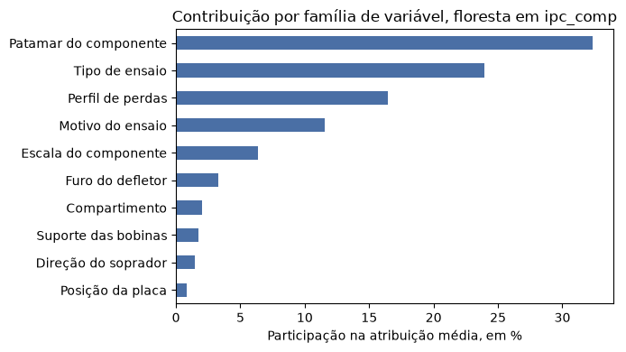<br>
  <p><b>Fonte:</b> Elaborado pelos autores, 2026</p>
</div>

A Imagem 27 é o gráfico de dispersão SHAP (beeswarm) do modelo entregue no IPC Comp, com as perdas agrupadas e o peso junto ao limite (Seção 13.2 do notebook), e mostra o sentido do efeito de cada variável. Cada ponto é uma leitura: à direita da linha central, a variável aumentou a temperatura prevista, e à esquerda, diminuiu, em °C. O vermelho indica valor alto ou indicador ativo, e o azul, valor baixo ou inativo. Os efeitos seguem o sentido físico esperado: patamar alto, o ensaio broil qualitative e o perfil de perdas simone elevam a previsão, e a ausência de perdas a reduz.

<div align="center">
  <p><b> Imagem 27 -</b> Gráfico de dispersão SHAP do modelo entregue no IPC Comp</p>
  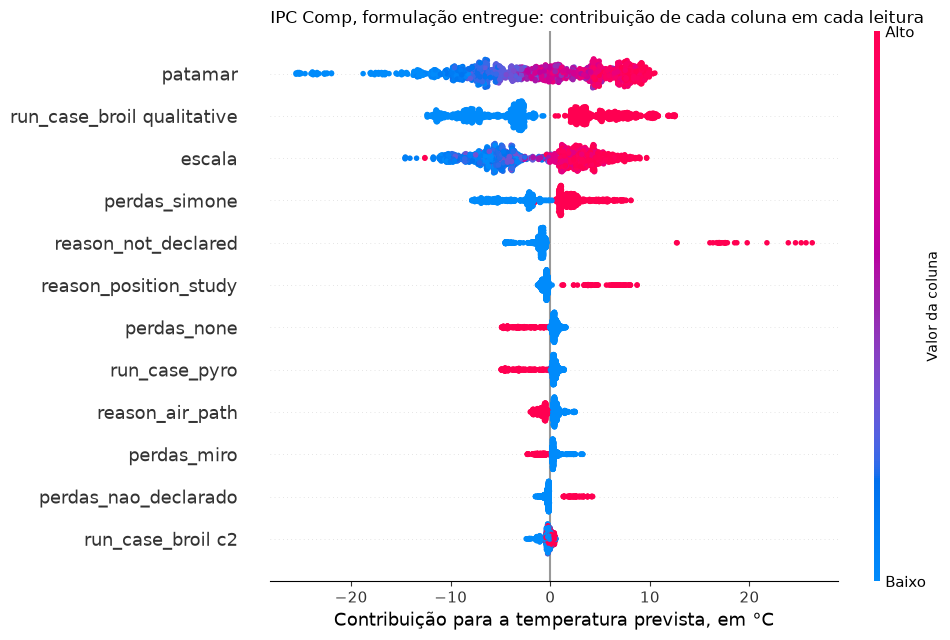<br>
  <p><b>Fonte:</b> Elaborado pelos autores, 2026</p>
</div>

A Imagem 28 compara cada área entre a Sprint 3 (ponto cinza) e a Sprint 4 (ponto azul), no erro médio absoluto, à esquerda, em que menor é melhor, e no R², à direita, em que maior é melhor (Seção 13.1 do notebook). A linha verde indica melhora, a vermelha indica piora, e o número entre parênteses é a variação. O erro caiu nas sete áreas, com os maiores ganhos no Mainback (−1,55 °C), no Coil Temps (−1,51 °C) e no Main Vent Sys (−0,94 °C), e o R² só recuou no CT Knobs, em 0,02. Os valores da Sprint 4 são o melhor resultado medido em cada área, e não os da formulação entregue do item e; onde esse resultado é o Gradient Boosting ajustado, ele carrega o viés de seleção discutido naquele item.

<div align="center">
  <p><b> Imagem 28 -</b> Erro médio absoluto e R² por área, Sprint 3 e Sprint 4</p>
  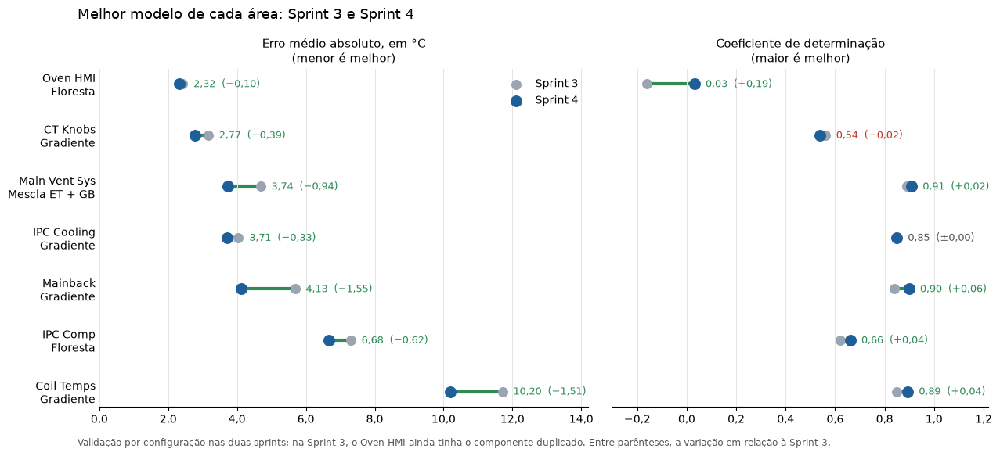<br>
  <p><b>Fonte:</b> Elaborado pelos autores, 2026</p>
</div>

#### h) Limitações da comparação

Três limitações acompanham os resultados desta seção. A primeira é o tamanho da base: os 46 ensaios de desenvolvimento correspondem a apenas dezessete configurações distintas, o que limita a precisão de qualquer comparação entre modelos, e diferenças de poucos centésimos de grau não devem ser lidas como vantagem real. A segunda é que os números por área das tabelas de resultados vêm de uma única semente aleatória, e a oscilação entre sementes, medida nesta base, é da ordem de centésimos de grau. A terceira é que os erros do Gradient Boosting ajustado e do melhor modelo por área são otimistas, pelo viés de seleção discutido acima, e só a faixa da formulação entregue foi medida com essa correção.

### 4.5. Avaliação

Esta seção avalia o modelo final contra os critérios definidos com a parceira na Seção 4.1, e não apenas pelo desempenho estatístico, como prevê a etapa de avaliação do CRISP-DM (Seção 3.3.5). O item a descreve a solução final e justifica a escolha; o item b confronta o resultado com os critérios de sucesso e com as personas; o item c define o plano de contingência para quando o modelo falhar; o item d discute a explicabilidade; e o item e verifica as hipóteses da Seção 4.2.3.

O modelo final é executado de ponta a ponta, com validação cruzada, teste reservado e exemplo de triagem, no notebook notebooks/modelo_final/modelo_final.ipynb. O caminho que levou até ele está descrito em notebooks/modelo_final/guia_modelo_final.ipynb.

#### a) Solução final e justificativa da escolha

Este item descreve o modelo final escolhido, como sua previsão é convertida em veredito de segurança, o desempenho medido e as razões que levaram à escolha dessa formulação.

##### O que é o modelo final

O modelo final é a formulação entregue descrita na Seção 4.4, item e: **sete modelos, um por área térmica**, que estimam a temperatura de cada componente a partir das decisões de projeto de uma configuração de fogão. Em cada área, o modelo recebe os atributos de configuração e dois atributos do componente, calculados apenas com os dados de treino: o **patamar**, que é a média das temperaturas do componente, e a **escala**, que é o seu desvio-padrão. A saída é a temperatura prevista em °C. Todos os estimadores usam 300 árvores e os demais hiperparâmetros no padrão do scikit-learn.

Dois ajustes completam a receita. A codificação das perdas é escolhida por área, entre os treze indicadores detalhados e quatro níveis agrupados. E o treino dá peso maior às leituras próximas do limite de cada componente, onde a decisão de triagem acontece. Sendo $y$ a temperatura medida e $L$ o limite do componente, o peso de cada leitura é:

$$
w = 1 + 2\,e^{-\left(\frac{|y - L|}{15}\right)^{2}}
$$

Uma leitura sobre o limite pesa 3, e uma leitura a 30 °C dele pesa praticamente 1. Componentes sem limite tabelado recebem peso 1.

| Área | Estimador | Codificação das perdas | Erro absoluto médio | Previsões dentro de 10% | Área viável no dashboard |
|---|---|---|---:|---:|---|
| Oven HMI | Random Forest | Agrupada | 2,32 °C | 93,1% | Sim |
| CT Knobs | Random Forest | Detalhada | 3,05 °C | 85,8% | Sim |
| Main Vent Sys | Mescla Extra Trees + Gradient Boosting | Detalhada | 3,74 °C | 88,0% | Sim |
| IPC Cooling | Random Forest | Agrupada | 4,07 °C | 79,5% | Sim |
| Mainback | Random Forest | Detalhada | 4,59 °C | 79,4% | Sim |
| IPC Comp | Random Forest | Agrupada | 6,68 °C | 73,4% | Sim |
| Coil Temps | Mescla Random Forest + Gradient Boosting | Detalhada | 10,61 °C | 69,0% | Não |
| Agregado | — | — | 5,96 a 6,23 °C | 77,0% | 6 de 7 áreas |

Valores da validação cruzada por configuração, médias de três sementes (Seção 4.4, item e). Por área, o erro corresponde ao método aninhado aproximado; no agregado, à faixa entre os métodos aproximado e estrito. A viabilidade segue o critério do dashboard descrito no item c.

##### Da previsão à decisão

A temperatura prevista é convertida em veredito pela regra de projeto da Whirlpool, que aprova apenas componentes com temperatura de até 90% do limite. Sendo $\hat{y}$ a temperatura prevista e $L$ o limite do componente, a folga é $f = L - \hat{y}$, e o dashboard classifica cada componente como:

$$
\text{veredito} =
\begin{cases}
\text{seguro}, & \text{se } f \geq 0{,}1\,L \\
\text{atenção}, & \text{se } 0 \leq f < 0{,}1\,L \\
\text{crítico}, & \text{se } f < 0
\end{cases}
$$

A configuração é aprovada quando todos os componentes com limite ficam como seguros. Componentes sem limite tabelado são apenas monitorados e não entram na decisão. A regra está implementada em src/frontend/previsao.py e em src/frontend/js/telas/visaoGeral.js.

##### Desempenho

- **Validação cruzada:** erro absoluto médio entre 5,96 e 6,23 °C, conforme o método de aninhamento, e erro percentual médio de 7,6%.
- **Teste reservado:** erro absoluto médio de 5,15 °C e erro percentual médio de 5,8% (notebook modelo_final.ipynb).
- **Triagem:** com margem de 8 °C, a detecção de excessos de limite fica entre 83,2% e 87,9% na validação, conforme o método.

##### Por que esta formulação foi escolhida

1. **Ela foi medida da forma que será usada.** A validação retira uma configuração experimental inteira por vez (Seção 4.3, item A.7), de modo que o erro reportado é o de prever um fogão cuja configuração o modelo nunca viu, que é o uso pretendido.
2. **Ela não depende de ajustes que não se sustentaram.** A busca de hiperparâmetros parecia render 0,506 °C, mas rendeu 0,051 °C sob validação aninhada, e o Gradient Boosting ajustado passou de ganho de 0,107 °C para perda de 0,448 °C pelo método estrito (Seção 4.4, itens c e e). Por isso, os hiperparâmetros ficaram no padrão.
3. **Ela melhora o modelo anterior na validação cruzada, que é a leitura adotada pelo projeto.** Em relação à Sprint 3, o erro agregado caiu de 6,57 °C para 5,96 a 6,23 °C, e as aprovações indevidas, de 36 para 23,3 a 32,3 (Seção 4.4, item e). No teste reservado, o sentido se inverte: o erro passa de 4,37 °C para 5,15 °C, e as aprovações indevidas, de 6 para 12 (relatório da sprint, seção 9.2). As duas comparações cruzam bases diferentes, e o teste reservado não tem ensaios de broil c1 nem com suporte de bobina em plástico, e tem um só de pyro. Por isso, o projeto adota a validação cruzada como leitura conservadora (Seção 4.3, item A.7; relatório da sprint, seções 5.3 e 9.6).
4. **Ela prioriza a região onde a decisão acontece.** O peso maior para as leituras próximas do limite reduziu as aprovações indevidas em 21%, sem custo apreciável no erro médio, ainda que o efeito não tenha se reproduzido no teste reservado (relatório da sprint, documents/extras/relatorios_sprint_4/relatorioS4.md, seção 16).

#### b) Atendimento aos requisitos do negócio e às personas

Este item confronta o resultado do modelo com os critérios de sucesso firmados com a Whirlpool e verifica em que medida a solução atende ao que cada persona pediu.

##### Critérios de sucesso

A tabela confronta o resultado com os critérios de sucesso firmados com a parceira (Seção 4.1.3) e com o objetivo de atender às duas arquiteturas (Seção 2.1, objetivo 5). Os ganhos de tempo e de custo só podem ser medidos depois que a solução estiver em uso, na implantação (Seção 2.1); aqui se verificam as condições que os tornam possíveis.

| Critério | Meta | Resultado | Situação |
|---|---|---|---|
| Velocidade | Assessment térmico de cerca de três semanas para menos de um dia | A previsão de uma configuração sai em segundos no dashboard, sem ocupar licença de simulação | Atendido no que depende do modelo |
| Precisão | Erro de até 10% | Erro percentual médio de 7,6% na validação e de 5,8% no teste; 77,0% das previsões dentro de 10% na validação e 82,6% no teste; Coil Temps com 69,0% | Atendido na média, não em todas as leituras |
| Confiabilidade | Alertar sempre que um componente se aproxima do limite | Na validação, detecção de 83,2% a 87,9% dos 193 excessos, com 23,3 a 32,3 sem alarme; no teste, 12 dos 63 excessos sem alarme | Parcial: exige o plano de contingência do item c |
| Escalabilidade | Retreino pela própria Whirlpool | Uma nova planilha passa pelos notebooks de preparação e tratamento, e o src/frontend/dados/exportar.py retreina os modelos e recalcula as métricas e a viabilidade de cada área | Atendido |
| Duas arquiteturas | Linhas brasileira e mexicana | A linha do México aparece como indisponível no dashboard, porque nenhum ensaio dessa linha foi exportado dos notebooks | Não atendido com a base atual |

Os números de confiabilidade usam a margem de 8 °C da comparação de modelos. A regra de projeto aplicada no dashboard é mais conservadora que essa margem para a maior parte dos componentes (Seção 4.4, item a).

##### Personas

| Persona (Seção 4.1.6) | O que pediu | O que a solução entrega |
|---|---|---|
| Sandra, Engenharia | Resultado com margem de incerteza e com indicação dos casos que o sustentam; simulação completa disponível para casos fora do padrão | Incerteza de cada componente (± erro absoluto médio na validação) ao lado da previsão; número de campos em que a configuração difere do ensaio mais próximo da base; importância das variáveis por área no dashboard e explicação SHAP nos notebooks (item d); o modelo atua como triagem, e os casos limítrofes seguem para a CFD |
| Henrique, Qualidade | Saber de antemão quais componentes operam perto do limite, com o limite visível ao lado do valor | Veredito por componente, com o limite e a porcentagem do limite; lista dos componentes reprovados, separando os que passam do limite dos que apenas invadem a margem de 10%. A linha do México, em que ele atua, ainda não está disponível |
| Diego, Marketing e Produto | Leitura em poucos segundos, sem vocabulário de simulação, com Brasil e México na mesma tela | Veredito de aprovado ou reprovado em linguagem direta, com menus e rótulos em português, inglês e espanhol; a linha do México ainda não está disponível |
| Rafael, Design Industrial, e Adriana, Engenharia de Custo | Conformidade e folga dentro da janela de decisão, comparando duas ou três alternativas | Previsão em segundos, com a folga de cada componente; o dashboard compara até três ensaios do histórico lado a lado, mas configurações novas são previstas uma de cada vez |

#### c) Plano de contingência

O modelo pode falhar de duas formas. A primeira é errar a temperatura por muitos graus. A segunda, de maior custo, é **subestimar um componente perto do limite** e aprová-lo indevidamente, o risco R06 da Seção 4.1.5. O item b mostra que isso acontece com parte dos excessos de limite, tanto na validação quanto no teste reservado.

O plano parte da delimitação firmada na Seção 4.1.4: **o modelo é triagem e não substitui a simulação CFD nem os ensaios de certificação**. A responsabilidade pelo parecer continua com a engenharia. A tabela lista as situações de risco, como cada uma é identificada e a resposta prevista.

| Situação de risco | Como é identificada | Resposta prevista |
|---|---|---|
| Componente perto do limite | Veredito "atenção" (folga menor que 10% do limite), ou aviso de que a previsão chegaria à margem se o erro absoluto médio do componente fosse somado a ela | Confirmar por CFD ou ensaio antes de aprovar |
| Configuração distante do histórico | Aviso de extrapolação quando a configuração difere em 3 ou mais dos 7 campos do ensaio mais próximo da base | Não usar o veredito como decisão; encaminhar à CFD |
| Área com desempenho abaixo do alvo | A tela de testes e o parecer exportado marcam a área como não viável: hoje, Coil Temps, que tem a menor proporção de previsões dentro de 10% (69,0%) e a menor detecção de excessos entre as áreas (74,7%) | Usar as previsões da área apenas como referência; decidir por CFD ou ensaio |
| Regime pouco representado | Configuração com broil c1 ou com suporte de bobina em plástico, condições ausentes do teste reservado (Seção 4.3, item A.7), ou com pyro, presente em um único ensaio do teste (notebook modelo_final.ipynb) | Tratar a previsão com cautela; os ensaios adicionais já foram solicitados à parceira |
| Previsão diverge do ensaio físico | Confronto entre o previsto e o medido, quando o ensaio é realizado | Incorporar o ensaio à base e retreinar com o exportar.py; a versão do modelo que fez a previsão é gravada com cada configuração salva |
| Modelo indisponível | A rota de previsão devolve erro, com a instrução para regravar os modelos | Seguir pelo processo atual, com CFD, e regravar os modelos com o exportar.py |

Dois mecanismos sustentam a tabela.

**Viabilidade por área.** Uma área é considerada viável quando ao menos 70% das previsões ficam dentro de 10% e as aprovações indevidas, contadas aqui contra o próprio limite, não passam de 5% das previsões (src/frontend/dados/exportar.py). Com esses valores, Coil Temps é a única área não viável: 69,8% das previsões dentro da margem na exportação do dashboard, feita com uma semente, e 69,0% na média de três sementes.

**Reprodução conferida e retreino.** Na base original, o exportar.py reproduz a validação cruzada antes de gravar os modelos e interrompe a exportação se o erro de alguma área divergir mais de 0,1 °C do registrado na Seção 23 de notebooks/colabs_S4/modelagem.ipynb. Isso garante que o dashboard usa a mesma formulação avaliada nesta seção. Ao exportar uma base nova, essa conferência é desligada, porque os valores de referência deixam de valer, e as métricas e a viabilidade de cada área são recalculadas sobre a nova base.

Fica registrada uma lacuna em relação ao plano do risco R06, que previa aplicar a regra de aprovação sobre o limite superior do intervalo de previsão. O veredito do dashboard usa a previsão central e apenas avisa quando a incerteza levaria o componente à margem. Aplicar a regra sobre a previsão somada à incerteza é o passo seguinte para reduzir as aprovações indevidas.

#### d) Explicabilidade

A explicabilidade responde ao risco de baixa adoção (R08, Seção 4.1.5) e à condição da persona da Engenharia, que não aceita um número que não consiga defender em reunião. Ela é tratada em dois níveis: o que o modelo aprendeu, no conjunto das previsões, e o que sustenta cada previsão individual.

##### O que o modelo aprendeu

No modelo entregue do IPC Comp, área que concentra metade das leituras, os valores SHAP (LUNDBERG; LEE, 2017) mostram que as variáveis de maior peso são o patamar do componente, o ensaio broil qualitative, a escala do componente e o perfil de perdas simone (Imagem 27, Seção 4.4, item g; Seção 13.2 de notebooks/colabs_S4/comparacao_modelos_final.ipynb). O sentido dos efeitos é o esperado fisicamente: patamar alto, broil qualitative e perdas simone elevam a temperatura prevista, e a ausência de perdas a reduz. Uma coluna exige cuidado: `reason_not_declared` está ativa num único ensaio de desenvolvimento do IPC Comp e funciona como marcador dele, de modo que o efeito que ela mostra no gráfico não se transfere para um ensaio novo (mesma seção do notebook).

Uma auditoria por SHAP nas sete áreas foi feita em notebooks/colabs_S3/analise_dataset/pipeline_custo_shap.ipynb, sobre os modelos de uma etapa anterior de busca de hiperparâmetros, com a mesma representação por patamar e escala. A tabela mostra as três famílias de maior peso na média das áreas.

| Área | Patamar e escala do componente | Tipo de ensaio | Perdas declaradas |
|---|---:|---:|---:|
| Oven HMI | 34,2% | 6,5% | 20,1% |
| CT Knobs | 52,3% | 12,4% | 6,9% |
| Main Vent Sys | 67,8% | 5,2% | 11,4% |
| IPC Cooling | 74,2% | 3,2% | 4,0% |
| Mainback | 69,8% | 6,0% | 7,2% |
| IPC Comp | 40,0% | 19,6% | 9,2% |
| Coil Temps | 30,3% | 33,4% | 20,1% |
| Média | 52,7% | 12,3% | 11,3% |

A leitura é coerente com o produto. Em seis das sete áreas, a família de maior peso é o patamar e a escala, isto é, a posição física do ponto de medição. A exceção é Coil Temps, em que o tipo de ensaio pesa mais, o que corresponde a componentes aquecidos pela potência dissipada nas bobinas. Em Mainback, o estudo por elementos finitos apontou o caminho do ar de exaustão como mecanismo dominante, o que é coerente com o fato de essa ser a região que mais ganha com o agrupamento do motivo do ensaio (relatório da sprint, seção 10.7). A auditoria não encontrou variável fisicamente implausível entre as de maior peso (relatório da sprint, seção 5.6).

##### O que sustenta cada previsão

Ao lado de cada previsão, o dashboard mostra três informações que permitem ao usuário julgá-la:

- a **incerteza** do componente, igual ao seu erro absoluto médio na validação cruzada, exibida como ± ao lado da temperatura prevista;
- o **limite** do componente e a porcentagem do limite que a previsão atinge;
- a **distância até o ensaio mais próximo** da base, que indica se a previsão é interpolação ou extrapolação.

Além disso, a tela de visualização mostra a **importância das variáveis** de cada área, exportada pelo exportar.py.

##### Limites da explicação

Os valores SHAP explicam como o modelo chega às previsões, e não provam relação de causa no produto. O SHAP do modelo entregue foi calculado apenas para o IPC Comp, e a auditoria das sete áreas usa modelos de uma etapa anterior. A importância exibida no dashboard é medida pela redução de impureza das árvores, que favorece variáveis contínuas como o patamar e a escala (Seção 4.3, item D.5).

#### e) Verificação das hipóteses

As três hipóteses da Seção 4.2.3 foram formuladas a partir da exploração dos dados. Aqui elas são confrontadas com o que o modelo aprendeu e com os resultados da modelagem.

| Hipótese | Veredito | Evidência principal |
|---|---|---|
| 1. A área do produto é o fator com maior poder explicativo | Aceita parcialmente | A área orientou a separação dos modelos, mas o componente, divisão mais fina que a área, explica mais; dentro das áreas, patamar e escala pesam 52,7% em média |
| 2. O tipo de ensaio determina o patamar da temperatura | Aceita parcialmente | Decisivo em Coil Temps (33,4%) e relevante em IPC Comp (19,6%); peso de 3,2% a 12,4% nas outras cinco áreas |
| 3. A distância até o limite é mais relevante que a temperatura absoluta | Aceita | O erro em graus e a decisão de segurança divergem: um modelo com erro maior produziu menos aprovações indevidas |

##### Hipótese 1: aceita parcialmente

A área separa bem a temperatura, respondendo por 43,6% da sua variância (Seção 4.2.3), e a modelagem seguiu a recomendação da hipótese, com um modelo por área (Seção 4.3, item A.2). Mas ela não é o fator de maior poder explicativo. Como cada componente pertence a uma única área, separar as leituras por componente é uma divisão mais fina que separar por área e, por isso, explica pelo menos a mesma parte da variância. É essa informação que o modelo usa: dentro de cada área, patamar e escala do componente são a família de maior peso na explicação SHAP, com 52,7% em média, e o patamar é a variável de maior peso no modelo entregue do IPC Comp. A medição da Seção 4.3, item C.1, mostra o mesmo efeito em erro: sem patamar e escala, o erro chega a 14,02 °C; com o patamar, cai para 7,17 °C; e com patamar e escala, para 6,57 °C.

##### Hipótese 2: aceita parcialmente

O tipo de ensaio determina o patamar nas áreas aquecidas pela potência elétrica. Em Coil Temps, é a família de maior peso na auditoria SHAP (33,4%). A Seção 4.3, item D.4, chega à mesma conclusão por outra medida, a importância por redução de impureza no modelo da Sprint 3: ali, tipo de ensaio e perfil de perdas somam 87,4% da importância das variáveis de projeto. Em IPC Comp, pesa 19,6% na auditoria, e o ensaio broil qualitative está entre as variáveis de maior efeito no modelo entregue (Imagem 27). Nas outras cinco áreas, o peso fica entre 3,2% e 12,4%, e a posição do componente domina.

Há uma limitação de delineamento: na base, todo ensaio pyro tem perdas declaradas como nenhuma, e todo ensaio sem perdas é pyro (relatório da sprint, seção 8.2). Por isso, o efeito do pyro não pode ser separado do efeito da ausência de perdas.

##### Hipótese 3: aceita

A hipótese orientou a forma de avaliar o modelo. A previsão é feita em graus, e o veredito é derivado do limite de cada componente (Seção 4.3, item A.1). Além do erro médio, o modelo foi escolhido também pelas aprovações indevidas e pela detecção (Seção 4.4, item a).

Os resultados confirmam que erro em graus e decisão de segurança são grandezas diferentes:

- no Coil Temps, o modelo físico reduzido errou mais que o modelo de produção, 10,21 °C contra 9,06 °C, e produziu menos aprovações indevidas, 2 contra 13 (Seção 4.3, item D.3);
- o peso maior para as leituras próximas do limite reduziu as aprovações indevidas em 21%, praticamente sem alterar o erro médio (relatório da sprint, seção 16).

Um ponto delimita a hipótese: o limite é relevante para a decisão, e não como entrada do modelo. Incluir o limite do componente e a contagem de fatores entre as variáveis rendeu 0,041 °C com a regra fixa, mas custou 0,065 °C quando a seleção aninhada foi refeita, e a mudança foi revertida (relatório da sprint, seção 16). A Imagem 25, na Seção 4.2.3, ilustra por que a mesma temperatura pode representar situações opostas de risco.

##### Síntese

O modelo final atende ao critério de velocidade e ao de precisão na média, e mostra ao usuário a incerteza, o limite e a distância ao histórico de cada previsão, dentro dos limites de explicação descritos no item d. O ponto fraco é a confiabilidade junto ao limite. Quase metade das aprovações indevidas da validação está no IPC Comp, a área com mais leituras (11,0 de 23,3), e a menor detecção de excessos está em Coil Temps (74,7%). É a esses casos que se dirige o plano de contingência.

## <a name="c5"></a>5. Conclusões e Recomendações

Esta seção apresenta as conclusões do projeto e as recomendações formais à Whirlpool para o uso do modelo preditivo. A Subseção 5.1 resume os principais resultados, a 5.2 retoma as hipóteses da Seção 4.2.3 à luz desses resultados, a 5.3 reúne as recomendações de uso e as recomendações nas três frentes solicitadas pela parceira, a 5.4 trata das pessoas afetadas pelas decisões do modelo e a 5.5 indica os materiais complementares.

### 5.1 Principais resultados

Esta subseção apresenta o que o projeto entregou e em que medida o resultado atende aos critérios de sucesso firmados com a parceira. A solução é composta por sete modelos, um por área térmica do fogão, que estimam a temperatura de cada componente a partir das decisões de projeto de uma configuração. A estimativa é convertida em veredito pela regra de projeto da Whirlpool, que aprova apenas componentes com temperatura de até 90% do limite. Quanto aos algoritmos, o Random Forest é usado em cinco áreas, e as mesclas com Gradient Boosting em Coil Temps e Main Vent Sys. Todos os modelos usam hiperparâmetros padrão, uma vez que a busca de hiperparâmetros não sustentou ganho sob validação aninhada (Seção 4.4, item e).

Na validação cruzada por configuração, o erro absoluto médio ficou entre 5,96 e 6,23 °C, com erro percentual médio de 7,6% e 77,0% das previsões dentro de 10%. No teste reservado, os valores foram de 5,15 °C, 5,8% e 82,6%. O critério de precisão é, portanto, atendido na média, mas não em todas as leituras. O critério de velocidade é atendido no que depende do modelo, já que a previsão de uma configuração sai em segundos no dashboard, frente a cerca de três semanas do assessment atual (Seção 4.5, item b). Seis das sete áreas cumprem o critério de viabilidade, e a exceção é Coil Temps, com 69,0% das previsões dentro de 10% (Seção 4.5, item c).

O ponto fraco é a confiabilidade junto ao limite. Na validação, o modelo detectou de 83,2% a 87,9% dos 193 excessos de limite, e de 23,3 a 32,3 deles ficaram sem alarme. No teste reservado, 12 dos 63 excessos não foram sinalizados. Quase metade das aprovações indevidas da validação se concentra no IPC Comp (11,0 de 23,3), e a menor detecção ocorre em Coil Temps (74,7%). A linha mexicana não está coberta, pois nenhum ensaio dessa linha foi exportado dos notebooks. Por fim, esses resultados delimitam o papel do modelo: trata-se de uma ferramenta de triagem, que não substitui a simulação CFD nem os ensaios de certificação (Seção 4.1.4).

### 5.2 Verificação das hipóteses

Esta subseção retoma as três hipóteses formuladas na Seção 4.2.3, cuja verificação detalhada está na Seção 4.5, item e. Duas foram aceitas parcialmente e uma foi aceita.

A Hipótese 1, de que a área do produto é o fator de maior poder explicativo sobre a temperatura, foi aceita parcialmente. A área responde por 43,6% da variância da temperatura e orientou a decisão de treinar um modelo por área. Contudo, o componente, por ser uma divisão mais fina que a área, explica ao menos a mesma parte da variância. Dentro de cada área, o patamar e a escala do componente concentram, em média, 52,7% da explicação SHAP (LUNDBERG; LEE, 2017).

A Hipótese 2, de que o tipo de ensaio determina o patamar da temperatura, também foi aceita parcialmente. O tipo de ensaio é decisivo nas áreas aquecidas pela potência elétrica, com 33,4% da explicação em Coil Temps e 19,6% em IPC Comp, mas pesa entre 3,2% e 12,4% nas outras cinco áreas. Além disso, como todo ensaio pyro da base tem perdas declaradas como nenhuma, o efeito do pyro não pode ser separado do efeito da ausência de perdas.

A Hipótese 3, de que a distância até o limite é mais relevante para o problema do que a temperatura absoluta, foi aceita. Erro em graus e decisão de segurança se mostraram grandezas distintas. Em Coil Temps, o modelo físico reduzido errou mais que o modelo de produção, 10,21 °C contra 9,06 °C, e ainda assim produziu menos aprovações indevidas, 2 contra 13. Da mesma forma, o peso maior para as leituras próximas do limite reduziu as aprovações indevidas em 21%, praticamente sem alterar o erro médio. O limite, contudo, é relevante para a decisão, e não como entrada do modelo, já que incluí-lo entre as variáveis piorou o erro sob seleção aninhada.

### 5.3 Recomendações à Whirlpool

Esta subseção reúne as recomendações formais à parceira. Começa pelas condições de uso do modelo e segue pelas três frentes solicitadas no Project Charter (WHIRLPOOL CORPORATION, 2026).

Quanto ao uso, recomenda-se adotar o modelo como etapa de triagem que antecede a fila de CFD, com o parecer final mantido sob responsabilidade da engenharia. Alguns casos devem seguir para CFD ou ensaio antes da aprovação, conforme o plano de contingência (Seção 4.5, item c), componentes com veredito de atenção, configurações que diferem em três ou mais dos sete campos do ensaio mais próximo da base e configurações com broil c1, suporte de bobina em plástico ou pyro. Em Coil Temps, as previsões devem servir apenas como referência até que a área atinja o critério de viabilidade. Ademais, a linha mexicana não deve ser avaliada pelo modelo até que seus ensaios sejam incorporados à base.

Na frente de seleção de algoritmos, recomenda-se manter a formulação entregue, com hiperparâmetros padrão, e só reabrir a busca de hiperparâmetros sob validação aninhada. O motivo é que o ganho aparente de 0,506 °C caiu para 0,051 °C quando o viés de seleção foi corrigido (Seção 4.4, item c). O passo seguinte de maior retorno é aplicar a regra de aprovação sobre a previsão somada à incerteza do componente, o que fecha a lacuna registrada em relação ao risco R06 (Seção 4.5, item c). Os esforços de melhoria devem se concentrar em IPC Comp e Coil Temps, que reúnem as falhas junto ao limite. O modelo físico reduzido não deve ser adotado antes que sejam atendidas as três condições listadas na Seção 4.3, item D.5.

Na frente de arquitetura de dados, a recomendação central é ampliar e padronizar a base. Os ensaios adicionais já solicitados, em broil c1 e com suporte de bobina em plástico, em particular combinado ao broil c2, cobrem as condições ausentes do teste reservado (Seção 4.3, item A.7). A eles devem se somar ensaios que desfaçam a coincidência entre o modo pyro e a ausência de perdas declaradas, além da exportação dos ensaios da linha mexicana. Os novos registros devem seguir vocabulário controlado para as categorias de configuração e separar o limite de segurança das referências de monitoramento. As inconsistências exigiram, neste projeto, normalização de grafia e esclarecimentos da parceira (Seção 4.2.2.1 e Seção 4.3, item A.4). Por fim, recomenda-se adotar o registro estruturado de cada consulta e de cada ensaio pelo dashboard (Seção 4.1.5, oportunidade O04) e retreinar o modelo periodicamente com o exportar.py, que grava a versão responsável por cada previsão.

Na frente de visualização, recomenda-se preservar, em qualquer evolução do dashboard, a exibição da incerteza, do limite e da distância ao histórico ao lado de cada previsão. São essas as informações que permitem ao usuário julgar o veredito (Seção 4.5, item d). Recomenda-se também manter a separação entre as visões técnica e não técnica, especificadas nos Anexos II e III. Por último, convém permitir a comparação lado a lado de configurações novas, já que essa é a lacuna em relação às personas de Design e de Engenharia de Custo (Seção 4.5, item b).

### 5.4 Pessoas afetadas e recomendações éticas

Esta subseção apresenta as pessoas potencialmente afetadas pelas decisões do modelo e as recomendações para que a parceira trate cada grupo de forma estratégica e ética. Os grupos partem das personas da Seção 4.1.6 e incluem o consumidor final, que não opera a ferramenta, mas é quem fica exposto às consequências de uma aprovação indevida.

O primeiro grupo é o das áreas que decidem a partir do veredito. Para a engenharia de simulação, representada por Sandra, o modelo altera a natureza do trabalho, pois a fila de CFD passa a receber os casos limítrofes e fora do padrão. Recomenda-se que a capacidade liberada seja direcionada a esses casos e à validação das previsões, já que é esse grupo que gera os dados de retreino e responde tecnicamente pelo parecer. Para a Qualidade, representada por Henrique, o erro de maior custo é a aprovação indevida, que no ensaio de segurança passa a ser falha de segurança (Seção 4.1.5, risco R06). Por isso, o modelo pode orientar quais componentes priorizar na bancada, mas não deve reduzir os ensaios de certificação. Para Marketing e Produto, Design Industrial e Engenharia de Custo, representados por Diego, Rafael e Adriana, o risco é de confiança excessiva. Essas personas recebem o veredito já interpretado, sem o detalhe técnico que permitiria questioná-lo. Recomenda-se, portanto, que o veredito de aprovação não seja comunicado ao varejo nem homologado como premissa de custo antes da confirmação pela engenharia nos casos de atenção, e que essas áreas recebam capacitação sobre o significado da incerteza e dos avisos do dashboard.

O segundo grupo é o da operação mexicana. Henrique e Adriana atuam a partir dela, e a linha mexicana não está coberta pela base atual (Seção 5.1). Recomenda-se que a ferramenta não seja apresentada às equipes do México como validada para a linha delas até que os ensaios correspondentes sejam incorporados e o desempenho seja medido. Do contrário, a solução trataria as duas arquiteturas de forma desigual, contrariando o objetivo 5 da Seção 2.1.

O terceiro grupo é o do consumidor final, para quem a segurança térmica do fogão não pode depender de uma previsão estatística. As recomendações que o protegem são as que mantêm o parecer final sob responsabilidade humana e a certificação inalterada (Seção 5.3). Somam-se a elas o acompanhamento contínuo do confronto entre o previsto e o medido, com atenção específica às aprovações indevidas, e a revisão periódica dos critérios de viabilidade por área. Essas medidas respondem também ao risco de baixa adoção (Seção 4.1.5, risco R08), uma vez que a confiança dos usuários depende de a ferramenta mostrar onde erra, e não apenas onde acerta.

### 5.5 Materiais complementares

Esta subseção indica os materiais que complementam este documento. Os Anexos II e III especificam os requisitos funcionais das visões técnica e não técnica do dashboard, e o Anexo I registra o teste de normalidade e o escalonamento das variáveis quantitativas. O modelo final é executado de ponta a ponta no notebook notebooks/modelo_final/modelo_final.ipynb, e o caminho que levou até ele está descrito em notebooks/modelo_final/guia_modelo_final.ipynb. Os apontamentos recebidos ao longo das sprints e as correções correspondentes estão consolidados em pastas no endereço documents/extras/.

## <a name="c6"></a>6. Referências
ASSOCIAÇÃO BRASILEIRA DE NORMAS TÉCNICAS (ABNT). NBR ISO 31000: gestão de riscos — diretrizes. Rio de Janeiro: ABNT, 2018.

BERGMAN, Theodore L.; LAVINE, Adrienne S.; INCROPERA, Frank P.; DEWITT, David P. Fundamentos de transferência de calor e de massa. 7. ed. Rio de Janeiro: LTC, 2014.

BERGSTRA, James; BENGIO, Yoshua. Random search for hyper-parameter optimization. Journal of Machine Learning Research, v. 13, p. 281-305, 2012.

BRASIL. Lei nº 12.965, de 23 de abril de 2014. Marco Civil da Internet. Diário Oficial da União, Brasília, DF, 24 abr. 2014.

BRASIL. Lei nº 13.709, de 14 de agosto de 2018. Lei Geral de Proteção de Dados Pessoais (LGPD). Diário Oficial da União, Brasília, DF, 15 ago. 2018.

BREIMAN, Leo. Random forests. Machine Learning, v. 45, n. 1, p. 5-32, 2001.

BUSSAB, W. O.; MORETTIN, P. A. Estatística básica. 10. ed. São Paulo: Saraiva, 2024.

CAWLEY, Gavin C.; TALBOT, Nicola L. C. On over-fitting in model selection and subsequent selection bias in performance evaluation. Journal of Machine Learning Research, v. 11, p. 2079-2107, 2010.

CHAPMAN, Pete; CLINTON, Julian; KERBER, Randy; KHABAZA, Thomas; REINARTZ, Thomas; SHEARER, Colin; WIRTH, Rüdiger. CRISP-DM 1.0: step-by-step data mining guide. [S. l.]: CRISP-DM Consortium, 2000. Disponível em: https://public.dhe.ibm.com/software/analytics/spss/documentation/modeler/14.2/es/CRISP-DM.pdf. Acesso em: 1 set. 2026.

DIETTERICH, Thomas G. Approximate statistical tests for comparing supervised classification learning algorithms. Neural Computation, v. 10, n. 7, p. 1895-1923, 1998.

FAYYAD, Usama; PIATETSKY-SHAPIRO, Gregory; SMYTH, Padhraic. From data mining to knowledge discovery in databases. AI Magazine, v. 17, n. 3, p. 37-54, 1996. Disponível em: https://doi.org/10.1609/aimag.v17i3.1230. Acesso em: 9 set. 2026.

FRIEDMAN, Jerome H. Greedy function approximation: a gradient boosting machine. The Annals of Statistics, v. 29, n. 5, p. 1189-1232, 2001.

GEURTS, Pierre; ERNST, Damien; WEHENKEL, Louis. Extremely randomized trees. Machine Learning, v. 63, n. 1, p. 3-42, 2006.

GIBBONS, Sarah. Journey Mapping 101. Nielsen Norman Group, 9 dez. 2018. Disponível em: https://www.nngroup.com/articles/journey-mapping-101/. Acesso em: 20 ago. 2026.

GOTHELF, Jeff. Lean UX: applying lean principles to improve user experience. Sebastopol: O'Reilly Media, 2013.

GÉRON, Aurélien. Mãos à obra: aprendizado de máquina com Scikit-Learn, Keras & TensorFlow. 2. ed. Rio de Janeiro: Alta Books, 2021.

GUSTAFSSON, Tom; MCBAIN, G. D. scikit-fem: a Python package for finite element assembly. Journal of Open Source Software, v. 5, n. 52, p. 2369, 2020. Disponível em: <https://doi.org/10.21105/joss.02369>. Acesso em: 17 set. 2026.

HASTIE, Trevor; TIBSHIRANI, Robert; FRIEDMAN, Jerome. The elements of statistical learning: data mining, inference, and prediction. 2. ed. New York: Springer, 2009.

KALBACH, Jim. Mapping experiences: a complete guide to creating value through journeys, blueprints, and diagrams. Sebastopol: O'Reilly Media, 2016.

KAUFMAN, Shachar; ROSSET, Saharon; PERLICH, Claudia; STITELMAN, Ori. Leakage in data mining: formulation, detection, and avoidance. ACM Transactions on Knowledge Discovery from Data, v. 6, n. 4, artigo 15, 2012.

KEN RESEARCH. Latin America Home Appliances Market Share, Companies & Trends Report 2025–2031. Disponível em: https://www.kenresearch.com/industry-reports/latin-america-home-appliances-market. Acesso em: 13 ago. 2026.

LIU, Yuce; ZHOU, Chaohui; HU, Yue; ZHANG, Wenkai; HE, Wei; GUAN, Weiwei. An ANN–CNN hybrid surrogate model for fast prediction of 3D temperature fields in large datacenter rooms. Buildings, v. 15, n. 22, p. 4042, 2025.

LUNDBERG, Scott M.; LEE, Su-In. A unified approach to interpreting model predictions. In: CONFERENCE ON NEURAL INFORMATION PROCESSING SYSTEMS, 31., 2017, Long Beach. Advances in Neural Information Processing Systems 30. Red Hook: Curran Associates, 2017. p. 4765-4774.

MARTÍNEZ-PLUMED, Fernando; CONTRERAS-OCHANDO, Lidia; FERRI, César; HERNÁNDEZ-ORALLO, José; KULL, Meelis; LACHICHE, Nicolas; RAMÍREZ-QUINTANA, María José; FLACH, Peter. CRISP-DM twenty years later: from data mining processes to data science trajectories. IEEE Transactions on Knowledge and Data Engineering, v. 33, n. 8, p. 3048-3061, 2021. Disponível em: https://doi.org/10.1109/TKDE.2019.2962680. Acesso em: 1 set. 2026.

MICCI-BARRECA, Daniele. A preprocessing scheme for high-cardinality categorical attributes in classification and prediction problems. ACM SIGKDD Explorations Newsletter, v. 3, n. 1, p. 27-32, 2001.

MONTGOMERY, D. C.; RUNGER, G. C. Estatística aplicada e probabilidade para engenheiros. 7. ed. Rio de Janeiro: LTC, 2021.

MORDOR INTELLIGENCE. Brazil Home Appliances Market Size & Share Analysis. Disponível em: https://www.mordorintelligence.com/industry-reports/brazil-home-appliances-market. Acesso em: 13 ago. 2026.

OSTERWALDER, Alexander; PIGNEUR, Yves; BERNARDA, Greg; SMITH, Alan. Value proposition design: how to create products and services customers want. Hoboken: Wiley, 2014.

PEDREGOSA, Fabian et al. Scikit-learn: machine learning in Python. Journal of Machine Learning Research, v. 12, p. 2825-2830, 2011.

PROJECT MANAGEMENT INSTITUTE (PMI). Um guia do conhecimento em gerenciamento de projetos (Guia PMBOK). 6. ed. Newtown Square: PMI, 2017.

PROVOST, Foster; FAWCETT, Tom. Data science for business: what you need to know about data mining and data-analytic thinking. Sebastopol: O'Reilly Media, 2013.

RAZALI, N. M.; WAH, Y. B. Power comparisons of Shapiro-Wilk, Kolmogorov-Smirnov, Lilliefors and Anderson-Darling tests. Journal of Statistical Modeling and Analytics, v. 2, n. 1, p. 21-33, 2011. Disponível em: https://www.nrc.gov/docs/ml1714/ml17143a100.pdf. Acesso em: 19 ago. 2026.

SCHRÖER, Christoph; KRUSE, Felix; GÓMEZ, Jorge Marx. A systematic literature review on applying CRISP-DM process model. Procedia Computer Science, v. 181, p. 526-534, 2021. Disponível em: https://doi.org/10.1016/j.procs.2021.01.199. Acesso em: 1 set. 2026.

SHAPIRO, S. S.; WILK, M. B. An analysis of variance test for normality (complete samples). Biometrika, v. 52, n. 3-4, p. 591-611, 1965. Disponível em: https://doi.org/10.1093/biomet/52.3-4.591. Acesso em: 19 ago. 2026.

WASSERSTEIN, R. L.; LAZAR, N. A. The ASA Statement on p-Values: Context, Process, and Purpose. The American Statistician, v. 70, n. 2, p. 129-133, 2016. Disponível em: https://doi.org/10.1080/00031305.2016.1154108. Acesso em: 25 ago. 2026.

WHIRLPOOL CORPORATION. Inovação. Disponível em: https://www.whirlpool.com.br/pagina/inovacao/. Acesso em: 13 ago. 2026.

WHIRLPOOL CORPORATION. Localizações no Brasil. Disponível em: https://www.whirlpoolcareers.com/work-with-us/trabalhe-conosco-no-brasil/localizacoes-no-brasil.html. Acesso em: 13 ago. 2026.

WHIRLPOOL CORPORATION. Missão, visão e valores. Disponível em: https://www.whirlpool.com.br/sustentabilidade2012/missao-visao-valores.html. Acesso em: 13 ago. 2026.

WHIRLPOOL CORPORATION. Project Charter — Ignis, Divisão Fogões (Brasil & México). Documento interno não publicado, compartilhado com o grupo em 2026.

WHIRLPOOL CORPORATION. Sobre a Whirlpool Corporation no Brasil. Disponível em: https://www.whirlpool.com.br/pagina/sobre/. Acesso em: 13 ago. 2026.

WHIRLPOOL CORPORATION. Sustentabilidade. Disponível em: https://www.whirlpool.com.br/pagina/sustentabilidade/.
 Acesso em: 13 ago. 2026.

BRAZIL ECONOMY. **O segredo da Whirlpool, dona de Brastemp e Consul, para crescer com juro alto e dólar caro**. São Paulo, abr. 2025\. Disponível em: [https://brazileconomy.com.br/empresas/2025/04/o-segredo-da-whirlpool-dona-de-brastemp-e-consul-para-crescer-com-juro-alto-e-dolar-caro/](https://brazileconomy.com.br/empresas/2025/04/o-segredo-da-whirlpool-dona-de-brastemp-e-consul-para-crescer-com-juro-alto-e-dolar-caro/). Acesso em: 8 ago. 2026\.

BRAZIL ECONOMY. **Dona de Brastemp e Consul, Whirlpool expande nacionalização e renovação de produtos**. São Paulo, jan. 2026\. Disponível em: [https://brazileconomy.com.br/empresas/2026/01/dona-de-brastemp-e-consul-whirlpool-expande-nacionalizacao-e-renovacao-de-produtos/](https://brazileconomy.com.br/empresas/2026/01/dona-de-brastemp-e-consul-whirlpool-expande-nacionalizacao-e-renovacao-de-produtos/). Acesso em: 10 ago. 2026\.  

BRAZIL ECONOMY. **Em clima de guerra e dólar instável, Whirlpool investe R$ 300 milhões em nacionalização**. São Paulo, maio 2026\. Disponível em: [https://brazileconomy.com.br/empresas/2026/05/em-clima-de-guerra-e-dolar-instavel-whirlpool-investe-r-300-milhoes-em-nacionalizacao/](https://brazileconomy.com.br/empresas/2026/05/em-clima-de-guerra-e-dolar-instavel-whirlpool-investe-r-300-milhoes-em-nacionalizacao/). Acesso em: 6 ago. 2026\.  

DIÁRIO DO COMÉRCIO. **Whirlpool, da Brastemp, fecha fábrica**. \[S. l.\], 2026\. Disponível em: [https://diariodocomercio.com.br/geral/whirlpool-da-brastemp-fecha-fabrica/](https://diariodocomercio.com.br/geral/whirlpool-da-brastemp-fecha-fabrica/). Acesso em: 6 ago. 2026\.  

ELETROS – ASSOCIAÇÃO NACIONAL DE FABRICANTES DE PRODUTOS ELETROELETRÔNICOS. **Página inicial**. São Paulo. Disponível em: [https://eletros.org.br/](https://eletros.org.br/). Acesso em: 8 ago. 2026\.  

EUROMONITOR INTERNATIONAL. **Página inicial**. Londres. Disponível em: [https://www.euromonitor.com/](https://www.euromonitor.com/). Acesso em: 6 ago. 2026\.  

IBGE – INSTITUTO BRASILEIRO DE GEOGRAFIA E ESTATÍSTICA. **Página inicial**. Rio de Janeiro. Disponível em: [https://www.ibge.gov.br/](https://www.ibge.gov.br/). Acesso em: 6 ago. 2026\.  

INVESTING.COM. **Whirlpool fica abaixo do consenso no 2º tri, mas supera projeções da empresa**. \[S. l.\], 2024\. Disponível em: [https://br.investing.com/news/earnings/whirlpool-fica-abaixo-do-consenso-no-20-tri-mas-supera-projecoes-da-empresa-93CH-2024379](https://br.investing.com/news/earnings/whirlpool-fica-abaixo-do-consenso-no-20-tri-mas-supera-projecoes-da-empresa-93CH-2024379). Acesso em: 8 ago. 2026\.  

INVESTING.COM. **Earnings call transcript: Whirlpool misses Q2 2026 estimates, but shares rise**. \[S. l.\], 2026\. Disponível em: [https://ng.investing.com/news/transcripts/earnings-call-transcript-whirlpool-misses-q2-2026-estimates-but-shares-rise-93CH-2636656](https://ng.investing.com/news/transcripts/earnings-call-transcript-whirlpool-misses-q2-2026-estimates-but-shares-rise-93CH-2636656). Acesso em: 10 ago. 2026\.  

KEN RESEARCH. **Latin America Home Appliances Market**. Nova Délhi, 2026\. Disponível em: [https://www.kenresearch.com/latin-america-home-appliances-market](https://www.kenresearch.com/latin-america-home-appliances-market). Acesso em: 8 ago. 2026\.  

MORDOR INTELLIGENCE. **Mexico Major Home Appliance Market Size & Share Analysis – Growth Trends and Forecast (2026-2031)**. Hyderabad, 15 mar. 2026\. Disponível em: [https://www.mordorintelligence.com/industry-reports/mexico-major-home-appliance-market](https://www.mordorintelligence.com/industry-reports/mexico-major-home-appliance-market). Acesso em: 10 ago. 2026\.  

MORDOR INTELLIGENCE. **Mexico Home Appliances Market Report | Industry Analysis, Size & Growth Trends (2026-2031)**. Hyderabad, 24 jul. 2026\. Disponível em: [https://www.mordorintelligence.com/industry-reports/mexico-home-appliances-market-industry](https://www.mordorintelligence.com/industry-reports/mexico-home-appliances-market-industry). Acesso em: 6 ago. 2026\.  

MORDOR INTELLIGENCE. **Latin America Laundry Appliances Market Size & Share Analysis – Growth Trends and Forecast**. Hyderabad, 2026\. Disponível em: [https://www.mordorintelligence.com/industry-reports/latin-america-laundry-appliances-market-industry](https://www.mordorintelligence.com/industry-reports/latin-america-laundry-appliances-market-industry). Acesso em: 6 ago. 2026\.  

MORDOR INTELLIGENCE. **Latin America Home Appliances Market Size & Share Analysis – Growth Trends and Forecast**. Hyderabad, 2026\. Disponível em: [https://www.mordorintelligence.com/industry-reports/latin-america-home-appliances-market-industry](https://www.mordorintelligence.com/industry-reports/latin-america-home-appliances-market-industry). Acesso em: 10 ago. 2026\.  

MUNDO DAS MARCAS. **Whirlpool: sensing difference**. \[S. l.\], ago. 2006\. Disponível em: [https://mundodasmarcas.blogspot.com/2006/08/whirlpool-sensing-difference.html](https://mundodasmarcas.blogspot.com/2006/08/whirlpool-sensing-difference.html). Acesso em: 6 ago. 2026\.  

ND MAIS. **Whirlpool transfere produção para o Brasil, em Rio Claro**. Florianópolis, 2026\. Disponível em: [https://ndmais.com.br/economia/negocios/whirlpool-transfere-producao-para-o-brasil-rio-claro/](https://ndmais.com.br/economia/negocios/whirlpool-transfere-producao-para-o-brasil-rio-claro/). Acesso em: 8 ago. 2026\.  

ND MAIS. **Whirlpool fecha fábrica de geladeiras e investe no Brasil**. Florianópolis, 2026\. Disponível em: [https://ndmais.com.br/economia/negocios/whirlpool-fecha-fabrica-de-geladeiras-e-investe-no-brasil/](https://ndmais.com.br/economia/negocios/whirlpool-fecha-fabrica-de-geladeiras-e-investe-no-brasil/). Acesso em: 8 ago. 2026\.  

NEOFEED. **Whirlpool Brasil tem novo comando e desafio de voltar a crescer as vendas**. São Paulo, 2026\. Disponível em: [https://neofeed.com.br/negocios/whirlpool-brasil-tem-novo-comando-e-desafio-de-voltar-a-crescer-as-vendas/](https://neofeed.com.br/negocios/whirlpool-brasil-tem-novo-comando-e-desafio-de-voltar-a-crescer-as-vendas/). Acesso em: 8 ago. 2026\.  

PLÁSTICOS EM REVISTA. **Linha branca: Injequaly amplia suprimento de peças para Whirlpool**. São Paulo, 2026\. Disponível em: [https://plasticosemrevista.com.br/linha-branca-injequaly-amplia-suprimento-de-pecas-para-whirlpool/](https://plasticosemrevista.com.br/linha-branca-injequaly-amplia-suprimento-de-pecas-para-whirlpool/). Acesso em: 8 ago. 2026\.  

PORTAL DO ELETRODOMÉSTICO. **Whirlpool**. \[S. l.\]. Disponível em: [https://www.portaldoeletrodomestico.com.br/whirlpool.htm](https://www.portaldoeletrodomestico.com.br/whirlpool.htm). Acesso em: 10 ago. 2026\.  

PORTAL HORTOLÂNDIA. **Whirlpool**. Hortolândia, 2026\. Disponível em: [https://portalhortolandia.com.br/secoes/financas/whirlpool-214037/](https://portalhortolandia.com.br/secoes/financas/whirlpool-214037/). Acesso em: 6 ago. 2026\.  

SEC – U.S. SECURITIES AND EXCHANGE COMMISSION. **Submit filings**. Washington, D.C. Disponível em: [https://www.sec.gov/submit-filings](https://www.sec.gov/submit-filings). Acesso em: 10 ago. 2026\.  

STRATEGY&. **Prêmio Valor Inovação Brasil 2026**. \[S. l.\], 2026\. Disponível em: [https://www.strategyand.pwc.com/br/pt/inovacao-brasil-2026.html](https://www.strategyand.pwc.com/br/pt/inovacao-brasil-2026.html). Acesso em: 5 out. 2026\.  

TN ONLINE. **Whirlpool registra queda nas vendas no 2º tri e reduz projeção de lucro para o ano**. \[S. l.\], 2026\. Disponível em: [https://tnonline.uol.com.br/noticias/economia/whirlpool-registra-queda-nas-vendas-no-2-tri-e-reduz-projecao-de-lucro-para-o-ano-1123657](https://tnonline.uol.com.br/noticias/economia/whirlpool-registra-queda-nas-vendas-no-2-tri-e-reduz-projecao-de-lucro-para-o-ano-1123657). Acesso em: 10 ago. 2026\.  

UOL CONFERE. **É enganoso que Brastemp, Consul e Whirlpool vão fechar fábricas no Brasil**. São Paulo, 29 jul. 2026\. Disponível em: [https://noticias.uol.com.br/confere/ultimas-noticias/2026/07/29/enganoso-brastemp-consul-whirpool-fechamento-fabricas-brasil.ghtm](https://noticias.uol.com.br/confere/ultimas-noticias/2026/07/29/enganoso-brastemp-consul-whirpool-fechamento-fabricas-brasil.ghtm). Acesso em: 6 ago. 2026\.  

UOL ECONOMIA. **Balanço Whirlpool**. São Paulo, 3 ago. 2026\. Disponível em: [https://economia.uol.com.br/noticias/redacao/2026/08/03/balanco-whirlpool.ghtm](https://economia.uol.com.br/noticias/redacao/2026/08/03/balanco-whirlpool.ghtm). Acesso em: 8 ago. 2026\.  

UOL ECONOMIA. **Entrevista UOL Líderes: João Carlos Brega, Whirlpool**. São Paulo, 2026\. Disponível em: [https://economia.uol.com.br/reportagens-especiais/entrevista-uol-lideres-joao-carlos-brega-whirlpool/](https://economia.uol.com.br/reportagens-especiais/entrevista-uol-lideres-joao-carlos-brega-whirlpool/). Acesso em: 8 ago. 2026\.

WILLMOTT, Cort J.; MATSUURA, Kenji. Advantages of the mean absolute error (MAE) over the root mean square error (RMSE) in assessing average model performance. Climate Research, v. 30, n. 1, p. 79-82, 2005.

WIRTH, Rüdiger; HIPP, Jochen. CRISP-DM: towards a standard process model for data mining. In: INTERNATIONAL CONFERENCE ON THE PRACTICAL APPLICATION OF KNOWLEDGE DISCOVERY AND DATA MINING, 4., 2000, Manchester. Proceedings [...]. Manchester: Practical Application Company, 2000. p. 29-39.

## <a name="attachments"></a>Anexos

Esta seção reúne os materiais que complementam o corpo do documento e que, por sua extensão ou pelo nível de detalhe, foram mantidos fora dele. São três anexos, cada um referenciado nas seções em que seu conteúdo é utilizado.

O Anexo I registra o teste de normalidade e o escalonamento das variáveis quantitativas, desenvolvidos na Sprint 2 e retomados na Seção 4.2. Os Anexos II e III especificam os requisitos funcionais do dashboard, divididos em visão técnica e visão não técnica conforme as personas da Seção 4.1.6, e fundamentam as recomendações de visualização da Seção 5.3.

### <a name="anexo1"></a>Anexo I — Teste de Normalidade e Escalonamento das Variáveis Quantitativas

Este anexo reúne a análise de normalidade das variáveis quantitativas do conjunto de dados e o processo de escalonamento aplicado a elas, conforme solicitado na Sprint 2. A redação está dividida entre os integrantes do grupo, e cada subseção indica o subitem do enunciado a que corresponde.

As hipóteses tratadas neste anexo são **hipóteses estatísticas**, próprias de um teste de aderência, e não se confundem com as hipóteses de negócio apresentadas na Seção 4.2.3, que tratam da relação entre os dados e o problema.

#### A.1. Análise e teste de normalidade das variáveis quantitativas

A verificação de normalidade conduzida neste anexo é um teste de hipóteses: um procedimento que permite decidir sobre uma característica da população a partir de uma amostra, mantendo controle explícito sobre o risco de erro embutido nessa decisão (MONTGOMERY; RUNGER, 2021). O procedimento se organiza em quatro etapas: formular duas hipóteses complementares sobre a população, fixar previamente um critério de decisão, calcular uma estatística a partir dos dados observados e, por fim, decidir entre as hipóteses com base nesse critério.

Na metodologia CRISP-DM adotada neste projeto, essa verificação pertence à etapa de compreensão dos dados e antecede qualquer decisão de modelagem. A razão é prática: diversas técnicas estatísticas e de aprendizado de máquina pressupõem determinado comportamento da distribuição dos dados, e aplicá-las sem verificar esse pressuposto compromete a validade dos resultados. Submeter a normalidade a um teste formal substitui a inspeção visual por um critério objetivo e reprodutível, condição para que a análise possa ser auditada por terceiros — exigência que, neste projeto, decorre tanto da rastreabilidade demandada pela engenharia de simulação, mapeada na Seção 4.1.6, quanto do critério de escalabilidade firmado com o parceiro na Seção 4.1.3.

**Testes de aderência e testes de comparação.** Os testes de hipóteses aplicados a dados quantitativos organizam-se em duas famílias, e a distinção entre elas é necessária para interpretar corretamente o que está sendo verificado. Os testes de comparação avaliam se dois ou mais conjuntos de observações diferem entre si quanto a algum parâmetro — seria o caso, neste projeto, de verificar se a temperatura média dos componentes difere entre as configurações de direção do ventilador registradas nos ensaios. Já os testes de aderência avaliam se um único conjunto de observações é compatível com uma distribuição teórica de referência, comparando a distribuição empírica dos dados com a distribuição esperada (BUSSAB; MORETTIN, 2024).

O teste de normalidade pertence à segunda família: não há grupos sendo comparados entre si, e sim uma amostra sendo confrontada com o modelo teórico da distribuição normal. Essa característica determina como as hipóteses são formuladas, ponto detalhado na Subseção A.1.1. O teste de Shapiro-Wilk, proposto por Shapiro e Wilk (1965), é o procedimento de aderência à normalidade mais difundido, e o estudo comparativo de Razali e Wah (2011) indica que ele apresenta poder estatístico superior ao de alternativas como Kolmogorov-Smirnov, Lilliefors e Anderson-Darling na maior parte dos cenários avaliados.

**Por que a normalidade importa neste projeto.** A verificação não é uma formalidade acadêmica: seu resultado condiciona três decisões técnicas subsequentes.

A primeira é o escalonamento das variáveis, tratado na Subseção A.2. A padronização por escore-z posiciona os dados em torno de média zero e desvio padrão unitário, referencial cuja interpretação usual pressupõe simetria da distribuição; a normalização por mínimo e máximo não faz esse pressuposto, mas é sensível a valores extremos. A escolha entre as duas depende, portanto, do que o teste de normalidade revelar.

A segunda é a seleção dos métodos de análise e modelagem. Procedimentos paramétricos apoiam-se na suposição de normalidade para construir intervalos de confiança e realizar inferências; quando essa suposição não se sustenta, alternativas não paramétricas ou baseadas em reamostragem tornam-se mais adequadas. Como o Project Charter estabelece margem de erro máxima de 10% para as predições do modelo, conforme registrado na Seção 4.1.3, a forma de estimar e comunicar essa margem depende diretamente do comportamento distribucional dos dados.

A terceira é o tratamento de valores extremos. Distribuições assimétricas concentram observações atípicas em uma das caudas, e a decisão de mantê-las ou tratá-las não pode ser tomada apenas por critério estatístico neste projeto: o risco R06, descrito na Seção 4.1.5, aponta que a subestimação de temperatura consome a folga de segurança da regra de projeto e pode liberar uma arquitetura que, na prática, ultrapassa o limite térmico do componente. Compreender a forma da distribuição é pré-requisito para tomar essa decisão de maneira fundamentada.

##### A.1.1. Afirmação a ser testada e hipóteses estatísticas

O ponto de partida de um teste de hipóteses é uma afirmação sobre a população que se pretende submeter à verificação empírica. Neste anexo, a afirmação testada é a seguinte:

> Toda variável quantitativa identificada na Seção 4.2.1.1 segue uma distribuição normal.

A formulação é deliberadamente ancorada na Seção 4.2.1.1, e não em uma lista de nomes repetida aqui. Aquela seção é a fonte única da verdade sobre o que o grupo classifica como variável quantitativa neste projeto, e vinculá-la à afirmação garante que as duas permaneçam coerentes ao longo do desenvolvimento, sem depender de atualização manual.

A afirmação não é uma formalidade metodológica. Ela decorre diretamente da natureza dos dados disponíveis e das decisões que o projeto ainda precisa tomar. As leituras de temperatura registradas nos ensaios de validação térmica resultam de simulações numéricas e medições físicas de componentes que operam sob condições distintas — um capacitor da placa inversora e uma bobina do cooktop não compartilham nem faixa de operação nem limite de projeto. Não há razão física evidente para supor que o conjunto dessas leituras se comporte como uma distribuição normal, e tampouco para descartar essa possibilidade sem verificação.

Submeter a suposição a teste, em vez de assumi-la ou rejeitá-la por intuição, é o que permite justificar tecnicamente as escolhas descritas na segunda parte deste anexo e nas etapas de modelagem previstas na Seção 4.3. Vale registrar que a afirmação é enunciada na direção da normalidade por convenção do procedimento: como se detalha adiante, o teste de aderência coloca a hipótese de normalidade na posição de hipótese nula, e é essa a formulação que os testes estatísticos efetivamente avaliam.

**Delimitação do escopo.** A afirmação se aplica às variáveis classificadas como quantitativas na Seção 4.2.1.1 e é avaliada sobre o conjunto completo de leituras válidas do histórico fornecido pela Whirlpool, considerado em formato longo — uma observação por sensor em cada ensaio, entendido aqui como cada caso registrado no histórico, seja ele simulação numérica ou teste físico. Registros sem leitura de temperatura são descartados antes do teste, por não representarem medição, e o tratamento aplicado aos demais casos de inconsistência apontados no risco R02 da Seção 4.1.5 é descrito na Seção 4.2.2.

A afirmação é avaliada variável a variável: formulada de modo distributivo, ela é rejeitada para aquela variável cuja amostra se afaste do modelo teórico, sem que a conclusão se transfira a qualquer outra que a Seção 4.2.1.1 venha a classificar como quantitativa. Nenhum recorte por área do fogão, por ciclo de operação ou por configuração de ensaio é aplicado nesta etapa; eventuais análises por subgrupo, caso se mostrem necessárias, serão registradas junto aos resultados dos testes.

**Formalização das hipóteses.** A afirmação enunciada acima é traduzida em duas hipóteses estatísticas complementares. A hipótese nula, designada por H₀, sustenta a afirmação; a hipótese alternativa, designada por H₁, sustenta a sua negação. Para cada variável quantitativa submetida a teste:

> **H₀:** a amostra provém de uma população com distribuição normal.
>
> **H₁:** a amostra não provém de uma população com distribuição normal.

Em notação estatística, sendo X a variável submetida a teste:

> **H₀:** X ~ N(μ, σ²)
>
> **H₁:** X ≁ N(μ, σ²)

A formulação acima pode ser escrita de maneira mais precisa em termos da função de distribuição acumulada. Sendo F a função de distribuição acumulada empírica da variável e Φ a função de distribuição acumulada da normal padrão:

> **H₀:** F(x) = Φ((x − μ) / σ), para todo x ∈ ℝ
>
> **H₁:** F(x) ≠ Φ((x − μ) / σ), para ao menos um x ∈ ℝ

Esta segunda forma explicita o que o teste de aderência de fato avalia: a distância entre a distribuição observada nos dados e a distribuição teórica de referência, ponto a ponto ao longo de todo o domínio da variável. Cabe registrar que os parâmetros μ e σ² não são conhecidos a priori — são estimados a partir da própria amostra —, circunstância que exige procedimentos construídos especificamente para esse caso, como o teste de Shapiro-Wilk adotado neste anexo.

**Por que a normalidade ocupa sempre a hipótese nula.** A atribuição não é arbitrária nem uma escolha do analista: decorre da mecânica do teste. Para calcular a probabilidade associada a um resultado, é necessário conhecer o comportamento esperado da estatística de teste sob a hipótese assumida como verdadeira — e só uma das duas hipóteses permite esse cálculo. H₀ especifica uma distribuição completa e determinada, a normal, a partir da qual é possível derivar o que seria esperado observar. H₁, ao contrário, não especifica distribuição alguma: ela abrange todas as infinitas maneiras pelas quais uma variável pode deixar de ser normal, sem indicar qual delas estaria em vigor.

Por essa razão, em todo teste de aderência a hipótese nula é a que afirma a conformidade ao modelo teórico, e o procedimento consiste em verificar se os dados observados se afastam dela mais do que o acaso amostral justificaria.

**H₁ é não direcional.** A hipótese alternativa afirma apenas que a distribuição não é normal, sem qualificar o tipo de afastamento. Não distingue assimetria à direita de assimetria à esquerda, nem excesso de curtose de multimodalidade. Uma eventual rejeição de H₀ indica, portanto, que a variável se afasta da normalidade, mas não informa de que modo — caracterização que depende de análise complementar, conduzida no restante deste anexo por meio dos histogramas e da comparação entre média e mediana.

As duas hipóteses são mutuamente exclusivas e exaustivas: não existe situação em que ambas sejam verdadeiras, nem situação em que ambas sejam falsas. Toda distribuição populacional possível está contemplada por uma das duas.

**Não rejeitar H₀ não equivale a comprovar a normalidade.** A decisão produzida por um teste de hipóteses é assimétrica, e essa assimetria precisa estar registrada para que os resultados apresentados adiante sejam lidos corretamente. Quando os dados se afastam do esperado sob H₀ mais do que o critério adotado tolera, rejeita-se H₀ e conclui-se que há evidência contra a normalidade. Quando esse afastamento não ocorre, o resultado correto é afirmar que não há evidência suficiente para rejeitar H₀ — e não que a normalidade tenha sido demonstrada.

A diferença é substantiva. A ausência de evidência contra uma hipótese pode decorrer tanto de ela ser verdadeira quanto da incapacidade do teste de detectar um afastamento existente, situação associada a amostras pequenas ou a desvios de pequena magnitude. Pelo mesmo raciocínio, amostras grandes tornam o teste sensível a afastamentos de pouca relevância prática, de modo que a decisão do teste, em qualquer dos dois desfechos, não esgota a caracterização da variável.

**Distinção em relação às hipóteses da Seção 4.2.3.** As hipóteses formalizadas aqui não se confundem com as hipóteses de negócio registradas na Seção 4.2.3. Estas últimas são conjecturas sobre a relação entre as variáveis e o problema de validação térmica — proposições substantivas cuja verificação é retomada na Seção 4.5, à luz do desempenho do modelo preditivo. H₀ e H₁, por sua vez, são construções instrumentais de um procedimento de decisão estatística: existem para viabilizar o teste de aderência, aplicam-se a uma variável de cada vez e se esgotam no momento em que o teste é concluído. Uma refere-se ao comportamento do fenômeno estudado; a outra, à forma da distribuição de uma variável.

##### A.1.2. Nível de significância e valor de p

A subseção anterior formalizou o que está sendo submetido a teste. Resta definir o critério que converte o resultado do procedimento em decisão. Esse critério tem dois componentes de naturezas distintas: um limiar fixado pelo analista antes de qualquer contato com os dados, o nível de significância, e uma quantidade calculada a partir da amostra observada, o valor de p. Esta subseção define ambos e a regra que os articula.

**Nível de significância adotado.** O nível de significância, designado por α, é a probabilidade máxima que se admite de rejeitar a hipótese nula quando ela é verdadeira (MONTGOMERY; RUNGER, 2021). Neste anexo, adota-se:

> α = 0,05

**α é critério prévio, não resultado.** O nível de significância é fixado antes da observação dos dados, e essa anterioridade é condição de validade do procedimento, não convenção de estilo. Um limiar escolhido depois de conhecida a estatística de teste deixa de limitar o risco de erro que se propõe a controlar, porque passa a ser calibrado pelo próprio resultado que deveria julgar. A exigência é reforçada pelo contexto deste projeto: o critério de escalabilidade firmado na Seção 4.1.3 pressupõe que a análise possa ser reexecutada por terceiros, e a rastreabilidade demandada pela engenharia de simulação, mapeada na Seção 4.1.6, pressupõe que cada decisão possa ser reconstruída a partir de critérios declarados. Um α definido a posteriori não sobrevive a nenhuma das duas exigências.

**Aplicação uniforme.** O valor declarado acima rege todos os testes de normalidade reportados neste anexo e é o mesmo que parametriza a sua execução, de modo que o critério documentado e o critério aplicado coincidam por construção. Não há ajuste por área do fogão, por subgrupo de ensaio ou por variável: toda variável quantitativa identificada na Seção 4.2.1.1 é submetida ao mesmo limiar, de modo que a decisão não dependa de um critério escolhido caso a caso e que eventuais análises por subgrupo permaneçam comparáveis à análise do conjunto.

**Os dois erros possíveis.** Toda decisão derivada de um teste de hipóteses está sujeita a dois erros, que não podem ocorrer simultaneamente porque dependem de qual das duas hipóteses é de fato verdadeira (BUSSAB; MORETTIN, 2024). O quadro abaixo organiza as quatro combinações entre a decisão tomada e a realidade desconhecida:

| Decisão do teste | H₀ verdadeira | H₀ falsa |
|---|---|---|
| Rejeitar H₀ | Erro tipo I — probabilidade α | Decisão correta — probabilidade 1 − β |
| Não rejeitar H₀ | Decisão correta — probabilidade 1 − α | Erro tipo II — probabilidade β |

Em notação de probabilidade condicional:

> **Erro tipo I:** α = P(rejeitar H₀ | H₀ verdadeira)
>
> **Erro tipo II:** β = P(não rejeitar H₀ | H₀ falsa)

Fixar α em 0,05 significa, portanto, admitir no máximo 5% de probabilidade de rejeitar a normalidade de uma variável que, na população, de fato a possui.

**Erro tipo II e poder do teste.** A quantidade complementar 1 − β é o poder do teste: a probabilidade de rejeitar H₀ quando H₀ é efetivamente falsa, ou seja, a capacidade de detectar um afastamento da normalidade que exista. Traduzidos para as hipóteses formalizadas na subseção anterior, os dois erros têm significados opostos neste anexo: o erro tipo I consiste em concluir que uma variável não é normal quando ela é; o erro tipo II, em não detectar um afastamento da normalidade presente nos dados.

A distinção importa porque os dois riscos não são controláveis do mesmo modo. O valor de α é escolhido diretamente pelo analista; β não é, pois depende da distribuição verdadeira da população, do tamanho da amostra e do procedimento adotado. Como β não pode ser fixado por decisão, a via disponível para reduzi-lo é a escolha do teste mais potente para o cenário em questão, critério que fundamentou a adoção do teste de Shapiro-Wilk neste anexo, conforme o estudo comparativo de Razali e Wah (2011) já citado na Subseção A.1.

**O compromisso entre os dois erros.** Os dois riscos não se movem de forma independente, porque ambos derivam do mesmo limiar. Reduzir α torna a rejeição mais exigente: diminui a probabilidade de erro tipo I e, pela mesma operação, aumenta β e reduz o poder, tornando mais provável que um afastamento real da normalidade passe despercebido. Elevar α produz o efeito inverso, pois o teste passa a detectar afastamentos menores e reduz β, ao custo de rejeitar com mais frequência a normalidade de variáveis que a possuem.

| Movimento no limiar | Erro tipo I (α) | Erro tipo II (β) | Poder (1 − β) |
|---|---|---|---|
| Reduzir α | Diminui | Aumenta | Diminui |
| Elevar α | Aumenta | Diminui | Aumenta |

A única via que melhora os dois desempenhos ao mesmo tempo é aumentar o número de observações independentes, o que reduz β sem alterar α. Essa via não está disponível aqui: o conjunto submetido a teste é o histórico de simulações e ensaios já realizados, cujo volume é dado e não constitui decisão da equipe. Resta, portanto, escolher a posição do limiar em função de qual dos dois erros custa mais caro ao projeto, escolha que se justifica a seguir.

**Justificativa da escolha.** O valor 0,05 é a convenção mais difundida em pesquisa aplicada (MONTGOMERY; RUNGER, 2021), mas a convenção é o ponto de partida da escolha, não a sua justificativa. Fixar α é decidir qual dos dois erros se prefere controlar de forma explícita, e essa decisão depende de qual deles é mais caro no contexto em que a análise será utilizada.

Os custos são assimétricos neste projeto, e a assimetria decorre das três decisões técnicas que a verificação de normalidade condiciona, registradas na abertura deste anexo. Um erro tipo I, isto é, rejeitar a normalidade de uma variável que a possui, conduz à adoção de escalonamento robusto e de métodos que não dependem desse pressuposto. O custo é de eficiência: procedimentos mais conservadores produzem estimativas menos precisas do que seria possível, sem comprometer a validade das conclusões.

Um erro tipo II tem consequência de outra natureza. Não detectar um afastamento existente significa manter o pressuposto de normalidade nas três decisões que dele dependem: a padronização por escore-z, cuja interpretação usual pressupõe simetria da distribuição; a seleção de métodos paramétricos para estimar e comunicar a margem de erro máxima de 10% firmada na Seção 4.1.3; e o tratamento de valores extremos, cujo risco está registrado em R06 na Seção 4.1.5. Nesse último ponto a consequência deixa de ser apenas estatística. O risco R06 estabelece que a margem de erro admitida no Project Charter e o fator de segurança da regra de projeto têm a mesma ordem de grandeza, de modo que subestimar a incerteza consome a folga que separa uma arquitetura aprovada de uma arquitetura que, na prática, ultrapassa o limite térmico do componente. Um pressuposto distribucional mantido indevidamente propaga-se justamente para a cauda superior da distribuição, que é onde essa folga é decidida.

O erro mais caro neste projeto é, portanto, o erro tipo II. Isoladamente, essa constatação recomendaria um α mais permissivo, já que elevar α aumenta o poder do teste e reduz β. O contrapeso é o volume de dados disponível: como se detalha adiante, o conjunto submetido a teste é grande o bastante para que o poder já seja elevado sob α = 0,05, o que torna marginal o ganho de detecção obtido ao afrouxar o limiar e desproporcional o aumento correspondente de rejeições indevidas. O valor adotado preserva, assim, sensibilidade suficiente ao erro que este projeto tem mais razões para temer, sem tornar a rejeição de H₀ um desfecho automático.

**Efeito do tamanho da amostra sobre a sensibilidade do teste.** A Subseção A.1.1 registrou que amostras grandes tornam o teste sensível a afastamentos de pouca relevância prática. Cabe agora precisar a origem desse efeito e a sua consequência sobre a decisão. O poder de um teste de aderência cresce com o número de observações: mantido α constante, a probabilidade de rejeitar H₀ diante de um afastamento de magnitude fixa aumenta com n. O conjunto submetido a teste neste anexo, obtido pela reestruturação do histórico em formato longo conforme delimitado na Subseção A.1.1, é da ordem de milhares de leituras, grandeza em que esse efeito é plenamente operante.

A consequência é interpretativa e precisa estar registrada antes que os resultados sejam apresentados: sob amostra grande, a rejeição de H₀ informa que o afastamento observado não é atribuível ao acaso amostral, mas não informa a sua magnitude nem a sua forma. Um desvio irrelevante para a modelagem e um desvio que inviabiliza o uso de métodos paramétricos produzem, ambos, rejeição. Distinguir os dois casos exige as evidências complementares reunidas nas subseções seguintes deste anexo, e é por essa razão que a decisão do teste não é reportada isoladamente.

**Observações independentes e estrutura do conjunto.** A sensibilidade discutida acima depende do número de observações independentes, e não do número de linhas do conjunto reestruturado, e as duas quantidades não coincidem aqui. Cada linha do formato longo corresponde à leitura de um sensor em um ensaio; as leituras de um mesmo sensor ao longo dos ensaios compartilham posição, componente e limite de projeto, assim como as leituras de sensores de uma mesma área do fogão compartilham a mesma região térmica do produto. A maior parte da variação total do conjunto distingue um sensor de outro, e não uma leitura de outra dentro de um mesmo sensor.

O teste de aderência pressupõe observações independentes, e a estrutura descrita acima não satisfaz esse pressuposto de forma estrita. A consequência não é invalidar o procedimento, e sim delimitar o que ele autoriza afirmar: a decisão diz respeito à distribuição do conjunto de leituras tal como foi reunido, e não à de uma amostra aleatória simples extraída de uma população de leituras. Pela mesma razão, o nível de significância efetivo pode afastar-se do valor nominal declarado, e a leitura da decisão deve considerar tanto o n reportado quanto a forma como o conjunto foi construído.

**O valor de p.** Declarado o critério, resta definir a quantidade que será comparada a ele. O valor de p é a probabilidade de obter um resultado tão ou mais extremo que o efetivamente observado, supondo verdadeira a hipótese nula (BUSSAB; MORETTIN, 2024). Sendo T a estatística de teste e t o valor que ela assume na amostra:

> p = P(T tão ou mais extremo que t | H₀ verdadeira)

No teste de Shapiro-Wilk, em que valores baixos da estatística indicam afastamento da normalidade, a região extrema corresponde aos valores iguais ou inferiores ao observado.

**Como o valor de p é obtido.** O cálculo tem dois insumos e nenhuma escolha do analista. O primeiro é a estatística de teste, um número que resume em uma única quantidade o quanto a amostra se afasta do padrão esperado sob H₀; no procedimento adotado neste anexo, essa estatística é W, construída a partir da comparação entre os valores ordenados da amostra e os valores que seriam esperados caso a variável fosse normal (SHAPIRO; WILK, 1965). O segundo insumo é a distribuição de referência dessa estatística, isto é, o comportamento que W apresentaria em amostras de mesmo tamanho extraídas de uma população efetivamente normal.

Confrontar o W observado com essa distribuição de referência é o que produz o valor de p. Daí decorre, agora pelo lado do cálculo, a propriedade que a Subseção A.1.1 estabeleceu pelo lado da lógica do teste: o valor de p só pode ser obtido porque H₀ especifica uma distribuição determinada, a partir da qual o comportamento esperado da estatística é derivável. H₁, por não especificar distribuição alguma, não admitiria cálculo equivalente. É essa assimetria, e não uma preferência de quem conduz a análise, que coloca a normalidade na hipótese nula.

**O que o valor de p não é.** A quantidade definida acima é interpretada de modo incorreto com frequência suficiente para que a American Statistical Association publicasse uma declaração formal destinada a corrigir esses usos (WASSERSTEIN; LAZAR, 2016). Duas dessas leituras equivocadas incidem diretamente sobre os resultados reportados neste anexo e são registradas a seguir.

**O valor de p não é a probabilidade de H₀ ser verdadeira.** Essa é a confusão mais difundida, e o que ela faz é inverter os termos da probabilidade condicional. O valor de p responde à pergunta "qual a chance de observar uma amostra como esta, caso a variável fosse normal?"; a leitura equivocada a substitui por "qual a chance de a variável ser normal, dada esta amostra?". As duas grandezas não são iguais nem se convertem uma na outra sem informação adicional, que o teste não fornece. Pela mesma razão, 1 − p não é a probabilidade de H₁ ser verdadeira. Em rigor, o valor de p não é uma afirmação sobre as hipóteses: é uma afirmação sobre os dados, calculada sob uma hipótese assumida como verdadeira apenas para efeito de cálculo.

**O valor de p não mede a magnitude do afastamento.** Um valor de p menor não corresponde a um desvio maior em relação à normalidade. O valor de p depende conjuntamente da intensidade do afastamento e do tamanho da amostra, de modo que um desvio pequeno observado em muitas leituras e um desvio pronunciado observado em poucas podem produzir valores de p semelhantes. Essa propriedade é a contrapartida direta do efeito registrado acima: em conjuntos da ordem de milhares de leituras, valores de p extremamente baixos são esperados mesmo diante de afastamentos de pouca relevância prática. Segue daí que a diferença entre dois valores de p não tem, por si, interpretação substantiva, e que comparar valores de p obtidos em conjuntos de tamanhos diferentes não ordena esses conjuntos por grau de afastamento da normalidade.

**O valor de p não é critério de decisão isolado.** As duas leituras corrigidas acima partilham uma raiz: tratam o valor de p como se ele próprio decidisse alguma coisa. Ele não decide. O valor de p é uma quantidade calculada a partir da amostra, que só produz decisão quando confrontada com o limiar declarado no início desta subseção.

A separação entre as duas quantidades é o que dá sentido ao procedimento. O nível de significância é escolha, é anterior aos dados e constitui a única parte do arranjo sob controle de quem conduz a análise; o valor de p é resultado, é posterior aos dados e não admite escolha. Um valor de p isolado não informa se o afastamento observado ultrapassa o que o projeto decidiu tolerar, porque essa tolerância não está contida nele, e sim em α. É a comparação entre os dois, e somente ela, que converte um número em decisão sobre a hipótese — comparação que se formaliza a seguir.

**Regra de decisão.** Declarado o limiar e definida a quantidade que a ele se compara, a decisão sobre H₀ segue uma regra única, aplicada sem julgamento adicional:

| Resultado observado | Decisão sobre H₀ | Leitura |
|---|---|---|
| p ≤ α | Rejeita-se H₀ | Há evidência de que a variável não provém de população normal |
| p > α | Não se rejeita H₀ | Não há evidência suficiente contra a normalidade |
Com o α declarado no início desta subseção, a regra se lê: rejeita-se H₀ sempre que o valor de p for igual ou inferior a 0,05, e não se rejeita H₀ em caso contrário. Os dois desfechos esgotam as possibilidades, pois nenhum resultado fica fora de uma das duas linhas nem se enquadra simultaneamente nas duas. A comparação entre p e α é o único critério de decisão adotado neste anexo: nem a magnitude do valor de p, nem a inspeção prévia dos dados, nem a expectativa da equipe quanto ao comportamento de uma variável participam da decisão sobre a hipótese.

**O caso de igualdade.** A regra acima atribui o valor de fronteira, p = α, à decisão de rejeitar. A escolha decorre da definição adotada na abertura desta subseção: α foi declarado como a probabilidade máxima admitida de rejeitar H₀ sendo ela verdadeira, e é a inclusão da fronteira na região de rejeição que faz a taxa efetiva de erro tipo I coincidir com o valor declarado. Sob H₀ verdadeira e estatística de teste contínua, a probabilidade de obter um valor de p igual ou inferior a α é exatamente α, o que corresponde à definição de nível de significância adotada acima. A convenção não é, portanto, arbitrária: é a que preserva a correspondência entre o critério declarado e o risco efetivamente assumido.

Registre-se que a igualdade exata é evento de probabilidade nula quando a estatística de teste é contínua, razão pela qual as duas convenções correntes na literatura e nas implementações computacionais, rejeitar quando p ≤ α ou quando p < α, produzem a mesma decisão em qualquer amostra efetivamente observada. O caso é tratado aqui por completude da regra, e não por consequência esperada sobre os resultados deste anexo.

**Leitura do desfecho de rejeição.** Rejeitar H₀ significa que a amostra observada seria improvável sob a suposição de normalidade, em grau que o critério previamente fixado não tolera. A conclusão diz respeito à compatibilidade entre os dados e o modelo teórico, não à intensidade do afastamento, que o valor de p não mede. A rejeição autoriza descartar o pressuposto de normalidade para aquela variável nas decisões que dele dependem, mas não descreve de que modo a distribuição se afasta do modelo — informação que H₁, por ser não direcional, tampouco fornece.

**Leitura do desfecho de não rejeição.** Não rejeitar H₀ significa que a amostra é compatível com a normalidade, no sentido de que o afastamento observado cabe dentro do que o acaso amostral explicaria sob o critério adotado. Não significa que a normalidade esteja comprovada. A assimetria registrada na Subseção A.1.1 aplica-se integralmente aqui: a ausência de evidência contra uma hipótese pode decorrer tanto de ela ser verdadeira quanto da incapacidade do teste de detectar um afastamento existente, possibilidade que o compromisso entre os dois erros, discutido acima, torna concreta. Por essa razão, um desfecho de não rejeição deve ser registrado como ausência de evidência contra H₀, nunca como confirmação de H₀, e a formulação empregada ao reportar os resultados deve preservar essa distinção.

**Fechamento do procedimento.** Com o limiar declarado, a quantidade definida e a regra estabelecida, o procedimento de decisão está integralmente especificado. A afirmação submetida a teste na Subseção A.1.1, a de que as variáveis quantitativas identificadas na Seção 4.2.1.1 seguem uma distribuição normal, dispõe agora de critério objetivo de julgamento: cada variável é submetida ao teste de aderência, o valor de p resultante é comparado ao α declarado, e a decisão sobre H₀ decorre dessa comparação, sem etapa discricionária.

Nada do que foi definido até aqui depende dos dados observados, o que é precisamente a condição de anterioridade registrada no início desta subseção. Aplicar o procedimento às variáveis quantitativas do projeto e reportar, para cada uma, a estatística de teste, o valor de p obtido e a decisão correspondente cabe às subseções seguintes deste anexo, onde os resultados são lidos em conjunto com as evidências complementares que caracterizam a forma de cada distribuição.

##### A.1.3. Aplicação do teste à variável quantitativa
 
Esta subseção realiza o teste de normalidade da variável Temperature, aplicando o procedimento que as duas subseções anteriores especificaram. O teste adotado foi o Shapiro-Wilk, executado por scipy.stats.shapiro, conforme justificado acima. O α que parametriza a execução é o declarado em A.1.2, e a regra codificada é p <= ALPHA, reproduzindo a convenção de fronteira ali justificada.

A restrição a essa única variável decorre da própria composição da base. Conforme a Seção 4.2.1.1, Temperature é a única coluna quantitativa do conjunto, o Active Limit é atributo normativo fixo do componente, o TC Number é identificador, as demais colunas são rótulos de configuração, e as colunas de Run compõem a própria Temperature em formato largo. A base fornecida registra, portanto, uma só grandeza mensurada, e não as três que o enunciado solicita, limitação do dataset, e não escolha de recorte. Diante disso, a condução do item foi validada com o professor responsável pela correção, que orientou aplicar o teste exclusivamente a Temperature.

```python
# Estabelece o limite do α
LIMITE_SHAPIRO = 5000  
SEED = 42

# Função para testar a normalidade das variáveis
def testar_normalidade(nome, serie, alpha=ALPHA):
    amostra = serie
    houve_amostragem = False

    if len(serie) > LIMITE_SHAPIRO:
        amostra = serie.sample(LIMITE_SHAPIRO, random_state=SEED)
        houve_amostragem = True

    estatistica, p_valor = stats.shapiro(amostra)
    rejeita = p_valor < alpha

    return {
        "Variável": nome,
        "n": len(amostra),
        "Amostragem": houve_amostragem,
        "Estatística W": estatistica,
        "p-valor": p_valor,
        "Decisão": "Rejeita H0" if rejeita else "Não rejeita H0",
        "Conclusão": "Não segue distribuição normal" if rejeita else "Compatível com distribuição normal",
    }

# Acumulador de resultados
resultados_normalidade = []
```
 
**Resultados:**
 
| Variável | Teste | n | Estatística W | p-valor | α | Decisão | Conclusão |
|---|---|---|---|---|---|---|---|
| Temperature | Shapiro-Wilk | 4012 | 0.9051 | 1.66e-44 | 0.05 | Rejeita H0 | Não segue distribuição normal |
 
Como conclusão, rejeita-se H₀ para Temperature, com W = 0,8667 e p-valor de 2,77 × 10⁻⁵⁰, muito inferior ao α de 0,05, há evidência de que a variável não provém de população com distribuição normal. Nos termos fixados em A.1.2, a rejeição estabelece que o afastamento observado não é atribuível ao acaso amostral, sem informar a sua magnitude nem a sua forma.

##### A.1.4. Análise dos histogramas
 
Esta subseção apresenta os histogramas da variável `Temperature`, um para cada região térmica do fogão, reunindo todas as leituras dos termopares daquela região ao longo de todos os ensaios. Cada histograma usa escala própria no eixo X, já que as faixas variam de cerca de 34 °C a 274 °C entre regiões. A finalidade é caracterizar a forma que a decisão do teste deixa em aberto, sendo H₁ não direcional, a rejeição de H₀ estabelece que a variável se afasta da normalidade, mas não informa de que modo.

A segmentação por região é exigida pela restrição a uma única variável, em que um histograma do conjunto agregado não distinguiria um afastamento próprio da temperatura de um artefato da mistura de componentes heterogêneos, já que as 4065 leituras provêm de 77 sensores com faixas de operação e limites normativos distintos. A Key Area é o nível adequado por reunir sensores que compartilham posição e função térmica, desfazendo a mistura de populações, e por preservar amostras legíveis, o que o recorte por termopar individual não faria. A delimitação de A.1.1 ampara o procedimento ao prever o registro de análises por subgrupo junto aos resultados.

 
<div align="center">
  <p><b> Imagem 29 -</b> Distribuição da temperatura nas sete regiões térmicas</p>
  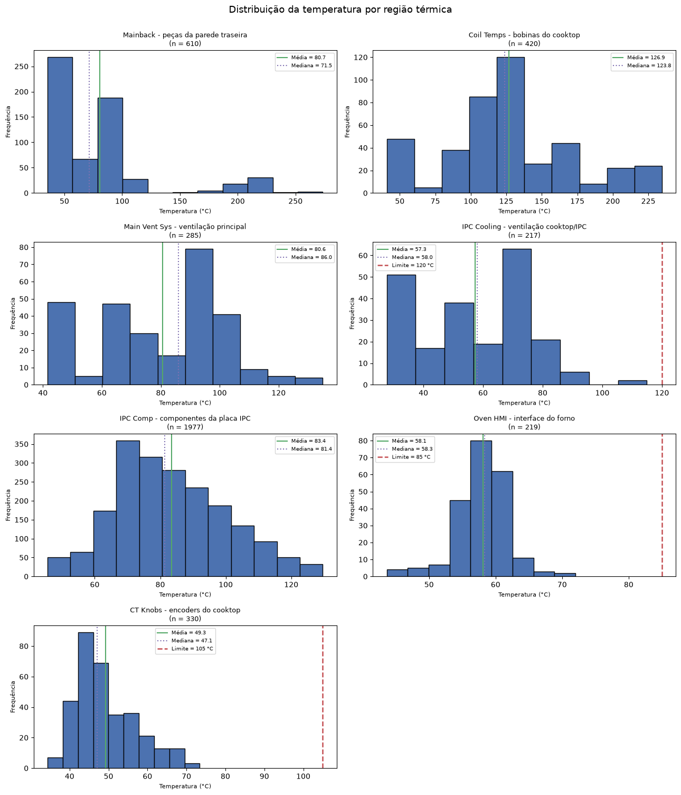<br>
  <p><b>Fonte:</b> Elaborado pelos autores, 2026</p>
</div>

Os histogramas reforçam o teste, mas com graus distintos de força, onde em cinco regiões o reforço é inequívoco, em duas é apenas parcial. A distinção é precisamente o que a decisão do teste, idêntica nas sete, não fornece.
 
**Mainback e CT Knobs: reforço por assimetria acentuada**

Em Mainback a forma é claramente assimétrica à direita, com o corpo abaixo de 100 °C e cauda até 273,6 °C, o máximo de toda a base. É o menor W do conjunto (0,7496) e o afastamento é visível sem apoio do teste. A causa é identificável, os onze termopares têm sete limites normativos distintos, de 60 °C a 165 °C, e a agregação de componentes tão heterogêneos produz a cauda extrema. Em CT Knobs a assimetria à direita é igualmente nítida, em escala térmica muito inferior.
 
<div align="center">
  <p><b> Imagem 30 -</b> Histogramas de Mainback</p>
  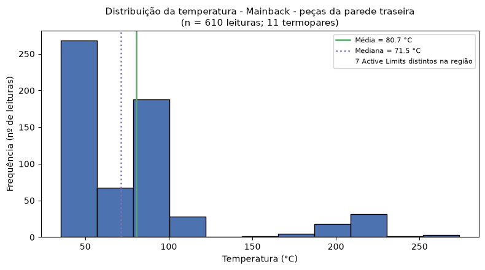<br>
  <p><b>Fonte:</b> Elaborado pelos autores, 2026</p>
</div>

<div align="center">
  <p><b> Imagem 31 -</b> Histogramas de CT Knobs</p>
  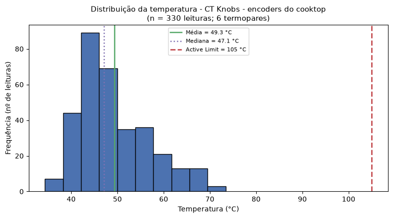<br>
  <p><b>Fonte:</b> Elaborado pelos autores, 2026</p>
</div>
 
**Main Vent Sys, IPC Cooling e Coil Temps: reforço por multimodalidade**

Nessas três regiões a forma apresenta patamares separados por vales, e não uma concentração central única. A causa é o desenho experimental, cada ensaio corresponde a uma configuração distinta de ventilador, housing, defletor e modo de operação, e cada configuração impõe um regime térmico próprio aos mesmos sensores.
 
IPC Cooling é o argumento mais forte a favor do histograma como instrumento complementar pois sua assimetria é praticamente nula (+0,010) e a diferença entre média e mediana é de apenas 1,03 °C, nenhuma medida de posição sinalizaria afastamento. A distribuição é, ainda assim, visivelmente bimodal, sendo um afastamento que somente a forma revela.
 
<div align="center">
  <p><b> Imagem 32 -</b> Histograma de Main Vent Sys</p>
  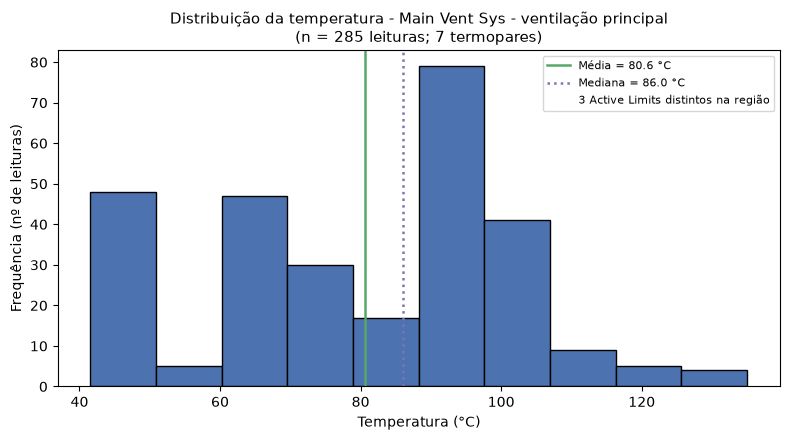<br>
  <p><b>Fonte:</b> Elaborado pelos autores, 2026</p>
</div>

<div align="center">
  <p><b> Imagem 33 -</b> Histograma de IPC Cooling</p>
  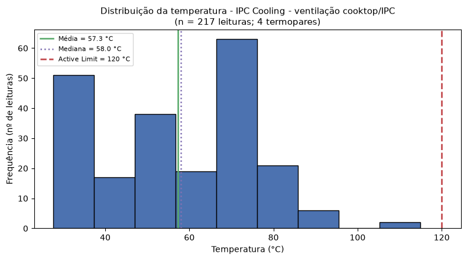<br>
  <p><b>Fonte:</b> Elaborado pelos autores, 2026</p>
</div>
 
 <div align="center">
  <p><b> Imagem 34 -</b> Histogramas de Coil Temps</p>
  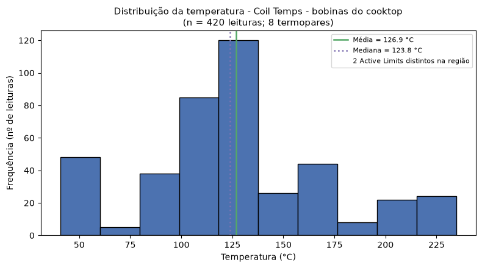<br>
  <p><b>Fonte:</b> Elaborado pelos autores, 2026</p>
</div>

**IPC Comp e Oven HMI: reforço parcial**

Aqui a distribuição é aproximadamente unimodal e próxima da simétrica, sem cauda pronunciada nem multimodalidade. Além disso, são também os dois maiores W do conjunto, 0,9815 e 0,9561. Por esse caminho, o histograma não contradiz o teste, mas não exibe afastamento que a inspeção visual identificaria por si só. A leitura correta é a antecipada em A.1.2, em que a rejeição é amplamente atribuível à sensibilidade do teste ao tamanho da amostra. Sem os histogramas, IPC Comp e Mainback seriam registradas apenas como "rejeita H₀", quando os afastamentos que produzem essa decisão são de naturezas inteiramente distintas.
 
<div align="center">
  <p><b> Imagem 35 -</b> Histograma de IPC Comp</p>
  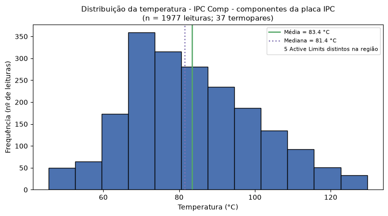<br>
  <p><b>Fonte:</b> Elaborado pelos autores, 2026</p>
</div>

<div align="center">
  <p><b> Imagem 36 -</b> Histograma de Oven HMI</p>
  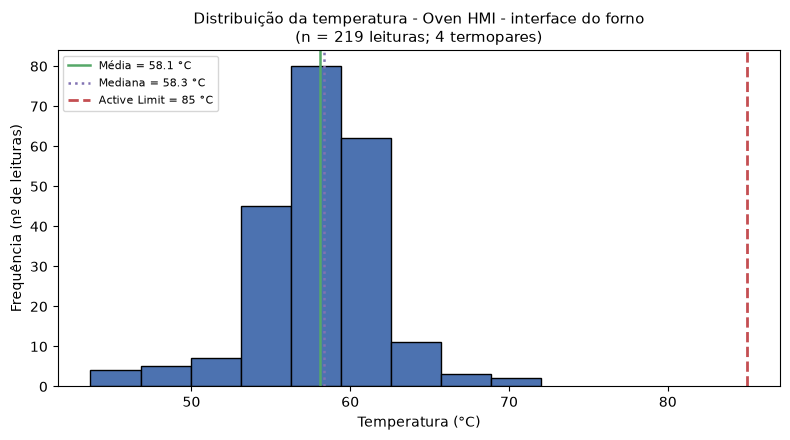<br>
  <p><b>Fonte:</b> Elaborado pelos autores, 2026</p>
</div>
 
Dessa forma, pelos histogramas é possível reforçar os resultados dos testes, em que nenhuma região exibe forma compatível com a normalidade, e cinco das sete exibem afastamento visualmente inequívoco. Desse modo, o que os histogramas acrescentam é a distinção entre duas causas, a heterogeneidade de componentes e a multimodalidade induzida pelas configurações de ensaio, que a decisão do teste não discrimina.
 
Portanto, a não normalidade desaconselha procedimentos que assumam distribuição normal, na caracterização exploratória e na avaliação dos resíduos do modelo, e recomenda estatísticas robustas, testes não paramétricos e tratamento segmentado por área.
 
##### A.1.5. Comparação entre média e mediana
 
Esta subseção compara a média com a mediana da variável Temperature, no conjunto completo e em cada região térmica, mantendo a segmentação adotada na subseção anterior. As duas medidas foram obtidas com os métodos mean() e median() do pandas sobre a mesma base em formato longo utilizada no teste, sem qualquer transformação prévia, de modo que permanecem em graus Celsius e diretamente comparáveis entre si.

O fundamento da comparação é que, em uma distribuição normal, média e mediana coincidem, pois a curva é simétrica em torno do centro. O afastamento entre as duas é, portanto, indício de assimetria, onde média acima da mediana indica cauda à direita e média abaixo indica cauda à esquerda. Como esse afastamento é expresso na escala da variável, e as regiões operam em faixas térmicas distintas, reporta-se também a diferença relativa à mediana e o coeficiente de assimetria de Pearson, definido como três vezes a diferença entre média e mediana dividida pelo desvio padrão, medida adimensional que torna a comparação independente da escala de cada recorte.
 
```python
# Comparação entre média e mediana
media_geral = var_temperatura.mean()
mediana_geral = var_temperatura.median()
desvio_geral = var_temperatura.std()

diferenca_geral = media_geral - mediana_geral
diferenca_relativa_geral = 100 * diferenca_geral / mediana_geral
pearson_geral = 3 * diferenca_geral / desvio_geral

print("VARIÁVEL 1 - Temperature (conjunto completo)\n")
print(f"n................................: {len(var_temperatura)}")
print(f"Média............................: {media_geral:.2f} °C")
print(f"Mediana..........................: {mediana_geral:.2f} °C")
print(f"Desvio-padrão....................: {desvio_geral:.2f} °C")
print(f"Diferença (média - mediana)......: {diferenca_geral:+.2f} °C")
print(f"Diferença relativa...............: {diferenca_relativa_geral:+.2f}% da mediana")
print(f"Assimetria de Pearson............: {pearson_geral:+.3f}")
print(f"Sentido da cauda.................: {'direita' if diferenca_geral > 0 else 'esquerda'}")
```
 
| Recorte | n | Média (°C) | Mediana (°C) | Dif. (°C) | Dif. (%) | Pearson | Sentido | Decisão |
|---|---|---|---|---|---|---|---|---|
| Conjunto completo | 4012 | 80,04 | 76,03 | +4,01 | +5,28 | +0,404 | Cauda à direita | Rejeita H₀ |
| Mainback | 557 | 68,13 | 59,53 | +8,60 | +14,45 | +1,017 | Cauda à direita | Rejeita H₀ |
| Coil Temps | 420 | 126,93 | 123,81 | +3,12 | +2,52 | +0,208 | Cauda à direita | Rejeita H₀ |
| Main Vent Sys | 288 | 80,51 | 85,79 | −5,29 | −6,17 | −0,739 | Cauda à esquerda | Rejeita H₀ |
| IPC Cooling | 218 | 57,38 | 58,41 | −1,03 | −1,76 | −0,165 | Cauda à esquerda | Rejeita H₀ |
| IPC Comp | 1979 | 83,44 | 81,53 | +1,91 | +2,34 | +0,337 | Cauda à direita | Rejeita H₀ |
| Oven HMI | 220 | 58,10 | 58,37 | −0,27 | −0,46 | −0,204 | Cauda à esquerda | Rejeita H₀ |
| CT Knobs | 330 | 49,30 | 47,14 | +2,16 | +4,59 | +0,844 | Cauda à direita | Rejeita H₀ |
 
Dessa forma, no conjunto completo, a comparação reforça o teste, com a média superando a mediana em 5,27 °C, ou 6,89%, com Pearson de +0,475, deslocamento positivo que aponta cauda à direita, no mesmo sentido observado nos histogramas. Por região, contudo, o reforço não é uniforme, ainda que a decisão do teste seja idêntica nos sete recortes.

Em Mainback, CT Knobs e Main Vent Sys o afastamento sinaliza assimetria por si só e Main Vent Sys, única região com média abaixo da mediana, mostra que o instrumento determina também o sentido da cauda, informação que H₁, por ser não direcional, não fornece. Já em Coil Temps e IPC Comp a diferença relativa não passa de 2,52%, o que não contradiz o teste nem o reforça. Por fim, em IPC Cooling e Oven HMI as duas medidas praticamente coincidem apesar da rejeição inequívoca de H₀, porque a não normalidade decorre ali de bimodalidade e do formato das caudas, e não de deslocamento do centro.

Concluí-se, dessa maneira, que a limitação é estrutural, e dela segue uma assimetria de leitura, onde a comparação pode reforçar a rejeição de H₀, mas a coincidência entre média e mediana nunca constitui evidência a favor da normalidade. O balanço, portanto, delimita o alcance do instrumento.


#### A.2 Escalonamento nas variáveis quantitativas.

Esta seção apresenta o escalonamento aplicado às temperaturas de cada área térmica: o tipo escolhido a partir do teste de normalidade, as estatísticas e as equações utilizadas, os histogramas após a transformação e as tabelas comparativas.

##### A.2.1 Tipo de escalonamento escolhido

<div align = "justify">
O tipo de escalonamento de cada variável é definido a partir do resultado do teste de Shapiro-Wilk, aplicado no Anexo A.1, quando o valor de p obtido for maior que o nível de significância adotado, H₀ não é rejeitada, a variável é tratada como normal e recebe padronização por score-z; quando o valor de p for menor que o nível de significância, H₀ é rejeitada, a variável é tratada como não normal e recebe normalização por mínimo e máximo. Esse critério deve ser aplicado à variável quantitativa do conjunto de dados escolhida para análise, sendo essa a variável Temperatura. Além disso, deve ser aplicado também às áreas (key area) nas quais esta variável é segmentada.


Com cada região possuindo escala e comportamento térmicos próprios, há possibilidade de serem selecionados métodos diferentes para cada uma. As justificativas específicas, com os respectivos valores de p, são apresentadas a seguir.


Todas as 7 regiões térmicas rejeitaram H₀ no teste de Shapiro-Wilk, com p-valores entre 2.82×10⁻¹⁵ (IPC Comp) e 2.33×10⁻²⁹ (Mainback), nenhuma apresentou evidência de normalidade. Por esse motivo, a normalização Min-Max é o método adotado em todas as regiões, de forma consistente com o resultado obtido em cada uma delas.

</div>

##### A.2.2 Dados estatísticos que serão utilizados

Antes de aplicar as transformações de padronização ou normalização a cada variável, é necessário conhecer suas medidas estatísticas de referência, calculadas sobre o conjunto de dados completo. O valor máximo e o valor mínimo servem de base para a normalização Min-Max, enquanto a média e o desvio padrão populacional fundamentam a padronização por escore-z.

A Seção 4.2.1.1, fonte única da verdade sobre a classificação das colunas neste projeto, identifica a Temperature como a única variável quantitativa do conjunto, e é sobre ela que as medidas abaixo são calculadas. Elas seguem o mesmo recorte delimitado na Subseção A.1.1: o histórico em formato longo, uma observação por sensor em cada ensaio, após o descarte dos registros sem leitura de temperatura. São 4.012 leituras válidas, provenientes de 76 termopares distribuídos em 7 áreas térmicas e 56 ensaios.

| Variável | n | Média (°C) | Desvio padrão populacional (°C) | Mínimo (°C) | Máximo (°C) |
| --- | ---: | ---: | ---: | ---: | ---: |
| Temperature | 4.012 | 80,04 | 29,82 | 27,69 | 234,60 |

O Active Limit não integra a tabela. Ainda que expresso em graus Celsius, ele é classificado como categórico na Seção 4.2.1.1, por ser atributo fixo do componente, inteiramente determinado pelo TC Name, e não medição que varie a cada ensaio. Pela mesma razão não é escalonado, conforme registrado na Seção 4.2.2.3. Para registro, entre as 4.012 leituras há 3.654 associadas a um limite numérico, distribuídas em 16 valores distintos entre 60 °C e 220 °C, e 358 associadas a sensores apenas monitorados, sem limite aplicável, identificados na planilha pelo rótulo Monitor. Média e desvio padrão dessa coluna não são reportados porque descrevem a frequência com que cada limite aparece no histórico, e não uma grandeza medida.

Cabe registrar uma inconsistência de origem já tratada na limpeza. Oito leituras do ensaio Run 5 - Broil Qualitative estavam gravadas na planilha com formatação de porcentagem, como 9489,00% no lugar de 94,89 °C, em sensores das áreas Coil Temps, Main Vent Sys, IPC Cooling, IPC Comp e Oven HMI. A conversão numérica transformaria esses textos em nulos, e o descarte dos registros sem leitura os eliminaria junto às ausências verdadeiras. Como são medições reais, e não ausências, a correção de formato passou a ser aplicada no notebook de leitura, conforme descrito na Seção 4.2.2, e as oito leituras integram normalmente as medidas desta subseção.

Os valores desta subseção descrevem o conjunto completo e servem de referência para a comparação entre as áreas. Os parâmetros efetivamente empregados na normalização são os de cada área térmica, apresentados na Subseção A.2.3.


##### A.2.3 Equações de Escalonamento

A normalização Min-Max mapeia cada observação para o intervalo [0, 1] segundo a equação geral:

$$x' = \frac{x - x_{\min}}{x_{\max} - x_{\min}}$$

onde $x_{\min}$ e $x_{\max}$ são calculados sobre o subconjunto de registros da área correspondente. A escolha da normalização em detrimento da padronização Z-score é justificada pelo resultado do teste de Shapiro-Wilk: todas as sete áreas rejeitam H₀ (p < 0,05), indicando ausência de distribuição normal, condição que invalida a interpretação de "quantos desvios padrão acima ou abaixo da média" que sustenta o Z-score.

A tabela abaixo reúne os parâmetros de cada área:

| Key Area | n | Mín (°C) | Máx (°C) | Amplitude (°C) |
|---|--:|---:|---:|---:|
| CT Knobs | 330 | 34,34 | 73,42 | 39,08 |
| Coil Temps | 420 | 40,80 | 234,60 | 193,80 |
| IPC Comp | 1.979 | 45,58 | 129,63 | 84,05 |
| IPC Cooling | 218 | 27,69 | 114,94 | 87,25 |
| Main Vent Sys | 288 | 41,56 | 135,00 | 93,44 |
| Mainback | 557 | 35,41 | 171,57 | 136,16 |
| Oven HMI | 220 | 43,64 | 72,01 | 28,37 |

As sete equações com valores substituídos:

**CT Knobs:**

$$x'_{\text{CT Knobs}} = \frac{x - 34{,}34}{39{,}08}$$

**Coil Temps:**

$$x'_{\text{Coil Temps}} = \frac{x - 40{,}80}{193{,}80}$$

**IPC Comp:**

$$x'_{\text{IPC Comp}} = \frac{x - 45{,}58}{84{,}05}$$

**IPC Cooling:**

$$x'_{\text{IPC Cooling}} = \frac{x - 27{,}69}{87{,}25}$$

**Main Vent Sys:**

$$x'_{\text{Main Vent Sys}} = \frac{x - 41{,}56}{93{,}44}$$

**Mainback:**

$$x'_{\text{Mainback}} = \frac{x - 35{,}41}{136{,}16}$$

**Oven HMI:**

$$x'_{\text{Oven HMI}} = \frac{x - 43{,}64}{28{,}37}$$

Em cada equação, o numerador representa o afastamento da observação em relação ao mínimo da área, e o denominador é a amplitude do subgrupo. O resultado 0 corresponde à menor temperatura registrada naquela área, 1, à maior.

Para fins de comparação, apresentam-se também as equações de padronização Z-score com os parâmetros populacionais de cada área. A padronização não foi adotada como método de escalonamento neste projeto, a rejeição de H₀ em todas as áreas desaconselha a interpretação em desvios padrão, mas o registro dos valores de média (µ) e desvio padrão populacional (σ) atende ao item 2.b do enunciado e evidencia a diferença de escala entre os dois métodos.

| Key Area | µ (°C) | σ (°C) |
|---|---:|---:|
| CT Knobs | 49,30 | 7,68 |
| Coil Temps | 126,93 | 44,97 |
| IPC Comp | 83,44 | 17,02 |
| IPC Cooling | 57,38 | 18,63 |
| Main Vent Sys | 80,51 | 21,44 |
| Mainback | 68,13 | 25,37 |
| Oven HMI | 58,10 | 3,95 |

As equações correspondentes, caso a padronização fosse aplicada:

**CT Knobs:**

$$z_{\text{CT Knobs}} = \frac{x - 49{,}30}{7{,}68}$$

**Coil Temps:**

$$z_{\text{Coil Temps}} = \frac{x - 126{,}93}{44{,}97}$$

**IPC Comp:**

$$z_{\text{IPC Comp}} = \frac{x - 83{,}44}{17{,}02}$$

**IPC Cooling:**

$$z_{\text{IPC Cooling}} = \frac{x - 57{,}38}{18{,}63}$$

**Main Vent Sys:**

$$z_{\text{Main Vent Sys}} = \frac{x - 80{,}51}{21{,}44}$$

**Mainback:**

$$z_{\text{Mainback}} = \frac{x - 68{,}13}{25{,}37}$$

**Oven HMI:**

$$z_{\text{Oven HMI}} = \frac{x - 58{,}10}{3{,}95}$$

##### A.2.4 Histogramas pós-escalonamentos

<div align = "justify">
Esta subseção reúne, para cada uma das sete áreas térmicas, a distribuição da temperatura antes e depois da normalização Min-Max. Cada figura traz dois painéis da mesma amostra: à esquerda, a escala original em graus Celsius; à direita, a escala adimensional restrita ao intervalo de 0 a 1. Ambos usam o mesmo número de classes, definido pela regra de Sturges, e exibem as linhas de média e de mediana.

A comparação é direta porque a normalização Min-Max é uma transformação linear: subtrai o mínimo e divide pela amplitude, sem reordenar as observações nem alterar as distâncias relativas. A forma da distribuição é preservada em todas as áreas, e as barras têm as mesmas alturas nos dois painéis. Muda apenas a unidade do eixo horizontal e, com ela, a comparabilidade entre áreas de faixas distintas. O escalonamento não corrige a assimetria nem a não normalidade constatada na Subseção A.1.
</div>

##### Mainback

<div align="center">
  <p><b> Imagem 37 -</b> Distribuição da temperatura antes e depois da normalização Min-Max.</p>
  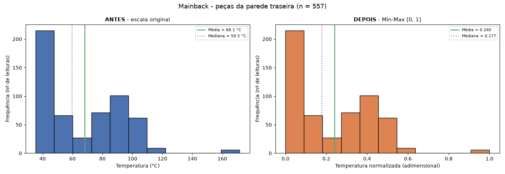<br>
  <p><b>Fonte:</b> Elaborado pelos autores, 2026</p>
</div>

O painel original cobre de 35,41 °C a 171,57 °C, com amplitude de 136,16 °C. A distribuição é assimétrica à direita, com assimetria de +0,791: das 557 leituras da área, 215 ocupam a primeira classe, entre 35,4 °C e 47,8 °C, enquanto as leituras acima de 150 °C se restringem a seis registros do sensor Storage Drawer (Metal Above). Depois do escalonamento, a média de 68,13 °C corresponde a 0,240 e a mediana de 59,53 °C, a 0,177, o que revela que metade das leituras se concentra nos primeiros 18% da faixa da área. As três classes vazias no trecho final do eixo normalizado correspondem à faixa entre 122 °C e 159 °C no painel original, em que nenhum termopar da área registra leitura. A figura ilustra a sensibilidade do Min-Max a valores extremos: um grupo reduzido de leituras define o denominador e comprime o restante junto ao zero. Cabe registrar que o termopar Oven RTD Connector Body, descartado na limpeza por orientação da parceira conforme a Seção 4.2.2.1, respondia pelas leituras acima de 200 °C nesta área, o que reduziu a amplitude de 238,19 °C para os 136,16 °C aqui reportados.

##### Coil temps

<div align="center">
  <p><b> Imagem 38 -</b> Distribuição da temperatura antes e depois da normalização Min-Max.</p>
  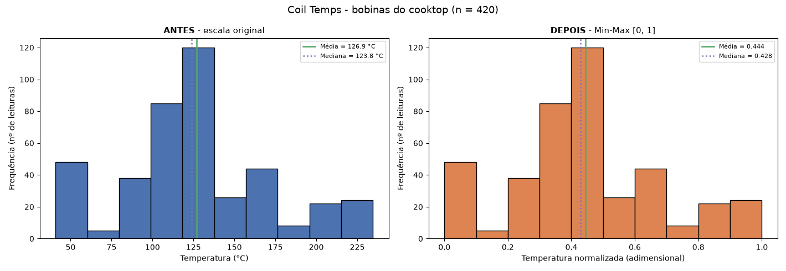<br>
  <p><b>Fonte:</b> Elaborado pelos autores, 2026</p>
</div>

A área reúne dois regimes distintos, e isso aparece nas duas escalas. O primeiro grupo, próximo de 50 °C, corresponde aos ensaios Pyro, nos quais as bobinas não são acionadas; o segundo, entre 100 °C e 235 °C, corresponde aos ensaios Broil. Com amplitude de 193,80 °C, a segunda maior do conjunto, a média de 126,93 °C e a mediana de 123,81 °C passam a 0,444 e 0,428, praticamente no centro do intervalo normalizado. A assimetria é moderada, de +0,346, coerente com a diferença de apenas 3,12 °C entre média e mediana. O desvio padrão equivale a 0,232 da amplitude, a maior dispersão relativa entre as sete áreas: mesmo depois de escalonada, esta é a área cujas leituras se espalham mais dentro da própria faixa de operação.

##### Main Ventilation System

<div align="center">
  <p><b> Imagem 39 -</b> Distribuição da temperatura antes e depois da normalização Min-Max.</p>
  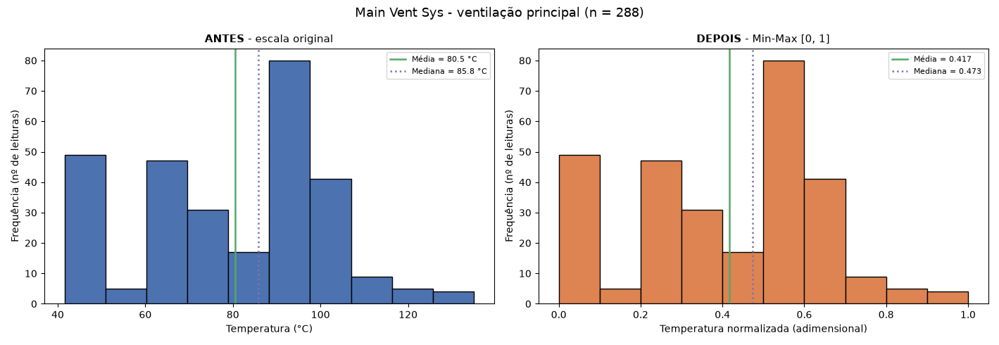<br>
  <p><b>Fonte:</b> Elaborado pelos autores, 2026</p>
</div>

É a única área em que a média fica claramente abaixo da mediana, com diferença de 5,29 °C e assimetria negativa de −0,153. A cauda à esquerda é visível nos dois painéis: as leituras entre 41 °C e 70 °C, dos ensaios Pyro e dos sensores de duto, puxam a média para baixo, enquanto o corpo da distribuição se concentra entre 85 °C e 105 °C. Após o escalonamento, essa inversão se preserva: a média passa a 0,418 e a mediana, a 0,475, mantendo a mesma distância relativa de 0,057 da amplitude de 93,44 °C. A área é uma das três cujos parâmetros de mínimo e máximo, 41,56 °C e 135,00 °C, permanecem inalterados em relação à tabela da Subseção A.2.3.

##### IPC Cooling

<div align="center">
  <p><b> Imagem 40 -</b> Distribuição da temperatura antes e depois da normalização Min-Max.</p>
  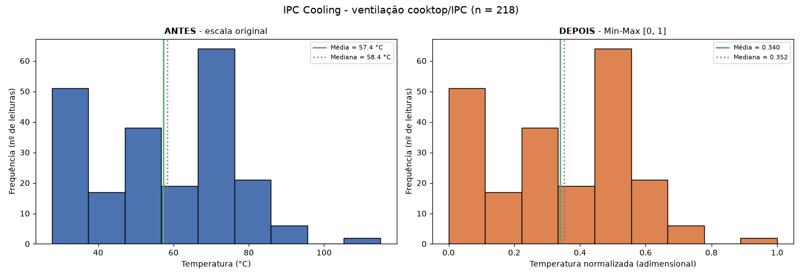<br>
  <p><b>Fonte:</b> Elaborado pelos autores, 2026</p>
</div>

É a área mais simétrica do conjunto, com assimetria de apenas +0,010 e diferença de 1,03 °C entre média e mediana, que se traduzem em 0,340 e 0,352 no eixo normalizado, praticamente sobrepostas. O mínimo da área, 27,69 °C, é também o mínimo global da base, o que faz o zero desta figura coincidir com a menor leitura de todo o histórico. O detalhe mais relevante está na extremidade direita: a leitura isolada de 114,94 °C, registrada na saída do duto horizontal nos primeiros ensaios, ocupa sozinha a última classe e deixa vazio o intervalo imediatamente anterior. Como esse valor define o denominador, ele afasta o corpo da distribuição do limite superior, que se encerra em torno de 0,7.

##### IPC Comp

<div align="center">
  <p><b> Imagem 41 -</b> Distribuição da temperatura antes e depois da normalização Min-Max.</p>
  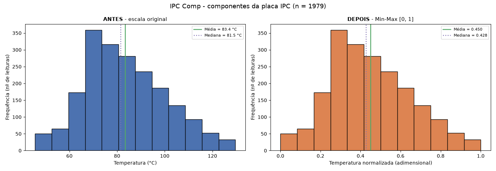<br>
  <p><b>Fonte:</b> Elaborado pelos autores, 2026</p>
</div>

Com 1.979 leituras, quase metade da base, é a área de maior amostra e a de forma mais próxima de um sino, o que se reflete nas doze classes definidas pela regra de Sturges. Ainda assim, o teste de Shapiro-Wilk rejeita a normalidade, com p igual a 2,82 × 10⁻¹⁵, e a assimetria de +0,411 confirma a cauda à direita, formada pelos IGBTs em ensaios de maior carga. A média de 83,41 °C e a mediana de 81,44 °C passam a 0,450 e 0,427 depois do escalonamento, e o desvio padrão equivale a 0,202 da amplitude de 84,05 °C. A figura é a que melhor evidencia o ponto geral desta subseção: a forma permanece idêntica nos dois painéis, e apenas a unidade do eixo horizontal muda.

##### Oven HMI

<div align="center">
  <p><b> Imagem 42 -</b> Distribuição da temperatura antes e depois da normalização Min-Max.</p>
  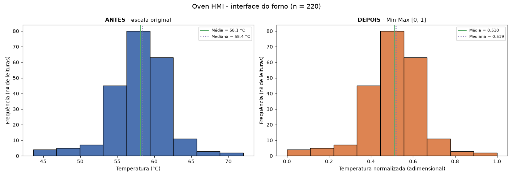<br>
  <p><b>Fonte:</b> Elaborado pelos autores, 2026</p>
</div>

É a área de menor amplitude, 28,37 °C, e de menor dispersão relativa, com desvio padrão equivalente a 0,140 da faixa. Média e mediana, 58,10 °C e 58,37 °C, ficam quase no centro do intervalo normalizado, em 0,510 e 0,519, e a assimetria de −0,418 aparece como a cauda curta à esquerda, entre 43 °C e 53 °C. A comparação entre os dois painéis expõe o efeito de ampliação do Min-Max quando a faixa é estreita: nesta área, uma variação de 1 °C corresponde a 0,035 no eixo normalizado, contra 0,004 na área Mainback. O mesmo deslocamento físico, portanto, produz efeitos muito diferentes sobre o dado escalonado, o que torna indispensável o registro dos denominadores feito na Subseção A.2.3.

##### CT Knobs

<div align="center">
  <p><b> Imagem 43 -</b> Distribuição da temperatura antes e depois da normalização Min-Max.</p>
  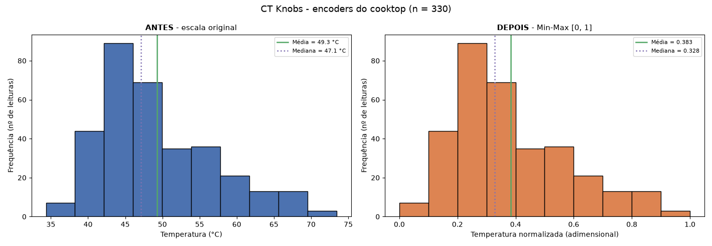<br>
  <p><b>Fonte:</b> Elaborado pelos autores, 2026</p>
</div>

A distribuição tem assimetria à direita de +0,809, a segunda mais acentuada do conjunto, com a maior parte das leituras entre 38 °C e 50 °C e uma cauda que se estende até 73,42 °C, formada pelo encoder direito nos ensaios Pyro. A diferença de 2,16 °C entre média e mediana equivale a 5,5% da amplitude de 39,08 °C, e é isso que separa as duas linhas verticais no painel escalonado: a média em 0,383 e a mediana em 0,328. A classe modal, entre 42 °C e 45 °C, corresponde ao intervalo de 0,2 a 0,3 no eixo normalizado. Como nas demais áreas, as alturas das dez barras são idênticas nos dois painéis, o que confirma que o escalonamento preservou integralmente a forma da distribuição.


##### A.2.5 Tabelas comparativas

**CT Knobs — dados originais**

| # | Temperature (°C) |
|--:|-----------------:|
| 1 | 50,83 |
| 2 | 46,51 |
| 3 | 64,37 |
| 4 | 45,08 |
| 5 | 44,36 |
| 6 | 49,44 |
| 7 | 43,38 |
| 8 | 41,21 |
| 9 | 53,50 |
| 10 | 44,60 |

**CT Knobs — dados escalonados (Min-Max)**

| # | Temperature' |
|--:|-------------:|
| 1 | 0,4220 |
| 2 | 0,3114 |
| 3 | 0,7684 |
| 4 | 0,2748 |
| 5 | 0,2564 |
| 6 | 0,3864 |
| 7 | 0,2313 |
| 8 | 0,1758 |
| 9 | 0,4903 |
| 10 | 0,2625 |

---

**Coil Temps — dados originais**

| # | Temperature (°C) |
|--:|-----------------:|
| 1 | 124,35 |
| 2 | 166,05 |
| 3 | 114,71 |
| 4 | 164,50 |
| 5 | 89,64 |
| 6 | 123,79 |
| 7 | 102,93 |
| 8 | 121,10 |
| 9 | 126,41 |
| 10 | 154,04 |

**Coil Temps — dados escalonados (Min-Max)**

| # | Temperature' |
|--:|-------------:|
| 1 | 0,4311 |
| 2 | 0,6463 |
| 3 | 0,3814 |
| 4 | 0,6383 |
| 5 | 0,2520 |
| 6 | 0,4282 |
| 7 | 0,3206 |
| 8 | 0,4143 |
| 9 | 0,4417 |
| 10 | 0,5843 |

---

**IPC Comp — dados originais**

| # | Temperature (°C) |
|--:|-----------------:|
| 1 | 50,44 |
| 2 | 61,94 |
| 3 | 98,61 |
| 4 | 92,70 |
| 5 | 97,79 |
| 6 | 98,50 |
| 7 | 99,02 |
| 8 | 99,19 |
| 9 | 92,30 |
| 10 | 103,82 |

**IPC Comp — dados escalonados (Min-Max)**

| # | Temperature' |
|--:|-------------:|
| 1 | 0,0578 |
| 2 | 0,1946 |
| 3 | 0,6309 |
| 4 | 0,5606 |
| 5 | 0,6212 |
| 6 | 0,6296 |
| 7 | 0,6358 |
| 8 | 0,6378 |
| 9 | 0,5559 |
| 10 | 0,6929 |

---

**IPC Cooling — dados originais**

| # | Temperature (°C) |
|--:|-----------------:|
| 1 | 28,44 |
| 2 | 49,15 |
| 3 | 78,73 |
| 4 | 71,26 |
| 5 | 32,87 |
| 6 | 51,52 |
| 7 | 72,97 |
| 8 | 75,61 |
| 9 | 33,15 |
| 10 | 53,50 |

**IPC Cooling — dados escalonados (Min-Max)**

| # | Temperature' |
|--:|-------------:|
| 1 | 0,0086 |
| 2 | 0,2460 |
| 3 | 0,5850 |
| 4 | 0,4994 |
| 5 | 0,0594 |
| 6 | 0,2731 |
| 7 | 0,5190 |
| 8 | 0,5492 |
| 9 | 0,0626 |
| 10 | 0,2958 |

---

**Main Vent Sys — dados originais**

| # | Temperature (°C) |
|--:|-----------------:|
| 1 | 71,05 |
| 2 | 94,65 |
| 3 | 75,87 |
| 4 | 46,01 |
| 5 | 66,60 |
| 6 | 89,11 |
| 7 | 100,19 |
| 8 | 89,76 |
| 9 | 45,04 |
| 10 | 69,01 |

**Main Vent Sys — dados escalonados (Min-Max)**

| # | Temperature' |
|--:|-------------:|
| 1 | 0,3156 |
| 2 | 0,5682 |
| 3 | 0,3672 |
| 4 | 0,0476 |
| 5 | 0,2680 |
| 6 | 0,5089 |
| 7 | 0,6275 |
| 8 | 0,5158 |
| 9 | 0,0372 |
| 10 | 0,2938 |

---

**Mainback — dados originais**

| # | Temperature (°C) |
|--:|-----------------:|
| 1 | 82,11 |
| 2 | 88,25 |
| 3 | 103,87 |
| 4 | 43,42 |
| 5 | 40,44 |
| 6 | 201,57 |
| 7 | 96,72 |
| 8 | 77,33 |
| 9 | 73,91 |
| 10 | 90,86 |

**Mainback — dados escalonados (Min-Max)**

| # | Temperature' |
|--:|-------------:|
| 1 | 0,3430 |
| 2 | 0,3881 |
| 3 | 0,5028 |
| 4 | 0,0588 |
| 5 | 0,0369 |
| 6 | 1,2203 |
| 7 | 0,4503 |
| 8 | 0,3079 |
| 9 | 0,2828 |
| 10 | 0,4072 |

---

**Oven HMI — dados originais**

| # | Temperature (°C) |
|--:|-----------------:|
| 1 | 56,33 |
| 2 | 60,34 |
| 3 | 56,33 |
| 4 | 53,15 |
| 5 | 58,63 |
| 6 | 57,48 |
| 7 | 58,63 |
| 8 | 56,43 |
| 9 | 59,11 |
| 10 | 57,51 |

**Oven HMI — dados escalonados (Min-Max)**

| # | Temperature' |
|--:|-------------:|
| 1 | 0,4473 |
| 2 | 0,5886 |
| 3 | 0,4473 |
| 4 | 0,3352 |
| 5 | 0,5284 |
| 6 | 0,4878 |
| 7 | 0,5284 |
| 8 | 0,4508 |
| 9 | 0,5453 |
| 10 | 0,4889 |

### <a name="anexo2"></a>Anexo II — Requisitos Funcionais da Visão Técnica do Dashboard Ignis

Este anexo reúne os requisitos funcionais da visão técnica do dashboard Ignis, ou seja, das duas personas que lidam direto com o dado térmico detalhado: Sandra, da Engenharia, e Henrique, da Qualidade. Diego, Rafael e Adriana ficaram de fora deste recorte porque, como mostra a Seção 4.1.6, eles precisam da informação já traduzida e sem termos de simulação, e por isso entram na visão não-técnica, tratada à parte.

A diferença é simples. Para Diego, Rafael e Adriana, o detalhe técnico atrapalha, porque eles decidem rápido e em linguagem de negócio. Para Sandra e Henrique é o oposto: tirar o detalhe é tirar a ferramenta de trabalho, já que Sandra só assina o que consegue conferir e Henrique só confia numa triagem que fale a linguagem da norma. Por isso os requisitos a seguir já partem do detalhe técnico.

**Legenda.** RF-T significa Requisito Funcional da visão Técnica, e a numeração é apenas sequencial, para citar o requisito no restante do documento. "Persona de origem" indica de quem partiu a necessidade, e "Critério de aceite" resume o que precisa acontecer na tela para o requisito estar cumprido.

#### A.II.1. Requisitos funcionais

**RF-T01 — Mostrar a temperatura de cada ponto com a incerteza**
- **O que faz:** mostra a temperatura prevista em cada ponto medido e, ao lado, o quanto ela pode variar para mais ou para menos.
- **Critério de aceite:** nenhum valor aparece sozinho, sempre acompanhado da faixa de variação.
- **Por que foi escolhido:** Sandra assina o parecer e não defende um número sem saber o quanto ele é confiável. A incerteza dá o argumento para sustentar o resultado na reunião e permite acompanhar a meta de erro de até 10% combinada com o parceiro.

**RF-T02 — Mostrar os casos passados que sustentam a previsão**
- **O que faz:** lista os casos antigos parecidos que serviram de base para a previsão, cada um com um atalho para a simulação original.
- **Critério de aceite:** cada previsão mostra os casos que a apoiam e permite chegar até o registro de origem.
- **Por que foi escolhido:** Sandra não defende o que não consegue reconstruir. Sem voltar até a origem do dado, o resultado vira caixa-preta e perde força técnica.

**RF-T03 — Mostrar o limite permitido ao lado do valor previsto e dar o veredito**
- **O que faz:** coloca, na mesma linha, o valor previsto e o limite do componente já com a folga de segurança de 10%, e informa o resultado como Aprovado, Reprovado ou Limítrofe.
- **Critério de aceite:** o limite e o valor aparecem lado a lado, e o veredito já considera o limite com a folga aplicada.
- **Por que foi escolhido:** é o requisito que atende as duas personas ao mesmo tempo. Henrique precisa do limite da norma junto do valor para não conferir isso por fora, e Sandra precisa que a folga de 10% seja aplicada sempre igual para confiar no veredito.

**RF-T04 — Destacar os componentes que estão perto do limite**
- **O que faz:** separa e ordena os componentes que estão operando perto do limite, indicando quais merecem prioridade no ensaio.
- **Critério de aceite:** dá para ver, sem fazer conta na mão, quais componentes estão na faixa de maior risco.
- **Por que foi escolhido:** hoje Henrique chega à bancada sem saber onde olhar. Concentrar o ensaio no que oferece risco real reduz os testes destrutivos, que estão entre os custos que o projeto quer cortar em 25%.

**RF-T05 — Avisar quando o caso é duvidoso e indicar a simulação completa**
- **O que faz:** marca as previsões de baixa confiança ou que ficaram no limite e sugere encaminhá-las para a simulação completa.
- **Critério de aceite:** o caso duvidoso recebe um aviso diferente do veredito Reprovado, com a recomendação de simulação completa.
- **Por que foi escolhido:** o modelo serve para filtrar, não para substituir a simulação. Manter esse encaminhamento evita que um "passou" que deveria ser "não passou" siga adiante, o que na qualidade não é só imprecisão, é risco de segurança.

**RF-T06 — Comparar duas ou três configurações com o detalhe técnico**
- **O que faz:** coloca de duas a três configurações lado a lado, mantendo a temperatura ponto a ponto de cada uma, e destaca a de maior folga.
- **Critério de aceite:** a comparação preserva o detalhe de cada configuração, não só o resultado final.
- **Por que foi escolhido:** Sandra decide entre alternativas rotineiras olhando o detalhe, e é nesses casos previsíveis que o modelo mais economiza tempo de espera.

**RF-T07 — Filtrar por linha do Brasil ou do México**
- **O que faz:** permite escolher a linha, e todos os valores, limites e vereditos passam a refletir a linha escolhida.
- **Critério de aceite:** ao trocar a linha, a tela inteira acompanha a escolha.
- **Por que foi escolhido:** Henrique atua na linha do México e é quem confirma se a solução funciona igual para as duas linhas do projeto, não só para a brasileira.

**RF-T08 — Guardar cada consulta feita ao modelo**
- **O que faz:** registra cada consulta de forma organizada, para depois poder realimentar a base de dados histórica.
- **Critério de aceite:** cada consulta gera um registro recuperável, com o que foi consultado, a resposta e a versão do modelo.
- **Por que foi escolhido:** sustenta a fase futura de realimentar a base e dá um histórico auditável de uso, condição para a engenharia confiar na evolução do modelo.

**RF-T09 — Exportar o parecer com os dados de origem**
- **O que faz:** gera um arquivo do parecer com data, autor, versão do modelo, casos que apoiaram a previsão e limites aplicados.
- **Critério de aceite:** o arquivo traz essas informações e repete o veredito que aparece na tela.
- **Por que foi escolhido:** o número que sai da área leva a assinatura de Sandra, então ela precisa levar para a reunião um parecer que mostre de onde ele veio. É o que fecha o caminho de rastreabilidade começado nos RF-T01 e RF-T02.

#### A.II.2. Quadro-resumo e rastreabilidade

O quadro abaixo resume os nove requisitos e liga cada um à necessidade da persona e ao objetivo do parceiro que ele atende. Serve como visão rápida do anexo e como base para a validação, já que todo requisito precisa se ligar a uma necessidade real de quem vai usar o dashboard.

<div align="center">
  <p><b>Quadro 1 -</b> Rastreabilidade dos requisitos da visão técnica</p>
</div>

| Requisito | Persona de origem | Necessidade que atende | Objetivo do parceiro |
|---|---|---|---|
| RF-T01 | Sandra | Ter a incerteza para defender o número | Erro de até 10% |
| RF-T02 | Sandra | Conseguir reconstruir a resposta | Explicabilidade e adoção |
| RF-T03 | Sandra e Henrique | Ver o limite junto do valor, com a folga de 10% | Erro de até 10% e conformidade |
| RF-T04 | Henrique | Saber onde olhar na bancada | Redução de 25% de custo (menos ensaio destrutivo) |
| RF-T05 | Sandra e Henrique | Preservar a simulação completa no caso atípico | Segurança e confiabilidade |
| RF-T06 | Sandra | Decidir entre configurações rotineiras | Redução de 30% no tempo de desenvolvimento |
| RF-T07 | Henrique | Confirmar a linha do México | Cobertura das duas linhas (BR e MX) |
| RF-T08 | Sandra | Realimentar a base de dados | Evolução do modelo |
| RF-T09 | Sandra | Defender a decisão que assina | Rastreabilidade e adoção |

<div align="center">
  <p><b>Fonte:</b> Elaborado pelos autores, 2026</p>
</div>

### <a name="anexo3"></a>Anexo III — Requisitos Funcionais da Visão Não Técnica do Dashboard Ignis

Este anexo reúne os requisitos funcionais da visão não técnica do dashboard Ignis, complementar ao Anexo II. Trata das três personas que decidem a partir do dado térmico sem operar a simulação em si: Diego, do Marketing e Produto, Rafael, do Design Industrial, e Adriana, do Cost Model. Como mostra a Seção 4.1.6, para essas três personas o detalhe técnico não é apoio, é ruído — cada uma precisa da resposta já traduzida para a própria decisão (prazo, geometria ou custo), sem depender de um engenheiro para interpretar o resultado.

A diferença em relação ao Anexo II está na origem da restrição. Para Sandra e Henrique, tirar o detalhe tira a ferramenta de trabalho. Para Diego, Rafael e Adriana é o oposto: qualquer campo de temperatura, ponto de medição ou termo de simulação que sobreviva até a tela devolve a essas três personas a dependência que o dashboard deveria eliminar. Por isso os requisitos a seguir partem sempre do resultado já interpretado — conforme, em atenção, não conforme, recomendado — e não do dado bruto.

**Legenda.** RF significa Requisito Funcional, com a numeração retomando a sequência do levantamento geral de requisitos funcionais do dashboard; os números que não aparecem neste anexo pertencem a requisitos fora do recorte da visão não técnica. "Persona de origem" indica de quem partiu a necessidade, e "Critério de aceite" resume o que precisa acontecer na tela para o requisito estar cumprido.

#### A.III.1. Requisitos funcionais

**RF-01 — Mostrar o estado geral da configuração já na primeira tela**
- **O que faz:** exibe, assim que a tela abre, a contagem de componentes por status (conforme, em atenção, não conforme) e destaca qual deles representa o maior risco.
- **Critério de aceite:** a tela inicial exibe a contagem por status e destaca o maior risco sem exigir mais de um clique ou rolagem.
- **Por que foi escolhido:** Diego precisa saber cedo se uma configuração vai falhar, sem esperar pela agenda de uma equipe técnica sobrecarregada. Colocar esse panorama na primeira tela é o que torna a leitura possível em poucos segundos, condição que ele próprio impõe para considerar a informação disponível.

**RF-02 — Consultar o status individual de cada componente**
- **O que faz:** mostra, para cada componente, o status de conformidade com ícone e texto associados.
- **Critério de aceite:** 100% dos componentes exibem status com ícone e texto, nunca só cor.
- **Por que foi escolhido:** uma leitura que dependa só de cor exclui quem não pode conferir o dado por trás dela e reintroduz a dependência de tradução técnica que Diego rejeita. Ícone e texto sustentam uma decisão de produto sem apoio de engenharia, e ainda atendem a um critério básico de acessibilidade.

**RF-05 — Ver o componente crítico (menor margem) destacado automaticamente**
- **O que faz:** identifica e destaca, no topo da tela de componentes, aquele com a menor margem em relação ao limite.
- **Critério de aceite:** o componente de menor margem aparece sempre destacado no topo da tela de componentes.
- **Por que foi escolhido:** Rafael decide por precaução quando não sabe qual ponto do desenho é o mais restritivo, e descarta alternativas por falta de resposta em tempo hábil. Levar o ponto mais restritivo automaticamente ao topo é o que permite orientar o design pela restrição real, e não pela mais conservadora.

**RF-06 — Comparar duas configurações (Brasil × México) lado a lado, com os mesmos critérios**
- **O que faz:** coloca as configurações de Brasil e México na mesma tela, com os mesmos critérios de comparação visíveis ao mesmo tempo.
- **Critério de aceite:** as duas configurações aparecem na mesma tela, com os mesmos critérios de comparação visíveis simultaneamente.
- **Por que foi escolhido:** Diego cobra explicitamente a leitura das duas linhas na mesma tela antes de comunicar prazo ao mercado, e Adriana avalia as arquiteturas de Brasil e México sob o mesmo critério financeiro. Manter os mesmos critérios visíveis ao mesmo tempo é o que evita comparação por memória entre telas separadas.

**RF-08 — Ver a justificativa da alternativa recomendada pelo sistema**
- **O que faz:** exibe, junto de toda alternativa recomendada, os critérios que motivaram a recomendação.
- **Critério de aceite:** toda alternativa recomendada exibe, no mínimo, três critérios (custo, risco e tempo) que motivaram a recomendação.
- **Por que foi escolhido:** as três personas assumem publicamente uma decisão que não escolheram sozinhas — Diego perante o varejo, Rafael perante quem aprova o projeto, Adriana perante a liderança que homologa o custo-alvo. Sem a justificativa, nenhuma delas consegue defender a recomendação como própria.

**RF-10 — Ver um resumo do diagnóstico do modelo antes de qualquer gráfico técnico**
- **O que faz:** apresenta, em linguagem simples, o desempenho do modelo antes de qualquer gráfico técnico correspondente.
- **Critério de aceite:** o resumo em linguagem simples precede todo gráfico técnico, em todas as telas onde ele aparece.
- **Por que foi escolhido:** Diego trata como indisponível qualquer informação que exija tradução por um engenheiro antes de virar slide, restrição que vale igualmente para Rafael e Adriana. Preceder o gráfico com um resumo simples é o que impede que MAE, RMSE ou outro conceito estatístico se torne pré-requisito para entender o resultado.

**RF-12 — Ver o ganho de tempo obtido pelo modelo em relação à simulação CFD**
- **O que faz:** mostra, de forma isolada, o tempo economizado pelo modelo em comparação à simulação térmica tradicional.
- **Critério de aceite:** o ganho de tempo aparece em linguagem separada e visualmente distinta de qualquer comparação de custo de produto.
- **Por que foi escolhido:** Adriana mede o benefício econômico do projeto pela planilha de custo por unidade, não pela velocidade da ferramenta. Separar visualmente as duas leituras evita que o ganho de eficiência da simulação seja confundido com folga de material, que é o dado que de fato entra no trade-off que ela decide.

#### A.III.2. Quadro-resumo e rastreabilidade

O quadro abaixo resume os sete requisitos e liga cada um à necessidade da persona e ao objetivo do parceiro que ele atende, no mesmo padrão de rastreabilidade adotado no Anexo II.

<div align="center">
  <p><b>Quadro 2 -</b> Rastreabilidade dos requisitos da visão não técnica</p>
</div>

| Requisito | Persona de origem | Necessidade que atende | Objetivo do parceiro |
|---|---|---|---|
| RF-01 | Diego | Ler o risco geral sem apoio técnico | Redução de 30% no tempo de desenvolvimento |
| RF-02 | Diego | Confirmar conformidade sem depender de engenharia | Redução de 30% no tempo de desenvolvimento |
| RF-05 | Rafael | Identificar o ponto mais restritivo sem busca manual | Redução de retrabalho no ciclo de design |
| RF-06 | Diego e Adriana | Comparar Brasil e México sob os mesmos critérios | Cobertura das duas linhas (BR e MX) |
| RF-08 | Diego, Rafael e Adriana | Defender uma recomendação que não escolheram sozinhas | Adoção e confiança na recomendação |
| RF-10 | Diego, Rafael e Adriana | Entender o modelo sem vocabulário estatístico | Adoção pelo usuário não técnico |
| RF-12 | Adriana | Não confundir eficiência da ferramenta com custo do produto | Redução de 25% nos gastos operacionais |

<div align="center">
  <p><b>Fonte:</b> Elaborado pelos autores, 2026</p>
</div>
