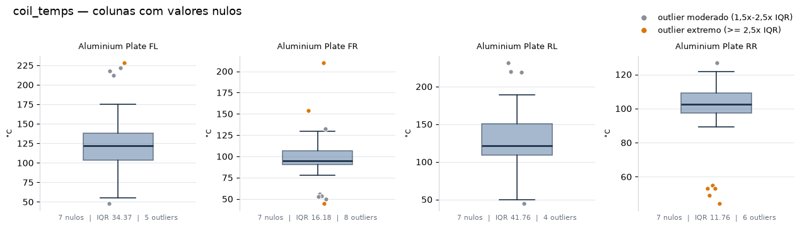
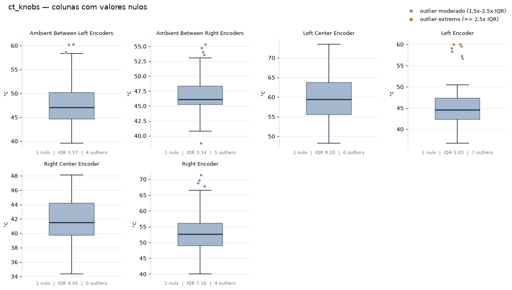
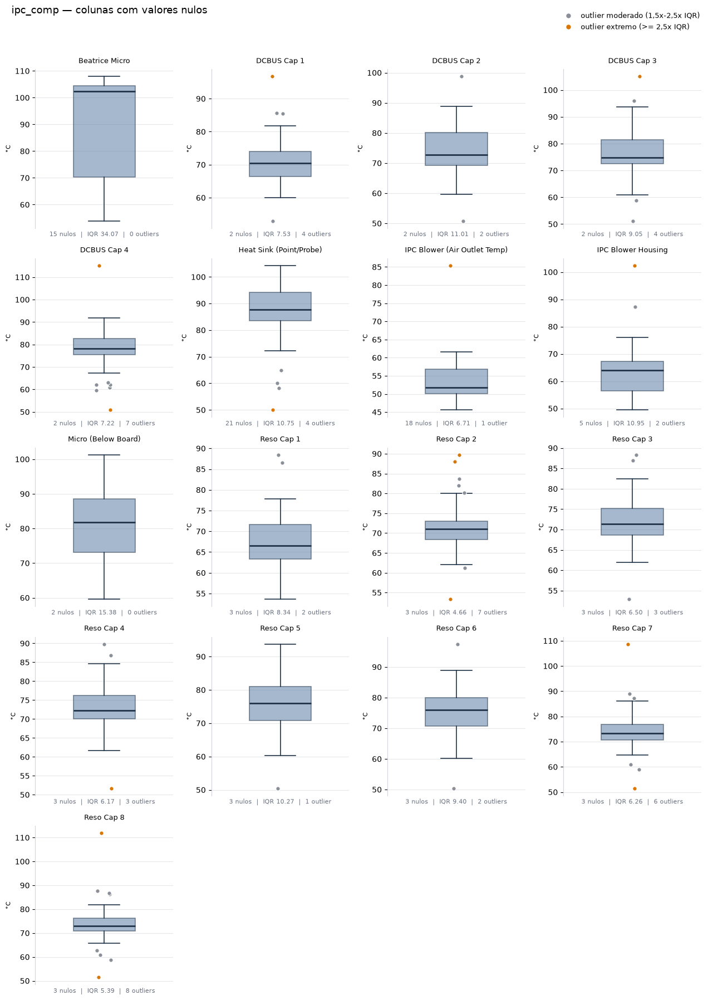
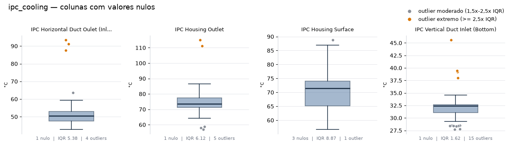
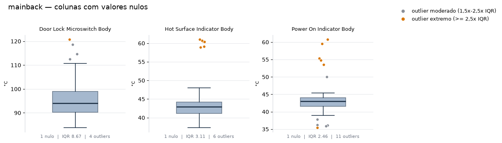
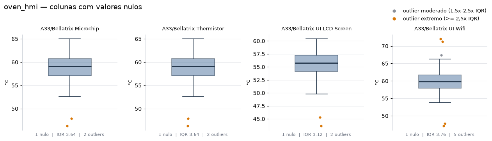

# Relatório — Tratamento de valores nulos

Documenta o diagnóstico dos valores nulos nos datasets `dataset_*_13cat.csv`, as
decisões tomadas para resolvê-los e o raciocínio por trás de cada limiar usado.

**Notebooks relacionados**

| Notebook | Papel |
|---|---|
| `notebooks/colabs_S3/boxplots_nulos.ipynb` | diagnóstico visual — gera os boxplots deste relatório |
| `notebooks/colabs_S3/tratamento_nulos_pos_revisao.ipynb` | aplica as regras e grava os `dataset_*_snull.csv` |

---

## 1. Diagnóstico: onde estão os nulos

São **38 colunas com valores nulos**, distribuídas em 6 dos 7 datasets
(`main_vent_sys_13cat` não tem nenhum). Cada dataset tem 56 linhas — uma por ensaio.

A tabela reúne, para cada coluna: quantos nulos tem, o IQR (`Q3 − Q1`), a contagem de
outliers separada em duas faixas, e a **faixa de valores** — o intervalo entre o menor e
o maior valor que ficam *dentro* da cerca de 1,5×IQR, ou seja, já descontados os
outliers.

- **Moderados** — fora da cerca de 1,5×IQR, mas dentro de 2,5×IQR
- **Extremos** — fora de 2,5×IQR

O corte em 2,5×IQR é o mesmo usado pela regra de imputação (`MULT_EXTREMO`, seção 5), de
modo que a coluna "Extremos" desta tabela é exatamente o que decide entre média e
mediana: **qualquer coluna com pelo menos um extremo é imputada pela mediana**.

| Dataset | Coluna | Nulos | % | IQR | Moderados | Extremos | Total | Faixa (°C) |
|---|---|---:|---:|---:|---:|---:|---:|---:|
| coil_temps | Aluminium Plate FL | 7 | 12,5% | 34,37 | 4 | 1 | 5 | 55,31 – 175,45 |
| coil_temps | Aluminium Plate FR | 7 | 12,5% | 16,18 | 5 | 3 | 8 | 78,04 – 129,34 |
| coil_temps | Aluminium Plate RL | 7 | 12,5% | 41,76 | 4 | 0 | 4 | 49,92 – 189,31 |
| coil_temps | Aluminium Plate RR | 7 | 12,5% | 11,76 | 1 | 5 | 6 | 89,25 – 121,80 |
| ct_knobs | Ambient Between Left Encoders | 1 | 1,8% | 5,57 | 4 | 0 | 4 | 39,58 – 58,33 |
| ct_knobs | Ambient Between Right Encoders | 1 | 1,8% | 3,14 | 5 | 0 | 5 | 40,76 – 53,05 |
| ct_knobs | Left Center Encoder | 1 | 1,8% | 8,20 | 0 | 0 | 0 | 48,24 – 73,42 |
| ct_knobs | Left Encoder | 1 | 1,8% | 5,03 | 5 | 2 | 7 | 36,69 – 50,44 |
| ct_knobs | Right Center Encoder | 1 | 1,8% | 4,45 | 0 | 0 | 0 | 34,34 – 48,10 |
| ct_knobs | Right Encoder | 1 | 1,8% | 7,16 | 4 | 0 | 4 | 40,04 – 66,54 |
| ipc_comp | Beatrice Micro | 15 | 26,8% | 34,07 | 0 | 0 | 0 | 53,94 – 107,90 |
| ipc_comp | DCBUS Cap 1 | 2 | 3,6% | 7,53 | 3 | 1 | 4 | 60,02 – 81,73 |
| ipc_comp | DCBUS Cap 2 | 2 | 3,6% | 11,01 | 2 | 0 | 2 | 59,68 – 88,78 |
| ipc_comp | DCBUS Cap 3 | 2 | 3,6% | 9,05 | 3 | 1 | 4 | 60,91 – 93,78 |
| ipc_comp | DCBUS Cap 4 | 2 | 3,6% | 7,22 | 5 | 2 | 7 | 67,20 – 91,78 |
| ipc_comp | Heat Sink (Point/Probe) | 21 | 37,5% | 10,75 | 3 | 1 | 4 | 72,28 – 104,22 |
| ipc_comp | IPC Blower (Air Outlet Temp) | 18 | 32,1% | 6,71 | 0 | 1 | 1 | 45,58 – 61,63 |
| ipc_comp | IPC Blower Housing | 5 | 8,9% | 10,95 | 1 | 1 | 2 | 49,43 – 75,93 |
| ipc_comp | Micro (Below Board) | 2 | 3,6% | 15,38 | 0 | 0 | 0 | 59,60 – 101,26 |
| ipc_comp | Reso Cap 1 | 3 | 5,4% | 8,34 | 2 | 0 | 2 | 53,65 – 77,77 |
| ipc_comp | Reso Cap 2 | 3 | 5,4% | 4,66 | 4 | 3 | 7 | 62,02 – 79,99 |
| ipc_comp | Reso Cap 3 | 3 | 5,4% | 6,50 | 3 | 0 | 3 | 61,91 – 82,47 |
| ipc_comp | Reso Cap 4 | 3 | 5,4% | 6,17 | 2 | 1 | 3 | 61,67 – 84,55 |
| ipc_comp | Reso Cap 5 | 3 | 5,4% | 10,27 | 1 | 0 | 1 | 60,37 – 93,77 |
| ipc_comp | Reso Cap 6 | 3 | 5,4% | 9,40 | 2 | 0 | 2 | 60,22 – 88,84 |
| ipc_comp | Reso Cap 7 | 3 | 5,4% | 6,26 | 4 | 2 | 6 | 64,65 – 86,19 |
| ipc_comp | Reso Cap 8 | 3 | 5,4% | 5,39 | 6 | 2 | 8 | 65,83 – 81,86 |
| ipc_cooling | IPC Horizontal Duct Oulet (Inlet IPC Fan) | 1 | 1,8% | 5,38 | 1 | 3 | 4 | 42,77 – 59,25 |
| ipc_cooling | IPC Housing Outlet | 1 | 1,8% | 6,12 | 3 | 2 | 5 | 64,32 – 86,39 |
| ipc_cooling | IPC Housing Surface | 3 | 5,4% | 8,87 | 1 | 0 | 1 | 56,67 – 87,00 |
| ipc_cooling | IPC Vertical Duct Inlet (Bottom) | 1 | 1,8% | 1,62 | 11 | 4 | 15 | 29,34 – 34,59 |
| mainback | Door Lock Microswitch Body | 1 | 1,8% | 8,67 | 3 | 1 | 4 | 83,77 – 110,70 |
| mainback | Hot Surface Indicator Body | 1 | 1,8% | 3,11 | 0 | 6 | 6 | 37,30 – 47,97 |
| mainback | Power On Indicator Body | 1 | 1,8% | 2,46 | 5 | 6 | 11 | 38,92 – 45,43 |
| oven_hmi | A33/Bellatrix Microchip | 1 | 1,8% | 3,64 | 0 | 2 | 2 | 52,63 – 64,96 |
| oven_hmi | A33/Bellatrix Thermistor | 1 | 1,8% | 3,64 | 0 | 2 | 2 | 52,63 – 64,96 |
| oven_hmi | A33/Bellatrix UI LCD Screen | 1 | 1,8% | 3,12 | 0 | 2 | 2 | 49,77 – 60,37 |
| oven_hmi | A33/Bellatrix UI Wifi | 1 | 1,8% | 3,76 | 1 | 4 | 5 | 53,76 – 66,29 |
| | **TOTAL** | | | | **98** | **58** | **156** | |

**Leitura geral.** A maioria das colunas tem 1 a 3 nulos — perdas pontuais de leitura.
Apenas três passam de 20%: `Beatrice Micro` (26,8%), `IPC Blower (Air Outlet Temp)`
(32,1%) e `Heat Sink (Point/Probe)` (37,5%). Essas três concentram o risco, porque
qualquer decisão sobre elas afeta um terço ou mais dos ensaios.

---

## 2. Diagnóstico visual: boxplots

Gerados por `boxplots_nulos.ipynb`. Uma figura por dataset, um painel por coluna com
nulos, cada painel com escala própria. Pontos **cinza** são outliers moderados,
**laranja** são extremos. O rodapé de cada painel repete nulos, IQR e total de outliers.

### coil_temps


### ct_knobs


### ipc_comp


### ipc_cooling


### mainback


### oven_hmi


---

## 3. Como a tabela e os boxplots sustentam a decisão

Os dois artefatos respondem a perguntas diferentes, e é a combinação que fecha a
decisão.

**A tabela dá a escala do problema.** É ela que diz *quantos* valores faltam e *quão
dispersa* é a coluna. Sem esses números não dá para separar uma perda pontual (1 nulo,
1,8%) de um sensor que faltou em um terço dos ensaios — e o custo de imputar é
completamente diferente nos dois casos.

**Os boxplots dão a forma da distribuição**, que a tabela não consegue mostrar. Três
exemplos concretos em que a leitura mudaria se olhássemos só os números:

- **`IPC Vertical Duct Inlet (Bottom)`** tem 15 outliers — o maior número da tabela — e
  isso sugeriria uma coluna problemática. O boxplot mostra o contrário: a faixa inteira
  cabe em 5,25 °C, porque é entrada de ar frio e quase não varia. Com um IQR de 1,62, um
  desvio de poucos graus já cruza a cerca de Tukey. A contagem alta é artefato do
  método, não sintoma de dado ruim.

- **`Hot Surface Indicator Body`** tem 6 outliers — número modesto — mas **todos os 6
  são extremos**, e no gráfico eles formam um agrupamento próprio em torno de 60 °C,
  separado de uma caixa que termina em 47,97 °C. Não é cauda, são dois patamares. Isso
  muda a escolha do imputador: a média seria puxada para o vão entre os dois grupos, um
  valor que o componente nunca assume.

- **`Aluminium Plate RL`** tem o maior IQR do conjunto (41,76), o que isoladamente
  pareceria dispersão excessiva. O boxplot mostra uma caixa larga e simétrica, sem
  outlier nenhum: a placa simplesmente opera entre ~50 e ~190 °C conforme o `run_case`.
  É variação real, não ruído.

**A distinção que os dois juntos permitem** é entre *dispersão grande* e *dispersão
assimétrica*. A primeira é aceitável para imputar pela média; a segunda exige mediana; e
dispersão grande **combinada** com muitos nulos é o que motiva exclusão (seção 6).

---

## 4. Por que imputamos em vez de mascarar

**A base é pequena: 56 ensaios.** Esse é o fato que determina tudo o que vem depois.
Descartar linhas com valor ausente ("mascarar") custa caro numa base desse tamanho.

Nas três colunas mais afetadas, mascarar significaria treinar com:

| Coluna | Nulos | Ensaios restantes |
|---|---:|---:|
| Heat Sink (Point/Probe) | 21 | **35** de 56 |
| IPC Blower (Air Outlet Temp) | 18 | **38** de 56 |
| Beatrice Micro | 15 | **41** de 56 |

Com 35 ensaios e 13 categorias de `losses` no modelo, várias combinações de condições de
teste ficariam com um único exemplo ou nenhum — o modelo não tem como aprender o efeito
delas. O problema não é estatístico no abstrato: é que a matriz de ensaios foi desenhada
para cobrir combinações específicas, e remover linhas desmonta esse desenho.

**Excluir runs inteiros está fora de questão.** Os nulos não estão concentrados nas
mesmas linhas — cada sensor falhou em ensaios diferentes. Remover toda linha que tenha
qualquer nulo eliminaria uma fração grande dos 56 ensaios de uma vez, e cada ensaio
descartado é um experimento físico que foi efetivamente executado e cujo custo já foi
pago. Perderíamos informação válida de dezenas de outros sensores só porque um deles
falhou naquela leitura.

**O teste empírico confirmou.** A comparação entre imputação e máscara mostrou **MAE
menor com imputação na maioria dos componentes**. O caso mais expressivo foi o
`Heat Sink`, que saiu de **MAE 9,31 com máscara para 5,93 com imputação** — uma redução
de 36%. Faz sentido: é justamente a coluna com mais nulos, logo a que mais perde dados
de treino quando as linhas são descartadas.

---

## 5. De onde vêm os limiares

Os três limiares estão no topo do notebook de tratamento como constantes. Nenhum deles é
derivado de uma prova formal — todos foram escolhidos olhando a distribuição real destes
dados. O que segue é o critério de cada um, junto com uma checagem de **quanto o
resultado mudaria** se o valor fosse outro.

### PCT_NULOS_MAX = 20%

**O critério: o limiar cai dentro de um vazio nos dados.** As proporções de nulos
observadas nas 38 colunas são apenas oito valores distintos:

```
1,8%   3,6%   5,4%   8,9%   12,5%   |   26,8%   32,1%   37,5%
                                 ↑ vazio de 14,3 pontos
```

Não há nenhuma coluna entre 12,5% e 26,8%. Os dados se separam sozinhos em dois grupos:
perdas pontuais de um lado, sensores sistematicamente ausentes do outro. O limiar só
precisa cair nesse vazio.

**Por que não 15%?** Daria exatamente o mesmo resultado — as mesmas 3 colunas. Qualquer
valor entre 13% e 26% seleciona o mesmo conjunto. A escolha é insensível dentro dessa
faixa inteira, e 20% fica no meio dela, com folga dos dois lados.

**Por que não 30%?** Aí sim mudaria: `Beatrice Micro` (26,8%) deixaria de ser candidata à
exclusão e seria imputada — exatamente o caso que a seção 6 argumenta ser o mais
problemático de todos. 30% é o único dos três valores considerados que altera o
resultado, e altera para pior.

20% também é o valor convencionalmente citado na literatura como ponto a partir do qual
a imputação passa a merecer justificativa — a coincidência com o vazio observado nos
dados é conveniente, mas a decisão se apoia no vazio, não na convenção.

### FAIXA_MAX = 35 °C

**O critério é o mesmo: um vazio na distribuição.** As 38 faixas ordenadas terminam
assim:

```
...  30,3   31,9   32,5   32,9   33,4   |   41,7   51,3   54,0   120,1   139,4
                                     ↑ vazio de 8,3 °C
```

Nenhuma coluna tem faixa entre 33,4 e 41,7 °C. O limiar de 35 fica dentro desse vazio.
Para contexto, a faixa mediana das 38 colunas é 22,5 °C e o terceiro quartil é 30,0 °C —
uma faixa acima de 35 °C está no quarto superior da distribuição.

**Onde isso importa de fato** é só entre as três colunas que passaram do limiar de nulos,
e ali a separação é ainda mais folgada:

| Coluna | % nulos | Faixa |
|---|---:|---:|
| IPC Blower (Air Outlet Temp) | 32,1% | 16,05 °C |
| Heat Sink (Point/Probe) | 37,5% | 31,94 °C |
| **Beatrice Micro** | 26,8% | **53,96 °C** |

Qualquer limiar entre 32 e 54 °C produz a mesma decisão: só `Beatrice Micro` sai. 35 °C
está perto da borda inferior desse intervalo, o que torna a regra conservadora — ela
exclui pouco.

**O critério físico por trás:** 35 °C é aproximadamente a diferença entre temperatura
ambiente e o ponto em que a maioria destes componentes começa a operar sob carga. Uma
coluna cuja variação normal cobre mais que isso está capturando **regimes térmicos
distintos** — o componente não tem "uma" temperatura típica que um valor único possa
representar. É essa a condição que torna a imputação perigosa, e não a amplitude em si.

**Nota sobre como a faixa é medida:** é o intervalo *sem os outliers* (os bigodes do
boxplot), não a amplitude bruta. Um único ponto distante infla a amplitude e faria a
coluna ser excluída por causa dele, não pela dispersão real. Pela amplitude bruta,
`Heat Sink` (54,24) e `IPC Blower` (39,77) também seriam excluídas — três colunas em vez
de uma. A medida sem outliers é a mais conservadora e foi a adotada.

### MULT_EXTREMO = 2,5×IQR

**O critério: o padrão de 1,5× esvazia uma das duas regras.** A cerca de Tukey de 1,5×
existe para *sinalizar* pontos que merecem inspeção, não para classificar distribuições.
Aplicada aqui, ela marca quase tudo:

| Multiplicador | Colunas → mediana | Colunas → média |
|---|---:|---:|
| 1,5× | **34** de 38 | 4 |
| 2,0× | 29 | 9 |
| **2,5×** | **24** | **14** |
| 3,0× | 16 | 22 |

Com 1,5×, apenas 4 das 38 colunas usariam a média — a regra da média viraria letra
morta, e a decisão entre os dois imputadores deixaria de existir na prática. Com 2,5× as
duas regras ficam povoadas (24 contra 14), o que significa que a classificação está
realmente discriminando entre distribuições assimétricas e simétricas, e não apenas
aplicando mediana em tudo.

**Por que não 3×?** Também seria defensável — é o outro valor clássico de Tukey, para
outlier "far out". A 3× o equilíbrio se inverte (16 contra 22). 2,5× foi escolhido por
ficar entre os dois clássicos e por manter a mediana como opção ligeiramente
predominante, o que é o comportamento mais seguro quando a base é pequena: em caso de
dúvida, o imputador robusto é preferível.

**Coerência com a tabela de diagnóstico:** a tabela da seção 1 usa este mesmo corte de
2,5×IQR para separar moderados de extremos. Assim a coluna "Extremos" de lá não é só
descritiva — ela é o critério de decisão: as 24 colunas com pelo menos um extremo são as
mesmas 24 que recebem mediana.

---

## 6. Média ou mediana

**A mediana é usada quando há outlier extremo porque ela não se move com valores
distantes — depende apenas da posição central dos dados — enquanto a média é calculada
somando todos os valores e por isso é arrastada na direção dos extremos, produzindo um
valor imputado que não representa o comportamento típico do componente.**

Onde não há extremo, a média é preferível: ela usa a informação de todos os pontos e é
uma estimativa mais estável do centro.

Distribuição final das 38 colunas:

| Ação | Colunas |
|---|---:|
| Excluída | 1 |
| Preenchida com **mediana** (tem outlier além de 2,5×IQR) | 24 |
| Preenchida com **média** (zero ou só moderados) | 13 |

---

## 7. A coluna excluída: Beatrice Micro

`Beatrice Micro`, do `ipc_comp`, é a única coluna removida. Atende às duas condições:
**26,8% de nulos** (15 de 56) e **faixa de 53,96 °C** (53,94 a 107,90).

**O que a exclusão evita.** O problema não é a proporção de nulos sozinha, nem a faixa
sozinha — é a combinação. Imputar significaria escrever o **mesmo número 15 vezes** numa
coluna cujos valores válidos se espalham por quase 54 °C. Os números que sustentam isso:

| Métrica | Valor |
|---|---:|
| Valores válidos | 41 de 56 |
| Faixa observada | 53,96 °C (53,94 – 107,90) |
| Desvio-padrão dos valores válidos | 17,91 °C |
| Desvio-padrão após imputar 15× a média | 15,27 °C |
| **Redução artificial da variância** | **−14,7%** |
| Fração da coluna que seria um único valor repetido | **26,8%** |
| Razão faixa / desvio-padrão | **3,01** — a maior entre as colunas de muitos nulos |

Mais de um quarto da coluna passaria a ser uma constante, e a dispersão cairia quase 15%
sem que nenhuma medição nova justificasse isso. O modelo veria um componente
artificialmente mais previsível do que ele é — e a variância que desaparece é exatamente
o sinal que se quer aprender.

**O contraste com as outras duas colunas de muitos nulos** mostra que a regra não está
punindo apenas a quantidade de nulos:

| Coluna | % nulos | Faixa | Desvio | Faixa/Desvio | Decisão |
|---|---:|---:|---:|---:|---|
| Heat Sink (Point/Probe) | 37,5% | 31,94 | 12,05 | 2,65 | imputada (mediana) |
| IPC Blower (Air Outlet Temp) | 32,1% | 16,05 | 6,77 | 2,37 | imputada (mediana) |
| **Beatrice Micro** | 26,8% | **53,96** | 17,91 | **3,01** | **excluída** |

`Heat Sink` tem *mais* nulos que `Beatrice Micro` (37,5% contra 26,8%) e mesmo assim foi
mantida — porque sua faixa é de apenas 31,94 °C. Um valor único representa
razoavelmente bem um componente que varia dentro de 32 °C; não representa um que varia
dentro de 54 °C. É a dispersão, não a contagem de nulos, que decide.

---

## 8. Ressalvas para as próximas etapas

Duas colunas passaram raspando na regra de exclusão e merecem acompanhamento:

- **`Heat Sink (Point/Probe)`** — faixa 31,94 °C, abaixo do limiar de 35 por 3 °C.
  **21 dos 56 valores** foram preenchidos com a mediana 87,70.
- **`IPC Blower (Air Outlet Temp)`** — faixa 16,05 °C. **18 valores** preenchidos com
  51,70.

Nas duas, mais de um terço da coluna passa a ser o mesmo número, com o efeito de
compressão de variância descrito na seção 7 — em menor grau que `Beatrice Micro`, mas
presente. Se o desempenho do modelo ficar anômalo nesses dois componentes, `FAIXA_MAX` é
o parâmetro a revisitar.


---

## 9. Saídas

O notebook `tratamento_nulos_pos_revisao.ipynb` grava sete arquivos em
`notebooks/colabs_S3/`:

| Arquivo | Dimensões | Nulos |
|---|---:|---:|
| dataset_coil_temps_snull.csv | 56 × 35 | 0 |
| dataset_ct_knobs_snull.csv | 56 × 33 | 0 |
| dataset_ipc_comp_snull.csv | 56 × 63 | 0 |
| dataset_ipc_cooling_snull.csv | 56 × 31 | 0 |
| dataset_main_vent_sys_snull.csv | 56 × 32 | 0 |
| dataset_mainback_snull.csv | 56 × 37 | 0 |
| dataset_oven_hmi_snull.csv | 56 × 31 | 0 |

Todos com as 56 linhas preservadas. O `ipc_comp` é o único que perdeu uma coluna
(64 → 63), pela exclusão do `Beatrice Micro`. O notebook verifica essas três condições
com `assert` antes de gravar.
